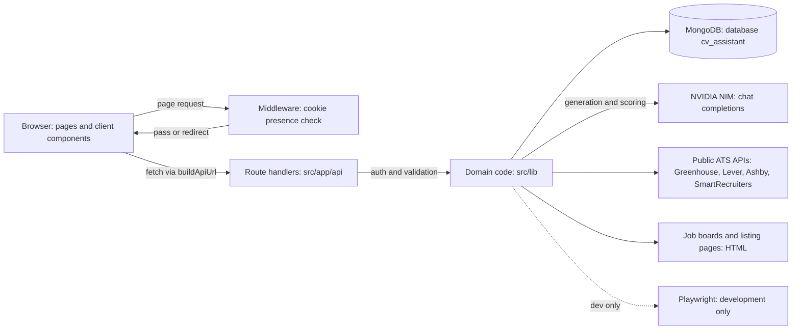

# CV Assistant architecture

This document describes how the CV Assistant (CVA) app is built. It was written from the working tree of `cv-assistant/` on `main` (HEAD `e471681`) and checked on 2026-11-07. At that time the working tree had uncommitted changes to `README.md`, `src/lib/cover-letter-service.ts` and `tests/auto-apply/run-tests.ts`.

Method and limits:

- Every statement comes from reading the code. Nothing was run against a live MongoDB or NVIDIA NIM endpoint, so behaviour that depends on external services is described from the code paths.
- Where older notes disagree with the code, the code is treated as correct.
- File paths are relative to `cv-assistant/`. Line numbers are given where a claim depends on a specific line. They refer to the working tree described above.
- Data-model details (every field, index and read or write site) are in [data-models.md](data-models.md).

## Contents

1. [System overview](#1-system-overview)
2. [Technology stack](#2-technology-stack)
3. [Repository layout](#3-repository-layout)
4. [src/ folder map](#4-src-folder-map)
5. [Configuration and environment variables](#5-configuration-and-environment-variables)
6. [Request lifecycle, middleware and base path](#6-request-lifecycle-middleware-and-base-path)
7. [Authentication and authorisation](#7-authentication-and-authorisation)
8. [Database connection](#8-database-connection)
9. [Instrumentation](#9-instrumentation)
10. [Root layout, theme and navigation](#10-root-layout-theme-and-navigation)
11. [UI kit, styling and motion helpers](#11-ui-kit-styling-and-motion-helpers)
12. [Long-running work, streaming and polling](#12-long-running-work-streaming-and-polling)
13. [External services and integrations](#13-external-services-and-integrations)
14. [Data flows](#14-data-flows)
15. [Auto Apply pipeline](#15-auto-apply-pipeline)
16. [Control Room pipeline](#16-control-room-pipeline)
17. [Module map](#17-module-map)
18. [API route inventory](#18-api-route-inventory)
19. [Build, test, evaluation and scripts](#19-build-test-evaluation-and-scripts)
20. [Known issues and inconsistencies](#20-known-issues-and-inconsistencies)

## 1. System overview

CVA is a single Next.js 15 application using the App Router and TypeScript. It has three layers:

- **Pages** (`src/app/**/page.tsx`): eight screens. All eight are client components.
- **Route handlers** (`src/app/api/**/route.ts`): 47 route files exporting 53 HTTP handlers. Forty-three of these files check the caller's JWT. The three auth routes and `/api/test` do not (section 7.5).
- **Domain code** (`src/lib/**`): profile import, resume and letter rendering, cover-letter generation, the Control Room pipeline, the Auto Apply pipeline, job search crawlers and the NVIDIA NIM client. State is stored in MongoDB through Mongoose.

There is no separate backend service, job queue, cron job or WebSocket server. Work that outlives a request is either finished inside the request, started with `after()` (Auto Apply runs), or driven by the browser, which polls or reads a stream.

| Module | Route | What it does |
|---|---|---|
| Your Profile | `/profile` | Candidate profile: details, experience, projects and skills. Imports from pasted text, PDF or DOCX |
| Resume Lab | `/resume` | Selects content and style, optionally tailors to a job, renders a two-page A4 PDF |
| Cover Letter | `/generate` | Evidence selection, clarifying questions, generated letter, PDF export |
| Job Search | `/search` | Streams results from public job boards and stores them as leads |
| Auto Apply | `/auto-apply` | Finds, scores and prepares applications for review. The user submits them |
| Control Room | `/control-room` | Lead pipeline: enrich, score and tailor, with user context and a blocker heatmap |

The home page (`/`) and the sign-in page (`/login`) complete the set.

Key properties:

- AI calls are made only from the server. `src/lib/ai.ts` is imported only by route handlers and server-side library code. No client component imports it. NVIDIA keys are read from environment variables and are never sent to the browser.
- Authentication is one `auth_token` cookie holding a signed JWT. Middleware checks only that the cookie exists. Route handlers that need a user verify the JWT themselves (section 7).
- Long pipelines save progress as they go, so a later request can resume or recover them (section 12).
- The project is set up as a Vercel project (`vercel.json`: framework `nextjs`, build `npm run build`, output `.next`). The code also supports serving the app under a path prefix (section 6).

## 2. Technology stack

Declared versions are the ranges in `package.json`. Installed versions are read from `node_modules/<package>/package.json`.

| Area | Package | Declared | Installed | Used for |
|---|---|---|---|---|
| Framework | next | 15.5.15 | 15.5.15 | App Router, route handlers, middleware, `after()`, `next/font/local` |
| UI | react, react-dom | 19.1.0 | 19.1.0 | Client components |
| Language | typescript | ^5 | 5.9.2 | Strict mode (`tsconfig.json`), `@/*` path alias to `src/*` |
| Database | mongoose | ^8.17.2 | 8.17.2 | Schemas and models (section 8) |
| Auth | jsonwebtoken | 9.0.3 | 9.0.3 | Signing and verifying the auth JWT |
| Auth | bcrypt | ^6.0.0 | 6.0.0 | Password hashing (native module, external in webpack) |
| Validation | zod | ^4.0.17 | 4.0.17 | Request bodies, search requests, Auto Apply preferences, AI output schemas |
| Motion | framer-motion | ^12.38.0 | 12.38.0 | Scroll reveal and hover motion |
| Styling | tailwindcss | ^3.4.1 | 3.4.17 | Utility classes; v3 config (`tailwind.config.ts`) |
| Styling | postcss, autoprefixer | ^8.4.35, ^10.4.21 | 8.5.6, 10.4.21 | Tailwind build pipeline |
| Parsing | cheerio | ^1.2.0 | 1.2.0 | HTML parsing for job boards and listing pages |
| Documents | pdf-lib | ^1.17.1 | 1.17.1 | Resume and cover-letter PDFs |
| Documents | @pdf-lib/fontkit | ^1.1.1 | 1.1.1 | Embedding TrueType fonts (Noto Sans) |
| Documents | pdfjs-dist | ^4.10.38 | 4.10.38 | Rendering PDF pages for profile import |
| Documents | @napi-rs/canvas | ^0.1.100 | 0.1.100 | Canvas for rasterising PDF pages |
| Documents | mammoth | ^1.12.0 | 1.12.0 | DOCX text extraction |
| Automation | playwright | ^1.60.0 | 1.60.0 | Dev-only browser sessions and local scripts |
| HTTP | formidable | ^3.5.4 | 3.5.4 | Declared, but not imported anywhere in the repository |
| Lint | eslint, eslint-config-next, @eslint/eslintrc | ^9, 15.5.15, ^3 | 9.33.0, 15.5.15, 3.3.1 | Lint (`eslint.config.mjs`) |
| Test helpers | tsconfig-paths | ^4.2.0 | 4.2.0 | Path aliases in the test scripts |
| Types | @types/node, @types/react, @types/react-dom | ^20, ^19, ^19 | 20.19.11, 19.1.10, 19.1.7 | Type definitions |
| Types | @types/bcrypt, @types/jsonwebtoken | ^6.0.0, ^9.0.10 | 6.0.0, 9.0.10 | Type definitions |

Not declared in `package.json` but used:

- `sucrase` 3.35.0 is installed as a dependency of `tailwindcss` (`^3.35.0`). The test scripts load it with `-r sucrase/register/ts`, and `tests/generate/clarifications-ui.test.ts` requires `sucrase/register/tsx`.
- `promptfoo@0.125.1` is fetched with `npx` by the `eval:letters` script (section 19).

Runtime requirements: `package.json` has no `engines` field. The installed Next.js declares `^18.18.0 || ^19.8.0 || >= 20.0.0`, which is the effective minimum Node.js version.

## 3. Repository layout

| Path | Contents |
|---|---|
| `src/` | Application source (section 4) |
| `public/` | UI fonts (`fonts/Manrope-Variable.ttf`, `fonts/Fraunces-Variable.ttf`) with their licence files, Noto Sans for PDFs (`fonts/NotoSans-Regular.ttf`, `fonts/NotoSans-Bold.ttf`), sample resume PDFs `style1.pdf` to `style5.pdf` used as style previews, `favicon.svg` and `logo.svg`. Several other files are not referenced (section 20) |
| `docs/` | Reference notes (`ai-layer.md`, `api-reference.md`, `configuration.md`, `contributing.md`, `deployment.md`, `testing.md`, `auto-apply-quality-metrics.md`, `career-evaluation-pipeline.md`, a `features/` folder) and this document |
| `scripts/` | Local browser-autofill tools (section 19). Not part of the web app |
| `tests/` | Custom test runners without a test framework, for the AI client, search, Auto Apply, career and generation code (section 19) |
| `evals/` | Promptfoo regression suite for cover letters, with a fixture profile |
| `graphify-out/` | Present in the checkout. Not part of the application |
| `.next/` | Next.js build output (git-ignored). The copy in this checkout has no `BUILD_ID` file, so do not treat it as a complete production build |
| `next.config.ts` | Base path, external packages, output file tracing, webpack externals (section 5) |
| `middleware.ts` (root) | One-line re-export of `src/middleware.ts` (section 6) |
| `tsconfig.json`, `tsconfig.tsbuildinfo`, `tailwind.config.ts`, `postcss.config.mjs`, `eslint.config.mjs` | Tooling configuration. `tsconfig.tsbuildinfo` is generated |
| `vercel.json` | Framework, build, dev, install and output settings. No cron jobs or function settings |
| `package.json`, `package-lock.json` | Dependencies and npm scripts |
| `next-env.d.ts` | Generated by Next.js. Git-ignored |
| `.env`, `.env.test.local` | Local environment files. Git-ignored (`.gitignore` excludes `.env*`). This checkout has no `.env.local`. Section 5 lists variable names only |

## 4. src/ folder map

The source tree has 195 TypeScript and TSX files. The tree below shows every directory and the notable files in it.

```text
src/
  middleware.ts               Route guard (cookie presence check)
  instrumentation.ts          Startup log of configured NVIDIA NIM keys
  app/                        App Router: pages, root layout, global CSS, route handlers
    layout.tsx                Root layout: fonts, theme init script, ThemeProvider, Navbar
    globals.css               Design tokens (CSS variables), component classes, Tailwind layers
    page.tsx                  Home (/)
    login/page.tsx            Sign in and create account
    profile/layout.tsx        Mounts ExperienceLocationInjector on profile routes
    profile/page.tsx          Your Profile
    resume/page.tsx           Resume Lab
    generate/page.tsx         Cover Letter workspace
    search/page.tsx           Job Search
    auto-apply/page.tsx       Auto Apply workspace
    auto-apply/error.tsx      Error boundary for the Auto Apply segment
    control-room/page.tsx     Control Room
    api/                      47 route.ts files (section 18), plus two helper modules
      resume/pdf-layout.ts    PDF text layout helpers (imported by pdf-renderer and the letter PDF route)
      resume/embed-noto-sans-fonts.ts   Embeds Noto Sans into pdf-lib documents
  components/
    Navbar.tsx                Global navigation (client component)
    ui/                       Hand-written UI primitives (section 11)
    motion/Reveal.tsx         Scroll-reveal helpers built on framer-motion
    auto-apply/               Auto Apply screens, state hook, typed API client
    generate/                 Cover Letter workspace parts
    resume/                   Resume Lab hook, types, style picker, preview and coaching panel
    search/                   Search filters, result cards and source status
    profile/ExperienceLocationInjector.tsx   Adds location fields to experience cards
  contexts/
    ThemeContext.tsx          Light and dark theme state and toggle
  lib/                        Domain code. Imported by route handlers, and some client code imports its types
    models/                   Mongoose schemas and models (one file per model)
    auto-apply/               Auto Apply domain
    career/                   Control Room domain
    search/                   Search schemas, types and the server-side crawlers
    resume/                   Resume constants, AI coaching, PDF renderer, text helpers
    generate/                 Input validation, clarifying questions, claim check
```

### 4.1 src/app and src/contexts

| File | Role |
|---|---|
| `app/layout.tsx` | Root layout. Section 10 |
| `app/globals.css` | Colour tokens as HSL CSS variables. `:root` holds the dark defaults and `.light` overrides them. `.dark` and `.light` selectors also style body pseudo-elements and `.textarea-premium`. Component classes such as `.button-primary`, `.input-premium`, `.glass-panel` and `.page-shell` |
| `app/auto-apply/error.tsx` | Client error boundary. Shows a reload button. It is the only error boundary in the app |
| `app/profile/layout.tsx` | Server layout that renders `ExperienceLocationInjector` next to the profile page |
| `contexts/ThemeContext.tsx` | `ThemeProvider` and `useTheme()`. Section 10.2 |

There are no `loading.tsx`, `not-found.tsx` or global `error.tsx` files.

### 4.2 src/components

| Path | Role |
|---|---|
| `Navbar.tsx` | Navigation bar, theme toggle, logout and mobile menu. Section 10.3 |
| `ui/` | `button.tsx`, `badge.tsx`, `card.tsx`, `dialog.tsx`, `input.tsx`, `label.tsx`, `separator.tsx`, `switch.tsx`, `tabs.tsx`, `textarea.tsx`, `GlassPanel.tsx`, `HoverTooltip.tsx`, `ModuleShell.tsx`, `SectionHeading.tsx`. Section 11 |
| `motion/Reveal.tsx` | `Reveal`, `StaggerGroup`, `StaggerItem`. Section 11.3 |
| `auto-apply/useAutoApply.ts` | Controller hook for the Auto Apply workspace: loads sessions, polls the active session every 2.5 s while a run is active, runs actions |
| `auto-apply/api.ts` | Typed client for the Auto Apply endpoints, all built with `buildApiUrl()` |
| `auto-apply/types.ts`, `auto-apply/ui.tsx` | Client types (including `RUNNING_PHASES`) and small presentation primitives (`Chip`, `Spinner`, `Disclosure`, `EmptyState`, `timeAgo`) |
| `auto-apply/BriefStep.tsx`, `MatchesStep.tsx`, `ReviewStep.tsx`, `ApplyStep.tsx`, `Stepper.tsx` | The four workspace steps: `brief`, `matches`, `review` and `apply` |
| `auto-apply/ApplyStep.tsx` | Shows the autofill bookmarklet (built by `buildBookmarklet()`) and the pack for an approved job |
| `auto-apply/ActivityRail.tsx` | Session event log |
| `generate/SectionNavigator.tsx`, `WorkspaceChrome.tsx`, `MobileGenerateBar.tsx` | Section navigation, disclosure and choice rows, and the mobile action bar |
| `generate/ClarificationQuestions.tsx`, `ResultBlock.tsx`, `TracePanel.tsx` | Clarifying questions, generated-letter panel, and the Advanced Mode trace |
| `resume/useResumeStudio.ts` | Resume Lab state and actions (profile load, generation, targeted enhancement, beautify) |
| `resume/SelectionList.tsx`, `StylePickerDialog.tsx`, `style-options.ts`, `types.ts` | Item selection, style catalogue (with preview PDFs in `public/`), the picker dialog and shared types |
| `resume/ResumePreview.tsx` | Iframe preview of the generated PDF |
| `resume/CoachingPanel.tsx`, `AICoachingInput.tsx` | Coaching UI. Neither component calls an API directly |
| `search/*.tsx`, `search/labels.ts` | Crawl filters, platform picker, result card and toolbar, source status rail, and label maps |
| `profile/ExperienceLocationInjector.tsx` | Adds a location field to each experience card by DOM injection. See section 20 |

### 4.3 src/lib (top level)

| File | Role |
|---|---|
| `ai.ts` | NVIDIA NIM client: key pool, model presets, streaming, retries and cooldowns. Section 13.1 |
| `api.ts` | `buildApiUrl(route)`: prefixes a route with the normalised `NEXT_PUBLIC_BASE_PATH` |
| `auth.ts` | `signAuthToken`, `verifyAuthToken`, `attachAuthCookie`, `clearAuthCookieOnResponse`, `getAuthFromCookies` |
| `db.ts` | `connectToDatabase()`: cached Mongoose connection to the `cv_assistant` database. Section 8 |
| `utils.ts` | `cn()` joins class names (it does not resolve Tailwind conflicts). `humanizeIdentifier()` |
| `profile-import.ts` | Turns pasted text, a PDF (page images sent to NIM) or a DOCX (mammoth text) into a candidate profile |
| `profile-sync.ts` | Writes a `localStorage` timestamp and dispatches `cv-assistant:profile-updated` so open views refresh |
| `experience-ordering.ts` | Parses experience dates (including `present` and `current`) and sorts by recency |
| `cover-letter.ts` | Selects evidence items and builds prompts for letters and employer answers |
| `cover-letter-service.ts` | Auto Apply cover-letter agent (`runCoverLetterAgent`): generation, grounding, defect checks and repair |
| `cover-letter-advanced.ts` | Advanced Mode for letters and answers. Uses `AsyncLocalStorage` to carry the model preset |

### 4.4 src/lib/models

One file per model: `User.ts`, `UserContext.ts`, `JobLead.ts`, `SearchCampaign.ts`, `JobEvaluation.ts`, `TailoringRun.ts`, `GeneratedArtifact.ts`, `ApplicationEvent.ts`, `AutoApplySession.ts`, `AutoApplyJobCandidate.ts`, `AutoApplyApplicationDraft.ts`, `AutoApplyEvent.ts`, `AutoApplyMemory.ts`, `AutoApplyUploadedFile.ts`. `CandidateFact.ts` and `StoryBankItem.ts` export embedded schemas only. See [data-models.md](data-models.md).

### 4.5 src/lib/auto-apply

| File | Role |
|---|---|
| `engine.ts` | Pipeline: discover, rank, resolve, score, shortlist, select and prepare. Also the run lock, heartbeat and standing-answer refresh. Section 15 |
| `state.ts` | Stage list, allowed transitions (`canTransition`, `assertTransition`), lock and stall constants, and session phase helpers (`deriveSessionPhase`, `remainingApplicationSlots`) |
| `routes.ts` | `requireAutoApplyAuth()` and ownership loaders: `loadOwnedSession`, `loadOwnedJob`, `loadOwnedDraft`, `loadOwnedDraftByJob`. The loaders connect to MongoDB |
| `types.ts` | Zod schemas for session creation and updates, filters, answers and submit requests |
| `persistence.ts` | `createSessionWithSnapshot()` and `logAutoApplyEvent()` |
| `ground-truth.ts` | Builds the profile snapshot a session works from, and suggests which profile items to include |
| `candidate.ts` | Candidate summary, contact details and preference merge |
| `discovery.ts` | `discoverFromDirectory()` and matching helpers. Searches employer ATS boards, matches roles and locations, and resolves listings to employer application forms |
| `ats.ts` | `detectAts()` (provider from apply URL), safe URL checks, title similarity |
| `ats-clients.ts` | Read-only clients for Greenhouse, Lever, Ashby and SmartRecruiters (list, detail and form schema) |
| `ats-directory.ts` | Static list of 59 employer career boards, used as a discovery source |
| `jd.ts` | Crawls a job description from a listing page |
| `ranking.ts` | Dedupe keys, `dedupeJobs`, and heuristic ranking (`rankAutoApplyCandidates`) |
| `fit.ts` | LLM fit scoring in batches of six (`BATCH_SIZE`) |
| `questions.ts` | Application-form question model: classification, deterministic answers, memory matching, sensitive categories |
| `answering.ts` | Classifies employer questions and answers them from the ground-truth snapshot |
| `prepare.ts` | `prepareApplication()`: form resolution, answers (deterministic first, then one LLM pass) and the cover letter. Also `hashApplicationPayload()` |
| `profile-draft.ts` | LLM distillation of the profile into an Auto Apply draft (used by the profile-draft route) |
| `pack.ts` | Builds the autofill pack, its text form, and the URL-fragment encoding for the bookmarklet |
| `autofill-script.ts` | Browser-side form filler, `AUTOFILL_VERSION = 6`. Runs as a bookmarklet or in the dev browser |
| `submit-guard.ts` | Init script and matcher that block form submission in the browser flows |
| `browser.ts` | Screenshot data URLs, job-platform host detection, automation-blocker detection |
| `browser-session.ts` | Dev-only visible Playwright Chromium sessions and single actions |
| `site-auth.ts` | Per-site browser storage state and optional encrypted credentials, stored on local disk. Used only by `browser-session.ts`. Section 20 |

### 4.6 src/lib/career

| File | Role |
|---|---|
| `workflow.ts` | `orchestrateLead()`: enrich, score, tailor, persist and record events. Section 16 |
| `market-analyst.ts` | `enrichLead()`: fetches the listing (10 s timeout), extracts text, sets liveness and job understanding |
| `liveness.ts` | `classifyLeadLiveness()`: active, expired or uncertain, from text patterns |
| `job-understanding.ts` | Zod schema and LLM extraction of requirements and keywords, with a heuristic fallback |
| `career-strategist.ts` | `scoreLeadFit()`: LLM strategist with a heuristic fallback. `CONTROL_ROOM_STRATEGIST_MODE` forces the heuristic |
| `career-strategist-helpers.ts` | `buildRequirementMatches()` and the lead and telemetry input types |
| `resume-specialist.ts` | `createTailoringArtifacts()`: evidence selection and resume variants (HTML and JSON) |
| `ats.ts` | `validateResumeDraft()`: required sections and keyword coverage for a draft |
| `context.ts` | `loadUserContextSnapshot()` and `updateUserContextSnapshot()`. Seeds the `UserContext` document from the profile |
| `control-room.ts` | `getControlRoomOverview()`, `getLeadDetail()` and the display helpers |
| `search-persistence.ts` | `createPersistedSearchCampaign()`, `recordSearchLead()`, `completePersistedSearchCampaign()` |
| `telemetry.ts` | `loadOutcomeTelemetry()`: past evaluations and self-filtered leads, used as strategist input |
| `types.ts` | Lifecycle, recommendation and snapshot types. `CONTROL_ROOM_ANALYSIS_VERSION = 2` |
| `utils.ts` | Text, keyword, salary and remote-policy helpers |

### 4.7 src/lib/search

| File | Role |
|---|---|
| `types.ts` | `SEARCH_SOURCES` (`linkedin`, `seek`, `indeed`, `careerone`, `adzuna`, `talent`), filter enums, stream event types |
| `schema.ts` | Zod schemas for search requests and the advanced question session |
| `filters.ts` | `passesPostFilters()`, applied after crawling |
| `retry.ts` | Shared text for the automatic-retry message |
| `server/stream.ts` | `streamSearchJobs()`: async generator that runs sources in sequence, retries them and yields events |
| `server/sources.ts` | Per-source crawlers (fetch and cheerio) for the six sources, JSON-LD parsing, blocked-page retry |
| `server/fallback.ts` | Fallback URL discovery through DuckDuckGo's HTML endpoint |
| `server/intent.ts` | `expandSearchInstruction()`, `buildAdvancedSearchQuestionPlan()` and `buildSequentialQuestion()`. These call NIM with the `easy` preset |
| `server/utils.ts` | URL canonicalisation, dedupe keys, instruction-context merge, blocked-page detection |

### 4.8 src/lib/resume and src/lib/generate

| File | Role |
|---|---|
| `resume/constants.ts` | `MAX_RESUME_ITEMS` (20), `MAX_RESUME_PAGES` (2), page-fill and budget constants |
| `resume/pdf-renderer.ts` | `renderResumePdf()`: A4 PDF with pdf-lib and embedded Noto Sans, used by the five style routes. It can call NIM through `maybeEnhanceContent()` (preset `hard`) and `maybePrepareNarrative()` (preset `easy`). Section 13.1 |
| `resume/ai-coaching.ts` | `runAICoaching()`: job-description analysis, consultant board, ATS review and evidence selection |
| `resume/high-impact-rewrite.ts`, `resume/text-section-prompts.ts` | Prompts and output normalisation for bullet rewrites and text sections |
| `resume/profile.ts`, `resume/skills.ts` | Text resolution and formatting for the profile paragraph and skills |
| `generate/validation.ts` | `validateGenerationInput()`: length limits on raw input before prompting |
| `generate/clarifications.ts` | Normalises clarifying questions and builds their prompts |
| `generate/claim-check.ts` | `checkDraftClaims()`: best-effort LLM review of personal claims, with an 18 s budget |

### 4.9 Other

| File | Role |
|---|---|
| `src/instrumentation.ts` | Startup hook. Section 9 |
| `src/middleware.ts` | Route guard. Section 6 |

## 5. Configuration and environment variables

Only variable names are listed here. Values belong in local environment files or the hosting platform, and are not recorded in this repository's documentation.

| Variable | Read in | Purpose and default |
|---|---|---|
| `MONGO_URI` | `src/lib/db.ts` | MongoDB connection string. Required. `connectToDatabase()` throws without it |
| `JWT_SECRET` | `src/lib/auth.ts`. Also a fallback key source in `src/lib/auto-apply/site-auth.ts` | Signs and verifies auth tokens. Required for sign-in and account creation |
| `NEXT_PUBLIC_BASE_PATH` | `next.config.ts`, `src/lib/api.ts` | Optional path prefix. Trimmed, trailing slashes removed, leading slash added. The `NEXT_PUBLIC_` prefix means client code receives it at build time |
| `NVIDIA_NIM_API_KEY_1` to `NVIDIA_NIM_API_KEY_9` | `src/lib/ai.ts`, `src/instrumentation.ts` | Up to nine NIM keys. Blank values and duplicates are ignored |
| `NVIDIA_NIM_BASE_URL` | `src/lib/ai.ts` | Default `https://integrate.api.nvidia.com/v1`. Trailing slashes are removed |
| `NVIDIA_NIM_EASY_MODELS`, `NVIDIA_NIM_HARD_MODELS`, `NVIDIA_NIM_DOCUMENT_MODELS` | `src/lib/ai.ts` (built from the preset name) | Comma-separated model lists for each preset. Defaults in section 13.1. Not used by the fixed lists in `cover-letter-service.ts` |
| `NVIDIA_NIM_SUPERVISOR_MODEL` | `src/lib/ai.ts` | Model used for Auto Apply browser guidance when the request has no images. Default: the first `hard` model |
| `NVIDIA_NIM_VISION_MODELS` | `src/lib/ai.ts` | Used when a request contains images. Default `nvidia/nemotron-3-nano-omni-30b-a3b-reasoning,stepfun-ai/step-5-preview` |
| `NVIDIA_NIM_TIMEOUT_S` | `src/lib/ai.ts` | Overall deadline for one NIM call, across retries. Default 240 |
| `NVIDIA_NIM_IDLE_TIMEOUT_S` | `src/lib/ai.ts` | Abort when a stream goes silent for this long. Default 90 |
| `NVIDIA_NIM_FIRST_TOKEN_TIMEOUT_S` | `src/lib/ai.ts` | Time allowed for the first token. Default 20. The defaults for `stepfun-ai/step-5-preview` and `deepseek-ai/deepseek-v4.1-flash` are 55 and 75 |
| `NVIDIA_NIM_MAX_TOKENS` | `src/lib/ai.ts` | Upper bound on `max_tokens`, reduced further per model. Default 65536 |
| `CONTROL_ROOM_STRATEGIST_MODE` | `src/lib/career/career-strategist.ts` | Set to `heuristic` to use the non-LLM scorer. `tests/career/run-tests.ts` sets it |
| `AUTO_APPLY_DEV_BROWSER` | `src/lib/auto-apply/browser-session.ts` | `true` enables visible browser sessions, but only when `NODE_ENV` is not `production` |
| `AUTO_APPLY_BROWSER_HEADLESS` | `src/lib/auto-apply/browser-session.ts` | `true` or `false` overrides headless mode. Default: headless only in production |
| `AUTO_APPLY_SITE_AUTH_SECRET` | `src/lib/auto-apply/site-auth.ts` | Key material for remembered site credentials. Falls back to `JWT_SECRET`, then to a fixed default string in the source (section 20) |
| `NODE_ENV` | `src/lib/auth.ts` (cookie `secure` flag), `src/lib/auto-apply/browser-session.ts` | Set by Next.js and by the hosting platform |
| `NEXT_RUNTIME` | `src/instrumentation.ts` | Set by Next.js. The key check runs only for the `nodejs` runtime |

Names that appear in local environment files but are not read by any code in `src/`, `scripts/`, `tests/` or `evals/`:

- `.env`: `AZURE_AI_FOUNDRY_ENDPOINT`, `AZURE_AI_FOUNDRY_API_KEY`, `GEMINI_API`
- `.env.test.local`: `E2E_TEST_USERNAME`, `E2E_TEST_PASSWORD`, `USER_TEST_USERNAME`, `USER_TEST_PASSWORD`

Names that are read or set only by tests or evals:

- `AUTO_APPLY_BROWSER_ENABLED` is read and restored only by `tests/career/run-tests.ts`. No code under `src/` reads it.
- `SUCRASE_OPTIONS` is set by `tests/generate/clarifications-ui.test.ts` (line 4).
- `evals/run-letter.ts` reads `.env` and `.env.local` by hand (not through Next.js).
- `NVIDIA_API_KEY` appears only in a comment at the top of `evals/promptfooconfig.yaml`.

`next.config.ts` also sets `serverExternalPackages` (`mongoose`, `pdfjs-dist`, `@napi-rs/canvas`), adds `outputFileTracingIncludes` for `/api/ocr` (the pdf.js worker and the Linux canvas binaries), and adds `bcrypt` to webpack externals.

## 6. Request lifecycle, middleware and base path

```text
Browser
  |  GET /profile                        cookie auth_token (present once signed in)
  v
middleware.ts (root) --re-exports--> src/middleware.ts     no runtime is set in the file, so Next.js applies its default
  |-- path starts with /login          -> next()
  |-- path starts with /api            -> next()   (route handlers check the JWT themselves)
  |-- no auth_token cookie             -> redirect (307) to {basePath}/login
  |-- cookie present                   -> next()   (JWT is not decoded or verified here)
  |-- any exception                    -> next()   (fail open)
  v
App Router
  |-- src/app/layout.tsx (server)  ->  ThemeProvider  ->  Navbar  ->  <main>{page}</main>
  |-- src/app/profile/page.tsx     (client component: renders, then fetches its data)
  v
Browser (client code)
  |  fetch(buildApiUrl("/api/profile"))
  v
src/app/api/profile/route.ts   (Node.js runtime by default)
  |-- getAuthFromCookies(req)           -> 401 {"error":"Unauthorized"} if missing or invalid
  |-- connectToDatabase()               -> MongoDB, database cv_assistant (for handlers that query a collection)
  |-- domain code in src/lib/**         -> NVIDIA NIM, ATS APIs, job boards, PDF libraries
  v
JSON response  |  NDJSON stream (job search)  |  PDF bytes (resume and letter)
```

### 6.1 Middleware

The guard is in `src/middleware.ts`. The root `middleware.ts` contains only `export { middleware, config } from './src/middleware';`. Both files therefore give the same behaviour. Section 20 covers the duplicate file.

The middleware logic, in order:

1. Reads the `auth_token` cookie from the request.
2. Computes `relativePath` by removing `req.nextUrl.basePath` from the pathname.
3. Paths starting with `/login` pass through.
4. Paths starting with `/api` pass through. The route handlers check authentication.
5. If there is no `auth_token` cookie, the request is redirected (`NextResponse.redirect`, which uses status 307) to `${basePath}/login`.
6. Otherwise the request passes through. The token is not verified.
7. Any exception passes the request through, which the code comment describes as fail-open behaviour.

The matcher is:

```ts
export const config = {
  matcher: ['/((?!_next/|favicon.ico).*)'],
};
```

The middleware imports only `next/server`.

Which paths are guarded:

| Request path | No cookie | Cookie present |
|---|---|---|
| `/login` | Passes | Passes |
| `/api/*` | Passes (handler returns 401) | Passes |
| `/` and the six module pages | Redirects to `/login` | Passes |
| `/_next/*` and `/favicon.ico` | Not matched | Not matched |
| Other public files, such as `/favicon.svg`, `/fonts/*` and `/style1.pdf` | Matched, so redirected to `/login` | Passes |

The last row follows from the matcher, which excludes only `_next/` and `favicon.ico`. Confirm it on a deployed build (section 20).

### 6.2 Base path

Setting `NEXT_PUBLIC_BASE_PATH` mounts the whole app under a path prefix:

- `next.config.ts` normalises the value and sets Next.js `basePath`. Next.js then prefixes `<Link>` targets, router navigation and static asset URLs.
- The middleware removes the base path before it matches guarded paths, and includes it in its redirect.
- Client code calls the API through `buildApiUrl()`, defined in `src/lib/api.ts`. Nine other files import it: the Navbar, the control-room, search, generate and profile pages, the Auto Apply client (`auto-apply/api.ts`), the resume hook (`useResumeStudio.ts`), `resume/style-options.ts` and `ExperienceLocationInjector.tsx`.
- Three call sites do not use the prefix. The sign-in page (`src/app/login/page.tsx`) calls both auth endpoints with plain `fetch` and redirects to a literal `/profile`. The resume route (`src/app/api/generate-resume/route.ts`) calls its own style routes through `req.nextUrl.origin`. Section 20 covers them.

### 6.3 Pages and route handlers

- `src/app/layout.tsx` is a server component. The other layout (`src/app/profile/layout.tsx`) is also a server component.
- All eight `page.tsx` files are client components. They render a shell and then fetch their data in the browser with the user's cookie.
- Route handlers use the Node.js runtime by default. Of the 47 route files, 24 export `runtime = "nodejs"` and 24 export `dynamic = "force-dynamic"`. Three routes export `maxDuration = 300` (section 12).

## 7. Authentication and authorisation

### 7.1 Credentials and password storage

- **Username.** 3 to 20 characters from `[A-Za-z0-9_-]`. The length and character rules are enforced only at registration (`src/app/api/auth/register/route.ts`). Usernames are case-sensitive, both in the lookup and in the unique index.
- **Password.** Any non-empty string. No length, complexity or breach rule exists.
- **Storage.** `bcrypt.hash(password, 10)` produces `User.passwordHash`. Sign-in uses `bcrypt.compare` (`src/app/api/auth/login/route.ts`). No route returns `passwordHash`.

### 7.2 Token

`src/lib/auth.ts`:

- `signAuthToken({ userId, username })` signs with `JWT_SECRET` and `expiresIn: '7d'`. The jsonwebtoken default algorithm for a string secret is HS256.
- `verifyAuthToken(token)` returns the payload, or `null` on any error.
- `getAuthFromCookies(req)` reads `auth_token` from the request and verifies it.
- `getJwtSecret()` throws `Missing JWT_SECRET in environment` when the variable is unset.

### 7.3 Cookie

`attachAuthCookie()` in `src/lib/auth.ts` sets:

| Attribute | Value |
|---|---|
| Name | `auth_token` |
| `httpOnly` | `true` |
| `sameSite` | `lax` |
| `secure` | `true` only when `NODE_ENV === 'production'` |
| `path` | `/` |
| `maxAge` | 604800 seconds (7 days) |

`clearAuthCookieOnResponse()` deletes the cookie. Nothing else is stored on the server for a session.

### 7.4 Routes

| Route | Method | Behaviour |
|---|---|---|
| `/api/auth/register` | POST | Requires both fields (400). Checks whether the name is taken before it checks length and characters: a taken name returns 409 with four alternative usernames. Length 3 to 20 and the character rule return 400. Creates the user with the bcrypt hash, then signs the token and sets the cookie. Returns `{ ok: true }`. Any exception returns 500 with the raw `error.message` |
| `/api/auth/login` | POST | 400 when a field is missing. 401 `Invalid credentials` for both an unknown user and a wrong password. Malformed JSON and any other exception return 500 `Server error`. Sets the cookie and returns `{ ok: true }` on success |
| `/api/auth/logout` | POST | Clears `auth_token`. The token itself is not revoked |

The sign-in page (`src/app/login/page.tsx`) uses one form for both routes, with a toggle. After a successful response it calls `window.location.replace('/profile')`, a full document navigation that lets the browser apply the new cookie before the guarded page loads.

### 7.5 Route-level checks

- `getAuthFromCookies(req)` (`src/lib/auth.ts`) returns the payload or `null`. Handlers then return `401 {"error":"Unauthorized"}`.
- Auto Apply routes call `requireAutoApplyAuth(req)` (`src/lib/auto-apply/routes.ts`), which returns the same 401 response.
- 43 route files call one of these two helpers. The three auth routes and `/api/test` do not (section 18).

### 7.6 Ownership

Handlers take `userId` from the verified token and use it in the queries they make. Client-supplied identifiers are combined with the owner filter. For example, `loadOwnedSession(userId, sessionId)` queries `{ _id: sessionId, userId }`. The Control Room lead detail uses the same pattern (`{ _id: leadId, userId }`, `control-room.ts` line 354). Some internal writes filter by `_id` alone and rely on an earlier owner-scoped read in the same request. Data-model details are in [data-models.md](data-models.md#retention-and-ownership).

### 7.7 What the checks do not cover

- The middleware does not verify tokens. An expired or forged cookie passes the page guard and then fails at the API.
- A token stays valid until it expires, even after logout. There is no server-side session store or deny list.
- There is no account deletion, password change or role model.
- There are no CSRF tokens. The main protection is `SameSite=Lax` on the auth cookie.
- No rate limiting exists in application code. The NIM key scheduler in `src/lib/ai.ts` is the only throttle on outbound AI calls, and it is per process.

## 8. Database connection

`src/lib/db.ts`:

- `connectToDatabase()` caches its state on `global.mongoose` as `{ conn, promise }`. The first call starts `mongoose.connect(MONGO_URI, { dbName: 'cv_assistant' })`. Later calls reuse the cached connection.
- The `promise` is kept after a failure. Later calls in the same process therefore reject with the same error until the process restarts (lines 22 to 25). Section 20 covers this.
- Model files export their models with the `mongoose.models.X || mongoose.model(...)` pattern. This avoids a re-registration error when modules are reloaded in development.
- `mongoose` is listed in `serverExternalPackages`, so Next.js does not bundle it.
- Index creation uses Mongoose's defaults. No `autoIndex`, `syncIndexes` or `ensureIndexes` call appears in the code.
- Handlers connect only when they query MongoDB, either directly or through a helper. The loaders in `src/lib/auto-apply/routes.ts` call `connectToDatabase()`, and so do some library functions such as `loadUserContextSnapshot()`.
- There are no migrations and no seed scripts.

The 14 registered models and their collections are listed in [data-models.md](data-models.md#model-index).

## 9. Instrumentation

`src/instrumentation.ts` exports `register()`, which Next.js calls at server start. On the `nodejs` runtime it:

- counts the distinct non-empty values of `NVIDIA_NIM_API_KEY_1` to `NVIDIA_NIM_API_KEY_9`;
- logs `console.warn` when there are none, noting that AI features will be unavailable;
- otherwise logs `console.info` with the count.

It does not stop the server, and it does not log the keys.

## 10. Root layout, theme and navigation

### 10.1 Root layout

`src/app/layout.tsx`:

- Loads two local variable fonts with `next/font/local`: `Manrope-Variable.ttf` (weights 200 to 800, CSS variable `--font-body`) and `Fraunces-Variable.ttf` (weights 100 to 900, `--font-display`).
- Sets metadata: title `CV Assistant | Premium Career Storytelling`, with `/favicon.svg` as the icon, shortcut and Apple icon.
- Renders `<html lang="en" suppressHydrationWarning>` and a `<body>` with `antialiased` and both font variables.
- Includes an inline script that runs before React. It reads `localStorage.theme`. If nothing is stored, it falls back to `prefers-color-scheme`. It then adds `light` or `dark` to `<html>`.
- Renders `ThemeProvider`, then `Navbar`, then `<main className="min-h-screen pb-16">{children}</main>`.

### 10.2 ThemeContext

`src/contexts/ThemeContext.tsx` (client component):

- `Theme` is `'light' | 'dark'`. The state starts as `'dark'`.
- On mount, one effect reads the class already on `<html>` and stores it in state.
- A second effect runs on every change. It swaps the `light` and `dark` classes on `<html>` and writes `localStorage.theme`.
- `toggleTheme()` flips the value. `useTheme()` throws when used outside the provider.

Because the state starts as `'dark'`, the class-writing effect runs once with `'dark'` before the state update from the first effect is applied. The final state is correct, but the stored value is briefly overwritten. Section 20 covers this.

### 10.3 Navbar

`src/components/Navbar.tsx` is a client component rendered on every page.

Links, in order:

| Label | Href |
|---|---|
| Your Profile | `/profile` |
| Resume Lab | `/resume` |
| Cover Letter | `/generate` |
| Job Search | `/search` |
| Auto Apply | `/auto-apply` |
| Control Room | `/control-room` |

The logo links to `/` (`aria-label="CV Assistant home"`). A link is active when `pathname.startsWith(href)`, and then carries `aria-current="page"`.

Breakpoints (Tailwind defaults; the config does not override `screens`):

| Element | Visible from |
|---|---|
| "CV Assistant" wordmark | 640 px (`sm`) |
| Desktop link row | 1280 px (`xl`). Below that, a menu button replaces it |
| "Career Storytelling Suite" subtitle and the "Orbit Mode" or "Sunny Mode" pill | 1536 px (`2xl`) |
| Logout button in the top bar | 768 px (`md`) |

The mobile menu appears below `xl`. It lists the six links and a Logout button. It closes when the route changes and when Escape is pressed. The menu button sets `aria-expanded` and `aria-controls="mobile-navigation"`.

Logout sends `POST` to `buildApiUrl('/api/auth/logout')` and then calls `router.push('/login')`.

The Navbar does not read the session. It renders the same links and the same Logout control for everyone. The only protection is the middleware redirect. A signed-out visitor on `/login` sees the full navigation, and any module link sends them back to `/login`.

## 11. UI kit, styling and motion helpers

### 11.1 Components

The UI kit is hand-written. It has no third-party component library and no Radix or class-variance dependency. Most components import React and `cn()`. Some also import other UI components: `dialog.tsx` imports `buttonVariants` from `button.tsx`, and `textarea.tsx` imports `controlClassName` from `input.tsx`.

| Component | File | Notes |
|---|---|---|
| `Button`, `buttonVariants` | `ui/button.tsx` | Variant and size maps |
| `Badge` | `ui/badge.tsx` | |
| `Card`, `CardHeader`, `CardTitle`, `CardDescription`, `CardContent`, `CardFooter` | `ui/card.tsx` | |
| `Dialog` family | `ui/dialog.tsx` | Client component |
| `Input`, `controlClassName` | `ui/input.tsx` | `controlClassName` is shared with other controls |
| `Label`, `Separator`, `Textarea` | `ui/label.tsx`, `ui/separator.tsx`, `ui/textarea.tsx` | |
| `Switch` | `ui/switch.tsx` | Client component |
| `Tabs` family | `ui/tabs.tsx` | Client component |
| `GlassPanel` | `ui/GlassPanel.tsx` | Polymorphic `as` prop and a `strong` variant. Used as the main surface |
| `HoverTooltip` | `ui/HoverTooltip.tsx` | Client component |
| `ModuleShell` | `ui/ModuleShell.tsx` | Page header with `eyebrow`, `title`, `description`, optional `stats` and `aside`, and `compactMobile` |
| `SectionHeading` | `ui/SectionHeading.tsx` | `eyebrow`, `title`, `description`, optional `action` |

`cn()` in `src/lib/utils.ts` filters falsy values and joins the rest with spaces. It does not merge conflicting Tailwind classes.

### 11.2 Styling

- Tailwind 3 with `darkMode: ['class']`. Colours map to CSS variables, for example `hsl(var(--border))`.
- The `light` or `dark` class on `<html>` sets the theme. The inline script in `layout.tsx` uses `prefers-color-scheme` only when no theme is stored. `globals.css` has no theme media query.
- Design tokens are defined in `globals.css` on `:root` (dark defaults) and `.light` (overrides). They include `--background`, `--foreground`, `--card`, `--primary`, `--accent`, `--muted-foreground`, `--surface-1` to `--surface-3`, and status colours.
- Component classes are in `@layer components`. Those used in the code are `.button-primary`, `.button-secondary`, `.input-premium`, `.textarea-premium`, `.glass-panel`, `.page-shell`, `.hero-card`, `.hero-title`, `.hero-copy`, `.section-kicker`, `.surface-subtle`, `.status-dot` and `.halo-ring`.
- The Tailwind `content` globs list `./src/pages/**` (that folder does not exist), `./src/components/**` and `./src/app/**`.
- Fonts: `font-display` maps to Fraunces and the body font to Manrope.

### 11.3 Motion helpers

`src/components/motion/Reveal.tsx` (client component) exports three helpers built on framer-motion:

- `Reveal` fades and lifts its children (opacity 0 to 1, 18 px upwards). It runs once when the element enters the viewport, with a `-10%` margin, over 0.55 s with the easing `[0.22, 1, 0.36, 1]`. The optional `delay` prop sets the start time.
- `StaggerGroup` and `StaggerItem` stagger a list of children.
- All three use `useReducedMotion()`. When the user prefers reduced motion, they render a plain `<div>` without animation.

`Reveal` is used on the home, profile and search pages. `StaggerGroup` and `StaggerItem` are used on the home, profile and generate pages.

## 12. Long-running work, streaming and polling

### 12.1 Mechanisms

| Mechanism | Where | What it does | Limits and notes |
|---|---|---|---|
| `export const maxDuration = 300` | `auto-apply/session/[id]/run`, `auto-apply/job/[jobId]/prepare`, `auto-apply/job/[jobId]/cover-letter` | Raises the function time limit to 300 s | No other route sets `maxDuration` |
| `after()` | `src/app/api/auto-apply/session/[id]/run/route.ts` (lines 32 and 41) | Returns `202 {"started": true}`, then runs `runPipeline()` or `preparePending()` after the response is sent | `RUN_BUDGET_MS` is 270 s |
| Run lock | `claimRun()` in `src/lib/auto-apply/engine.ts` | An atomic `findOneAndUpdate` sets the phase to `searching`. A second run gets 409 unless the previous run is idle or stale | Stale means `run.updatedAt` is older than `RUN_STALL_MS` (150 s) |
| Heartbeat | `startHeartbeat()` in `engine.ts` (line 60) | Updates `run.updatedAt` every 20 s while the phase is `searching`, `scoring` or `preparing` | Stopped when the run ends |
| Stall recovery | `GET /api/auto-apply/session/[id]` (lines 24 to 32) | Marks a run as stalled when its heartbeat has stopped, so the workspace does not show "running" forever | Recovery happens on read, not in a background job |
| Cancel | `POST /api/auto-apply/session/[id]/cancel` | Sets `run.phase` to `cancelled`. `isCancelled()` checks stop the pipeline | Cooperative. Checked between stages and before each application is prepared |
| Polling | `useAutoApply()` in `src/components/auto-apply/useAutoApply.ts` (line 156) | Refreshes the active session every 2,500 ms while the run phase is `searching`, `scoring` or `preparing` | Client-side. No push channel |
| NDJSON stream | `POST /api/search/jobs/stream` (lines 173 and 174) | One JSON event per line, `application/x-ndjson`, `Cache-Control: no-cache, no-transform` | Intent expansion (an LLM call) runs before the first byte. The search page reads the body with `getReader()` and can abort with an `AbortController` |
| Source retries | `src/lib/search/server/stream.ts` (`SOURCE_ERROR_RETRIES` = 2) | Up to two retries per source, after waits of 600 ms and 1,200 ms | Sources run one after another |
| Client timeout | `src/app/generate/page.tsx` (line 279) | An `AbortController` aborts the clarifying-questions request after 60 s | Client-side |

There is no Server-Sent Events endpoint and no WebSocket. In `src/`, the only `text/event-stream` string is the `Accept` header that `src/lib/ai.ts` sends to NVIDIA. Tests stub SSE responses. `vercel.json` defines no cron jobs.

### 12.2 Timeouts and budgets

| Limit | Value | Where |
|---|---|---|
| NIM overall deadline for one call, across retries | 240 s (`NVIDIA_NIM_TIMEOUT_S`) | `src/lib/ai.ts` |
| NIM idle timeout between stream chunks | 90 s (`NVIDIA_NIM_IDLE_TIMEOUT_S`) | `src/lib/ai.ts` |
| NIM time to first token | 20 s; 55 s for `stepfun-ai/step-5-preview`; 75 s for `deepseek-ai/deepseek-v4.1-flash` | `src/lib/ai.ts` |
| Auto Apply run budget | 270 s (`RUN_BUDGET_MS`) | `src/lib/auto-apply/engine.ts` |
| Auto Apply board crawl | 70 s (`BOARD_CRAWL_MS`) | `engine.ts` |
| Employer form resolution | 20 s per job. New resolutions stop after 60 % of the run budget | `engine.ts` |
| Fit scoring | 90 s overall | `engine.ts` |
| Auto Apply preparation lock | 4 minutes (`PREPARE_LOCK_MS`) | `src/lib/auto-apply/state.ts` |
| Cover-letter model call | 40 s default (`timeoutMs`). Grounding calls use `GROUNDING_CALL_TIMEOUT_MS` | `src/lib/cover-letter-service.ts` |
| Claim check | 18 s (`CHECK_TIMEOUT_MS`) | `src/lib/generate/claim-check.ts` |
| ATS client requests | 9 s default; 12 s for Ashby | `src/lib/auto-apply/ats-clients.ts` |
| Listing fetch for Control Room enrichment | 10 s | `src/lib/career/market-analyst.ts` |

## 13. External services and integrations

### 13.1 NVIDIA NIM

`src/lib/ai.ts` calls NVIDIA's OpenAI-compatible endpoint `POST {NVIDIA_NIM_BASE_URL}/chat/completions` with `stream: true` and a bearer key. The reply is read as server-sent events and joined into text. The stream must contain the `[DONE]` marker or a `finish_reason`. If a `finish_reason` is present it must be `stop`. Empty text is an error.

Entry points:

- `getModel(preset)` returns `{ generateContent(payload) }` for the presets `easy`, `hard` and `document`.
- `getAutoApplySupervisorModel()` uses the `hard` list with the supervisor override. When `NVIDIA_NIM_SUPERVISOR_MODEL` is set and the request has no images, that model is the only one tried.
- `generateJsonSafe(preset, prompt, maxRetries = 2, signal?)` takes the text between the first `{` and the last `}` and parses it as JSON. It makes `maxRetries + 1` attempts.

Default model lists (`DEFAULT_MODELS`):

| Preset | Default order |
|---|---|
| `easy` | `poolside/laguna-xs-2.1`, `nvidia/nemotron-3-nano-omni-30b-a3b-reasoning`, `nvidia/nemotron-3-ultra-550b-a55b` |
| `hard` | `nvidia/nemotron-3-ultra-550b-a55b`, `nvidia/nemotron-3-nano-omni-30b-a3b-reasoning`, `deepseek-ai/deepseek-v4.1-flash` |
| `document` | Same as `hard` |

Which features use which preset:

| Feature | Preset | Source |
|---|---|---|
| Profile import (PDF page images, DOCX text, pasted text) | `document` | `src/lib/profile-import.ts` |
| Profile item summaries (on `PUT /api/profile`) | `easy` | `src/app/api/profile/route.ts` |
| Profile section enhance and explore | `hard` | `src/app/api/enhance/route.ts` |
| Resume enhance, summarise and style parser | `easy` | `src/app/api/resume/enhance`, `summarize`, `style-parser` |
| Resume coach, targeted rewrite and beautify | `hard` | `src/app/api/resume/coach`, `enhance-targeted`, `beautify` |
| Resume PDF helpers (`maybeEnhanceContent`, `maybePrepareNarrative`) | `hard`, then `easy` | `src/lib/resume/pdf-renderer.ts` |
| Resume AI coaching board | `hard` | `src/lib/resume/ai-coaching.ts` |
| Evidence selection on `/generate` | `hard` | `src/app/api/generate/select/route.ts` |
| Clarifying questions | `easy` | `src/app/api/generate/clarifications/route.ts` |
| Standard cover letter | `hard`, then `easy` | `src/app/api/generate/cover-letter/route.ts` |
| Advanced cover letter | Preset from `AsyncLocalStorage`, default `hard` | `src/lib/cover-letter-advanced.ts` |
| Cover-letter agent: ranking and generation | `easy`, plus fixed model lists | `src/lib/cover-letter-service.ts` |
| Cover-letter verifier | `hard` | `src/lib/cover-letter-service.ts` (line 404) |
| Employer question | Chosen in the route | `src/app/api/generate/employer-question/route.ts` |
| Claim check | `easy` | `src/lib/generate/claim-check.ts` |
| Job understanding (Control Room) | `easy` | `src/lib/career/job-understanding.ts` |
| Lead fit strategist | `hard` | `src/lib/career/career-strategist.ts` |
| Lead display parsing (detail view only, `allowAi: true`) | `easy` | `src/lib/career/control-room.ts` (line 129) |
| Overview recommendations | `easy` | `src/lib/career/control-room.ts` (line 239) |
| Search intent and advanced questions | `easy` | `src/lib/search/server/intent.ts` |
| Auto Apply fit scoring | `easy` | `src/lib/auto-apply/fit.ts` |
| Auto Apply answers | `easy` | `src/lib/auto-apply/prepare.ts` |
| Auto Apply profile draft | `easy` | `src/lib/auto-apply/profile-draft.ts` |
| Auto Apply browser guidance (dev only) | Supervisor model over the `hard` list | `src/app/api/auto-apply/job/[jobId]/browser/start/route.ts` |

Rules in the client:

- Requests with image parts use `NVIDIA_NIM_VISION_MODELS`. Only `image/*` inline data is accepted. Other MIME types throw.
- Keys are de-duplicated. Duplicate values are one credential and share state. For each attempt the client picks the eligible key with the fewest requests in flight, then the least recently used.
- A 401 or 402 disables that key for the longer of the `Retry-After` value and five minutes, for every model.
- A 403, 404, 429, a network failure (status 0) or a 5xx puts that model and key pair on cooldown. The computed delay is 3 s (10 s for a 429), doubled for each repeat failure and capped at 60 s. A `Retry-After` value replaces the computed delay.
- Any other status (for example 400) rejects that model for the rest of the request.
- The request schedule works in rounds. Each round visits every model once, using the least busy eligible key that has not yet been tried for that model. Rounds repeat up to the number of configured keys. The whole call stops at `NVIDIA_NIM_TIMEOUT_S`.
- Time limits: `NVIDIA_NIM_IDLE_TIMEOUT_S` (90 s) applies between chunks, `NVIDIA_NIM_FIRST_TOKEN_TIMEOUT_S` applies before the first chunk, and the overall deadline applies to the whole call.
- `max_tokens` is the smaller of `NVIDIA_NIM_MAX_TOKENS` (default 65536) and a per-model cap: 16,384 for `poolside/laguna-xs-2.1`; 65,536 for `nemotron-3-nano-omni`; 1,048,576 for `step-5-preview` and `deepseek-v4.1-flash`; 32,768 for the rest.
- The scheduling state lives in module-level maps. Each serverless instance has its own copy, as the comment in `ai.ts` notes.
- Requests that set `previousResponseId`, `tools` or `extraInputItems` throw. Those fields need the Responses API, which this client does not use.

### 13.2 Employer ATS APIs

`src/lib/auto-apply/ats-clients.ts` uses public, unauthenticated, read-only endpoints:

| Provider | Endpoints |
|---|---|
| Greenhouse | `boards-api.greenhouse.io/v1/boards/{board}` (name), `.../jobs` (list), `.../jobs/{id}?questions=true` (detail with form questions) |
| Lever | `api.lever.co/v0/postings/{site}?mode=json` (list), `.../{site}/{id}?mode=json` (detail) |
| Ashby | `api.ashbyhq.com/posting-api/job-board/{org}` (list), `jobs.ashbyhq.com/api/non-user-graphql?op=ApiJobPosting` (detail and form) |
| SmartRecruiters | `api.smartrecruiters.com/v1/companies/{company}/postings` (list), `.../postings/{id}` (detail) |

`ATS_PROVIDERS` in `src/lib/auto-apply/ats.ts` also lists Workable, Recruitee, Workday, PageUp, LiveHire, BambooHR, Jobvite, iCIMS, Taleo, SuccessFactors, `jobboard` and `unknown`. URLs for those are classified but have no client. Only the four providers in `SCHEMA_PROVIDERS` (Greenhouse, Lever, Ashby and SmartRecruiters) yield an employer form schema.

The discovery source `ats-directory.ts` holds 59 employer boards, each with a provider, a board token and a company name.

### 13.3 Job boards and listing pages

- Search sources (`src/lib/search/server/sources.ts`): LinkedIn (`www.linkedin.com`, the jobs-guest API), Seek (`www.seek.com.au`), Indeed (`au.indeed.com`), CareerOne (`www.careerone.com.au`), Adzuna (`www.adzuna.com.au`) and Talent (`au.talent.com`). The crawlers fetch HTML and parse it with cheerio. They detect blocked pages and retry up to five times.
- Fallback URL discovery (`src/lib/search/server/fallback.ts`): the DuckDuckGo HTML endpoint, `html.duckduckgo.com/html/`.
- Listing pages are also fetched by `market-analyst.ts` (Control Room enrichment), `discovery.ts` (resolving listings to employer forms) and `jd.ts` (job descriptions).

### 13.4 Documents and browser automation

- **Profile import.** `src/lib/profile-import.ts` renders up to 12 PDF pages to JPEG (quality 85) with pdf.js and `@napi-rs/canvas`, sends them to the `document` preset, and extracts DOCX text with mammoth.
- **Resume PDFs.** `src/lib/resume/pdf-renderer.ts` draws A4 pages (595.28 by 841.89 points) with pdf-lib and Noto Sans, limited to `MAX_PAGES` = 2. The same module can call NIM through `maybeEnhanceContent()` (preset `hard`) and `maybePrepareNarrative()` (preset `easy`, for the summary and skills text).
- **Cover-letter PDFs.** `src/app/api/generate/cover-letter/pdf/route.ts` draws US Letter pages (612 by 792 points). It renders the `premium`, `compact` and `micro` presets in that order and returns the first render that fits `MAX_PDF_BYTES` (512 KB). If none fits, it returns the smallest render with `withinLimit` set to `false`.
- **Playwright.** `src/lib/auto-apply/browser-session.ts` launches Chromium. The browser routes (`browser/start` and `browser/action`) return 404 unless `isVisibleBrowserEnabled()` is true, which requires `NODE_ENV` not to be `production` and `AUTO_APPLY_DEV_BROWSER` to be `true`. The scripts in `scripts/` also use Playwright or safaridriver.

### 13.5 MongoDB

`MONGO_URI` points at the database. Database `cv_assistant` holds all application collections. The code uses no MongoDB feature beyond the standard driver through Mongoose: no transactions, change streams, Atlas Search or TTL indexes.

## 14. Data flows

### 14.1 Container view



### 14.2 Main flows

**A. Sign-in**

```text
Browser  POST /api/auth/login {username, password}
  -> users.findOne({username})                    MongoDB
  -> bcrypt.compare(password, passwordHash)
  -> signAuthToken({userId, username}); Set-Cookie auth_token
  <- {ok: true}; the page then calls window.location.replace('/profile')
```

**B. Profile import and save**

```text
Browser  POST /api/ocr   (multipart file, or JSON {text})
  -> getAuthFromCookies
  -> PDF:  pdf.js renders up to 12 pages to JPEG -> NIM "document" preset
     DOCX: mammoth extracts text                 -> NIM "document" preset
     text:                                       -> NIM "document" preset
  <- normalised profile JSON (not saved yet)
Browser  PUT /api/profile   -> users.profile (may call NIM "easy" for item summaries)
```

**C. Resume PDF**

```text
Browser  POST /api/generate-resume {selectedStyle, selections, job_description, ...}
  -> zod validation; MAX_RESUME_ITEMS (20) unless AI coaching is on
  -> if ai_coaching_enabled: runAICoaching (NIM "hard") chooses evidence
  -> internal fetch  {origin}/api/resume/{style1..5}, forwarding the request's cookie
       -> users.profile -> renderResumePdf (pdf-lib, Noto Sans, at most 2 pages; may call NIM)
  <- application/pdf with X-CV-Assistant-Resume-* headers
```

**D. Cover letter**

```text
Browser  POST /api/generate/select               -> users.profile -> NIM "hard" ranks items
Browser  POST /api/generate/clarifications       -> NIM "easy" (Content-Length above 100,000 bytes is rejected)
Browser  POST /api/generate/cover-letter         -> NIM "hard", falling back to "easy"
                                                    advancedMode uses cover-letter-advanced
                                                 -> claim check (NIM "easy", 18 s)
Browser  POST /api/generate/cover-letter/pdf     -> pdf-lib letter (premium, compact, micro;
                                                    first preset within 512 KB is returned)
```

**E. Job search (streamed)**

```text
Browser  POST /api/search/jobs/stream {search request}
  -> getAuthFromCookies; zod (searchRequestSchema)
  -> usercontexts: loadUserContextSnapshot
  -> expandSearchInstruction (intent.ts, NIM "easy")
  -> searchcampaigns.create
  -> streamSearchJobs: sources one after another (fetch and cheerio)
       events: status | source-progress | progress | result | complete | error   (NDJSON)
       each result -> jobleads find-or-create; applicationevents "lead_found" for new leads only
  -> campaign status: completed | failed | canceled
```

**F. Control Room lead**

```text
Browser  POST /api/control-room/leads/{id}/orchestrate
  -> usercontexts, outcome telemetry, users.profile
  -> enrichLead: fetch listing (10 s) -> text -> liveness -> job understanding (NIM "easy")
                 -> jobleads saved (lifecycle "enriched")
  -> scoreLeadFit: NIM "hard" strategist, or the heuristic (section 16) -> jobevaluations
  -> if recommendation is not "skip": createTailoringArtifacts
       -> tailoringruns + generatedartifacts (resume_html, resume_json)
  -> applicationevents: scored, then tailored and exported (or self_filtered and stop);
     lifecycle "exported"
```

**G. Auto Apply**

```text
Browser  POST /api/auto-apply/session             -> autoapplysessions (ground-truth snapshot)
Browser  POST /api/auto-apply/session/{id}/run    -> claimRun; 202; after(() => runPipeline)
  runPipeline:
    board crawl (streamSearchJobs, 70 s cap) and the employer board directory run in parallel
    rank -> resolve up to 28 employer forms (ATS clients, 6 at a time)
         -> LLM fit scores (NIM "easy", batches of 6)
         -> autoapplyjobcandidates upserts -> "shortlisted" when fit >= 62
    manual_curate: stops at status awaiting_selection, then the user selects roles
    other modes:   autoSelect(applicationLimit) -> preparePending (3 at a time)
         prepareApplication: answers (deterministic, then NIM "easy"), cover letter agent
         -> autoapplyapplicationdrafts; stage "prepared", "needs_input" or "failed"
Browser  GET  /api/auto-apply/session/{id}        every 2.5 s while a run phase is active
Browser  POST .../approve {jobIds | all: true}    "prepared" -> "approved" (compare and set)
Browser  GET  /api/auto-apply/job/{id}/pack       autofill pack (approved or applied only)
         ... the user fills in and submits the form on the employer site ...
Browser  POST /api/auto-apply/job/{id}/applied {confirm: true}   -> "applied" (self-attested)
```

## 15. Auto Apply pipeline

### 15.1 Stages

`src/lib/auto-apply/state.ts` defines the stages a job candidate moves through.

| Stage | Meaning |
|---|---|
| `discovered` | Found by a run. Not yet selected |
| `shortlisted` | Fit score at or above 62 |
| `selected` | Chosen for preparation, by the run or by the user |
| `preparing` | Preparation is running (locked for up to 4 minutes) |
| `needs_input` | Preparation finished, but at least one answer needs the user |
| `prepared` | Application pack ready for review |
| `approved` | Approved by the user. Pack can be opened |
| `applied` | The user has confirmed submitting it on the employer site |
| `skipped` | Excluded by the user or by a run guard |
| `failed` | Preparation failed. Can be retried |

Legacy values written by the previous engine (`ready_for_review`, `submitted`, `manual_apply_recommended`) are still in the enum. `normalizeStage()` maps them when it reads them (`LEGACY_STAGES`: `prepared`, `applied` and `discovered`). Unknown values also normalise to `discovered`.

Allowed transitions (`TRANSITIONS` in `state.ts`). Staying in the same stage is always allowed (`canTransition`):

| From | Allowed next stages |
|---|---|
| `discovered` | `shortlisted`, `selected`, `skipped`, `preparing` |
| `shortlisted` | `selected`, `skipped`, `discovered`, `preparing` |
| `selected` | `preparing`, `skipped`, `shortlisted`, `discovered` |
| `preparing` | `prepared`, `needs_input`, `failed`, `selected` |
| `needs_input` | `prepared`, `preparing`, `skipped` |
| `prepared` | `approved`, `needs_input`, `preparing`, `skipped` |
| `approved` | `applied`, `prepared`, `preparing` |
| `applied` | `approved` |
| `skipped` | `selected`, `shortlisted`, `discovered` |
| `failed` | `preparing`, `selected`, `skipped` |

`assertTransition()` is called in one place only: the `PATCH /api/auto-apply/job/[jobId]` handler (line 70). The comment at the top of `state.ts` says every route that changes a stage calls it. That is not true (section 20). Other stage changes use guards in the query itself. For example, approval uses `updateOne({ _id, status: "prepared" }, ...)` (`approve/route.ts` line 63).

### 15.2 Pipeline steps (runPipeline)

1. **Discovery.** The board crawl (`streamSearchJobs`, capped at 70 s) and `discoverFromDirectory()` run in parallel (`Promise.all` in `engine.ts`). The directory search covers the employer boards in `ats-directory.ts` (59 entries). Employer-board postings get a `career_site` source.
2. **Heuristic ranking.** `rankAutoApplyCandidates()` scores everything. Employer-board postings get a +12 bonus when sorting. Duplicate apply URLs are skipped. The top 28 (`SCORE_TOP_N`) go to the next step.
3. **Resolution.** Each of the 28 is resolved to its employer form, six at a time (`mapWithConcurrency`). Each lookup has a 20-second timeout signal. New resolutions stop once 60 % of the run budget has elapsed.
4. **LLM fit scoring.** `scoreJobsWithLlm()` scores the 28 in batches of six, with a 90-second overall signal. A job without an LLM result keeps a heuristic score capped at 58 (`Math.min(job.fitScore, 58)`).
5. **Persist.** `bulkWrite` upserts one `AutoApplyJobCandidate` per job, keyed by session and dedupe key. Scores are capped by guards: with no location the score is capped at 61 (one below the shortlist threshold), a location that does not match the target gives at most 40, and a board result whose title does not match the role gives at most 74. Jobs with a fit score of 62 or more and no blacklist flag move to `shortlisted`.
6. **Selection.** In `manual_curate` mode the run stops with status `awaiting_selection`. In any other mode (the default is `ai_coaching`), `autoSelect(applicationLimit)` selects the best shortlisted jobs, then `preparePending()` prepares them three at a time.

### 15.3 Preparation (prepareJobById)

- A `findOneAndUpdate` locks the job only from `discovered`, `shortlisted`, `selected`, `needs_input`, `prepared` or `failed`, or when a `preparing` lock is older than `PREPARE_LOCK_MS` (`engine.ts`, lines 403 to 410).
- `prepareApplication()` in `src/lib/auto-apply/prepare.ts` (line 94) answers form questions deterministically first. One grounded LLM pass answers the rest (`generateJsonSafe("easy", ...)` at line 167). A cover letter is produced by `runCoverLetterAgent()`.
- The draft is upserted into `autoapplyapplicationdrafts`, keyed by session and job. `finalReviewStatus` becomes `needs_input` when a required answer is missing, and `ready` otherwise.
- The job moves to `needs_input` or `prepared`. An exception moves it to `failed`.

### 15.4 Limits and constants

| Constant | Value | Where |
|---|---|---|
| `RUN_BUDGET_MS` | 270,000 ms | `engine.ts` (line 23) |
| Route `maxDuration` for run, prepare and cover letter | 300 s | Three route files |
| `SCORE_TOP_N` | 28 | `engine.ts` (line 24) |
| `SELECT_MIN_SCORE` | 62 | `engine.ts` (line 25) |
| `BOARD_CRAWL_MS` | 70,000 ms | `engine.ts` (line 26) |
| Resolution concurrency | 6 | `engine.ts` |
| Preparation concurrency | 3 | `engine.ts` |
| Fit batch size | 6 | `src/lib/auto-apply/fit.ts` |
| Heartbeat interval | 20,000 ms | `engine.ts` (line 63) |
| `RUN_STALL_MS` | 150,000 ms | `state.ts` |
| `PREPARE_LOCK_MS` | 240,000 ms | `state.ts` |
| Employer ATS description text | Up to 20,000 characters (`MAX_DESCRIPTION_CHARS`) | `ats-clients.ts` |
| Job board description | `MAX_DESCRIPTION_CHARS` 9,000; `RICH_DESCRIPTION_CHARS` 1,500; `MIN_USEFUL_CHARS` 300 | `src/lib/auto-apply/jd.ts` |

### 15.5 Submission safety

- The app never submits an application. `applied` is the user's own attestation, recorded with `confirm: true`.
- `submit-guard.ts` provides an init script and a matcher that block form submission in the browser flows.
- `scripts/agent-fill.ts` aborts requests that look like application submissions at the network layer.
- The autofill bookmarklet tells the user to review every field and press the employer's Submit button themselves.

## 16. Control Room pipeline

Leads come from search (`recordSearchLead`) or from the Control Room. Each lead carries a lifecycle state and a recommendation.

- Lifecycle states are declared as `lead_found`, `enriched`, `scored`, `tailored`, `exported`, `tracked` and `followup_due` (`src/lib/career/types.ts`). The code writes `lead_found`, `enriched`, `scored` and `exported`. `tailored` is read but never written, and `tracked` and `followup_due` are never written (section 20).
- Recommendations are `unscored`, `prioritize`, `consider` and `skip`. Evaluations use `prioritize`, `consider` and `skip`.
- `analysisSource` on evaluations is `llm`, `heuristic` or `fallback`. `CONTROL_ROOM_ANALYSIS_VERSION` is 2.

`orchestrateLead()` in `src/lib/career/workflow.ts` runs the steps in order:

1. Loads the user context snapshot, outcome telemetry and the stored profile.
2. `enrichLead()` fetches the listing with a 10-second timeout, extracts readable text with cheerio, classifies liveness, extracts job understanding (LLM with a heuristic fallback), sets the lifecycle to `enriched` and saves the lead.
3. `scoreLeadFit()` returns a strategist result:
   - When the canonical job description is at least 40 characters, it uses the LLM strategist (`hard` preset). Hard guardrails are applied to the result.
   - When the description is shorter than 40 characters or missing, it uses the heuristic scorer. The result is recorded with `analysisSource` `fallback`, and guardrails are applied.
   - When `CONTROL_ROOM_STRATEGIST_MODE` is `heuristic`, it uses the heuristic scorer without guardrails and records `heuristic`.
   - When the LLM call throws, it uses the heuristic scorer and records `fallback`.
4. Writes a `JobEvaluation` and a `scored` event, and sets the lifecycle to `scored`.
5. If the recommendation is `skip`, writes a `self_filtered` event and stops.
6. Otherwise `createTailoringArtifacts()` builds the evidence set and resume variants, and `validateResumeDraft()` checks them. This writes a `TailoringRun` (status `exported` if the ATS check passes, otherwise `validated`), the `GeneratedArtifact` rows, `tailored` and `exported` events, and sets the lead to `exported`.

`getControlRoomOverview()` and `getLeadDetail()` in `src/lib/career/control-room.ts` read these collections:

- Company and location display parsing can call NIM (`parseCompanyLocationWithAi`, preset `easy`). It runs only when `buildLeadDisplayInfo()` receives `allowAi: true`. The overview passes `allowAi: false` (line 314), and the single-lead detail view passes `allowAi: true` (line 365).
- The overview also calls `buildStrategistRecommendations()` (line 215), which asks NIM (preset `easy`, line 239) for 2 to 3 short recommendations from a pipeline summary. A heuristic version exists at line 162. This call is not gated by `allowAi` (section 20).

The shorter note `docs/career-evaluation-pipeline.md` covers the same pipeline. It was not used as a source for this document.

## 17. Module map

Every page is a client component. Each one is protected by the middleware redirect, except `/login`. The shared shell for every page is the root layout (section 10), which renders the Navbar.

### 17.1 `/` (home): `src/app/page.tsx`

Purpose: the landing screen for signed-in users. It presents three pillars (Profile Intelligence, Resume Direction and Letter Conversion), three static stat tiles, and two calls to action that link to `/profile` and `/resume`. It makes no API calls.

- Main components: `GlassPanel`, `Reveal`, `StaggerGroup`, `StaggerItem`, and framer-motion `motion` for button hover.
- API routes: none.

### 17.2 `/login`: `src/app/login/page.tsx`

Purpose: one form for signing in and creating an account, switched by a toggle. It shows the server's error, and for a taken username it offers up to four alternatives as buttons. A successful response triggers a full navigation to `/profile`. The page is not guarded, because the middleware passes `/login` through.

- Main components: `GlassPanel`.
- API routes: `POST /api/auth/login` and `POST /api/auth/register`, called with plain `fetch` and no base-path prefix (section 20).

### 17.3 `/profile`: `src/app/profile/page.tsx` with `layout.tsx`

Purpose: the editor for the candidate profile stored on `User.profile`. It covers identity, skills, experiences and projects. An import dialog accepts pasted text, a PDF or a DOCX. Each item has an AI enhance and explore action. Experience ordering uses `experience-ordering.ts`. Saved changes are announced with `profile-sync.ts`, so other open views refresh. The layout adds `ExperienceLocationInjector`, which adds location fields to experience cards.

- Main components: `ModuleShell`, `SectionHeading`, `GlassPanel`, `Reveal`, `StaggerGroup`, `StaggerItem`, `HoverTooltip`, `ExperienceLocationInjector`.
- API routes: `GET` and `PUT /api/profile`; `POST /api/enhance` (`enhance` and `explore` modes); `POST /api/ocr` (file or text import). The injector also calls `GET` and `PUT /api/profile`.

### 17.4 `/resume`: `src/app/resume/page.tsx`

Purpose: Resume Lab. It runs in steps: choose experiences and projects (at most 20 items), optionally tailor to a job description, choose a style and styling preferences, then generate a two-page A4 PDF shown in an iframe. Targeted rewrites and beautify are available for individual items. Logic lives in the `useResumeStudio` hook. Style previews are the static PDFs in `public/`.

- Main components: `ModuleShell`, `GlassPanel`, `SectionHeading`, `Badge`, `Button`, `Label`, `Separator`, `Textarea`, `SelectionList`, `AICoachingInput`, `CoachingPanel`, `StylePickerDialog`, `ResumePreview`, and the `useResumeStudio` hook.
- API routes: `GET /api/profile`; `POST /api/generate-resume` (which calls `POST /api/resume/style1` to `style5` internally); `POST /api/resume/enhance-targeted`; `POST /api/resume/beautify`.

### 17.5 `/generate`: `src/app/generate/page.tsx`

Purpose: the Cover Letter workspace. It takes a job brief (company, role and description), ranks the profile items as evidence, asks clarifying questions, generates the letter (standard or Advanced Mode), optionally answers one employer question, and exports a PDF. It has a section navigator and a mobile action bar.

- Main components: `ModuleShell`, `GlassPanel`, `SectionHeading`, `StaggerGroup`, `StaggerItem`, `SectionNavigator`, `WorkspaceChrome` (`DisclosureSection`, `ChoiceRow`, `SelectableRow`, `DetailsToggle`), `ClarificationQuestions`, `ResultBlock`, `TracePanel`, `MobileGenerateBar`.
- API routes: `GET /api/profile`; `POST /api/generate/select`; `POST /api/generate/clarifications`; `POST /api/generate/cover-letter`; `POST /api/generate/employer-question`; `POST /api/generate/cover-letter/pdf`.

### 17.6 `/search`: `src/app/search/page.tsx`

Purpose: Job Search. The user sets titles, a location, platforms, filters and a result limit per source. A short question flow (`advanced-sequential`) refines the request. The search then streams events from the server, showing progress per source and the results as they arrive. Each run creates a `SearchCampaign` and `JobLead` records. The browser does no scraping.

- Main components: `ModuleShell`, `GlassPanel`, `SectionHeading`, `Reveal`, `CrawlFilters`, `PlatformPicker`, `MobileSearchBar`, `ResultToolbar`, `ResultCard`, `SourceRail`, `search/labels.ts`.
- API routes: `POST /api/search/advanced-sequential`; `POST /api/search/jobs/stream`.

### 17.7 `/auto-apply`: `src/app/auto-apply/page.tsx` with `error.tsx`

Purpose: Auto Apply. A four-step workspace (`brief`, `matches`, `review`, `apply`) driven by the `useAutoApply` controller. The user creates or resumes a session, sets filters, starts a run, selects matches, reviews each prepared application (answers, cover letter and risk notes), approves in batches, and opens the autofill pack for each approved job. The user then records any submissions they made. An activity rail shows the event log. The page never submits an application. The error boundary is the only one in the app.

- Main components: `Stepper`, `BriefStep`, `MatchesStep`, `ReviewStep`, `ApplyStep` (bookmarklet and pack), `ActivityRail`, `ui.tsx`, `GlassPanel`, the `useAutoApply` hook, and the typed client `auto-apply/api.ts`.
- API routes used by the page: `GET` and `POST /api/auto-apply/session`; `GET` and `PATCH /api/auto-apply/session/[id]`; `POST .../run`; `POST .../cancel`; `POST .../approve`; `POST .../refresh-answers`; `GET` and `PATCH /api/auto-apply/job/[jobId]`; `POST .../prepare`; `POST .../cover-letter`; `GET .../pack`; `POST .../applied`; `GET` and `PUT /api/auto-apply/preferences`.

### 17.8 `/control-room`: `src/app/control-room/page.tsx`

Purpose: the Control Room. It shows the career pipeline (lead counts by stage, recent search campaigns, a blocker heatmap and strategist recommendations). It lets the user edit their context (score floor, salary range, locations and remote preference), which feeds scoring. A lead detail panel shows the evaluation, tailoring result and artifacts, and offers the orchestrate action. Artifact previews render in an iframe with `sandbox="allow-same-origin"` and no script permission.

- Main components: `ModuleShell`, `GlassPanel`, `SectionHeading`.
- API routes: `GET /api/control-room/overview`; `GET` and `PATCH /api/control-room/context`; `GET /api/control-room/leads/[leadId]`; `POST /api/control-room/leads/[leadId]/orchestrate`.

## 18. API route inventory

There are 47 route files exporting 53 handlers. Every route is under `src/app/api/`.

Auth column: "cookie" means the handler calls `getAuthFromCookies` or `requireAutoApplyAuth` and returns 401 when the token is missing or invalid. "none" means the route has no check.

### 18.1 Authentication and diagnostics

| Route | Methods | Auth | Purpose and notes |
|---|---|---|---|
| `/api/auth/register` | POST | none | Creates an account and sets the cookie (section 7.4) |
| `/api/auth/login` | POST | none | Signs in and sets the cookie |
| `/api/auth/logout` | POST | none | Clears the cookie. No server-side revocation |
| `/api/test` | GET | none | MongoDB connectivity check. Returns the raw error message with 500. No caller in the repository |

### 18.2 Auto Apply (16 files)

| Route | Methods | Auth | Purpose and notes |
|---|---|---|---|
| `/api/auto-apply/session` | GET, POST | cookie | GET lists up to 20 sessions, most recently updated first. POST creates a session with a ground-truth snapshot |
| `/api/auto-apply/session/[id]` | GET, PATCH | cookie | GET returns the session, job summaries with draft status, stage counts, the run phase and the latest 40 events, and recovers stalled runs. PATCH updates filters; returns 409 while a run is active. Status is system-owned |
| `/api/auto-apply/session/[id]/run` | POST | cookie | Returns 202 and starts `runPipeline` (or `preparePending` with `mode: "prepare"`) with `after()`. `maxDuration` 300. Returns 409 when a run is active |
| `/api/auto-apply/session/[id]/cancel` | POST | cookie | Requests a stop. Cooperative |
| `/api/auto-apply/session/[id]/approve` | POST | cookie | Approves prepared applications listed in `jobIds`, or all with `all: true`. `undo` withdraws approval. Uses a compare-and-set from `prepared` |
| `/api/auto-apply/session/[id]/refresh-answers` | POST | cookie | Reapplies standing answers to open jobs (`refreshStandingAnswers`) |
| `/api/auto-apply/session/[id]/events` | GET | cookie | Last 100 events. No caller in the repository. The session GET already returns the latest 40 events |
| `/api/auto-apply/job/[jobId]` | GET, PATCH | cookie | GET returns the job with its draft. PATCH changes the stage (through `assertTransition`), edits answers or the cover letter, and can save a reusable answer to `AutoApplyMemory` |
| `/api/auto-apply/job/[jobId]/prepare` | POST | cookie | Prepares one application through `prepareJobById` (lock rules in section 15.3). `maxDuration` 300 |
| `/api/auto-apply/job/[jobId]/cover-letter` | POST | cookie | Rewrites the cover letter. `maxDuration` 300. Returns 409 when applied, approved or preparing |
| `/api/auto-apply/job/[jobId]/pack` | GET | cookie | Autofill pack. Only for approved or applied jobs |
| `/api/auto-apply/job/[jobId]/applied` | POST | cookie | Records the user's own submission (`confirm: true`), or undoes it |
| `/api/auto-apply/job/[jobId]/browser/start` | POST | cookie | Development only. Opens a visible browser with NIM guidance. Returns 404 unless `isVisibleBrowserEnabled()`. No caller in the repository |
| `/api/auto-apply/job/[jobId]/browser/action` | POST | cookie | Development only. Runs one browser action with the same gate. No caller in the repository |
| `/api/auto-apply/profile-draft` | POST | cookie | LLM distillation of the profile for Auto Apply. No caller in the repository |
| `/api/auto-apply/preferences` | GET, PUT | cookie | Reads and saves applicant preferences on `User.autoApplyPreferences`. PUT validates the body with zod (`safeParse`) |

### 18.3 Control Room (4 files)

| Route | Methods | Auth | Purpose and notes |
|---|---|---|---|
| `/api/control-room/overview` | GET | cookie | Pipeline overview: counts, campaigns, leads, the blocker heatmap, and strategist recommendations (one NIM "easy" call, section 16) |
| `/api/control-room/context` | GET, PATCH | cookie | Reads and patches the user-context snapshot through `updateUserContextSnapshot` |
| `/api/control-room/leads/[leadId]` | GET | cookie | Lead detail: evaluation, tailoring run, artifacts and recent events |
| `/api/control-room/leads/[leadId]/orchestrate` | POST | cookie | Runs `orchestrateLead` (enrich, score, tailor) for one lead |

### 18.4 Cover letter and profile

| Route | Methods | Auth | Purpose and notes |
|---|---|---|---|
| `/api/generate/select` | POST | cookie | Ranks profile items against a job description (NIM "hard"). Used by `/generate` |
| `/api/generate/clarifications` | POST | cookie | Clarifying questions (NIM "easy"). Rejects a `Content-Length` above 100,000 bytes (413). Input limits: company 300, job description 18,000, question 4,000 characters |
| `/api/generate/cover-letter` | POST | cookie | Letter with standard (NIM "hard", then "easy") or Advanced Mode (`advancedMode` in the body). Runs the claim check. Same `Content-Length` check |
| `/api/generate/cover-letter/pdf` | POST | cookie | Letter PDF. Renders the `premium`, `compact` and `micro` presets in turn and returns the first within 512 KB (section 13.4) |
| `/api/generate/employer-question` | POST | cookie | Answers one employer question, standard or advanced. Same `Content-Length` check |
| `/api/profile` | GET, PUT | cookie | Reads or updates `User.profile`. Writes summaries for changed items (NIM "easy") |
| `/api/enhance` | POST | cookie | Enhances or explores one profile text section (NIM "hard"). Used by `/profile` |
| `/api/ocr` | POST | cookie | Profile import from a multipart file (PDF of up to 12 pages, or DOCX) or from a JSON `{text}` body |

### 18.5 Resume (11 route files under `api/resume/`, plus `generate-resume`)

| Route | Methods | Auth | Purpose and notes |
|---|---|---|---|
| `/api/generate-resume` | POST | cookie | Orchestrates the resume PDF. Validates the body with zod. Optional AI coaching. Calls the style route on its own origin, forwarding the cookie. Used by `/resume` |
| `/api/resume/style1` to `/api/resume/style5` | POST (each) | cookie | Renders the resume PDF in one template with `renderResumePdf`. Rejects more than `MAX_RESUME_ITEMS` (20) selected items. Called by `/api/generate-resume` |
| `/api/resume/enhance-targeted` | POST | cookie | Targeted rewrite of one item (NIM "hard"). Used by `/resume` |
| `/api/resume/beautify` | POST | cookie | Adds Markdown emphasis without changing facts (NIM "hard"). Used by `/resume` |
| `/api/resume/enhance` | POST | cookie | Expands content by about 50 % (NIM "easy"). No caller in the repository |
| `/api/resume/summarize` | POST | cookie | Shortens content by about 50 % (NIM "easy"). No caller in the repository |
| `/api/resume/style-parser` | POST | cookie | Turns a free-text styling answer into JSON (NIM "easy"). No caller in the repository |
| `/api/resume/coach` | POST | cookie | Content coaching turn (NIM "hard"). Styling turns return `<STYLING_UI>` without calling a model. No caller in the repository |

### 18.6 Search (3 files)

| Route | Methods | Auth | Purpose and notes |
|---|---|---|---|
| `/api/search/jobs/stream` | POST | cookie | Runs a search and streams NDJSON events. Persists the campaign and leads. The main search endpoint |
| `/api/search/advanced-sequential` | POST | cookie | Returns the next question in the advanced search flow. Used by `/search` |
| `/api/search/advanced` | POST | cookie | Builds an advanced question plan in one response. No caller in the repository |

## 19. Build, test, evaluation and scripts

### 19.1 npm scripts

| Script | Command | Purpose |
|---|---|---|
| `dev` | `next dev` | Development server |
| `build` | `next build` | Production build |
| `start` | `next start` | Serves the production build |
| `lint` | `eslint` | ESLint 9 with `eslint.config.mjs` |
| `test:unit` | `node -r tsconfig-paths/register -r sucrase/register/ts tests/career/run-tests.ts` | Career pipeline tests. The file sets `CONTROL_ROOM_STRATEGIST_MODE=heuristic` |
| `test:search` | Same runner, `tests/search/run-tests.ts` | Search schemas and crawlers |
| `test:ai` | Same runner, `tests/ai/run-tests.ts` | NIM client: key rotation, streaming and errors. Uses stubbed `fetch` |
| `test:auto-apply` | Same runner, `tests/auto-apply/run-tests.ts` | Auto Apply rules, state and questions |
| `verify:career` | `npm run lint && npm run test:unit && npm run test:auto-apply` | Combined check |
| `eval:letters` | `npx --yes promptfoo@0.125.1 eval -c evals/promptfooconfig.yaml --no-cache` | Cover-letter regression suite. Makes live NIM calls |
| `agent:fill` | `scripts/agent-fill.ts` | Local Playwright fill. Never submits |
| `test:autofill-live` | `scripts/autofill-live.ts` | Playwright harness that runs the autofill script against a live form |
| `test:autofill-safari` | `scripts/autofill-safari.ts` | Autofill in Safari through safaridriver. Nothing is submitted |

The six files in `tests/generate/` (clarifications, claim check, cancellation, prompts and validation) have no npm script and must be run by hand. `tests/` is excluded from the TypeScript project in `tsconfig.json`, so `next build` does not type-check it.

### 19.2 Evaluation suite

- `evals/promptfooconfig.yaml` defines one prompt, `{{title}} at {{company}}`, with a provider at `file://provider.js`.
- The default assertion requires the letter to have between 170 and 400 words.
- `evals/provider.js` runs `evals/run-letter.ts`. That script loads `.env` and `.env.local` by hand, sets any variables not already set, and calls `runCoverLetterAgent()` (the same code as Auto Apply). The suite therefore makes live NIM calls.
- `evals/fixtures/profile.json` is the fixture profile (name, email, major, school, skills, projects and experiences).
- The config comment says the suite needs `NVIDIA_API_KEY`. The code reads the `NVIDIA_NIM_API_KEY_n` variables (section 20).

### 19.3 Scripts

- `scripts/agent-fill.ts` drives a real browser with trusted input. It uploads the résumé file with `setInputFiles` and fills a form from an autofill pack. It aborts requests that look like application submissions and never clicks submit.
- `scripts/autofill-live.ts` is a manual Playwright harness. It hard-codes sample applicant details and a specific live job URL. It listens for `submit` events and fails if the autofill submits the form. It is not part of the application.
- `scripts/autofill-safari.ts` runs the autofill against a live Greenhouse form in Safari through safaridriver. It needs safaridriver available and Safari's remote automation enabled on the machine.

## 20. Known issues and inconsistencies

The items below were found while reading the code. Each one names its location. None was reproduced by running the app, so the impact of each is an assessment from the code.

| # | Area | Observation | Location | Suggested action |
|---|---|---|---|---|
| 1 | Base path | The sign-in form posts to literal `/api/auth/login` and `/api/auth/register`, and redirects to literal `/profile`. None of these uses the base path, so they break when `NEXT_PUBLIC_BASE_PATH` is set | `src/app/login/page.tsx` (the two fetch calls and the `window.location.replace` call) | Use `buildApiUrl()` for the requests, and a base-path-aware redirect |
| 2 | Base path | The resume route calls `${req.nextUrl.origin}/api/resume/...`. That skips the base path, and it makes a second HTTP request for each resume | `src/app/api/generate-resume/route.ts` (line 91) | Call the shared renderer directly instead of fetching over HTTP. Otherwise use the base path |
| 3 | Middleware | Two middleware files exist: `middleware.ts` at the root and `src/middleware.ts`. The root file only re-exports the other, so behaviour is the same either way. Next.js decides which file it uses at build time | `middleware.ts`, `src/middleware.ts`, `node_modules/next/dist/build/index.js` | Confirm with a production build, then delete the root file |
| 4 | Middleware | The matcher excludes only `_next/` and `favicon.ico`. Other public files, such as `/favicon.svg`, the fonts and the style PDFs, pass through the cookie check. A signed-out visitor gets a redirect instead of the file, including for the favicon the layout declares | `src/middleware.ts`, `src/app/layout.tsx` | Extend the matcher to cover static assets, then check on a deployed build |
| 5 | Auth | Sign-out does not revoke the token. A copied token stays valid for up to 7 days. No server-side session exists | `src/lib/auth.ts`, logout route | Accept as a known limit, or add a token version or deny list |
| 6 | Auth | `/api/test` is unauthenticated and returns the raw error message on failure | `src/app/api/test/route.ts` | Remove the route, or protect it and return a generic message |
| 7 | Auth | Registration returns the raw `error.message` with status 500. A missing `JWT_SECRET` therefore appears in the browser. The user record is created before the token is signed, so a missing secret leaves an account with no session. The route also logs progress messages and the new user's ID with `console.log` | `src/app/api/auth/register/route.ts` | Sign the token before creating the user, return a generic message and log the error server-side only |
| 8 | Auth | Login and register check only that fields are present. A JSON object is passed to `findOne` unchanged, so Mongo query operators are accepted as the username. Register runs its duplicate lookup before its format checks. Malformed JSON on sign-in returns 500 rather than 400. Sign-in runs bcrypt only for existing users, so response timing reveals whether a username exists | `src/app/api/auth/login/route.ts`, `register/route.ts` | Require string values with zod, validate before the lookup, return 400 for bad bodies, and compare against a dummy hash for unknown users |
| 9 | Auth | No password policy. Username uniqueness is case-sensitive, so `Alice` and `alice` can both exist | `register/route.ts`, `User.ts` | Add a minimum length, and decide whether usernames are case-insensitive |
| 10 | Database | `connectToDatabase()` keeps a rejected connection promise. Every later call in that process fails until it is recycled, even after the database recovers | `src/lib/db.ts` (lines 22 to 25) | Clear `global.mongoose.promise` when the connect call fails |
| 11 | Secrets | Remembered site credentials use AES-256-GCM. The key is SHA-256 of `AUTO_APPLY_SITE_AUTH_SECRET`, else `JWT_SECRET`, else a fixed default string defined in the source. With no secret set, the key is public. If the key comes from `JWT_SECRET`, rotating that secret breaks saved credentials | `src/lib/auto-apply/site-auth.ts` (line 24) | Require an explicit secret for this feature |
| 12 | Secrets | Browser storage state (cookies and local storage for job sites) is written as plain JSON under `.codex-data/auto-apply/site-auth/`. Only the development browser path uses this module | `src/lib/auto-apply/site-auth.ts` (line 104) | Encrypt the storage state, or keep it in memory |
| 13 | Rendering | Resume and letter PDF code reads fonts with `fs.readFileSync(path.join(process.cwd(), 'public', 'fonts', ...))` at module load. Only `/api/ocr` is listed in `outputFileTracingIncludes`. The fonts may be missing from the deployed function bundle | `src/app/api/resume/embed-noto-sans-fonts.ts` (lines 10 to 13), `next.config.ts` (lines 20 to 25) | Add the font paths to `outputFileTracingIncludes`, then test the PDF routes on a preview deployment |
| 14 | Rendering | The resume PDF library (`src/lib/resume/pdf-renderer.ts`) imports from `src/app/api/resume/`. Library code therefore depends on the app directory | `pdf-renderer.ts` | Move the two helper modules to `src/lib/` |
| 15 | Workflow | The `state.ts` header says every route that changes a stage calls `assertTransition`. Only the job PATCH route does. Other routes rely on query guards or direct writes | `src/lib/auto-apply/state.ts` (lines 1 and 2), job route (line 70) | Correct the comment, or route every stage change through the same guard |
| 16 | Data | `AutoApplyUploadedFile` (binary `data` in MongoDB) is never created or read. The `uploadedResumeId`, `uploadedAdditionalDocumentIds`, `resumeFileId`, `coverLetterFileId` and `additionalDocumentFileIds` fields point at it and are never set. No upload route exists, so there are no upload size limits in the code | `src/lib/models/AutoApplyUploadedFile.ts` and the fields above | Remove the model and fields, or implement upload with size limits |
| 17 | Data | Enum values with no writer. `JobLead.lifecycleState`: `tailored` (read only), `tracked`, `followup_due`. `ApplicationEvent.type`: `context_updated`, `tracked`, `followup_due`. `TailoringRun.status`: `planned` (schema default, always overwritten) and `generated`. `GeneratedArtifact.artifactType`: `cover_letter_html`. `AutoApplyMemory.scope`: `session`. `AutoApplyMemory.source`: all values except `user`. `AutoApplySession.status`: `ranking`, `applying`, `browser_active`, `awaiting_user_answer`, `submitting`, `submitted`, `blocked`, `ready_for_review`, `completed`. `AutoApplyApplicationDraft.finalReviewStatus`: `confirmed`, `submitted`, `blocked`. `browser_active` is used only as a browser mode value | Models, `src/lib/career/types.ts`, `src/lib/auto-apply/browser-session.ts` | Remove the unused values, or add the missing writes |
| 18 | Routes | Routes with no caller in `src/`, `scripts/` or `evals/`: `/api/search/advanced`, `/api/auto-apply/session/[id]/events`, `/api/auto-apply/profile-draft`, `/api/auto-apply/job/[jobId]/browser/start` and `browser/action`, `/api/resume/enhance`, `/api/resume/summarize`, `/api/resume/style-parser`, `/api/resume/coach`, `/api/test` | Section 18 | Confirm nothing outside the repository calls them, then remove them or document them |
| 19 | Config | `evals/promptfooconfig.yaml` says it needs `NVIDIA_API_KEY`. The code reads `NVIDIA_NIM_API_KEY_1` to `_9`, so the comment is stale | `evals/promptfooconfig.yaml` (line 1) | Correct the comment |
| 20 | Config | Names in local environment files that no code reads: Azure AI Foundry variables and `GEMINI_API` in `.env`, and the E2E and user test variables in `.env.test.local`. `AUTO_APPLY_BROWSER_ENABLED` is read only by a test | Section 5 | Remove them, or document why they exist |
| 21 | Dependencies | `sucrase` is used by the test scripts and by `tests/generate/clarifications-ui.test.ts` but is not declared. It is present only as a dependency of `tailwindcss`. `formidable` is declared but never imported | `package.json` | Declare `sucrase` as a dev dependency. Remove `formidable` |
| 22 | Tests | The six `tests/generate/*` files have no npm script. `tests/` is excluded from the TypeScript project | `package.json`, `tsconfig.json` | Add a script, or add the files to the test set |
| 23 | Models | The cover-letter agent keeps its own hard-coded model lists (`COVER_LETTER_MODELS`, `GROUNDING_MODELS`), so the `NVIDIA_NIM_*_MODELS` overrides do not reach it | `src/lib/cover-letter-service.ts` (lines 17 and 20) | Read these lists from the same configuration |
| 24 | Theme | `ThemeProvider` starts with `'dark'` and writes the class and `localStorage` before the stored preference is read. The final state is right. A flash or a briefly overwritten preference is possible | `src/contexts/ThemeContext.tsx` (lines 14 and 26) | Read the stored preference in the inline script only, and keep the provider as a reader |
| 25 | Navigation | The Navbar does not read the session. It shows the same links and Logout to everyone, including on `/login` | `src/components/Navbar.tsx` | Accept as a design choice, or hide the navigation on `/login` |
| 26 | Profile | `ExperienceLocationInjector` adds inputs to React-rendered cards with DOM queries and a `MutationObserver`, and saves by PUTting the full experiences array. It re-reads the profile before each save, which reduces but does not remove the risk of overwriting a concurrent edit | `src/components/profile/ExperienceLocationInjector.tsx` | Move the field into the React profile form |
| 27 | Concurrency | `recordSearchLead()` finds a lead and then creates it. Two simultaneous searches can hit the unique `(userId, dedupeKey)` index and fail with a duplicate-key error. `loadUserContextSnapshot()` has the same shape, with the unique `userId` index | `src/lib/career/search-persistence.ts` (line 21), `src/lib/career/context.ts` (lines 237 and 245) | Use an upsert, and catch the duplicate-key error |
| 28 | UI | `cn()` joins class names without resolving Tailwind conflicts | `src/lib/utils.ts` | Use `tailwind-merge` if conflicts become a problem |
| 29 | Assets | `public/1.pdf`, `public/harvard.webp`, `public/file.svg`, `public/next.svg`, `public/window.svg` and `public/logo.svg` are not referenced by the source. `logo.svg` is the only one of these with a plausible use | `public/` | Remove them if they are not used by an external document |
| 30 | Scripts | `scripts/autofill-live.ts` contains hard-coded sample applicant details and a specific live job URL | `scripts/autofill-live.ts` | Move the sample data to a fixture file |
| 31 | Limits | No rate limiting on sign-in or on the NIM-backed routes. The per-process key scheduler is the only throttle, and it is not shared between instances | `src/lib/ai.ts` | Add rate limiting at the platform or in middleware |
| 32 | Limits | Only three generation routes check `Content-Length` (`generate/cover-letter`, `generate/employer-question` and `generate/clarifications`), and each check is skipped when the header is absent. The other generation and resume routes have no body-size guard | `src/app/api/generate/*` | Read the body with a size cap |
| 33 | Limits | The Control Room overview can make a NIM call on each request that reaches `buildStrategistRecommendations()`. The call is not gated by `allowAi`, and the code does not show a cache | `src/lib/career/control-room.ts` (line 239) | Cache the recommendations per user and pipeline state, or move them to a background step |
| 34 | Limits | The resume PDF renderer calls NIM (`maybeEnhanceContent` and `maybePrepareNarrative`). The five style routes depend on NIM availability for that step, and none of them sets `maxDuration` | `src/lib/resume/pdf-renderer.ts` (lines 201 to 237), `src/app/api/resume/style1` to `style5` | Set an explicit time budget for the PDF routes, and document the NIM dependency |
