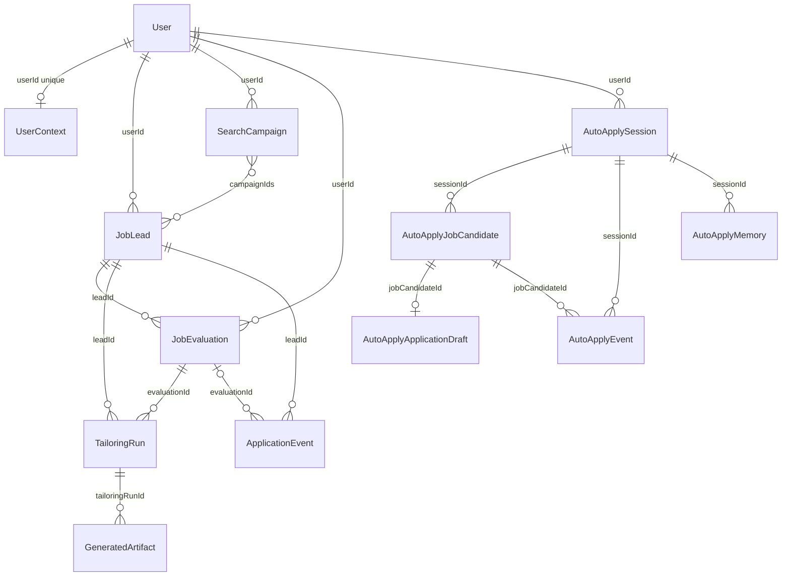

# CV Assistant data models

This document describes the MongoDB collections that CV Assistant (CVA) uses. It covers the Mongoose models in `cv-assistant/src/lib/models/`: their fields, types, defaults, indexes and relationships, the code that reads and writes each collection, and how data is owned and kept. It was checked on 2026-11-07 against the working tree described in [architecture.md](architecture.md).

Method and limits:

- Field names, types, defaults, required flags, enum values and indexes come from the 16 files in `src/lib/models/`.
- Read and write sites come from a text search of `src/`. Line numbers are as checked on the working tree.
- No database was queried, so the contents of live collections are unknown.
- `Mixed` fields accept any value. Mongoose does not validate what is inside them.
- Each model file exports a TypeScript type inferred from its schema (`InferSchemaType`) and a model object created with the `mongoose.models.X || mongoose.model(...)` pattern.

## Contents

1. [Model index](#model-index)
2. [Entity relationships](#entity-relationships)
3. [Conventions](#conventions)
4. [Identity and profile](#identity-and-profile)
5. [Job search and Control Room](#job-search-and-control-room)
6. [Auto Apply](#auto-apply)
7. [Embedded sub-schemas](#embedded-sub-schemas)
8. [Indexes](#indexes)
9. [Enum values with no writer](#enum-values-with-no-writer)
10. [Unused fields and models](#unused-fields-and-models)
11. [Duplicates, growth and inconsistencies](#duplicates-growth-and-inconsistencies)
12. [Retention and ownership](#retention-and-ownership)

## Model index

There are 14 models. Two further schema files, `CandidateFact.ts` and `StoryBankItem.ts`, export embedded schemas only.

| Model | Collection | Owned by | Timestamps | Purpose |
|---|---|---|---|---|
| `User` | `users` | (is the owner) | No | Account, password hash, candidate profile and Auto Apply preferences |
| `UserContext` | `usercontexts` | `userId`, unique | Yes | Career preferences, candidate facts and story bank |
| `JobLead` | `jobleads` | `userId` | Yes | A job found by search or added to the Control Room |
| `SearchCampaign` | `searchcampaigns` | `userId` | Yes | One saved search run |
| `JobEvaluation` | `jobevaluations` | `userId` | Yes | Fit evaluation of a lead |
| `TailoringRun` | `tailoringruns` | `userId` | Yes | A resume tailoring build for a lead |
| `GeneratedArtifact` | `generatedartifacts` | `userId` | Yes | Resume HTML or JSON produced by a tailoring run |
| `ApplicationEvent` | `applicationevents` | `userId` | Yes | Lifecycle events for a lead |
| `AutoApplySession` | `autoapplysessions` | `userId` | Yes | One Auto Apply session, its settings and run state |
| `AutoApplyJobCandidate` | `autoapplyjobcandidates` | `userId` | Yes | A job within an Auto Apply session |
| `AutoApplyApplicationDraft` | `autoapplyapplicationdrafts` | `userId` | Yes | Prepared answers and cover letter for one job |
| `AutoApplyEvent` | `autoapplyevents` | `userId` | Yes | Activity log for Auto Apply |
| `AutoApplyMemory` | `autoapplymemories` | `userId` | Yes | Saved answers to recurring questions |
| `AutoApplyUploadedFile` | `autoapplyuploadedfiles` | `userId` | Yes | Uploaded file bytes. No code path uses it |

## Entity relationships

The relationships are ObjectId references. The database does not enforce them.

- `User` to `UserContext`: zero or one. `userId` is unique.
- `User` to every other owned collection: zero or many, through `userId`.
- `SearchCampaign` and `JobLead` are many to many through `JobLead.campaignIds`.
- `JobLead` to `JobEvaluation`, `TailoringRun` and `ApplicationEvent` through `leadId`.
- `JobEvaluation` to `TailoringRun` through `evaluationId` (required), and to `ApplicationEvent` through `evaluationId` (optional).
- `TailoringRun` to `GeneratedArtifact` through `tailoringRunId`. `TailoringRun.artifactIds` also lists them.
- `AutoApplySession` to `AutoApplyJobCandidate`, `AutoApplyEvent` and `AutoApplyMemory` through `sessionId`. `AutoApplySession.currentJobCandidateId` points at one candidate.
- `AutoApplyJobCandidate` to `AutoApplyApplicationDraft`: at most one draft per session and job, enforced by a unique index on `sessionId` and `jobCandidateId`.
- `AutoApplyJobCandidate` to `AutoApplyEvent` through `jobCandidateId` (optional).
- `AutoApplyApplicationDraft` to `AutoApplyEvent` through `applicationDraftId`. The field is never set (see Unused fields and models).
- `AutoApplyUploadedFile` is referenced by five fields on `AutoApplySession` and `AutoApplyApplicationDraft`. None of them is ever set.

## Conventions

- Embedded sub-schemas declared with `{ _id: false }` have no `_id`. The profile, project and experience sub-documents in `User` keep the `_id` that Mongoose adds by default.
- `timestamps: true` adds `createdAt` and `updatedAt`. Every model except `User` has it.
- Fields with `default: Date.now` are set when a document is created. They are not refreshed on later updates.
- Mongoose checks enum values on `create()` and `save()`. The code never sets `runValidators`, so updates made with `updateOne` or `findOneAndUpdate` are not checked against the enum.
- Writes use `create`, `save`, `updateOne`, `updateMany`, `findOneAndUpdate` (some with upsert), `findByIdAndUpdate`, `bulkWrite` and `insertMany`. No code deletes documents (see Retention and ownership).

## Identity and profile

### User

Collection `users`, file `src/lib/models/User.ts`. No timestamps.

| Field | Type | Required | Default | Notes |
|---|---|---|---|---|
| `username` | String | Yes | none | Unique index. Matching is case-sensitive |
| `passwordHash` | String | Yes | none | bcrypt hash. No route returns it |
| `profile` | ProfileSchema | No | `{}` | Candidate profile. Sub-schema tables below |
| `autoApplyPreferences` | Mixed | No | `{}` | Applicant answers reused by Auto Apply, such as work rights and salary expectation |

ProfileSchema (embedded in `profile`):

| Field | Type | Default | Notes |
|---|---|---|---|
| `name`, `major`, `school`, `studyPeriod`, `email`, `workEmail`, `phone`, `website`, `linkedin`, `profileSummary`, `skills`, `languages` | String | `''` | Personal details. `email`, `workEmail`, `phone`, `website` and `linkedin` are contact data |
| `projects` | [ProjectSchema] | `[]` | ProjectSchema: `name` (String, required); `description` and `summary` (String, `''`); `createdAt` (Date, set on creation) |
| `experiences` | [ExperienceSchema] | `[]` | ExperienceSchema: `companyName` and `role` (String, required); `location`, `timeFrom`, `timeTo`, `description`, `summary` (String, `''`); `createdAt` and `updatedAt` (Date, set on creation); `normalizedTimeTo` (String, `''`); `normalizedTimeToSortKey` (Number, `null`); `normalizedTimeToIsPresent` (Boolean, `false`); `normalizedTimeToSource` (String, `''`) |

Written by:

- `src/app/api/auth/register/route.ts`: `create` (line 59).
- `src/app/api/auto-apply/preferences/route.ts`: `updateOne` (line 43).
- `src/app/api/profile/route.ts`: `findByIdAndUpdate` (line 389).

Read by:

- `src/app/api/auth/register/route.ts` (`findOne`, line 19) and `src/app/api/auth/login/route.ts` (`findOne`, line 14).
- `src/app/api/resume/style1` to `style5` (`findById`, line 25) and `src/app/api/generate-resume/route.ts` (line 56).
- `src/app/api/auto-apply/profile-draft/route.ts` (line 35), `src/app/api/auto-apply/job/[jobId]/cover-letter/route.ts` (line 35) and `src/app/api/auto-apply/session/[id]/route.ts` (line 83).
- `src/app/api/profile/route.ts` (`findById`, lines 354 and 363).
- Generate routes: `select` (line 14), `clarifications` (line 30), `cover-letter` (line 66), `employer-question` (line 68) and `cover-letter/pdf` (line 484).
- `src/lib/career/context.ts` (line 242), `src/lib/career/workflow.ts` (line 45), `src/lib/auto-apply/engine.ts` (line 32) and `src/lib/auto-apply/persistence.ts` (line 36).

### UserContext

Collection `usercontexts`, file `src/lib/models/UserContext.ts`. Timestamps.

| Field | Type | Required | Default | Notes |
|---|---|---|---|---|
| `userId` | ObjectId, ref `User` | Yes | none | Unique index |
| `targetRoles`, `archetypes`, `techStackPreferences`, `proofPoints`, `learnedExclusions` | [String] | No | `[]` | |
| `compensation` | CompensationPreferences | No | `{}` | Sub-schema below |
| `workPreferences` | WorkPreferences | No | `{}` | Sub-schema below |
| `searchPreferences` | SearchPreferences | No | `{}` | Sub-schema below |
| `cultureSignals` | [CultureSignal] | No | `[]` | Sub-schema below |
| `scoreFloor` | Number | No | 65 | See Duplicates, growth and inconsistencies |
| `outreachPreferences` | OutreachPreferences | No | `{}` | Sub-schema below |
| `candidateFacts` | [CandidateFact] | No | `[]` | Embedded schema (section 7) |
| `storyBank` | [StoryBankItem] | No | `[]` | Embedded schema (section 7) |
| `controlRoomPreferences` | ControlRoomPreferences | No | `{}` | Sub-schema below. Every field is a String except `remoteOnly` |
| `calibration` | Calibration | No | `{}` | Sub-schema below |

Sub-schemas (all `_id: false`):

- CompensationPreferences: `currency` (String, `'AUD'`), `targetMin` (Number, 0), `targetMax` (Number, 0), `salaryFloor` (Number, 0).
- WorkPreferences: `modes` ([String], `['remote', 'hybrid']`), `preferredLocations` ([String], `[]`), `avoidLocations` ([String], `[]`), `visaStatus` (String, `''`), `remoteOnly` (Boolean, `false`).
- SearchPreferences: `jobTitles`, `locations`, `sources` ([String], `[]`), `remoteOnly` (Boolean, `false`).
- OutreachPreferences: `channels` ([String], `['email', 'linkedin']`), `tone` (String, `'confident'`).
- ControlRoomPreferences: `scoreFloor`, `salaryFloor`, `targetMin`, `targetMax`, `jobTitles`, `locations`, `preferredLocations`, `avoidLocations` (all String, `''`); `remoteOnly` (Boolean, `false`).
- Calibration: `lastFeedbackAt` (Date, `null`), `selfFilteredReasons` ([String], `[]`), `winningPatterns` ([String], `[]`).
- CultureSignal: `label` (String, `''`), `weight` (Number, 0.5).

Written by: `src/lib/career/context.ts` (`create`, line 245; `findOneAndUpdate`, line 354).

Read by: `src/lib/career/context.ts` (`findOne`, line 237), which `loadUserContextSnapshot()` uses. The search stream route, the Control Room context route and the lead orchestrate route all read the snapshot.

## Job search and Control Room

### JobLead

Collection `jobleads`, file `src/lib/models/JobLead.ts`. Timestamps.

| Field | Type | Required | Default | Notes |
|---|---|---|---|---|
| `userId` | ObjectId, ref `User` | Yes | none | Index |
| `campaignIds` | [ObjectId], ref `SearchCampaign` | No | `[]` | |
| `source` | String | No | `''` | Index. Search source, such as `linkedin` or `seek` |
| `dedupeKey` | String | Yes | none | Unique with `userId` |
| `title`, `company`, `location`, `postedText`, `snippet`, `listingUrl`, `applicationUrl` | String | No | `''` | |
| `applicationUrlType` | String | No | `'listing'` | |
| `searchQueryMatch` | String | No | `'partial'` | |
| `lifecycleState` | String enum | No | `'lead_found'` | Index. `lead_found`, `enriched`, `scored`, `tailored`, `exported`, `tracked`, `followup_due` |
| `liveStatus` | String enum | No | `'unknown'` | `unknown`, `active`, `expired`, `uncertain` |
| `canonicalJobDescription` | String | No | `''` | |
| `jobUnderstanding` | Mixed | No | `null` | LLM-extracted requirements (v2). Legacy leads may omit it |
| `extractedKeywords` | [String] | No | `[]` | |
| `salaryText`, `remotePolicy`, `employmentType` | String | No | `''` | |
| `companySignals` | [String] | No | `[]` | |
| `fitScore` | Number | No | 0 | |
| `recommendation` | String enum | No | `'unscored'` | `unscored`, `prioritize`, `consider`, `skip` |
| `lastSeenAt` | Date | No | now | |
| `lastWorkflowAt` | Date | No | `null` | |

Index: unique `{ userId: 1, dedupeKey: 1 }`.

Written by:

- `src/lib/career/search-persistence.ts`: `create` (line 43) and `findByIdAndUpdate` (line 23).
- `src/lib/career/workflow.ts`: `save` (line 62), `updateOne` (line 118) and `findByIdAndUpdate` (line 148).
- `src/lib/career/market-analyst.ts`: `save` (line 147).

Read by:

- `src/lib/career/search-persistence.ts`: `findOne` (line 21) and `findById` (line 40).
- `src/lib/career/market-analyst.ts`: `findOne` (line 75).
- `src/lib/career/control-room.ts`: `find`, limited to 24 (line 263), and `findOne` (line 354).

### SearchCampaign

Collection `searchcampaigns`, file `src/lib/models/SearchCampaign.ts`. Timestamps.

| Field | Type | Required | Default | Notes |
|---|---|---|---|---|
| `userId` | ObjectId, ref `User` | Yes | none | Index |
| `status` | String enum | No | `'active'` | Index. `active`, `completed`, `failed`, `canceled` |
| `query` | SearchCampaignQuery | Yes | none | Sub-schema below |
| `totalResults` | Number | No | 0 | |
| `blockedSources` | [String] | No | `[]` | |
| `errorMessage` | String | No | `''` | |
| `startedAt` | Date | No | now | |
| `completedAt` | Date | No | `null` | |

SearchCampaignQuery (`_id: false`): `jobTitle` (String, required), `location` (String, required), `filters` (Mixed, `{}`), `maxResultsPerSource` (Number, 50), `selectedSources` ([String], `[]`), `searchInstruction` (String, `''`), `instructionExpansion` (Mixed, `null`), `advancedSearchSession` (Mixed, `null`).

Written by: `src/lib/career/search-persistence.ts` (`create`, line 8; `findByIdAndUpdate`, line 79).

Read by: `src/lib/career/control-room.ts` (`find`, limited to 6, line 262).

### JobEvaluation

Collection `jobevaluations`, file `src/lib/models/JobEvaluation.ts`. Timestamps. No unique index. Each orchestration run of a lead creates a new evaluation.

| Field | Type | Required | Default | Notes |
|---|---|---|---|---|
| `userId` | ObjectId, ref `User` | Yes | none | Index |
| `leadId` | ObjectId, ref `JobLead` | Yes | none | Index |
| `fitScore` | Number | No | 0 | |
| `recommendation` | String enum | No | `'consider'` | `prioritize`, `consider`, `skip` |
| `dimensionScores` | [DimensionScore] | No | `[]` | Sub-schema below |
| `gapMap` | [Gap] | No | `[]` | Sub-schema below |
| `reasoningSummary` | String | No | `''` | |
| `nextActions` | [String] | No | `[]` | |
| `matchedRequirements` | [RequirementCoverage] | No | `[]` | Sub-schema below |
| `telemetrySnapshot` | Mixed | No | `{}` | Outcome telemetry used for the score |
| `analysisSource` | String enum | No | `'heuristic'` | `heuristic`, `llm`, `fallback` |
| `analysisVersion` | Number | No | 0 | |
| `model` | String | No | `''` | |
| `jobUnderstanding` | Mixed | No | `null` | |

Sub-schemas (all `_id: false`):

- DimensionScore: `key`, `label` (String, required); `score` (Number, required); `reason` (String, `''`).
- Gap: `code` (String, `''`); `title` (String, required); `severity` (enum `critical`, `moderate`, `minor`; default `minor`); `detail`, `mitigation` (String, `''`); `supportingRequirements` ([String], `[]`).
- RequirementCoverage: `requirement` (String, required); `coverage` (enum `covered`, `partial`, `gap`; default `gap`); `matchedFacts` ([String], `[]`).

Written by: `src/lib/career/workflow.ts` (`create`, line 52).

Read by: `src/lib/career/control-room.ts` (`find`, limited to 24, line 264; `findOne`, line 355) and `src/lib/career/telemetry.ts` (`find`, limited to 40, line 6).

### TailoringRun

Collection `tailoringruns`, file `src/lib/models/TailoringRun.ts`. Timestamps.

| Field | Type | Required | Default | Notes |
|---|---|---|---|---|
| `userId`, `leadId`, `evaluationId` | ObjectId, refs `User`, `JobLead`, `JobEvaluation` | Yes | none | Index |
| `status` | String enum | No | `'planned'` | Index. `planned`, `generated`, `validated`, `exported` |
| `evidenceSet` | [EvidenceItem] | No | `[]` | Sub-schema below |
| `resumeDraft` | Mixed | No | `{}` | Tailored resume content |
| `atsValidation` | Mixed | No | `{}` | Result of the ATS check |
| `artifactIds` | [ObjectId], ref `GeneratedArtifact` | No | `[]` | |

EvidenceItem (`_id: false`): `type` (enum `project`, `experience`; required); `index` (Number, required); `title` (String, required); `score` (Number, 0); `matchedKeywords` ([String], `[]`); `rewrittenContent` (String, `''`).

Written by: `src/lib/career/workflow.ts` (`create`, line 96; `save`, line 116).

Read by: `src/lib/career/control-room.ts` (`findOne`, line 356).

### GeneratedArtifact

Collection `generatedartifacts`, file `src/lib/models/GeneratedArtifact.ts`. Timestamps.

| Field | Type | Required | Default | Notes |
|---|---|---|---|---|
| `userId`, `leadId`, `tailoringRunId` | ObjectId, refs `User`, `JobLead`, `TailoringRun` | Yes | none | Index |
| `artifactType` | String enum | Yes | none | `resume_html`, `resume_json`, `cover_letter_html` |
| `variant` | String | No | `'executive'` | |
| `mimeType` | String | No | `'text/html'` | |
| `body` | String | No | `''` | Generated content. Personal data |
| `summary` | String | No | `''` | |
| `lineageVersion` | Number | No | 1 | |

Written by: `src/lib/career/workflow.ts` (`insertMany`, line 106).

Read by: `src/lib/career/control-room.ts` (`countDocuments`, line 265; `find`, line 357).

### ApplicationEvent

Collection `applicationevents`, file `src/lib/models/ApplicationEvent.ts`. Timestamps.

| Field | Type | Required | Default | Notes |
|---|---|---|---|---|
| `userId`, `leadId` | ObjectId, refs `User`, `JobLead` | Yes | none | Index |
| `evaluationId` | ObjectId, ref `JobEvaluation` | No | `null` | |
| `type` | String enum | Yes | none | Index. `lead_found`, `enriched`, `scored`, `self_filtered`, `tailored`, `exported`, `tracked`, `followup_due`, `context_updated` |
| `payload` | Mixed | No | `{}` | |

Written by:

- `src/lib/career/workflow.ts`: `scored` (line 64), `self_filtered` (line 76), `tailored` and `exported` (line 125).
- `src/lib/career/market-analyst.ts`: `enriched` (line 149).
- `src/lib/career/search-persistence.ts`: `lead_found` (line 61), for new leads only.

Read by: `src/lib/career/telemetry.ts` (`find`, line 7) and `src/lib/career/control-room.ts` (`find`, line 358).

## Auto Apply

### AutoApplySession

Collection `autoapplysessions`, file `src/lib/models/AutoApplySession.ts`. Timestamps.

| Field | Type | Required | Default | Notes |
|---|---|---|---|---|
| `userId` | ObjectId, ref `User` | Yes | none | Index |
| `mode` | String enum | No | `'ai_coaching'` | Index. `ai_coaching`, `manual_curate` |
| `status` | String enum | No | `'idle'` | Index. `idle`, `searching`, `scoring`, `ranking`, `review`, `applying`, `awaiting_selection`, `preparing`, `browser_active`, `awaiting_user_answer`, `ready_for_review`, `submitting`, `submitted`, `blocked`, `failed`, `stopped`, `completed` |
| `prompt` | String | No | `''` | |
| `filters` | Mixed | No | `{}` | |
| `uploadedResumeId` | ObjectId, ref `AutoApplyUploadedFile` | No | `null` | Never set (see Unused fields and models) |
| `uploadedAdditionalDocumentIds` | [ObjectId], ref `AutoApplyUploadedFile` | No | `[]` | Never set |
| `selectedGroundTruthIds` | [String] | No | `[]` | |
| `sessionGroundTruthSnapshot` | Mixed | No | `{}` | Applicant snapshot taken when the session is created. Removed from session GET responses |
| `allowFullResumeContext` | Boolean | No | `false` | |
| `currentJobCandidateId` | ObjectId, ref `AutoApplyJobCandidate` | No | `null` | |
| `lastError` | String | No | `''` | |
| `preferences` | Mixed | No | `{}` | |
| `run` | nested path | No | | `run.phase` and `run.message` (String, `''`); `run.startedAt` and `run.updatedAt` (Date, `null`; `updatedAt` is the heartbeat); `run.stats` (Mixed, `{}`) |
| `stoppedAt` | Date | No | `null` | |

Written by:

- `src/lib/auto-apply/persistence.ts`: `create` (line 44).
- `src/lib/auto-apply/engine.ts`: run state with `updateOne` (line 48), heartbeat (line 62), `findOneAndUpdate` in `claimRun` (line 70), status changes (lines 329, 332 and 386) and `currentJobCandidateId` (line 491).
- `src/app/api/auto-apply/session/[id]/route.ts`: stall recovery `updateOne` (line 26) and PATCH `update` (line 93).
- `src/app/api/auto-apply/session/[id]/cancel/route.ts` (line 14), `approve/route.ts` (line 70) and `run/route.ts` (line 29).

Read by: `src/app/api/auto-apply/session/route.ts` (`find`, line 16); `src/lib/auto-apply/routes.ts` (`findOne`, line 18); `src/lib/auto-apply/engine.ts` (`findById`, line 52; `findOne`, lines 122, 417 and 517).

### AutoApplyJobCandidate

Collection `autoapplyjobcandidates`, file `src/lib/models/AutoApplyJobCandidate.ts`. Timestamps.

| Field | Type | Required | Default | Notes |
|---|---|---|---|---|
| `userId` | ObjectId, ref `User` | Yes | none | Index |
| `sessionId` | ObjectId, ref `AutoApplySession` | Yes | none | Index |
| `source` | String | No | `''` | Index. Employer-board postings are tagged `career_site` through `discoveredVia` |
| `sourceJobId` | String | No | `''` | |
| `dedupeKey` | String | Yes | none | Unique with `sessionId` |
| `title`, `company`, `location`, `workMode`, `salary`, `url`, `applyUrl` | String | No | `''` | |
| `applyUrlType` | String | No | `'listing'` | |
| `descriptionText` | String | No | `''` | |
| `requirements`, `responsibilities` | [String] | No | `[]` | |
| `fitScore` | Number | No | 0 | |
| `fitReasons`, `missingRequirements`, `riskFlags` | [String] | No | `[]` | |
| `applicationStrategy` | String | No | `''` | |
| `status` | String enum | No | `'discovered'` | Index. `discovered`, `shortlisted`, `selected`, `preparing`, `needs_input`, `prepared`, `approved`, `applied`, `skipped`, `failed`; legacy `ready_for_review`, `submitted`, `manual_apply_recommended` |
| `snippet` | String | No | `''` | |
| `postedAt` | String | No | `''` | |
| `discoveredVia` | String | No | `'job_board'` | |
| `recommendation`, `fitVerdict` | String | No | `''` | |
| `scoredBy` | String | No | `'heuristic'` | |
| `ats` | nested path | No | | `provider`, `board`, `jobId`, `matchedBy` (String, `''`); `confidence` (Number, 0) |
| `formSource` | String | No | `''` | |
| `questions` | [Mixed] | No | `[]` | Application form questions |
| `heuristicScore` | Number | No | 0 | |
| `fitGaps` | [String] | No | `[]` | |
| `resolvedAt` | Date | No | `null` | |
| `resolutionNotes` | [String] | No | `[]` | |
| `stageHistory` | [stage item] | No | `[]` | Items: `stage` (String), `at` (Date), `note` (String); `_id: false` |
| `preparingStartedAt`, `approvedAt`, `appliedAt` | Date | No | `null` | |
| `lastError` | String | No | `''` | |
| `attempts` | Number | No | 0 | |

Index: unique `{ sessionId: 1, dedupeKey: 1 }`.

Written by:

- `src/lib/auto-apply/engine.ts`: `bulkWrite` upsert keyed by session and dedupe key (line 309); `updateMany` (lines 310 and 357); `findOneAndUpdate` for the prepare lock (line 404); `updateOne` (lines 474, 502 and 550).
- `src/app/api/auto-apply/session/[id]/route.ts`: `updateMany` moving `preparing` back to `selected` (line 30).
- `src/app/api/auto-apply/session/[id]/approve/route.ts`: `updateOne` (lines 47 and 63).
- `src/app/api/auto-apply/job/[jobId]/route.ts`: `updateOne` (lines 71 and 104).
- `src/app/api/auto-apply/job/[jobId]/applied/route.ts`: `updateOne` (lines 23 and 32).
- `src/app/api/auto-apply/job/[jobId]/cover-letter/route.ts`: `updateOne` (line 77).

Read by:

- `src/app/api/auto-apply/session/[id]/run/route.ts` (`countDocuments`, line 27) and `src/app/api/auto-apply/session/[id]/route.ts` (`find`, line 35).
- `src/app/api/auto-apply/session/[id]/approve/route.ts` (`find`, line 35).
- `src/lib/auto-apply/routes.ts` (`findOne`, line 24).
- `src/lib/auto-apply/engine.ts`: `countDocuments` (lines 342 and 390), `find` (lines 348, 367 and 520) and `exists` (line 413).

### AutoApplyApplicationDraft

Collection `autoapplyapplicationdrafts`, file `src/lib/models/AutoApplyApplicationDraft.ts`. Timestamps.

| Field | Type | Required | Default | Notes |
|---|---|---|---|---|
| `userId` | ObjectId, ref `User` | Yes | none | Index |
| `sessionId` | ObjectId, ref `AutoApplySession` | Yes | none | Index |
| `jobCandidateId` | ObjectId, ref `AutoApplyJobCandidate` | Yes | none | Index. Unique with `sessionId` |
| `resumeFileId`, `coverLetterFileId` | ObjectId, ref `AutoApplyUploadedFile` | No | `null` | Never set |
| `additionalDocumentFileIds` | [ObjectId], ref `AutoApplyUploadedFile` | No | `[]` | Never set |
| `coverLetterText` | String | No | `''` | Cover letter. Personal content |
| `employerQuestions` | [Mixed] | No | `[]` | |
| `answers` | [Mixed] | No | `[]` | Answer objects with fields such as `questionId`, `label`, `value`, `type`, `options`, `needsInput`, `required`, `category` and `note` |
| `userProvidedAnswers` | [Mixed] | No | `[]` | Never written |
| `uncertaintyFlags` | [String] | No | `[]` | |
| `generatedApplicationSummary` | String | No | `''` | |
| `riskNotes` | [String] | No | `[]` | |
| `letterClaims` | [String] | No | `[]` | Claims in the cover letter that the CV does not support |
| `finalReviewStatus` | String enum | No | `'not_ready'` | Index. `not_ready`, `needs_input`, `ready`, `approved`, `applied`, `confirmed`, `submitted`, `blocked` |
| `submittedAt` | Date | No | `null` | |
| `applyUrl`, `formSource` | String | No | `''` | |
| `payloadHash` | String | No | `''` | Hash of the answers, cover letter and apply URL, used to detect edits after review |
| `approvedAt` | Date | No | `null` | |
| `generatedBy` | String | No | `''` | |
| `preparedAt` | Date | No | `null` | |

Index: unique `{ sessionId: 1, jobCandidateId: 1 }`.

Written by:

- `src/lib/auto-apply/engine.ts`: upsert (`findOneAndUpdate`, line 449); `needs_input` or `ready` status (line 463); `updateOne` (line 542); refresh of standing answers (line 545).
- `src/app/api/auto-apply/session/[id]/approve/route.ts`: `updateOne` to undo approval (line 46) and to approve with `payloadHash` (line 65).
- `src/app/api/auto-apply/job/[jobId]/applied/route.ts`: `applied` and `submittedAt` (line 31).
- `src/app/api/auto-apply/job/[jobId]/route.ts` (line 92) and `cover-letter/route.ts` (line 59): `updateOne`.

Read by: `src/app/api/auto-apply/session/[id]/route.ts` (`find`, line 39); `approve/route.ts` (`findOne`, line 40); `src/lib/auto-apply/routes.ts` (`findOne`, lines 30 and 39); `src/lib/auto-apply/engine.ts` (`findOne`, line 523).

### AutoApplyEvent

Collection `autoapplyevents`, file `src/lib/models/AutoApplyEvent.ts`. Timestamps. Index `{ sessionId: 1, createdAt: -1 }` (not unique).

| Field | Type | Required | Default | Notes |
|---|---|---|---|---|
| `userId` | ObjectId, ref `User` | Yes | none | Index |
| `sessionId` | ObjectId, ref `AutoApplySession` | Yes | none | Index |
| `jobCandidateId` | ObjectId, ref `AutoApplyJobCandidate` | No | `null` | Index |
| `applicationDraftId` | ObjectId, ref `AutoApplyApplicationDraft` | No | `null` | Never set |
| `type` | String | Yes | none | Index. Free text, such as `answers_edited`. Not an enum |
| `message` | String | Yes | none | Human-readable summary |
| `payload` | Mixed | No | `{}` | Event details |

Written by: `src/lib/auto-apply/persistence.ts` (`create`, line 16, through `logAutoApplyEvent()`).

Read by: `src/app/api/auto-apply/session/[id]/events/route.ts` (`find`, limited to 100, line 14) and `src/app/api/auto-apply/session/[id]/route.ts` (`find`, limited to 40, line 40).

### AutoApplyMemory

Collection `autoapplymemories`, file `src/lib/models/AutoApplyMemory.ts`. Timestamps. Index `{ userId: 1, scope: 1, questionPattern: 1 }` (not unique).

| Field | Type | Required | Default | Notes |
|---|---|---|---|---|
| `userId` | ObjectId, ref `User` | Yes | none | Index |
| `sessionId` | ObjectId, ref `AutoApplySession` | No | `null` | Index. Set when the answer is saved |
| `scope` | String enum | No | `'session'` | Index. `session`, `reusable_profile` |
| `questionPattern` | String | Yes | none | The question label used for matching |
| `answer` | String | Yes | none | Saved answer. Personal data |
| `source` | String enum | No | `'user'` | `user`, `resume`, `selected_project`, `generated_with_user_approval` |
| `provenance` | [String] | No | `[]` | |
| `confidence` | Number | No | 0.8 | Saved answers are written with 1 |
| `consentedAt` | Date | No | `null` | |

Written by: `src/app/api/auto-apply/job/[jobId]/route.ts` (`findOneAndUpdate` with upsert, line 111). It saves scope `reusable_profile`, source `user`, confidence 1 and `consentedAt`.

Read by: `src/lib/auto-apply/engine.ts` (`find`, line 35, scope `reusable_profile`).

### AutoApplyUploadedFile

Collection `autoapplyuploadedfiles`, file `src/lib/models/AutoApplyUploadedFile.ts`. Timestamps.

| Field | Type | Required | Default | Notes |
|---|---|---|---|---|
| `userId` | ObjectId, ref `User` | Yes | none | Index |
| `sessionId` | ObjectId, ref `AutoApplySession` | Yes | none | Index |
| `kind` | String enum | Yes | none | Index. `resume`, `supporting_document` |
| `filename`, `mimeType` | String | Yes | none | |
| `size` | Number | Yes | none | |
| `checksum` | String | Yes | none | Index |
| `data` | Buffer | Yes | none | File bytes |
| `parsedText` | String | No | `''` | |
| `parseStatus` | String enum | No | `'pending'` | `pending`, `parsed`, `failed`, `unsupported` |
| `parseError` | String | No | `''` | |

No code reads or writes this model. See Unused fields and models.

## Embedded sub-schemas

| Sub-schema | Defined in | Used by | `_id` |
|---|---|---|---|
| ProfileSchema, ProjectSchema, ExperienceSchema | `User.ts` | `User.profile` and its arrays | Yes (default) |
| CultureSignal, CompensationPreferences, WorkPreferences, SearchPreferences, OutreachPreferences, ControlRoomPreferences, Calibration | `UserContext.ts` | `UserContext` | No |
| CandidateFact | `CandidateFact.ts` | `UserContext.candidateFacts` | No |
| StoryBankItem | `StoryBankItem.ts` | `UserContext.storyBank` | No |
| SearchCampaignQuery | `SearchCampaign.ts` | `SearchCampaign.query` | No |
| DimensionScore, Gap, RequirementCoverage | `JobEvaluation.ts` | `JobEvaluation` arrays | No |
| EvidenceItem | `TailoringRun.ts` | `TailoringRun.evidenceSet` | No |
| Stage history item | `AutoApplyJobCandidate.ts` | `AutoApplyJobCandidate.stageHistory` | No |
| `run` | `AutoApplySession.ts` | Nested path, not a sub-schema | No |
| `ats` | `AutoApplyJobCandidate.ts` | Nested path, not a sub-schema | No |

CandidateFact (`src/lib/models/CandidateFact.ts`, `_id: false`):

| Field | Type | Default | Notes |
|---|---|---|---|
| `kind` | String enum | `'profile'` | `profile`, `experience`, `project`, `skill`, `story` |
| `title`, `sourceLabel`, `summary` | String | `''` | |
| `evidence`, `keywords` | [String] | `[]` | |
| `impact` | String | `''` | |
| `confidence` | Number | 0.7 | |
| `sourceHash` | String | `''` | |

StoryBankItem (`src/lib/models/StoryBankItem.ts`, `_id: false`):

| Field | Type | Default | Notes |
|---|---|---|---|
| `title`, `situation`, `task`, `action`, `result`, `reflection` | String | `''` | |
| `tags` | [String] | `[]` | |
| `evidenceSource` | String | `''` | |
| `confidence` | Number | 0.6 | |

## Indexes

Mongoose creates these indexes by default (`autoIndex`). The code does not manage indexes, and the database has no TTL index.

| Collection | Single-field indexes | Compound index |
|---|---|---|
| `users` | `username` (unique) | None |
| `usercontexts` | `userId` (unique) | None |
| `jobleads` | `userId`, `source`, `lifecycleState` | `{ userId: 1, dedupeKey: 1 }` (unique) |
| `searchcampaigns` | `userId`, `status` | None |
| `jobevaluations` | `userId`, `leadId` | None |
| `tailoringruns` | `userId`, `leadId`, `evaluationId`, `status` | None |
| `generatedartifacts` | `userId`, `leadId`, `tailoringRunId` | None |
| `applicationevents` | `userId`, `leadId`, `type` | None |
| `autoapplysessions` | `userId`, `mode`, `status` | None |
| `autoapplyjobcandidates` | `userId`, `sessionId`, `source`, `status` | `{ sessionId: 1, dedupeKey: 1 }` (unique) |
| `autoapplyapplicationdrafts` | `userId`, `sessionId`, `jobCandidateId`, `finalReviewStatus` | `{ sessionId: 1, jobCandidateId: 1 }` (unique) |
| `autoapplyevents` | `userId`, `sessionId`, `jobCandidateId`, `type` | `{ sessionId: 1, createdAt: -1 }` |
| `autoapplymemories` | `userId`, `sessionId`, `scope` | `{ userId: 1, scope: 1, questionPattern: 1 }` |
| `autoapplyuploadedfiles` | `userId`, `sessionId`, `kind`, `checksum` | None |

## Enum values with no writer

These values are allowed by the schema, but no code writes them.

| Field | Values never written | Notes |
|---|---|---|
| `jobleads.lifecycleState` | `tailored` (read only), `tracked`, `followup_due` | The code writes `lead_found`, `enriched`, `scored` and `exported` |
| `applicationevents.type` | `context_updated`, `tracked`, `followup_due` | |
| `tailoringruns.status` | `generated` | `planned` is only the schema default |
| `generatedartifacts.artifactType` | `cover_letter_html` | |
| `autoapplysessions.status` | `ranking`, `applying`, `awaiting_user_answer`, `submitting`, `submitted`, `blocked`, `ready_for_review`, `completed`, `browser_active` | `browser_active` is a browser session mode, not a session status |
| `autoapplyjobcandidates.status` | `manual_apply_recommended` (set in memory only), `ready_for_review` and `submitted` (legacy values, read through `LEGACY_STAGES`) | |
| `autoapplyapplicationdrafts.finalReviewStatus` | `confirmed`, `submitted`, `blocked` | `not_ready` is only the schema default |
| `autoapplymemories.scope` | `session` | Only the schema default |
| `autoapplymemories.source` | `resume`, `selected_project`, `generated_with_user_approval` | |

## Unused fields and models

- **`AutoApplyUploadedFile`** has no reads and no writes. Its `data` field (Buffer) would hold file bytes. No upload route exists.
- **Five reference fields** point at `AutoApplyUploadedFile` and are never set: `AutoApplySession.uploadedResumeId`, `AutoApplySession.uploadedAdditionalDocumentIds`, `AutoApplyApplicationDraft.resumeFileId`, `AutoApplyApplicationDraft.coverLetterFileId` and `AutoApplyApplicationDraft.additionalDocumentFileIds`.
- **`AutoApplyApplicationDraft.userProvidedAnswers`** is never written.
- **`AutoApplyEvent.applicationDraftId`** is never set.

## Duplicates, growth and inconsistencies

- **Two score floors.** `UserContext.scoreFloor` (Number, default 65) and `UserContext.controlRoomPreferences.scoreFloor` (String, default `''`) hold the same concept. This review did not trace which one the Control Room reads.
- **Mixed types for one concept.** `controlRoomPreferences` stores numbers as Strings (`scoreFloor`, `salaryFloor`, `targetMin`, `targetMax`). `compensation` and `scoreFloor` use Numbers.
- **Overlapping location lists.** Locations appear in `workPreferences.preferredLocations`, `workPreferences.avoidLocations`, `searchPreferences.locations`, `controlRoomPreferences.locations`, `controlRoomPreferences.preferredLocations` and `controlRoomPreferences.avoidLocations`.
- **Find-then-create races.** `recordSearchLead()` (`src/lib/career/search-persistence.ts`, lines 21 and 43) and `loadUserContextSnapshot()` (`src/lib/career/context.ts`, lines 237 and 245) look a document up and then create it. Two concurrent calls can hit the unique indexes and fail with a duplicate-key error.
- **Username case.** Uniqueness is case-sensitive, so `Alice` and `alice` can both exist.
- **Two status fields for one progression.** `AutoApplyJobCandidate.status` and `AutoApplyApplicationDraft.finalReviewStatus` both track approval and application. The approve route updates them in separate writes with no transaction, so a failure between the writes can leave them out of step.
- **Unbounded arrays.** The schema sets no size limit on `stageHistory`, `answers` or `questions`. Stage changes append to `stageHistory`, and edits replace `answers`. The PATCH schema caps one request at 80 answers.
- **Growth from repeated use.** Each orchestration of a lead creates a new `JobEvaluation`, `TailoringRun` and set of `GeneratedArtifact` rows. Each search creates a `SearchCampaign`. Nothing removes earlier rows (see Retention and ownership).
- **Snapshot per session.** Each Auto Apply session stores its own copy of the applicant snapshot in `sessionGroundTruthSnapshot`.

## Retention and ownership

Ownership:

- Every collection except `users` has a required `userId`. Reads filter by it. For example, `loadOwnedSession(userId, sessionId)` in `src/lib/auto-apply/routes.ts` queries `{ _id, userId }` (line 18). The Control Room lead lookup uses `{ _id: leadId, userId }` (`src/lib/career/control-room.ts`, line 354).
- Some writes filter by `_id` alone, after an owner-scoped read earlier in the same request. The job PATCH route does this (`src/app/api/auto-apply/job/[jobId]/route.ts`, lines 71 and 104).
- `passwordHash` appears only in `src/app/api/auth/register/route.ts` (lines 55 and 59), `src/app/api/auth/login/route.ts` (line 18) and `src/lib/models/User.ts`. No route returns it.
- The session GET response omits `sessionGroundTruthSnapshot` (`src/app/api/auto-apply/session/[id]/route.ts`, line 57).

Deletion and retention:

- No code deletes documents. `src/` has no `deleteOne`, `deleteMany`, `findByIdAndDelete` or `findOneAndDelete` calls. The only `remove()` calls are DOM removals.
- There are no TTL indexes, retention jobs or archive steps. Data stays until someone removes it outside the application.
- Drafts, events and saved answers accumulate. Undoing an action changes status but does not remove the earlier data.

Sensitive data:

| Collection and field | What it holds |
|---|---|
| `users.passwordHash` | bcrypt hash |
| `users.profile` | Name, contact details (email, phone, LinkedIn, website and work email), experience, projects and skills |
| `users.autoApplyPreferences` | Applicant answers such as work rights, salary expectation and notice period |
| `usercontexts.candidateFacts` and `usercontexts.storyBank` | Facts and stories drawn from the profile |
| `autoapplysessions.sessionGroundTruthSnapshot` | Full applicant snapshot, taken when the session is created (`createSessionWithSnapshot()`, `src/lib/auto-apply/persistence.ts`) |
| `autoapplymemories.answer` | Saved answers, reused across sessions |
| `autoapplyapplicationdrafts`: `answers`, `coverLetterText`, `letterClaims`, `payloadHash` | Application answers and cover letter |
| `autoapplyevents.payload` | Event details |
| `tailoringruns.resumeDraft` and `generatedartifacts.body` | Tailored resume content |
| `autoapplyuploadedfiles.data` | File bytes (unused) |

No schema field is designed for payment data or government identifiers.

Stored off the database:

- `.codex-data/auto-apply/site-auth/`, relative to the working directory, holds per-site browser storage state as plain JSON. `src/lib/auto-apply/site-auth.ts` writes it (line 104). Its optional encrypted credential records use AES-256-GCM. Only the development browser path uses this module. Section 20 of [architecture.md](architecture.md#20-known-issues-and-inconsistencies) covers it.
