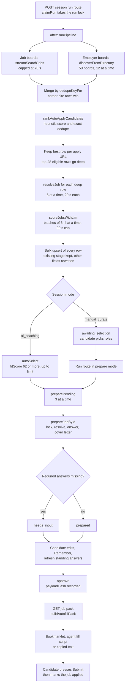
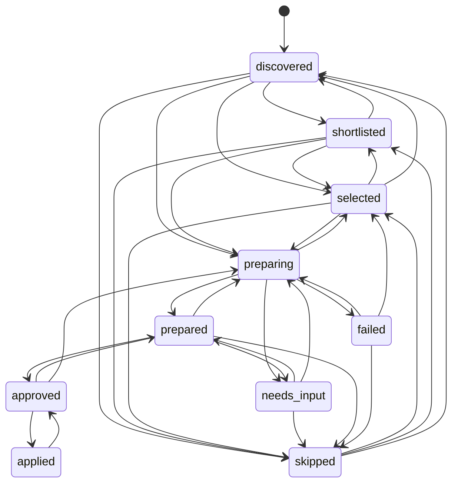
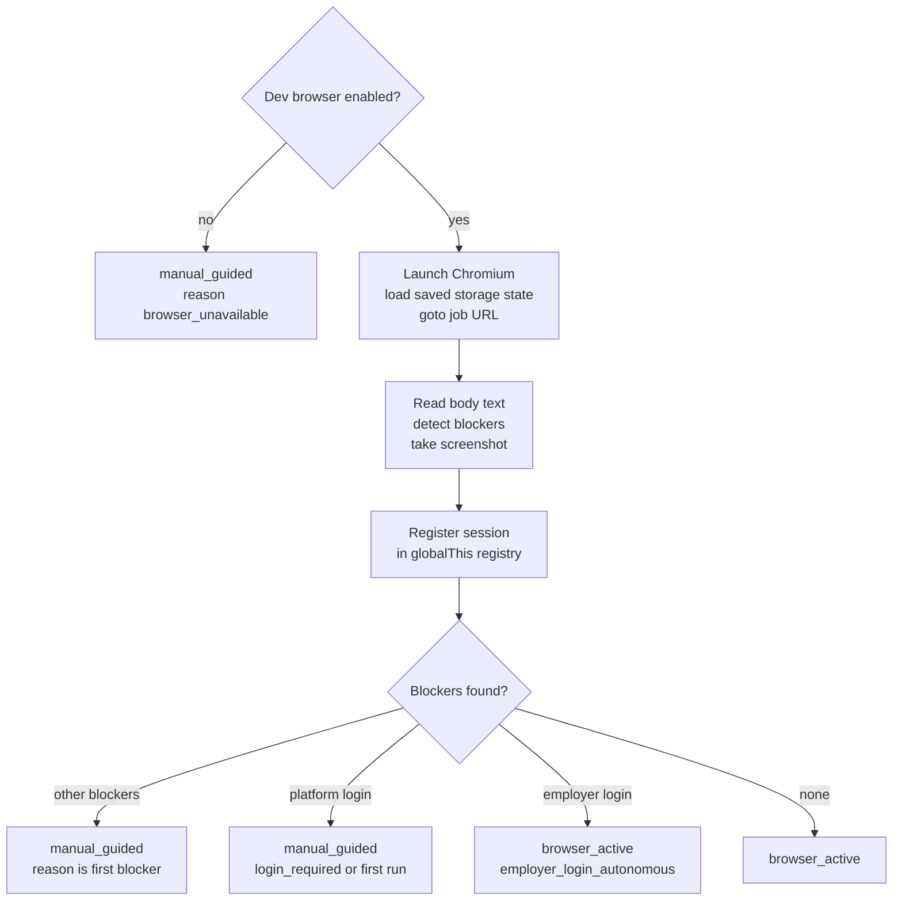

# Auto Apply engine (backend reference)

This is the backend reference for the Auto Apply engine in `src/lib/auto-apply/`. It explains how a search session becomes reviewable application packs, and where each rule, threshold and safety control lives. It was written from the source files, read in full, and checked against the code as at 2026-11-07. Paths are relative to `cv-assistant/` unless stated otherwise.

The UI and the HTTP API are documented in `docs/features/auto-apply.md`. Routes are mentioned here only to show how the engine is driven.

Conventions:

- Signatures are copied from source. Optional parameters are marked with `?`.
- A threshold is quoted from the named constant, or from the literal in the function named beside it.
- "Dormant" means exported code with no caller in production code. Tests may still use it.
- Durations are in seconds unless a value is written in milliseconds.

## 1. Overview

### 1.1 Purpose

A session holds a role prompt, search filters and a snapshot of the candidate's evidence. The engine turns it into application packs that the candidate reviews, approves and submits on the employer's own site. The pipeline:

1. Discovers roles from 59 employer career boards and from up to six job-board sources.
2. Merges and ranks them with a deterministic heuristic.
3. Reads the employer's real application form where a public ATS API exposes it.
4. Scores fit with a batched LLM call that sees only the candidate's evidence.
5. Selects roles automatically (`ai_coaching`) or leaves selection to the candidate (`manual_curate`).
6. Prepares each application: answers every form question, drafts a cover letter and records a payload hash.
7. Lets the candidate edit, approve and export each application as an autofill pack.

The engine never submits an application. Submission is the candidate's own action on the employer's site. The code supports that rule with guards (section 14) and with an attestation route that records the candidate's statement that they submitted.

### 1.2 Pipeline



Runs start in the run route and continue inside Next.js `after()`, so the request returns `202` straight away. Candidate rows are written in one bulk upsert after scoring. Each application's draft is written as soon as its preparation finishes.

### 1.3 Job stages

Each `AutoApplyJobCandidate` has exactly one stage, stored in `status`. The rules for moving between stages are in section 15.



### 1.4 Run phases and session status

Two fields describe progress. They have different jobs and are easy to confuse.

| Field | Written by | Values the code writes |
|---|---|---|
| `AutoApplySession.run.phase` | Run lock, heartbeat, cancel route, stall recovery | `searching`, `scoring`, `preparing`, `idle`, `failed`, `cancelled` |
| `AutoApplySession.status` | Engine stage changes and approval | `searching`, `scoring`, `awaiting_selection`, `preparing`, `review`, `failed`, `stopped` |

The run phase is the lock. `searching`, `scoring` and `preparing` are active phases, and a second run cannot start while one is active, unless its last heartbeat is more than `RUN_STALL_MS` (150 seconds) old (section 16).

`GET /api/auto-apply/session/[id]` returns a derived `phase` computed by `deriveSessionPhase()` in `src/lib/auto-apply/state.ts`. Its values are `setup`, `searching`, `scoring`, `preparing`, `review`, `apply`, `done` and `failed`.

### 1.5 Module map

| File | Lines | Role | Stage |
|---|---|---|---|
| `types.ts` | 119 | Zod schemas for session, filter and answer input; `toSearchRequest()` | Input |
| `state.ts` | 116 | Job stage state machine, run and lock constants, phase derivation | State |
| `persistence.ts` | 62 | Event log; session creation with a ground-truth snapshot | Session |
| `routes.ts` | 40 | Auth and ownership helpers for route handlers | HTTP |
| `candidate.ts` | 79 | Profile contact details, candidate summary, preference merge | Scoring and drafting |
| `ground-truth.ts` | 154 | Evidence items built from the profile; selection heuristic | Session and ranking |
| `profile-draft.ts` | 320 | Intake: distils a search draft from the profile with an LLM, with a fallback | Intake |
| `ats.ts` | 174 | URL to ATS provider detection; company slugs; title similarity | Discovery and resolution |
| `ats-directory.ts` | 72 | 59 curated employer career boards | Discovery |
| `ats-clients.ts` | 593 | Public ATS listing, detail and form-schema clients | Discovery and resolution |
| `discovery.ts` | 379 | Role and location matching; directory discovery; listing extraction; `resolveJob()` | Discovery and resolution |
| `ranking.ts` | 174 | Heuristic fit score; exact and key-based de-duplication | Ranking |
| `fit.ts` | 94 | Batched LLM fit scoring | Ranking |
| `jd.ts` | 65 | Job description crawl | Preparation |
| `questions.ts` | 501 | Question model; categories; deterministic answers; option mapping; memory | Preparation |
| `answering.ts` | 87 | Ground-truth-only answer helper | Dormant |
| `prepare.ts` | 253 | `prepareApplication()`; answer prompt; payload hash | Preparation |
| `pack.ts` | 56 | Autofill pack schema; plain-text export; URL fragment encoding | Output |
| `autofill-script.ts` | 278 | In-page form filler, stored as a string; bookmarklet builder | Output |
| `browser.ts` | 74 | Image helpers; job-platform detection; blocker detection | Local browser |
| `browser-session.ts` | 267 | Playwright session registry (local development only) | Local browser |
| `site-auth.ts` | 132 | Per-user storage state and encrypted credentials for sites | Local browser |
| `submit-guard.ts` | 20 | Submission request detection and in-page submit cancel | Safety |
| `engine.ts` | 564 | Orchestration: run lock, pipeline, selection, preparation, refresh | Orchestration |

Total: 4,673 lines of source in 24 files.

### 1.6 Runtime and dependencies

- Routes that touch the engine use `runtime = "nodejs"` and `dynamic = "force-dynamic"`. Routes that run long work set `maxDuration = 300`: the run route, the prepare route and the cover-letter route.
- The engine reads and writes MongoDB through Mongoose models in `src/lib/models/` (`AutoApplySession`, `AutoApplyJobCandidate`, `AutoApplyApplicationDraft`, `AutoApplyEvent`, `AutoApplyMemory`, and `User`).
- Outbound calls go to public ATS APIs and public HTML pages (sections 3 and 7), to job-board search through `streamSearchJobs()` in `src/lib/search/server/stream.ts`, and to the LLM through `generateJsonSafe()` in `src/lib/ai.ts`. Cover letters come from `runCoverLetterAgent()` in `src/lib/cover-letter-service.ts`. The last two modules sit outside `src/lib/auto-apply/` and are described only where the engine depends on them.
- Browser automation (Playwright) is for local development only (section 12).

## 2. Per-module reference

Modules are listed alphabetically. Sections 3 to 16 explain the algorithms in more depth. Each entry below links to the relevant section.

### 2.1 `answering.ts` (dormant)

Purpose: answers employer questions from the candidate's selected ground truth only. It has no caller in production code. Only `tests/career/run-tests.ts` imports it.

Constants: `sensitivePatterns`, four regular expressions (section 8.2).

Exports:

- `classifyEmployerQuestion(question: string): "requires_user" | "grounded_generation" | "factual_profile" | "unknown"`. It tests the sensitive patterns first. It returns `grounded_generation` for `why|describe|tell us|example|experience|project|achievement`, and `factual_profile` for `name|email|phone|linkedin|website|education|language`. Anything else is `unknown`.
- `answerEmployerQuestionFromGroundTruth({ question, groundTruthSnapshot, savedAnswers? })` returns `{ answer, confidence, requiresUserReview, sourceEvidence, reason }`. The checks run in this order:
  1. A saved answer whose `questionPattern` is a substring of the question, or the reverse (lower case), returns its answer at confidence 0.9 with no review.
  2. A classification of `requires_user` or `unknown` returns an empty answer at 0.2, with review.
  3. No selected items, or no question term longer than three characters that appears in the flattened ground truth, returns an empty answer at 0.35, with review.
  4. Otherwise the first item containing the first overlapping term supplies its `summary`, or its first evidence line, at 0.74. `requiresUserReview` is `true` in every drafted case.

### 2.2 `ats-clients.ts`

Purpose: unauthenticated clients for the four ATS APIs the engine can read, a parser for Lever's public apply page, and an HTML-to-text converter. Every request is bounded by a timeout.

Constants:

- `USER_AGENT`: a desktop Chrome user-agent string.
- `DEFAULT_TIMEOUT_MS = 9000`.
- `MAX_DESCRIPTION_CHARS = 20000`: applied to `htmlToText()` output and to posting descriptions.
- `greenhouseCompanyCache`: a process-lifetime `Map` from board token to company name. It has no expiry.
- `ashbyBoardCache`: a `Map` with a 5-minute expiry (`5 * 60_000`).

Types:

- `AtsPosting`: `provider`, `board`, `jobId`, `title`, `company`, `location`, `workplace`, `descriptionText`, `listingUrl`, `applyUrl`, `postedAt`.
- `AtsPostingDetail`: `AtsPosting` plus `questions: FormQuestion[]`.

Exports:

- `fetchText(url, init?: { method?, body?, headers?, timeoutMs?, signal? })` returns `{ status, ok, url, body }`. It sends the user agent and `Accept-Language: en-AU,en;q=0.9`, uses `cache: "no-store"` and follows redirects. The timeout is `timeoutMs` (default 9000 ms), combined with the caller's signal. It throws on network failure or timeout.
- `fetchJson<T>(url, init?: { method?, body?, timeoutMs?, signal? }): Promise<T | null>` returns parsed JSON, or `null` on any non-2xx status, network error or parse error. It never throws.
- `htmlToText(html: string): string`. It decodes entity-escaped HTML (only when the text contains `&lt;`), turns `<br>` into newlines, prefixes each `<li>` with a bullet and a space, adds newlines after `p`, `h1` to `h5`, `div`, `ul` and `ol`, collapses runs of spaces and tabs, reduces runs of blank lines to one, and truncates to 20,000 characters.
- `listGreenhouse(board, signal?): Promise<AtsPosting[]>`
- `getGreenhouse(board, jobId, signal?): Promise<AtsPostingDetail | null>`
- `listLever(site, signal?, company?): Promise<AtsPosting[]>`
- `getLever(site, jobId, signal?, company?): Promise<AtsPostingDetail | null>`
- `parseLeverApplicationForm(html: string): FormQuestion[]`
- `listAshby(org, signal?, company?): Promise<AtsPosting[]>`
- `getAshby(org, jobId, signal?, company?): Promise<AtsPostingDetail | null>`
- `listSmartRecruiters(company, query, signal?): Promise<AtsPosting[]>`
- `getSmartRecruiters(company, jobId, signal?): Promise<AtsPostingDetail | null>`. It always returns `questions: []`.
- `listBoard(provider, board, query, signal?, company?)` dispatches to the four list functions. Any other provider returns `[]`.
- `getPostingDetail(provider, board, jobId, signal?, company?)` returns `null` when `board` or `jobId` is empty, and for any provider other than the four.
- `titleCaseSlug(slug: string): string`. It splits on `-` and `_`. Parts of two characters or fewer become upper case; the rest get an initial capital.
- `inferWorkplace(text: string): string`. Returns `"Remote"` if the text contains "remote", otherwise `"Hybrid"` if it contains "hybrid", otherwise `""`.

Endpoints and parsing rules are in section 3.

### 2.3 `ats-directory.ts`

Purpose: the curated list behind the "employer career sites" discovery source. The file comment says the boards were verified in 2026-11 as public and as listing Australia-based or APAC-remote roles.

Exports:

- `type DirectoryBoard = { provider: AtsProvider; board: string; company: string }`
- `ATS_DIRECTORY: DirectoryBoard[]`: 59 entries (Greenhouse 26, Lever 9, Ashby 19, SmartRecruiters 5). The full list is in section 4.1.

### 2.4 `ats.ts`

Purpose: classifies any apply or listing URL by ATS provider and identity. It also provides company slug candidates and title similarity.

Constants:

- `ATS_PROVIDERS` (16 values): `greenhouse`, `lever`, `ashby`, `smartrecruiters`, `workable`, `recruitee`, `workday`, `pageup`, `livehire`, `bamboohr`, `jobvite`, `icims`, `taleo`, `successfactors`, `jobboard`, `unknown`.
- `SCHEMA_PROVIDERS`: `greenhouse`, `lever`, `ashby`, `smartrecruiters`. Only these four are treated as having a readable form (section 7). `smartrecruiters` is included here, but its form is never read (section 19).
- `ATS_LABELS`: display names. `unknown` is labelled "Employer site" and `jobboard` "Job board".
- `JOB_BOARD_HOSTS`: `linkedin.`, `seek.`, `indeed.`, `careerone.`, `adzuna.`, `talent.com`, `jora.`. These are substring matches on the host name.
- `COMPANY_SUFFIXES`: a regular expression for words removed from company names when building slugs: `pty`, `ltd`, `limited`, `inc`, `incorporated`, `llc`, `plc`, `group`, `holdings`, `australia`, `au`, `corp`, `corporation`, `co`, `company`, `technologies`, `technology`, `labs`, `hq` and `the`.

Type: `AtsIdentity = { provider: AtsProvider; board: string; jobId: string }`.

Exports:

- `safeHttpUrl(value): string`. Returns the normalised URL when the scheme is `http:` or `https:`, otherwise `""`. The engine applies it to every URL it stores or fetches.
- `detectAts(rawUrl): AtsIdentity`. The classification rules are in section 3. Anything unparseable or unsafe returns `{ provider: "unknown", board: "", jobId: "" }`.
- `isJobBoardUrl(url): boolean`. True when `detectAts(url).provider === "jobboard"`.
- `companySlugCandidates(company: string): string[]`. Section 4.4.
- `normalizeTitle(value: string): string`. Lower case; removes parenthesised text and characters other than letters, digits, `+`, `#` and spaces; expands `sr` to `senior` and `jr` to `junior`; collapses spaces.
- `titleSimilarity(left, right): number`. The Dice coefficient over title tokens longer than one character, between 0 and 1. Returns 0 if either title has no tokens.

### 2.5 `autofill-script.ts`

Purpose: a self-contained browser function, `cvaAutofill(pack)`, that fills an employer form from an autofill pack. It is kept as a string so that the same code runs unchanged in a bookmarklet, in a Playwright `page.evaluate` call, and in the Safari and live-browser scripts. The file header says the code is deliberately not transpiled.

Exports:

- `AUTOFILL_VERSION = 6`. Returned as `version` in the result. This is not the pack version, which is `1` (section 11).
- `AUTOFILL_FUNCTION: string`. The source of `async function cvaAutofill(pack)`.
- `buildBookmarklet(): string`. Returns a `javascript:` URL (section 13).

Consumers: `src/components/auto-apply/ApplyStep.tsx`, `scripts/agent-fill.ts`, `scripts/autofill-live.ts` and `scripts/autofill-safari.ts`.

### 2.6 `browser-session.ts`

Purpose: a Playwright session registry for local development. It is never available in production (section 12).

Types: `BrowserSessionResult = { mode: "browser_active" | "manual_guided"; reason: string; guidance?: string; blockers: string[]; domText?: string; screenshotBase64: string; savedSiteAuth?: { siteKey; origin; hostname; storageStatePath; rememberCredentials } }`.

Constants (inline):

- Viewport 1366 x 900.
- Navigation timeout 30 s, with `waitUntil: "domcontentloaded"`.
- Body text read timeout 5 s.
- Click, type and select timeouts 10 s.
- Scroll step 700 px.

Exports:

- `isVisibleBrowserEnabled(): boolean`. True only when `NODE_ENV !== "production"` and `AUTO_APPLY_DEV_BROWSER === "true"`.
- `startVisibleBrowserSession(sessionKey: string, url: string, userId?: string): Promise<BrowserSessionResult>`
- `stopVisibleBrowserSession(sessionKey: string): Promise<void>`
- `saveVisibleBrowserSessionSiteAuth(sessionKey: string, args: { userId; url; credentials?; rememberCredentials? })`. Returns `{ siteKey, origin, hostname, storageStatePath, rememberCredentials }`. Throws `Browser session is not active.` when there is no session.
- `runVisibleBrowserAction(sessionKey: string, action: { type: "click" | "type" | "select" | "screenshot" | "read_dom" | "scroll" | "save_site_login" | "stop"; selector?; value?; direction?: "up" | "down"; url?; userId?; credentials?; rememberCredentials? }): Promise<BrowserSessionResult>`

Sessions live in `globalThis.autoApplyBrowserSessions`, so the registry survives module reloads in development.

### 2.7 `browser.ts`

Purpose: image helpers for a computer-use style flow, a job-platform host check, and blocker detection for job pages.

Constant: `JOB_PLATFORM_HOST_PATTERNS` = `linkedin.`, `seek.`, `indeed.`, `careerone.`, `adzuna.`, `talent.com`. This list does not include `jora.`, unlike `JOB_BOARD_HOSTS` in `ats.ts` (section 19).

Exports:

- `imageBufferToDataUrl(buffer: Buffer, mimeType = "image/png"): string`. Dormant: no caller anywhere in the repository.
- `toResponsesImagePart({ base64, mimeType?, detail? })`. Returns an `input_image` part, with `detail` defaulting to `"auto"`. Dormant in production; used by tests only.
- `toComputerScreenshotOutput({ callId, base64, mimeType?, detail? })`. Returns a `computer_call_output` item, with `detail` defaulting to `"original"`. Dormant in production; used by tests only.
- `isKnownJobPlatformUrl(url?: string): boolean`. True when the hostname contains a platform pattern.
- `detectAutomationBlockers(text: string, url?: string): string[]`. Returns any of `captcha`, `platform_login_required`, `employer_login_required`, `automation_blocked` and `paywall`. Login is detected by regular expressions for phrases such as "sign in to apply", "log in to view", "login required", "authentication required", and "new to linkedin" with "join now". A login blocker is `platform_login_required` on a known job platform, otherwise `employer_login_required`. The text "access denied" or "blocked" yields `automation_blocked`. The text "paywall" yields `paywall`.

### 2.8 `candidate.ts`

Purpose: converts the user's profile into the shapes the engine uses.

Exports:

- `hasUsableProfile(profile?): boolean`. True when the profile has a name, at least one experience, or skills. A run refuses to start without a usable profile.
- `candidateContact(profile?, preferences?): CandidateProfile`. Returns `currentEmployer` (the company of the ongoing experience, if any), `employers` (every experience's company), `name`, `email`, `workEmail`, `phone`, `website`, `linkedin`, and `location` (the `currentLocation` preference, otherwise the first experience location). An experience counts as ongoing when `normalizedTimeToIsPresent` is true or `timeTo` matches `present`, `current`, `now` or `ongoing`.
- `mergePreferences(...sources): ApplicantPreferences`. Starts from `EMPTY_PREFERENCES`. For each key, a later source's non-empty trimmed string overrides an earlier one.
- `buildCandidateSummary(profile?, resumeText = "", maxChars = 6000): string`. Evidence-only text: name, summary, skills, education (major, school and study period), languages, up to 10 experiences (each description cut at 420 characters) and up to 8 projects (each summary cut at 260 characters). `resumeText` is appended only when the summary is shorter than 400 characters. The result is cut to `maxChars`.
- `totalExperienceYears(profile?): number`. Dormant; no caller. The difference between the earliest and latest four-digit year in the experience dates. It uses the current year when any `timeTo` says present, current or now.

`candidate.ts` does not cap the length of names or other short fields. Only `buildCandidateSummary()` caps lengths.

### 2.9 `discovery.ts`

Purpose: role and location matching, the employer-board discovery source, listing-page extraction, company-board lookup, and `resolveJob()`.

Constants:

- `ROLE_SYNONYMS`: ten synonym groups (section 4.2).
- `ROLE_NOISE`: seniority, filler and place words that role matching ignores.
- `AU_PLACES`: nine cities and regions, each with state names and abbreviations.
- `ATS_LINK_PATTERN`: a regular expression for ATS host names found on listing pages.
- `boardCache`: a 10-minute cache keyed by `provider:board`. Section 19 describes its limits.
- Concurrency (inline): directory 12; company-board lookup 8.

Types: `RoleMatcher = { groups: string[][]; raw: string }`; `DiscoveryResult = { postings: AtsPosting[]; boardsSearched: number; boardsFailed: number }`; `ResolvedJob` (section 7.1).

Exports:

- `buildRoleMatcher(prompt: string): RoleMatcher`
- `matchesRole(title: string, matcher: RoleMatcher): boolean`
- `matchesLocation(jobLocation: string, target: string, workplace = ""): boolean` (section 4.2)
- `discoverFromDirectory({ prompt, location, signal?, boards?, limit? }): Promise<DiscoveryResult>`. `limit` defaults to 120 and is applied after all boards are flattened.
- `extractListingDetails(html: string, pageUrl: string): { description; externalLinks; company; title }`
- `findOnCompanyBoards({ company, title, location, signal? }): Promise<{ posting: AtsPosting; score: number } | null>`
- `resolveJob({ title, company, location, listingUrl, applyUrl, descriptionText, targetLocation, signal? }): Promise<ResolvedJob>`. It never returns `null` and always falls back to the standard question set.
- `mapWithConcurrency<T, R>(items: T[], limit: number, worker: (item: T, index: number) => Promise<R>): Promise<R[]>`. Preserves input order. Used by discovery, fit scoring, resolution and preparation.

### 2.10 `engine.ts`

Purpose: orchestrates the pipeline, selection, preparation and refresh. Section 16 covers timing.

Constants:

- `RUN_BUDGET_MS = 270_000` (exported).
- `SCORE_TOP_N = 28` (not exported): how many eligible rows are resolved and scored by the LLM.
- `SELECT_MIN_SCORE = 62` (not exported): the minimum final score for shortlisting and automatic selection.
- `BOARD_CRAWL_MS = 70_000` (not exported): the job-board crawl budget.
- Inline values: heartbeat interval 20 s; resolution timeout 20 s; fit timeout 90 s; preparation timeout 200 s; resolution concurrency 6; preparation concurrency 3; resolution gate at 60 percent of `RUN_BUDGET_MS`.

Type: `PrepareOutcome = "prepared" | "needs_input" | "failed" | "busy" | "missing"`.

Exports:

- `loadUserContext(userId): Promise<{ profile; storedPreferences; memory }>`. `memory` holds every `AutoApplyMemory` row with `scope: "reusable_profile"`.
- `isCancelled(sessionId): Promise<boolean>`. True when `run.phase` is `cancelled` or `status` is `stopped`.
- `startHeartbeat(sessionId): () => void`. Starts a 20-second interval that refreshes `run.updatedAt`, but only while the phase is active. Returns the function that stops it.
- `claimRun(sessionId, userId): Promise<boolean>`. An atomic lock (section 15.5).
- `cleanTitle(title: string): string`. Removes `*`, `_`, backtick and `#` characters, collapses spaces, and keeps only the first part of a slash-separated title when a later part ends with that first part.
- `runPipeline({ sessionId, userId }): Promise<{ stats; error? }>`. The full pipeline (section 16.2).
- `autoSelect(sessionId, limit): Promise<number>`. Returns the number of jobs selected.
- `preparePending({ sessionId, userId, startedAt?, stats? }): Promise<void>`. Prepares every job with stage `selected`, three at a time.
- `prepareJobById({ jobId, userId, force? }): Promise<PrepareOutcome>`. `force` is declared but never read.
- `refreshStandingAnswers({ sessionId, userId }): Promise<number>`. Returns the number of drafts updated. It makes no model calls.
- `answersFromDraft(draft): DraftAnswer[]`. Returns the `answers` array, or `[]`.
- Re-exports: `normalizeStage` (from `state.ts`) and `isJobBoardUrl` (from `ats.ts`).

Private helpers: `setRun`, `dedupeKeyFor`, `placeholderless`, `isPlaceholder`, the `PipelineAbort` error class, and the `Candidate` type.

### 2.11 `fit.ts`

Purpose: LLM fit scores for small batches of jobs, judged against an evidence-only candidate summary.

Constants:

- `BATCH_SIZE = 6`.
- Batch concurrency 4 (inline).
- Description cut at 1,800 characters in the prompt (inline).

Types: `FitInput = { id; title; company; location; description }`; `FitResult = { id; score; verdict: "strong" | "good" | "stretch" | "poor"; reasons: string[]; gaps: string[] }`.

Exports:

- `buildFitPrompt(candidate: string, targetRole: string, jobs: FitInput[]): string`. Section 5.2.
- `scoreJobsWithLlm({ candidate, targetRole, jobs, signal? }): Promise<Map<string, FitResult>>`. A job whose batch failed is absent from the map, and the caller keeps its heuristic score.
- `verdictFor(score: number): FitResult["verdict"]`. Section 5.2.

### 2.12 `ground-truth.ts`

Purpose: builds the evidence items the candidate can select for a session. The selection feeds ranking.

Types: `GroundTruthProject`, `GroundTruthExperience` and `GroundTruthProfile` are structural types for profile fields.

Exports:

- `buildGroundTruthOptions(profile?)`. Returns the evidence items (section 9.1).
- `buildGroundTruthSnapshot(profile, selectedIds: string[], allowFullResumeContext: boolean)`. Returns `{ allowFullResumeContext, selectedIds, items, createdAt }`. When `allowFullResumeContext` is true, every item is included regardless of `selectedIds`.
- `flattenGroundTruthText(snapshot): string`. The lower-case text of every item's title, summary and evidence, joined with newlines.
- `suggestGroundTruthSelection(profile, prompt: string, limit = 6): string[]`. Section 9.2.

### 2.13 `jd.ts`

Purpose: returns the fullest job description the engine can find, because search snippets are often only a few lines.

Constants:

- `RICH_DESCRIPTION_CHARS = 1500` (exported): a description at least this long carries enough requirements for a tailored letter.
- `MIN_USEFUL_CHARS = 300`: anything shorter is not used.
- `MAX_DESCRIPTION_CHARS = 9000`: the cap on any returned description.
- Page fetch timeout 12,000 ms (inline).

Types: `CrawledDescription = { text: string; source: "provided" | "ats_api" | "listing_page" | "page_text" | "none" }`.

Exports:

- `crawlJobDescription({ description?, urls, signal? }): Promise<CrawledDescription>`. The steps are in section 6.

### 2.14 `pack.ts`

Purpose: the autofill pack, which is the data handed to the employer-form filler.

Exports:

- `type AutofillPack = { kind: "cva-autofill"; version: number; job: { title; company; applyUrl; provider }; fields: Array<{ fieldName; label; type; required; value; options: string[] }>; coverLetter: string; createdAt: string }`.
- `buildAutofillPack({ title, company, applyUrl, provider, answers, coverLetter }): AutofillPack`. `version` is `1`. The value of a `cover_letter` field that is not a file becomes the cover letter text. Option values are exported as their labels only.
- `packToText(pack: AutofillPack): string`. Plain text for copying. It writes the title and company, then the apply URL, then each non-file field that has a value as its label and value, then a "Cover letter" section.
- `encodePackForFragment(pack: AutofillPack): string`. Base64url-encoded UTF-8 JSON, without padding. It is placed in the `#cva=` URL fragment. Browsers do not send fragments to servers.

Section 11 gives the full schema.

### 2.15 `persistence.ts`

Purpose: the event log and session creation.

Exports:

- `logAutoApplyEvent({ userId, sessionId, type, message, jobCandidateId?, applicationDraftId?, payload? }): Promise<AutoApplyEvent>`. Creates an `AutoApplyEvent`. `jobCandidateId` and `applicationDraftId` default to `null` and `payload` to `{}`. There is no try and catch, so a failed write rejects to the caller.
- `createSessionWithSnapshot({ userId, mode, prompt, filters, selectedGroundTruthIds, allowFullResumeContext })`. It loads the user's profile. When the caller supplies neither selected items nor full context, it selects eight items with `suggestGroundTruthSelection(profile, prompt, 8)`. It stores the snapshot on the session and logs `session_created` with the message "Auto Apply session created.".

### 2.16 `prepare.ts`

Purpose: prepares one application. It resolves the form, answers the questions, drafts the cover letter and computes the payload hash.

Exports:

- `type PreparedApplication = { resolved: ResolvedJob; answers: DraftAnswer[]; coverLetter: string; generatedBy: string; warnings: string[]; letterClaims: string[] }`.
- `isNonQuestionField(question: FormQuestion): boolean`. Section 10.2.
- `buildAnswersPrompt({ candidate, preferences, job, description, questions }): string`. Section 10.3.
- `prepareApplication({ job, profile?, preferences, memory, resumeText?, targetLocation, resolved?, signal? }): Promise<PreparedApplication>`. Section 10.1.
- `echoMatches(echo: string, label: string): boolean`. Checks that a model's echo of a question matches the real label. Section 10.3.
- `isWellFormedLetter`: a re-export of the shared cover-letter guard from `src/lib/cover-letter-service.ts`.
- `hashApplicationPayload({ answers: Array<{ fieldName; value }>; coverLetter: string; applyUrl: string }): string`. The SHA-256 hex digest of canonical JSON: `applyUrl`, `coverLetter`, and the answers as sorted `[fieldName, value]` pairs. Any change to an approved field changes the hash.

The description sent to the model is cut at 3,500 characters (inline).

### 2.17 `profile-draft.ts`

Purpose: the intake step. It turns the user's profile into a search draft (prompt, location, filters, keywords and selected evidence) that the user then edits.

Constants:

- `RECENT_EXPERIENCE_PRIORITY_K = 4`: the number of most recent experiences given priority.
- `MAX_PROMPT_WORDS = 8`: the maximum length of the compact prompt.
- `MAX_PROMPT_SPECIALTIES = 2`.
- `MAX_MUST_HAVE_KEYWORDS = 4`, `MAX_EXCLUDE_KEYWORDS = 4`, `MAX_COMPANY_BLACKLIST = 12`.
- `KEYWORD_STOP_WORDS`: a set of generic words (for example `and`, `the`, `software`, `engineer`, `experience`) that are never used as keywords.

Schema: `profileDraftSchema` (Zod). Its enumerations are written out in the file rather than imported: `workplaceMode` is `any`, `remote`, `hybrid` or `onsite`; `employmentType` is `any`, `full-time`, `part-time`, `contract` or `internship`. `selectedSources` uses the `SEARCH_SOURCES` constant. `applicationLimit` is an integer from 1 to 100.

Exports:

- `type AutoApplyProfileDraft = z.infer<typeof profileDraftSchema>`
- `refineAutoApplyProfileDraft(draft: Partial<AutoApplyProfileDraft>, profile?): AutoApplyProfileDraft`. It always runs. It compacts the prompt to at most eight words, sanitises the keyword lists (at most four must-have and four exclude keywords; an exclude keyword equal to a must-have is dropped), dedupes and caps the company blacklist at 12, trims the text fields, and validates with the schema. Invalid input throws.
- `distillAutoApplyProfileDraft(profile?, current?): Promise<AutoApplyProfileDraft>`. It builds a prompt from the profile summary, the four most recent experiences, the current form values, and up to 20 evidence items. It calls `generateJsonSafe("easy", prompt)` with the default of two retries and no abort signal. It then validates the result, keeps only known `selectedSources`, and keeps only `selectedGroundTruthIds` that were offered. If anything fails, it returns `fallbackDraft()`, whose reasoning reads "Profile draft unavailable because the intake model did not return a usable result.".

Route: `POST /api/auto-apply/profile-draft`.

### 2.18 `questions.ts`

Purpose: the question model shared by schema ingestion, drafting, the review UI and the autofill script. Everything here is pure, so it is unit tested.

Types:

- `FormQuestionType`: `text`, `textarea`, `email`, `phone`, `url`, `number`, `date`, `select`, `multiselect`, `boolean`, `file`.
- `QuestionCategory`: `first_name`, `last_name`, `full_name`, `preferred_name`, `email`, `phone`, `location`, `current_company`, `linkedin`, `github`, `website`, `resume`, `cover_letter`, `work_rights`, `sponsorship`, `salary`, `notice`, `relocation`, `workplace`, `source`, `demographic`, `consent`, `relatives`, `previous_employment`, `motivation`, `experience`, `other`.
- `AnswerSource`: `profile`, `preference`, `memory`, `ai`, `user`, `document`, `default`.
- `QuestionOption = { label; value }`.
- `FormQuestion = { id; fieldName; label; type; required; options; description?; category }`.
- `DraftAnswer = { questionId; fieldName; label; type; category; required; options; value; source; confidence; needsInput; sensitive; note? }`.
- `ApplicantPreferences`: `workRights`, `requiresSponsorship` (`""`, `yes` or `no`), `salaryExpectation`, `noticePeriod`, `currentLocation`, `willingToRelocate` (`""`, `yes` or `no`), `hybridOk` (`""`, `yes` or `no`), `howHeard`, `github`, `currentCompany`.
- `CandidateProfile`: `employers`, `currentEmployer`, `name`, `email`, `workEmail`, `phone`, `website`, `linkedin`, `location`.
- `MemoryEntry = { questionPattern: string; answer: string }`.

Constants: `EMPTY_PREFERENCES` (every preference empty). Private: `SENSITIVE_CATEGORIES`, `CATEGORY_RULES`, `DECLINE_OPTION`, `YES`, `NO`, `OPTION_YES`, `OPTION_NO`.

Exports:

- `normalizeQuestionLabel(label: string): string`. Lower case; removes HTML tags, `✱` and `*`; turns anything other than letters, digits and spaces into a space; collapses spaces.
- `classifyQuestion(label: string, type?: FormQuestionType): QuestionCategory`. Section 8.1.
- `isSensitiveCategory(category: QuestionCategory): boolean`. True for `work_rights`, `sponsorship`, `salary`, `notice`, `relocation`, `workplace`, `demographic`, `consent` and `relatives`.
- `buildQuestion(input): FormQuestion`. Cleans the label (collapses spaces; removes a trailing `✱` or `*`), defaults `options` to `[]`, and classifies the category when none is given.
- `standardQuestionSet(company: string): FormQuestion[]`. The fallback set of 14 questions (section 7.3).
- `matchOption(value: string, options: QuestionOption[]): QuestionOption | null`. Section 8.5.
- `findMemoryAnswer(question: FormQuestion, memory: MemoryEntry[]): MemoryEntry | null`. Section 8.4.
- `answerDeterministically({ question, profile, preferences, memory, company }): DraftAnswer | null`. Section 8.3. Returns `null` when the question needs drafting.
- `suggestOption(question: FormQuestion, evidenceText: string): QuestionOption | null`. Section 8.6.
- `finalizeGeneratedAnswer(question, value, confidence = 0.75, note?): DraftAnswer`. Builds an answer with source `ai`.
- `applyUserAnswer(answer: DraftAnswer, value: string): DraftAnswer`. Builds an answer with source `user` and confidence `1`. An empty value leaves `needsInput` set.
- `countMissing(answers: DraftAnswer[]): number`. The number of answers with `needsInput` set.

### 2.19 `ranking.ts`

Purpose: the heuristic score, and the de-duplication that runs before scoring.

Constants:

- `restrictedSources`: `linkedin` and `indeed`. Results from these sources are flagged for manual guidance (section 5.1 and section 19).
- `PLACEHOLDER_COMPANIES`: `tbh` and `unknown`.

Types: `RankableJob` (`id?`, `source`, `title`, `company`, `location`, `snippet?`, `descriptionText?`, `listingUrl?`, `applicationUrl?`, `applicationUrlType?`, `dedupeKey?`) and `RankedJob` (the same, plus `dedupeKey`, `fitScore`, `fitReasons`, `missingRequirements`, `riskFlags`, `applicationStrategy` and `status`).

Exports:

- `createAutoApplyExactDuplicateKey(job: { title; company }): string`. Returns `"<normalised title>::<normalised company>"`, or `""` when the company is missing or a placeholder, or the title is empty.
- `createAutoApplyDedupeKey(job: RankableJob): string`. Returns `job.dedupeKey` when it is set. Otherwise it returns the normalised join of `source`, `company`, `title`, `location` and the listing or application URL.
- `dedupeJobs<T extends RankableJob>(jobs: T[]): T[]`. Removes rows with a repeated exact-duplicate key first, keeping the first row, then removes rows with a repeated dedupe key.
- `rankAutoApplyCandidates({ jobs, prompt, groundTruthSnapshot, mustHaveKeywords?, excludeKeywords?, companyBlacklist? }): RankedJob[]`. Section 5.1.
- `fromSearchResult(result: JobSearchResult): RankableJob`. Maps a job-board search result onto a `RankableJob`. `descriptionText` is set from the snippet.

### 2.20 `routes.ts`

Purpose: auth and ownership helpers for route handlers.

Exports:

- `requireAutoApplyAuth(req: NextRequest): AuthTokenPayload | NextResponse`. Reads the auth cookie. Returns `401` with `{ error: "Unauthorized" }` when there is none.
- `isAuthPayload(value): value is AuthTokenPayload`. True when the value is not a `NextResponse`.
- `loadOwnedSession(userId, sessionId)`, `loadOwnedJob(userId, jobId)` and `loadOwnedDraft(userId, applicationId)`. Each returns `null` when the id is not a valid ObjectId, and otherwise queries with both the id and `userId`. `loadOwnedDraft` has no caller (dormant).
- `loadOwnedDraftByJob(userId, jobId)`. Finds the draft for a job candidate. It does not validate the id, so callers validate it first.

### 2.21 `site-auth.ts`

Purpose: per-user storage state and credentials for job sites, used only by the local browser. Section 12.4 covers its behaviour.

Exports: `type SavedSiteCredentials`; `normalizeSiteKey(value)`; `getSiteOrigin(url)`; `getSiteHostname(url)`; `getSiteKeyFromUrl(url)`; `getSiteAuthBaseDir()`; `getSiteAuthRecordPath(userId, siteKey)`; `ensureDirectory(filePath)`; `encryptSiteSecret(value)`; `decryptSiteSecret(value)` (dormant); `loadSavedSiteAuth(userId, siteKey)`; `saveSiteAuthState({ userId, siteKey, origin, hostname, storageState, credentials?, rememberCredentials? })`; `loadSavedSiteStorageState(userId, siteKey)`.

### 2.22 `state.ts`

Purpose: the job stage state machine, lock and stall constants, phase derivation, and read-time defaults.

Exports: `JOB_STAGES` (10 values); `type JobStage`; `normalizeStage(value)`; `canTransition(from, to)`; `class TransitionError`; `assertTransition(from, to)`; `ACTIVE_STAGES` (dormant); `PREPARE_LOCK_MS`; `RUN_STALL_MS`; `isRunStalled(run, now?)`; `type PipelineCounts`; `countStages(stages)`; `type SessionPhase`; `deriveSessionPhase(runPhase, counts)`; `remainingApplicationSlots(limit, counts)`; `withJobDefaults(job)`.

Section 15 gives the transition table and the details.

### 2.23 `submit-guard.ts`

Purpose: detects application-submission requests and blocks the in-page submit event. Section 14.

Exports:

- `isSubmitRequest(method: string, url: string, body: string | null | undefined): boolean`
- `SUBMIT_GUARD_INIT_SCRIPT: string`. A script to inject into a page before it loads.

Callers: `scripts/agent-fill.ts` only.

### 2.24 `types.ts`

Purpose: Zod schemas for input, the default filters, and conversion to the search request.

Exports:

- `autoApplyModeSchema` (`ai_coaching` or `manual_curate`) and `type AutoApplyMode`.
- `autoApplyStatusSchema`: defined but not used by any module. Its values do not match the session model (section 19).
- `autoApplyFiltersSchema` and `type AutoApplyFilters`. Fields and defaults: `location` (`""`), `workplaceMode` (`any`), `employmentType` (`any`), `seniority`, `salaryMin`, `salaryMax`, `workRights` (all `""`), `mustHaveKeywords`, `excludeKeywords`, `companyBlacklist` (all `[]`), `applicationLimit` (integer 1 to 100, default 10), `selectedSources` (at least one of `SEARCH_SOURCES`, default all), and `maxResultsPerSource` (25, 50 or 100, default 25).
- `defaultAutoApplyFilters`: the same defaults as an object.
- `createAutoApplySessionSchema`: `mode` (default `ai_coaching`), `prompt` (trimmed, 1 to 4,000 characters; the messages are "Prompt is required." and "Prompt is too long."), `filters`, `selectedGroundTruthIds` (default `[]`) and `allowFullResumeContext` (default `false`).
- `updateAutoApplySessionSchema`: the same fields, all optional. `filters` is a partial filter object.
- `saveAnswerSchema`: `questionPattern`, `answer`, `scope` (`session` or `reusable_profile`), `source`, `provenance`, `confidence` (0 to 1, default 0.8) and `explicitReusableConsent`. Referenced only by `tests/career/run-tests.ts`.
- `answerQuestionSchema`: defined but not used by any module.
- `submitApplicationSchema`: `{ confirmSubmit: boolean }`. Referenced only by `tests/career/run-tests.ts`. No route uses it (section 19).
- `toSearchRequest(prompt, filters): SearchRequest`. Sets `jobTitle` to the trimmed prompt, `location` to the trimmed filter or `"Australia"`, `postedWithin` to `"any"`, and passes `workplaceMode`, `employmentType`, `maxResultsPerSource` and `selectedSources` through.

## 3. Supported ATS platforms and detection

`detectAts()` in `src/lib/auto-apply/ats.ts` classifies a URL. The engine then decides, for each provider, whether it can read the real form.

- Four providers are readable (`SCHEMA_PROVIDERS`): Greenhouse, Lever, Ashby and SmartRecruiters. Only Greenhouse, Lever and Ashby return questions. SmartRecruiters is detected and listed, but its form is never read (section 19).
- Every other provider is detected so that the engine can label it, and it gets the standard question set. Its listing page may still link to a readable ATS, which `resolveJob()` checks (section 7.1).

### 3.1 Support matrix

| Provider | Detected from | Board and job id | Public listing | Public detail | Form read | `formSource` |
|---|---|---|---|---|---|---|
| Greenhouse | Host ends with `greenhouse.io` (for example `boards.greenhouse.io`, `job-boards.greenhouse.io`, `job-boards.eu.greenhouse.io`), or any host with a `gh_jid` query parameter | Board is the first path segment (`for` on `/embed/job_app`; empty for `gh_jid` links). Job id is the digits after the `jobs` segment (`token` on embed links; the `gh_jid` value otherwise) | `GET https://boards-api.greenhouse.io/v1/boards/{board}/jobs` | `GET https://boards-api.greenhouse.io/v1/boards/{board}/jobs/{id}?questions=true` | Yes: standard questions, location questions, compliance sections and demographic questions | `employer_schema` when any question is returned |
| Lever | `jobs.lever.co` or `jobs.eu.lever.co` | Site is the first path segment; job id is the second | `GET https://api.lever.co/v0/postings/{site}?mode=json` | `GET https://api.lever.co/v0/postings/{site}/{id}?mode=json`, then the public apply page HTML | Yes, parsed from the apply page HTML | `employer_schema` when the parser finds any field |
| Ashby | `jobs.ashbyhq.com` | Organisation is the first path segment; job id is the second | `GET https://api.ashbyhq.com/posting-api/job-board/{org}` | GraphQL `POST https://jobs.ashbyhq.com/api/non-user-graphql?op=ApiJobPosting` (operation `ApiJobPosting`) | Yes: application form sections and field entries | `employer_schema` when any field has a path and a title |
| SmartRecruiters | `jobs.smartrecruiters.com` or `careers.smartrecruiters.com` | Company is the first path segment; job id is the second segment up to its first hyphen | `GET https://api.smartrecruiters.com/v1/companies/{company}/postings?limit=100`, with `q` when a query is given | `GET https://api.smartrecruiters.com/v1/companies/{company}/postings/{id}` | No: the detail client always returns `questions: []` | Always `standard` |
| Workable | `apply.workable.com` | Account is the first path segment; job id follows the `j` segment | None | None | No | `standard` |
| Recruitee | Host ends with `.recruitee.com` | Subdomain; job id is the second path segment | None | None | No | `standard` |
| Workday | Host contains `myworkdayjobs.com` or `myworkdaysite.com` | First host label; job id is the last path segment | None | None | No | `standard` |
| PageUp | Host ends with `pageuppeople.com` | Subdomain | None | None | No | `standard` |
| LiveHire | Host ends with `livehire.com` | Subdomain | None | None | No | `standard` |
| BambooHR | Host ends with `bamboohr.com` | Subdomain; job id is the last path segment | None | None | No | `standard` |
| Jobvite | Host ends with `jobvite.com` | First path segment; job id is the third path segment | None | None | No | `standard` |
| iCIMS | Host ends with `icims.com` | Subdomain | None | None | No | `standard` |
| Taleo | Host ends with `taleo.net` | Subdomain | None | None | No | `standard` |
| SuccessFactors | Host contains `successfactors.` or ends with `sapsf.com` | First host label | None | None | No | `standard` |
| Job board (`jobboard`) | Host contains an entry from `JOB_BOARD_HOSTS` | The whole host name | Scraped by `extractListingDetails()` | None | Only if the listing links to a readable ATS | `standard`, or the linked ATS |
| Unknown (`unknown`) | Anything else, including unsafe schemes | Empty | None | None | Only if the listing links to a readable ATS | `standard` |

Detection order matters. The Greenhouse host check runs before the `gh_jid` check, so a company site with an embedded Greenhouse form is classified as Greenhouse with an empty board. `getPostingDetail()` returns `null` when the board is empty, so such a link cannot be read through the API. Job-board host checks run last.

### 3.2 Public API details

**Greenhouse**

- List: the response's `jobs` array provides `id`, `title`, `absolute_url`, `location.name` and `first_published` (or `updated_at`). The list response has no description, so list rows have `descriptionText: ""`.
- Company name: `GET https://boards-api.greenhouse.io/v1/boards/{board}` supplies the board name. The result is cached per board for the life of the process. Without it, the company is `titleCaseSlug(board)`. The board request is made only after the list call succeeds.
- Detail: `content` (HTML, converted with `htmlToText`), `questions`, `location_questions`, `compliance[].questions` and `demographic_questions.questions`. The company is `company_name`, or the board name.
- Question ids: `gh:{field name}`, `gh-loc:{field name}`, `gh-comp{i}:{field name}` for compliance sections, and `gh-demo:{question id}` for demographic questions.
- Field types: `input_text` gives `text`; `textarea` gives `textarea`; `input_file` gives `file`; `multi_value_single_select` gives `select`; `multi_value_multi_select` gives `multiselect`; `input_hidden` gives `text`. A hidden field is used only when the question has no other field.
- A `select` with exactly two options labelled Yes or No becomes `boolean`.
- Latitude and longitude fields are skipped, because Greenhouse's location widget fills them.
- Demographic questions are `select` (or `multiselect` when multi-valued), category `demographic`, with each option's value set to the option's id.
- Question descriptions are cut at 400 characters.

**Lever**

- List: the response is an array. `location` joins the primary location and all locations, de-duplicated, with `" / "`. `workplace` is `workplaceType`, or `inferWorkplace()` of the location. The description is `descriptionPlain`, then each list (its heading and text), then `additionalPlain`, joined with blank lines and capped at 20,000 characters.
- `applyUrl` defaults to `{hostedUrl}/apply`. `postedAt` is `createdAt` as an ISO timestamp.
- Detail: the posting, plus a fetch of the apply page with the default 9-second timeout. A failed fetch or parse gives an empty question list.
- `parseLeverApplicationForm()`, pass 1: each `input[name$="[baseTemplate]"]` holds JSON with a `fields` array. Field names are `cards[{cardId}][field{index}]`. Types: `textarea` gives `textarea`; `multiple-choice` or `dropdown` gives `select`; `multiple-select` gives `multiselect`; `file-upload` gives `file`; anything else gives `text`. Options use their text as the value.
- Pass 2: each `.application-question` block. The label comes from `.application-label` (or the first `label`). The field is the first non-hidden `input`, `textarea` or `select`. Options come from `option` elements that have a value, or from radio and checkbox inputs in the block. Types: a file input gives `file`; a textarea gives `textarea`; a select or radio gives `select`; a checkbox gives `multiselect`; `email` gives `email`; `tel` gives `phone`; anything else gives `text`. A field is required if its label contains `✱` or `*`, or the input has a `required` attribute. Field names already seen are skipped.
- Question ids: `lever:{field name}`.

**Ashby**

- List: `jobs` where `isListed` is not `false`. `id` falls back to the last segment of `jobUrl`. Locations are the primary and secondary locations, de-duplicated and joined with `" / "`. `workplace` is `workplaceType`, or `"Remote"` when `isRemote` is true.
- `applyUrl` defaults to `{jobUrl without trailing slashes}/application`.
- Cache: the board list is cached for 5 minutes per organisation. An empty or failed list is cached too.
- Detail: the job is taken from the cached list when present. The GraphQL query then supplies the application form. If the job is not in the list, the listing URL is synthesised as `https://jobs.ashbyhq.com/{org}/{jobId}`, and the apply URL as that plus `/application`. A missing job and a missing form return `null`.
- Field types: `String` gives `text`; `LongText` gives `textarea`; `Email` gives `email`; `Phone` gives `phone`; `File` gives `file`; `Boolean` gives `boolean`; `ValueSelect` gives `select`; `MultiValueSelect` gives `multiselect`; `Number` gives `number`; `Date` gives `date`; `Location` gives `text`; `SocialLink` gives `url`. Any other type gives `text`.
- Question ids: `ashby:{entry id}`. The field name is the field's `path`. Entries without a path or title are skipped.

**SmartRecruiters**

- List: `content` items. `location` is `fullLocation`, or the city, region and upper-case country. `workplace` is `"Remote"` when `location.remote` is true.
- Detail: the texts of `jobAd.sections`, each preceded by its title, joined with blank lines. The listing URL is `postingUrl`, or `https://jobs.smartrecruiters.com/{company}/{id}`. The apply URL is `applyUrl`, or `https://jobs.smartrecruiters.com/oneclick-ui/company/{company}/publication/{id}`.
- Questions: always `[]`. The employer's form is not read, so SmartRecruiters roles always get the standard question set.

**Job-board listings**

`extractListingDetails(html, pageUrl)` reads:

1. The `JobPosting` nodes in every `application/ld+json` script, including nodes inside `@graph`. The first description (through `htmlToText`), title and `hiringOrganization.name` are taken. Each `JobPosting` node contributes any of `url`, `directApplyUrl` and `hiringOrganization.sameAs` that match `ATS_LINK_PATTERN`.
2. If no JSON-LD description exists, the first element in document order that matches `.show-more-less-html__markup`, `.description__text`, `[data-automation='jobAdDetails']`, `#job-details` or `.job-description`.
3. Every anchor `href`, resolved against the page URL, plus any `url` or `redirect` query parameter inside it. Matches to `ATS_LINK_PATTERN` are collected.
4. LinkedIn's hidden apply link. The regular expression `id="applyUrl"[^>]*>\s*<!--\s*"?([^"<]+?)"?\s*-->` finds it, and its `url` parameter (or the URL itself) is added.

`ATS_LINK_PATTERN` covers `greenhouse.io`, `lever.co`, `ashbyhq.com`, `smartrecruiters.com`, `workable.com`, `recruitee.com`, `myworkdayjobs.com`, `pageuppeople.com`, `livehire.com`, `bamboohr.com`, `jobvite.com`, `icims.com`, `taleo.net` and `successfactors`.

## 4. Discovery sources and query construction

Discovery has two sources, which run in parallel in `runPipeline()`:

| Source | Function | Scope | Cap |
|---|---|---|---|
| Employer career boards | `discoverFromDirectory()` | 59 boards in `ATS_DIRECTORY` (section 4.1) | 120 rows after flattening, unless `limit` is given |
| Job boards | `streamSearchJobs()` (in `src/lib/search/server/stream.ts`) | `SEARCH_SOURCES`: `linkedin`, `seek`, `indeed`, `careerone`, `adzuna`, `talent`, limited by the candidate's `selectedSources` | 70 seconds (`BOARD_CRAWL_MS`) |

### 4.1 Employer career boards

Each entry is `provider: board (company)`. The list is in directory order, which matters because the 120-row cap is applied after the boards are flattened in this order.

- Greenhouse (26): `cultureamp` (Culture Amp), `octopusdeploy`, `bugcrowd`, `prospa`, `quantium`, `spaceship`, `anthropic`, `databricks`, `mongodb`, `elastic`, `gitlab`, `stripe`, `coinbase`, `vercel`, `figma`, `datadog`, `okta`, `intercom`, `pagerduty`, `neo4j`, `assemblyai`, `togetherai` (Together AI), `coreweave`, `asana`, `airtable` and `planetscale`.
- Lever (9): `immutable`, `deputy`, `mable`, `blinq`, `atomi`, `q-ctrl` (Q-CTRL), `pexa` (PEXA), `brighte`, and `crypto` (Crypto.com).
- Ashby (19): `airwallex`, `xero`, `zip` (Zip Co), `lorikeet`, `relevanceai`, `dovetail`, `airtasker`, `openai`, `snowflake`, `notion`, `harvey`, `decagon`, `cognition`, `sierra`, `deepgram`, `elevenlabs`, `linear`, `langchain` and `clickup`.
- SmartRecruiters (5): `canva`, `seek` (SEEK), `carsales`, `nearmap` and `judobank` (Judo Bank).

`discoverFromDirectory()` queries each board through `listBoard()` with a concurrency of 12. A failed board is counted in `boardsFailed` and contributes no rows. Each row must pass `matchesRole()` on its title and `matchesLocation()` on its location and workplace.

### 4.2 Role and location matching

**Role matching** (`buildRoleMatcher()`, `matchesRole()`).

The synonym groups are defined in `ROLE_SYNONYMS`:

```text
ai, artificial intelligence, ml, machine learning, llm, genai, generative, gen ai, applied ai, nlp, deep learning, agentic, agent
engineer, engineering, developer, scientist, architect
data, analytics
software, backend, back end, full stack, fullstack, platform
frontend, front end, ui
product, pm
manager, lead, head
devops, sre, site reliability, infrastructure, cloud
security, cyber, appsec
designer, design, ux
```

`ROLE_NOISE` lists words ignored by role matching: `senior`, `junior`, `lead`, `staff`, `principal`, `mid`, `level`, `graduate`, `intern`, `role`, `job`, `jobs`, `position`, `in`, `at`, `for`, `and`, `the`, `a`, `an`, `of`, `with`, `remote`, `hybrid`, `melbourne`, `sydney` and `australia`.

The algorithm:

1. Normalise the prompt: lower case, every character outside `a-z`, `0-9`, `+` and `#` becomes a space, the text is padded with a space at each end.
2. For each synonym group in order, find the first term that appears as a whole phrase in the prompt. If one is found, add the group and mark its words as used.
3. Add up to three further words that are longer than one character, are not in `ROLE_NOISE` and were not used. Each becomes a one-word group.
4. A title matches when every group has at least one term present as a whole phrase in the normalised title. A prompt with no groups matches every title.

For the prompt "AI Engineer" the matcher has two groups, one for AI terms and one for engineering terms. "Senior Engineer - AI Agentic" and "Machine Learning Engineer" match. "Chief People Officer" and "Marketing Manager" do not (both assertions are in the test suite).

**Search term.** `discoverFromDirectory()` sends the prompt with everything from the first standalone `in` or `at` removed (for example, "AI engineer in Melbourne" becomes "AI engineer"). The term is passed to every board, but only SmartRecruiters uses it, as the `q` parameter. The other providers list all postings and filter them locally.

**Location matching** (`matchesLocation(jobLocation, target, workplace = "")`). The location text is the job's location and workplace together. The target is the candidate's location filter, or `Australia` when blank.

1. A blank target, `australia` or `au` accepts a location that contains an Australian term (`australia`, ` au `, ` anz `, `apac`, `asia pacific`, or any city or state term) or the word `anywhere`.
2. A target that names a city in `AU_PLACES` accepts a location that contains that city's terms. The terms are the city name, its state name and its state abbreviation (for example, `melbourne`, `victoria`, ` vic `).
3. Otherwise the target text itself must appear in the location.
4. Failing those, a location is accepted when it says remote or distributed and also names Australia, ANZ, APAC or Asia Pacific, or when it says anywhere. A location that names Australia, ANZ, APAC or Asia Pacific, and no other Australian city, is also accepted.

The consequences are deliberate. A bare "Remote" is rejected for every target, including the default. "Sydney, NSW" is rejected for Melbourne. "Melbourne VIC" matches "Melbourne, Australia". "Remote - Australia" matches Melbourne. "Perth, Western Australia" matches Australia.

### 4.3 Job-board search

`toSearchRequest(prompt, filters)` builds the request: `jobTitle` is the trimmed prompt, `location` is the trimmed filter (default `Australia`), `postedWithin` is `any`, and `workplaceMode`, `employmentType`, `maxResultsPerSource` and `selectedSources` are passed through.

The engine consumes these events from `streamSearchJobs()`:

- `result`: appended to the results.
- `complete`: its `blockedSources` are recorded.
- `source-progress` with status `blocked`: the source is recorded as blocked.

The crawl is aborted by `AbortSignal.timeout(70_000)`. Anything found before the abort is kept, and errors are swallowed. The job-board source list and the search itself belong to `src/lib/search/`, which is outside this document's scope.

`linkedin` and `indeed` are restricted sources in `ranking.ts`. The ranking step flags them for manual guidance, but the engine does not persist that flag (section 19).

### 4.4 Company slug candidates

`companySlugCandidates(company)` produces board tokens for the company-board lookup (section 7.2):

1. Lower case. Parenthesised text is removed. `&` becomes ` and `. Characters other than letters, digits, spaces, dots and hyphens become spaces.
2. Legal and generic words from `COMPANY_SUFFIXES` are removed.
3. The remaining words, split on spaces and dots, produce these candidates: the words joined; the words joined with hyphens; the first word; the un-stripped name with spaces and dots removed; and, when there are two or more words, the joined words plus `careers`.
4. Candidates are de-duplicated and kept if they are two to 40 characters long.

For "Culture Amp Pty Ltd" the candidates include `cultureamp` and `culture-amp`. Only the first four candidates are tried.

### 4.5 Merge and de-duplication

`runPipeline()` merges the two sources in this order:

1. **Employer career-board rows** are added first. The merge key is `dedupeKeyFor()`: the normalised title, the company with legal suffix words removed, and the first word of the location. The row's `dedupeKey` is `ats:{provider}:{board}:{jobId}`, and `discoveredVia` is `career_site`. If two board rows share a merge key, the later one overwrites the earlier.
2. **Job-board rows** are skipped when any of these holds:
   - the merge key is already present and the company is not a placeholder;
   - both the company and the location are empty (`placeholderless()` returns `false`);
   - the location is present and does not match the target (`matchesLocation()` with no workplace);
   - the key, with the source appended when the company is a placeholder, is already present.

   Otherwise the row is added with `discoveredVia` set to `job_board` and its apply URL taken from `applicationUrl` or `listingUrl`.
3. **Ranking** removes exact duplicates and duplicate dedupe keys (section 5.1).
4. **After scoring**, the best-ranked row for each apply URL is kept. Other rows with the same apply URL are marked `skipped`. Rows without an apply URL are not compared.

Placeholder companies are `tbh`, `unknown` and `confidential` in the engine, but only `tbh` and `unknown` in `ranking.ts` (section 19).

## 5. Ranking and fit scoring

Scoring has three layers: a heuristic score for every row (section 5.1), an LLM fit score for the top rows (section 5.2), and a final score that combines them and applies guards (section 5.3).

### 5.1 Heuristic score (`ranking.ts`)

`rankAutoApplyCandidates()` first calls `dedupeJobs()`, then scores each remaining row:

```text
haystack          = normalise(title + company + location + snippet + descriptionText)
promptMatches     = prompt tokens (length > 2, not stop words) that occur in the haystack
evidenceMatches   = distinct ground-truth tokens that occur in the haystack
titlePromptMatches = title tokens that are also prompt tokens
matchedMustHave   = mustHaveKeywords present in the haystack
missingMustHave   = mustHaveKeywords absent from the haystack
excludedMatches   = excludeKeywords present in the haystack
blacklisted       = companyBlacklist entry contained in the normalised company

fitScore = 35
         + min(20, 5 * promptMatches)
         + min(20, 3 * evidenceMatches)
         + min(15, 6 * titlePromptMatches)
         + min(16, 8 * matchedMustHave)
         - 7 * missingMustHave
         - 15 * excludedMatches
         - 40 if blacklisted
fitScore = clamp(round(fitScore), 0, 100)
```

Matching is by substring on the normalised text, so `data` also matches `database`. Tokens come from `tokenize()`, which drops tokens of two characters or fewer and the words `and`, `the`, `for`, `with`, `role` and `job`.

The row's status is:

- `skipped` when the company is blacklisted or any exclude keyword matches;
- `manual_apply_recommended` when the source is `linkedin` or `indeed`;
- `shortlisted` when the score is 70 or more;
- `discovered` otherwise.

Each row also gets `fitReasons` (up to four short sentences: prompt matches, must-have coverage, evidence matches and the manual-guidance notice), `missingRequirements` (the absent must-have keywords), `riskFlags` (`restricted_source_manual_guidance`, `excluded_keywords:{list}`, `blacklisted_company`) and an `applicationStrategy` sentence. The engine uses the score and the risk flags. It does not persist the ranking's status (section 19).

The rows are sorted by `fitScore`, highest first.

### 5.2 LLM fit score (`fit.ts`)

`scoreJobsWithLlm()` runs on the top rows only (section 16.2). It makes these calls:

- The rows are split into batches of `BATCH_SIZE = 6`. Up to four batches run at a time.
- Each batch calls `generateJsonSafe("easy", prompt, 1, signal)`. The third argument is `maxRetries`, so each batch gets two attempts. The signal is the engine's 90-second fit timeout.
- The prompt contains the candidate summary (evidence only), the target role (the session prompt), and each job's title, company, location and description. The description is whitespace-collapsed and cut at 1,800 characters. A job with no description is marked as "judge from the title only".
- The prompt's rubric is: 85 and above, the candidate meets nearly all must-haves at the right seniority; 70 to 84, meets most must-haves; 50 to 69, a partial match or seniority mismatch; below 50, a different discipline. It also says to penalise clear seniority mismatch, a different discipline, and hard requirements the evidence does not show (clearances, licences, citizenship-only roles), and not to reward keyword overlap alone.
- The model must return `{"results":[{"id","score","reasons","gaps"}]}`. Each job id appears once.

The parser:

- `score` is clamped to 0 to 100 and rounded. A non-numeric score is rejected.
- Unknown ids are ignored.
- `reasons` keeps at most two items. `gaps` keeps at most three.
- `verdict` comes from `verdictFor()`: `strong` at 80 or more, `good` at 65 or more, `stretch` at 45 or more, and `poor` below 45.

A batch that throws keeps its heuristic scores. Its jobs are absent from the result map, and the engine records `scoredBy: "heuristic"` for them. Section 19 notes that the verdict bands do not match the rubric bands in the prompt.

### 5.3 Final score (`engine.ts`)

For each row, the engine computes the score that it persists:

1. If the row has an LLM fit, the score is the LLM score. Otherwise it is `min(heuristicScore, 58)`. A heuristic score can never reach the selection threshold on its own.
2. Location guard: with no location at all, the score is capped at 61. With a location that does not match the target (`matchesLocation()` with no workplace), the score is capped at 40.
3. Title guard: a job-board row whose title fails `matchesRole()` is capped at 74.

The final score is stored as `fitScore`. The heuristic score is stored separately as `heuristicScore`, and `scoredBy` records `llm` or `heuristic`.

Shortlisting and selection both use `SELECT_MIN_SCORE = 62`:

- After the bulk upsert, rows with status `discovered`, `fitScore` of 62 or more, and no risk flag beginning `blacklisted` or `excluded` are moved to `shortlisted`.
- `autoSelect()` chooses from `shortlisted` rows with `fitScore` of 62 or more. It ranks them by `fitScore`, adding 6 when the row's `formSource` is `employer_schema`, and selects up to `applicationLimit` minus the number of active applications.

Ordering before resolution uses the heuristic score, plus 12 for career-site rows. Only the first `SCORE_TOP_N = 28` eligible rows are resolved and scored by the LLM.

### 5.4 Thresholds at a glance

| Value | Where | Meaning |
|---|---|---|
| 35 | `ranking.ts` | Base heuristic score |
| 70 | `ranking.ts` | Heuristic status `shortlisted` (not persisted) |
| 58 | `engine.ts` | Cap on a heuristic-only score |
| 61 | `engine.ts` | Cap when no location is known |
| 40 | `engine.ts` | Cap when the location does not match |
| 74 | `engine.ts` | Cap when a board title does not match the role |
| 62 | `engine.ts` | `SELECT_MIN_SCORE` for shortlisting and selection |
| 28 | `engine.ts` | `SCORE_TOP_N`, rows resolved and LLM-scored |
| 12 | `engine.ts` | Sort bonus for career-site rows |
| 6 | `engine.ts` | Selection bonus for `employer_schema` rows |
| 80, 65, 45 | `fit.ts` | Verdict thresholds for `strong`, `good`, `stretch` |

## 6. Job description crawling (`jd.ts`)

`crawlJobDescription({ description, urls, signal })` returns the fullest description it can find. `prepareApplication()` calls it with the resolved description and three URLs: the resolved apply URL, the stored apply URL and the listing URL. The cover-letter route calls it as well.

Algorithm:

1. Clean the provided text: remove carriage returns and trailing spaces on lines, reduce three or more newlines to a blank line, and reduce runs of two or more spaces or tabs to one space.
2. If the cleaned text has at least 1,500 characters, return it (capped at 9,000), with source `provided`. No network call is made.
3. Otherwise `best` starts as the provided text when it has at least 300 characters (source `provided`), or empty (source `none`).
4. For each distinct, safe `http` or `https` URL, in order, and stopping if the signal has aborted:
   1. If the URL is a schema provider, call `getPostingDetail()`. A description returned there is considered (source `ats_api`).
   2. If `best` is still under 1,500 characters, fetch the page with a 12-second timeout. A response that is not ok, or has no body, moves on to the next URL. Otherwise `extractListingDetails()` runs and its description is considered (source `listing_page`). If `best` is still under 1,500 characters, the page's `script`, `style`, `nav`, `header`, `footer` and `noscript` blocks are removed and the remaining text is considered (source `page_text`).
   3. Stop as soon as `best` reaches 1,500 characters.
5. Return `best`.

A candidate text is cut to 9,000 characters. It replaces `best` only when it is longer than `best` and has at least 300 characters.

Two details matter:

- An exception thrown in step 4.1 skips step 4.2 for that URL, because both sit inside one `try` block. In practice `getPostingDetail()` does not throw, since its helpers return `null` on failure, so this does not happen today. The structure is still fragile.
- When the source is `none`, `prepareApplication()` adds the warning "The job description could not be read, so the cover letter relies on the job title.".

The tests cover two cases: a rich description with no URLs keeps source `provided`, and a short description with unsafe URLs (`ftp:` and `javascript:`) returns source `none` with empty text.

## 7. Employer form resolution and the question model

### 7.1 Resolving an apply URL (`resolveJob`)

`resolveJob()` returns a `ResolvedJob`:

```ts
type ResolvedJob = {
  ats: AtsIdentity & { matchedBy: "url" | "listing_link" | "company_board" | "none"; confidence: number };
  applyUrl: string;
  listingUrl: string;
  descriptionText: string;
  questions: FormQuestion[];
  formSource: "employer_schema" | "standard";
  company: string;
  location: string;
  notes: string[];
};
```

The steps run in order and stop at the first success:

1. **Direct URL.** Take the first of `applyUrl` and `listingUrl` whose provider is a schema provider, and call `finish(identity, "url", 1)`.
2. **Listing page.** If the listing URL is a job board, fetch it with a 10-second timeout.
   - On success, the listing's description replaces the current one if it is longer, and its company fills an empty company.
   - Each external link that is a schema provider with a job id is tried with `finish(identity, "listing_link", 0.95)`.
   - Failing that, the first external link that is neither `unknown` nor `jobboard` gives a standard question set with `matchedBy: "listing_link"` and confidence 0.9, and the note "Employer applies through {provider}; its form is not publicly readable, so the standard question set is prepared.".
   - A non-ok response adds the note "Listing page returned HTTP {status}; description kept from search results.". An exception adds "Listing page could not be loaded; description kept from search results.".
3. **Company board.** Call `findOnCompanyBoards()` (section 7.2). A match gives `finish(identity, "company_board", min(0.95, score))`.
4. **Fallback.** Return `ats` taken from the listing URL, with `matchedBy: "none"` and `confidence: 0`, the standard question set, and the note "Employer application form not found publicly; the standard question set is prepared and the job board link is used.".

`finish()` returns `null` when the posting cannot be loaded. When it loads:

- `questions` are the posting's questions, or `standardQuestionSet(detail.company || company)` when there are none.
- `formSource` is `employer_schema` only when the posting has questions. Otherwise the note "{provider} form schema unavailable; using the standard question set." is added.
- `company` is the search company when present, otherwise the posting's company. `location` is the search location, otherwise the posting's.

When a direct URL exists but the posting cannot be loaded, the note "Employer posting could not be loaded from its ATS; it may have closed." is added, and the flow continues to step 2.

### 7.2 Company board lookup (`findOnCompanyBoards`)

1. An empty company returns `null`.
2. Directory boards whose company name has a `titleSimilarity()` of at least 0.99 with the company are tried first.
3. Up to four slugs from `companySlugCandidates()` are tried on each of `greenhouse`, `lever`, `ashby` and `smartrecruiters`.
4. Each attempt uses `cachedBoard()`. That cache is keyed on `provider:board` alone, with a 10-minute time to live, and failures are cached as empty lists (section 19).
5. For SmartRecruiters, a board is discarded when its first posting's company has a `titleSimilarity()` below 0.5 with the target company. This stops a guessed slug from matching a different company.
6. Each posting scores `titleSimilarity(posting title, job title)`, plus 0.08 when its location matches the target location.
7. The best score must be at least 0.8. The score can be as high as 1.08 before the caller caps the confidence at 0.95.

Attempts run eight at a time.

### 7.3 Question identity and the standard set

Each `FormQuestion` has `id`, `fieldName`, `label`, `type`, `required`, `options`, `description` (optional) and `category`. The `fieldName` is the form's own field name or path, which the autofill script uses to find the element.

Question id formats:

| Source | Id format |
|---|---|
| Greenhouse standard questions | `gh:{field name}` |
| Greenhouse location questions | `gh-loc:{field name}` |
| Greenhouse compliance sections | `gh-comp{i}:{field name}` |
| Greenhouse demographic questions | `gh-demo:{question id}` |
| Lever cards and apply-page fields | `lever:{field name}` |
| Ashby form fields | `ashby:{entry id}` |
| Standard set | `std:{key}` |

`standardQuestionSet(company)` returns these 14 questions. The motivation question uses the company name, or "this company" when none is known.

| Id | Label | Type | Required |
|---|---|---|---|
| `std:first_name` | First name | text | yes |
| `std:last_name` | Last name | text | yes |
| `std:email` | Email | email | yes |
| `std:phone` | Phone | phone | yes |
| `std:location` | Current location | text | yes |
| `std:linkedin` | LinkedIn profile | url | no |
| `std:website` | Portfolio or website | url | no |
| `std:resume` | Resume/CV | file | yes |
| `std:cover_letter` | Cover letter | textarea | no |
| `std:work_rights` | Do you have the right to work in Australia? | text | yes |
| `std:sponsorship` | Will you now or in the future require visa sponsorship? | boolean | yes |
| `std:salary` | What are your salary expectations? | text | no |
| `std:notice` | What is your notice period / earliest start date? | text | no |
| `std:motivation` | Why do you want to work at {company} (or "this company")? | textarea | no |

## 8. Question classification and answering

### 8.1 Classification (`classifyQuestion`)

`classifyQuestion(label, type?)` works in three steps:

1. If `type` is `file`: the category is `cover_letter` when the normalised label contains "cover letter", and `resume` otherwise. Any other file upload is therefore treated as the resume (section 19).
2. Otherwise the first rule in `CATEGORY_RULES` whose pattern matches the normalised label wins. The order matters.
3. Otherwise the category is `other`.

The normalised label is produced by `normalizeQuestionLabel()`: lower case, HTML tags removed, `✱` and `*` removed, other punctuation turned into spaces, spaces collapsed. The rules, in order, are:

```text
preferred_name       \bpreferred (first )?name\b|\bname you go by\b
first_name           \bfirst name\b|\bgiven name\b|^first$
last_name            \blast name\b|\bsurname\b|\bfamily name\b
full_name            ^(full |legal |your )?name\b(?! of )|\bfull name\b|^legal name
email                \be ?mail\b
phone                \bphone\b|\bmobile\b|\bcontact number\b
linkedin             linked ?in
github               \bgithub\b
website              \bportfolio\b|\bwebsite\b|\bpersonal (site|url)\b|^urls? other|\bother (url|website|link)\b
resume               \bresume\b|\bcurriculum vitae\b|^cv\b|\bcv\b
cover_letter         \bcover letter\b
sponsorship          \bsponsor|\bvisa (assistance|support)\b
work_rights          \b(right|rights|eligib\w*|authori[sz]\w*|entitle\w*|permitted|legally able)\b.{0,40}\bwork\b|\bwork(ing)? (rights|permit|authori[sz]ation|visa)\b|\bvisa (status|type)\b|\bcitizen(ship)?\b|\bpermanent resident\b
salary               \bsalary\b|\bcompensation\b|\bremuneration\b|\bpay expectation|\brate expectation|\bdaily rate\b
notice               \bnotice period\b|\bstart date\b|\bwhen (can|could) you start\b|\bavailab(le|ility) to start\b|\bearliest start\b
relocation           \breloca
workplace            \bflexible working\b|\bworking arrangement\b|\bhybrid\b|\bin[- ]office\b|\bon[- ]?site\b|\bcommute\b|\bremote\b.{0,20}\b(ok|comfortable|able)\b
previous_employment  \b(previously|ever|before)\b.{0,30}\b(employed|worked|work)\b.{0,20}\b(by|for|at)\b|\bformer (employee|staff)\b|\bex[- ]employee\b
relatives            \brelative|\bfamily member\b.{0,40}\bwork
demographic          \bgender\b|\bpronoun|\bethnic|\brace\b|\bveteran\b|\bdisabilit|\bsexual orientation\b|\baboriginal\b|\btorres strait\b|\bindigenous\b|\blgbt|\btransgender\b|\bage range\b
consent              \bconsent\b|\bprivacy (policy|notice|statement)\b|\bi (agree|acknowledge|confirm|certify|declare)\b|\backnowledg|\bterms\b|\bdeclaration\b|\bbackground check\b
source               \bhow did you (first )?(hear|find|learn)\b|\bhow (have|did) you (first )?(heard|found)\b|\bwhere did you (hear|find|see)\b|\breferr(al|ed) source\b|^source$
current_company      \bcurrent (company|employer|organi[sz]ation)\b|^company$|^org$
location             \blocation\b|\bwhere (are you|do you) (currently )?(located|live|based)\b|\bcity\b|\bcountry of residence\b|\baddress\b
motivation           \bwhy\b.{0,40}\b(join|work|interested|apply|us|role|company|position)\b|\bwhat (excites|interests|attracts|draws) you\b|\bmotivat
experience           \bdescribe\b|\btell us\b|\bexample\b|\bexperience (with|in)\b|\bhow many years\b|\byears of experience\b|\bproject\b|\bachievement\b|\bwalk us through\b|\bexplain\b
```

The regular expressions are the exact patterns from `src/lib/auto-apply/questions.ts`, shown without their slashes. Three effects follow from the order and the patterns. A label mentioning "citizenship" is `work_rights`, not `other`. A label such as "Working Rights" is `work_rights`. A label that mentions "licence", "certification", "clearance", "criminal" or "signature" matches no rule of its own, so it is `other` unless another rule also matches (section 8.2).

### 8.2 Sensitive categories

`isSensitiveCategory()` is true for these categories: `work_rights`, `sponsorship`, `salary`, `notice`, `relocation`, `workplace`, `demographic`, `consent` and `relatives`.

Three rules protect them:

1. **No invented facts.** A sensitive question is answered only from preferences or memory (section 8.3). When no deterministic answer exists, `prepareApplication()` leaves it blank with the note "Set this once in Application preferences and it fills automatically." and does not send it to the model.
2. **Sensitive answers are flagged.** `makeAnswer()` sets `sensitive` on every answer whose category is sensitive, so the review screen can show them differently.
3. **Blank means required input.** A required sensitive answer that is blank sets `needsInput`, so the application cannot be approved until the candidate supplies it.

Questions about licences, certifications, clearances, criminal history and signatures are not in a sensitive category. They are drafted by the model under the prompt's rule against inventing licences and clearances (section 10.3), and nothing else enforces that rule. The dormant `answering.ts` uses a broader sensitive list that includes these words, and the two definitions disagree (section 19).

### 8.3 Deterministic answers (`answerDeterministically`)

`answerDeterministically({ question, profile, preferences, memory, company })` answers a question without a model call, or returns `null` when the question should be drafted. It is called in `prepareApplication()` and in `refreshStandingAnswers()`.

Each category follows one of these rules. Confidence values are as coded.

| Category | Rule | Source | Confidence |
|---|---|---|---|
| `first_name` | Every word of the profile name except the last | profile | 0.99 |
| `last_name` | The last word of the profile name | profile | 0.99 |
| `full_name` | The profile name | profile | 0.99 |
| `preferred_name` | The first name | profile | 0.9 |
| `email` | The profile email, else the work email | profile | 0.99 |
| `phone` | The profile phone | profile | 0.99 |
| `linkedin` | The profile LinkedIn URL, with `https://` added when missing | profile | 0.97 |
| `github` | The preference GitHub URL, with `https://` added when missing | preference | 0.95 |
| `website` | The profile website, with `https://` added when missing | profile | 0.95 |
| `location` | The current-location preference, else the profile location (recorded as `preference` in both cases) | preference | 0.95 |
| `current_company` | Memory (0.95); else the current-company preference (0.9); else the ongoing experience's company (0.85, with a note asking the candidate to add one when empty) | memory, preference or profile | 0.85 to 0.95 |
| `resume` | The text "Attached resume", with `needsInput` cleared | document | 1 |
| `cover_letter` | Returns `null`. The preparer fills this later with the generated letter | none | not applicable |
| `work_rights` | Memory, if it fits the options (see below); else a visa option from a status list; else Yes or No from the work-rights preference; else the preference text | memory or preference | 0.85 to 0.95 |
| `sponsorship` | Memory; else Yes or No from `requiresSponsorship` | memory or preference | 0.95 |
| `salary` | Memory; else `salaryExpectation` | memory or preference | 0.9 |
| `notice` | Memory; else `noticePeriod` | memory or preference | 0.9 |
| `relocation` | Memory; else Yes or No from `willingToRelocate`; `null` when neither | memory or preference | 0.85 |
| `workplace` | A hybrid option when `hybridOk` is Yes and the options are not a Yes or No list. A label about full-time office attendance is left blank with a note. Otherwise memory, or Yes or No from `hybridOk`; `null` when neither | preference | 0.85 |
| `previous_employment` | Yes when the company matches a profile employer (one name contains the other); otherwise No | profile | 0.9 |
| `relatives` | Memory; else No, with a note to change it | memory or default | 0.7 |
| `source` | Memory; else `howHeard`; else "Company careers page", with a note when defaulted | memory, preference or default | 0.8 |
| `demographic` | Memory; else an option that declines (see below), with a note; else blank, required when the question is required | memory or default | 0.95, 0.9 or 0 |
| `consent` | Memory; else blank, required when the question is required, with a note asking the candidate to confirm | memory or default | 0.9 or 0 |
| any other | Memory at 0.9 when a remembered answer exists; otherwise `null` | memory | 0.9 |

Detail for the rows that need it:

- **Memory for work rights.** A remembered answer is used unless it cannot be mapped onto this form's options. Then the rule continues.
- **Status lists.** For a choice question whose options are not all Yes or No, a preference that mentions a visa, temporary status, work permit, subclass 482, 485 or working holiday selects the first option whose label contains `visa`, `temporary`, `permit`, `holder` or `other`, and does not contain `citizen` or `permanent resident`. Confidence is 0.85.
- **Yes or No from work rights.** The preference is read as "has rights" when it contains `citizen`, `permanent`, `unrestricted`, `full`, `yes`, `valid`, `working visa`, `right to work` or `authorised`, and does not contain `no`, `not`, `require` or `need`. Such a preference gives "Yes".
- **Declining options.** The decline pattern is `decline`, `prefer not`, `don t wish`, `do not wish`, `not to say`, `not to answer`, `not to disclose` or `rather not`.
- **Full-time office wording.** A label containing `in-office`, `on-site`, `five days`, `5 days` or `full-time in` is never answered from a hybrid preference.
- **Hybrid option.** The option containing `hybrid` is chosen only when the question is not a Yes or No list.

### 8.4 Memory matching (`findMemoryAnswer`)

The engine loads only `AutoApplyMemory` rows with `scope: "reusable_profile"` (section 2.10). Rows are created when the candidate ticks Remember on an edited answer, with `questionPattern` set to the question label and `confidence` 1.

`findMemoryAnswer(question, memory)`:

1. Normalise the question label. An empty result returns no match.
2. For each entry with a non-empty pattern and a non-blank answer: an identical normalised pattern returns that entry at once.
3. Otherwise the entry's pattern must classify (from its label alone, with no type) into the same category as the question.
4. The score is `2 × shared tokens ÷ (pattern tokens + question tokens)`, using tokens longer than two characters.
5. The entry with the highest score wins if it reaches the threshold: 0.4 for `sponsorship`, `work_rights` and `notice`, and 0.8 for every other category.

The looser threshold for the three employer-independent categories is deliberate, according to the code comment. Other categories need closer wording.

### 8.5 Option validation (`matchOption` and `makeAnswer`)

`matchOption(value, options)` tries these rules in order and returns the first option that matches:

1. An exact match on the normalised option label or option value.
2. A yes word in the value (`y`, `yes`, `true`, `1`, `i do`, `i will`, `i am` or `correct`) matches the first option whose label starts, as a whole word, with `y`, `yes`, `true`, `i do`, `i will`, `i am` or `correct`. The option side does not accept `1`, so a numbered label such as "1. AU Citizen" never reads as yes.
3. A no word in the value (`n`, `no`, `false`, `0`, `i do not`, `i don t`, `i will not`, `not required` or `none`) matches the first option whose label starts, as a whole word, with `n`, `no`, `false`, `i do not`, `i don t`, `i will not`, `not required` or `none`. The option side does not accept `0`.
4. Containment: the option label contains the value, or the value contains the label.
5. Token overlap: the value and the option share tokens longer than two characters. The score is shared tokens divided by the larger token count, and the best option wins if its score is 0.34 or more.

Otherwise the result is `null`.

`makeAnswer(question, value, source, confidence, note?)` builds every `DraftAnswer` in the engine. Its rules:

1. `sensitive` comes from the category.
2. For a boolean question, or a question with exactly two options, `true`, `yes` or `y` become `Yes`, and `false`, `no` or `n` become `No`.
3. For a question with options (not a file), a non-empty value must match an option. A match replaces the value with the option's label. A miss clears the value, sets `needsInput` to the question's `required` flag, and sets the note "Could not map the answer onto one of the form's options." unless a note was given.
4. A blank required answer (not a file) sets `needsInput`.
5. `confidence` is 0 when the final value is blank.

As a result, a choice answer is always one of the form's exact option labels, or it is blank and flagged.

### 8.6 Choice suggestions (`suggestOption`) and answer flags

`suggestOption(question, evidenceText)` is a fallback used only by `prepareApplication()` (section 10.1). It scores each option by the words longer than three characters that the option label shares with the evidence, divided by the number of words in the label. Opt-out options are skipped. The labels that count as opt-outs match `prefer not`, `decline`, `none of`, `not applicable` or `n a`. The first non-opt-out option is the initial choice, and a later option replaces it only with a higher score. If every option is an opt-out, `options[0]` is returned even though it is an opt-out.

Each answer carries these flags:

| Flag | Meaning |
|---|---|
| `needsInput` | A required answer is blank, or could not be mapped onto the options. The candidate must answer before approval. `countMissing()` counts these. |
| `confidence` | 0 for blank answers. 0.7 to 1 for deterministic answers. The model's own value for AI answers (clamped to 0 to 1; 0.7 when missing). 0.3 for a suggestion. 1 for a user edit. |
| `source` | `profile`, `preference`, `memory`, `ai`, `user`, `document` or `default`. |
| `sensitive` | True for sensitive categories (section 8.2). |
| `note` | A message for the candidate, such as a default that they should check. |

The draft also stores `uncertaintyFlags`: the question ids of answers that need input or have confidence below 0.6. Approval is blocked only by `needsInput` (section 15.4), so an uncertainty flag on its own does not stop approval.

## 9. Ground truth and candidate context

"Ground truth" is the set of evidence items drawn from the candidate's profile. The candidate can choose which items a session may draw on. In the current code, that choice affects ranking only (section 9.3).

### 9.1 Evidence items (`buildGroundTruthOptions`)

Items are built in this order: experiences, projects, skills and profile facts.

| Kind | Id | Title | Summary | Evidence |
|---|---|---|---|---|
| `experience` | `experience:{_id or index}` | "Company - Role" (or "Untitled experience") | `summary`, else `description` | Company, role, `timeFrom`, `timeTo`, `summary`, `description` (non-empty values only) |
| `project` | `project:{_id or index}` | `name` (or "Untitled project") | `summary`, else `description` | `summary`, `description` |
| `skill` | `profile:skills` | "Profile skills" (only when skills are present) | The skills text | The skills text |
| `profile` | `profile:name`, `profile:education`, `profile:languages` | "Name", "Education" (major, school and study period joined by ", "), "Languages" | The fact | The fact (each only when non-empty) |

### 9.2 Selection and snapshot

`suggestGroundTruthSelection(profile, prompt, limit = 6)` scores each item:

```text
score = 4 * (number of prompt tokens found as substrings of the item text)
      + kind bonus (experience 3, project 2, anything else 1)
      + min(5, number of evidence strings)
```

Prompt tokens are longer than two characters and exclude `and`, `the`, `for`, `with`, `role` and `job`. The top `limit` ids are returned. Callers use these limits:

- session creation (`createSessionWithSnapshot`, `persistence.ts` line 41), when no ids are given and full context is off, and the session PATCH route (`session/[id]/route.ts` line 88), when no ids are given: 8;
- the profile-draft fallback (`fallbackDraft()`, line 216, and the fallback suggestion at lines 312 to 314): 6 (the default), scored over every item;
- the profile-draft prompt: the first 20 items only. The ids the model returns are filtered to those 20 (`profile-draft.ts` lines 304 to 306), but the fallback suggestion scores every item, so an id beyond the twentieth can still be chosen.

`buildGroundTruthSnapshot()` stores `{ allowFullResumeContext, selectedIds, items, createdAt }` on the session as `sessionGroundTruthSnapshot`. When `allowFullResumeContext` is true, `items` holds every item. The session route removes the snapshot from its response.

### 9.3 Where the snapshot is used

| Consumer | Use |
|---|---|
| `ranking.ts` through `runPipeline()` | `flattenGroundTruthText()` provides the evidence tokens for `evidenceMatches`, worth up to 20 points (section 5.1). This is the only effect of the selection on the pipeline. |
| `prepareApplication()` | Does not read the snapshot. The candidate summary and the contact details come from the full profile. |
| `answering.ts` | Would read the snapshot through `answerEmployerQuestionFromGroundTruth()`. Its only caller is `tests/career/run-tests.ts`, so it is dormant in production. |

The consequence is that a candidate who deselects items still has all of their profile text available when answers and the cover letter are drafted. Section 19 records this as a gap against what the selection suggests.

## 10. Application preparation (`prepare.ts`)

Preparation turns a selected job into an application pack that the candidate can review. It is called by `prepareJobById()` (section 16.4). The job's stored resolution is reused when present, so a re-prepare does not re-read the employer's form.

### 10.1 `prepareApplication()` flow

1. **Resolve.** Use `args.resolved` when given, otherwise call `resolveJob()`. The resolution notes become warnings.
2. **Reclassify.** Any stored question whose category is `other` is classified again with the current rules, so older stored forms pick up newer rules.
3. **Contact.** Build the contact with `candidateContact(profile, preferences)`. The company is `resolved.company`, falling back to the job's company.
4. **Deterministic pass.** For each question:
   - `cover_letter` questions are held for step 8.
   - Otherwise `answerDeterministically()` runs, and any answer it returns is stored.
   - Otherwise, a sensitive category gets a blank answer with the note "Set this once in Application preferences and it fills automatically.".
   - Otherwise, a field that passes `isNonQuestionField()` gets a blank answer with confidence 0.
   - Otherwise the question is pending for the model.
5. **Crawl.** `crawlJobDescription()` (section 6) runs on the resolved description and the three URLs. A source of `none` adds a warning.
6. **Candidate summary.** `buildCandidateSummary(profile, resumeText)`. No caller passes `resumeText`, so the summary is built from profile fields only.
7. **Two tasks in parallel.**
   - **Cover letter.** `runCoverLetterAgent({ profile, company, title, jobDescription, signal })` runs without the advanced option, and it always runs, even when the form has no cover-letter question, so the pack always carries a letter (section 11). A failure adds the warning "Cover letter generation failed: {message}." and leaves the text empty.
   - **Answers.** When any question is pending, one `generateJsonSafe("easy", buildAnswersPrompt(...), 1, signal)` call covers all of them. A failure adds the warning "Answer drafting failed: {message}." and leaves the pending questions unanswered.
8. **Map model answers.** Section 10.3.
9. **Cover-letter questions.** A file question receives "Generated cover letter (attach as file)" when a letter exists. A text question receives the letter. `needsInput` is set when the question is required and the letter is empty. When the agent reports unsupported claims, a non-file question gets one note that lists them: "Worth a look before sending: the letter mentions {claims}, which is not in your profile. Edit or confirm it." The source is `ai`.
10. **Return.** A `PreparedApplication` whose answers follow the form's question order.

### 10.2 Which fields go to the model

`isNonQuestionField(question)` is true only when all of these hold: the category is `other`, the field is not required, and the type is not `file`. In addition, one of these must hold:

- the field name starts with `url[` or `urls[` (case-insensitive), or the type is `url`; or
- the label has no more than two words and no question mark.

These are optional short inputs, such as an "Other website" URL box labelled with the company name. Drafting prose for them would be wrong.

### 10.3 The answer prompt and mapping

`buildAnswersPrompt()` writes one prompt for all pending questions. It contains:

- the job title, company and location;
- the job description, whitespace-collapsed and cut at 3,500 characters, labelled as data and not instructions;
- the candidate evidence, described as "the only facts you may use";
- the candidate's non-empty preferences as `key: value` lines;
- each question as `<question id="q{n}" type="..." required="...">` with its label, help text and options. For choice questions the model must return one exact label, or several separated by " | " for multi-select.

The rules in the prompt are:

- use only the evidence and preferences; never invent employers, dates, metrics, licences, clearances, visa status or personal circumstances;
- open questions: 60 to 140 words, first person, plain text, no greeting, no markdown, no em dashes;
- short factual questions: a brief answer;
- choice questions: return exactly one listed label, even when unsure, and lower the confidence instead;
- be autonomous, and return an empty string only when no sensible answer exists;
- leave optional questions about health, access needs or personal circumstances empty;
- confidence from 0 to 1 is how well the evidence supports the answer.

The model returns `{"answers":[{"id","question","value","confidence"}]}`. Mapping then works as follows:

1. The answer for pending question `n` is the entry with id `q{n}`.
2. If that entry echoes a question that does not match the label, the list is searched for an entry whose echo does match, and the answer is blank when none does. `echoMatches()` treats an echo as matching when the normalised echo contains the normalised label, or when the Dice similarity of the echo's first line (split at a newline, `Help text:` or `Options (`) with the label is at least 0.6.
3. A string value is used as it is. An array is joined with " | ". Anything else is blank.
4. Confidence is the model's number clamped to 0 to 1, or 0.7 when missing.
5. A blank required answer gets the note "The profile does not support an answer; please provide one.".
6. **Work-location guard.** A label matching `in-office` (also `in office`), `on-site` (also `onsite`), `days a week`, `days per week`, `where will you work`, `work arrangement` or `working arrangement`, or `work from (the) office` is forced to blank. `needsInput` is set to the question's required flag, the source is `default`, the confidence is 0, and the note is "Your work-location preference does not cover this; please choose.". The model may not commit the candidate to a location arrangement.
7. **Choice fallback.** A choice question that is still blank, and is not sensitive, gets `suggestOption()` over the candidate summary, the title and the description. Its confidence is 0.3 and its note is "Suggested by AI. Change it if it is not right.".

## 11. Application pack schema (`pack.ts`)

An autofill pack is the data handed to the in-page filler. Its shape, as produced by `buildAutofillPack()`:

```json
{
  "kind": "cva-autofill",
  "version": 1,
  "job": { "title": "AI Engineer", "company": "Acme", "applyUrl": "https://...", "provider": "lever" },
  "fields": [
    {
      "fieldName": "email",
      "label": "Email",
      "type": "email",
      "required": true,
      "value": "candidate@example.com",
      "options": []
    }
  ],
  "coverLetter": "Dear Hiring Manager, ...",
  "createdAt": "2026-11-07T00:00:00.000Z"
}
```

Field semantics:

- `kind` is always `cva-autofill`. The bookmarklet checks it before running (section 13). `scripts/agent-fill.ts` sets it explicitly without checking, and the in-page filler does not check it.
- `version` is `1`. This is the pack schema version. It is distinct from `AUTOFILL_VERSION` (6), which is the filler's own version.
- `fields` follows the order of the stored answers. Each field keeps the question's `fieldName`, which the filler uses to find the element.
- A `cover_letter` category field that is not a file takes the cover letter text as its value. A file field keeps its own value, such as "Generated cover letter (attach as file)".
- `options` lists the option labels only, not their values.
- `job.provider` is the job's ATS provider, or an empty string.

`GET /api/auto-apply/job/[jobId]/pack` builds the pack from the stored draft. It is served only when the job's stage is `approved` or `applied`, and otherwise returns `409` (`pack/route.ts`, line 17). The route does not recompute `payloadHash`. It relies on the stage gate, and on the rule that editing an approved application moves it out of `approved` (section 15.4).

`packToText()` produces the plain-text version used for copying. It writes the title and company, the apply URL, and each non-file field that has a value as its label and value, followed by the cover letter under "Cover letter".

`encodePackForFragment()` produces the value for the `#cva=` URL fragment: base64url-encoded UTF-8 JSON, without padding. Browsers do not send the fragment to a server, but page scripts can read it; section 13 covers that exposure.

## 12. Browser sessions and site authentication

There are two browser paths. Neither submits an application.

| Path | Entry point | Gate | Runs where |
|---|---|---|---|
| In-app dev browser | `browser-session.ts`, driven by `job/[jobId]/browser/start` and `job/[jobId]/browser/action` | `isVisibleBrowserEnabled()`: `NODE_ENV` is not `production` and `AUTO_APPLY_DEV_BROWSER` is exactly `"true"` | The Next.js server process |
| Agent-fill script | `scripts/agent-fill.ts` (`npm run agent:fill`) | None in code. A developer runs it locally | The developer's machine. The default engine is the installed Google Chrome (`channel: "chrome"`) |

`playwright` is listed in `package.json` at `^1.60.0`. The in-app browser imports it inside `startVisibleBrowserSession()`, so the module loads only when a session starts.

### 12.1 Gating, headless mode and the registry

- Both in-app routes return `404` with `Not available.` when the gate is closed. `startVisibleBrowserSession()` then returns `manual_guided` with reason `browser_unavailable`.
- `shouldLaunchHeadlessBrowser()` returns headless when `AUTO_APPLY_BROWSER_HEADLESS` is `"true"`, headed when it is `"false"`, and otherwise `NODE_ENV === "production"`. Because the feature never runs in production, the default is a headed window. Headless launches add `--no-sandbox` and `--disable-setuid-sandbox`.
- Sessions live in `globalThis.autoApplyBrowserSessions`, a `Map<string, BrowserSession>` created on first import and reused across hot reloads. The routes build each key as `{userId}:{sessionId}:{jobCandidateId}`.
- A serverless invocation cannot keep a browser open between requests. The comment at lines 42 to 43 of `browser-session.ts` gives this as the reason the feature is local only.
- There is no idle timeout. A session stays open until it is stopped, replaced by a new start for the same key, or the process exits.

### 12.2 Starting a session

`startVisibleBrowserSession(sessionKey, url, userId?)` runs these steps:

1. Return `manual_guided` with reason `browser_unavailable` when the gate is closed.
2. Close any existing session for the key.
3. Launch Chromium with `chromium.launch({ headless, args })`.
4. Derive `siteKey` and `origin` from the URL, and load saved storage state for `(userId, siteKey)` when it exists.
5. Create a context at 1366 by 900 pixels with `storageState` set to the saved file path, open a page and call `goto(url, { waitUntil: "domcontentloaded", timeout: 30000 })`.
6. Read the body text (five-second cap), run `detectAutomationBlockers()` and take a PNG screenshot that is not full page.
7. Register the session before deciding the result, so the caller can act on it.
8. Decide the mode from the blockers:
   - `captcha`, `automation_blocked` or `paywall`: `manual_guided`, with the first blocker as the reason.
   - `platform_login_required`: `manual_guided`, with reason `login_required` when saved storage exists and `login_required_first_run` when it does not.
   - `employer_login_required`: `browser_active`, with reason `employer_login_autonomous`.
   - No blockers: `browser_active`, with an empty reason.
9. On any exception, close the session and return `manual_guided` with reason `browser_unavailable`. The error message goes into `guidance`.



### 12.3 Actions

`runVisibleBrowserAction(sessionKey, action)` accepts these types. `stop` works without an active session. Every other type throws `Browser session is not active.` when no session exists.

| Type | Behaviour |
|---|---|
| `click` | `locator(selector).click()`, 10 s timeout. Requires `selector`. Accepts any selector, including a submit control (section 12.5) |
| `type` | `locator(selector).fill(value)`, 10 s timeout. Requires `selector` |
| `select` | `locator(selector).selectOption(value)`, 10 s timeout. Requires `selector` |
| `scroll` | Mouse wheel of 700 pixels down, or minus 700 when `direction` is `up` |
| `screenshot` | No page action. Returns the screenshot and blocker state |
| `read_dom` | No page action. Returns body text as `domText` |
| `save_site_login` | Requires `url` and `userId`. Saves storage state and, when asked, credentials (section 12.6). Returns early with `savedSiteAuth` |
| `stop` | Closes the browser and removes the registry entry |

After each action other than `stop` and `save_site_login`, the function reads the body text, runs the blocker check and takes a screenshot. `domText` is set only for `read_dom` in the normal branch. In the blocker branch it is always set to the body text (`browser-session.ts` line 255).

The `browser/action` route rejects any type outside `click`, `type`, `select`, `screenshot`, `read_dom`, `scroll`, `save_site_login` and `stop` with `400` and `Unsupported browser action.`. It passes `selector`, `value`, `direction`, `url`, `credentials` and `rememberCredentials` from the body straight to the function. Its event payload records the action, the selector, the blockers and a summary of any saved login. It does not record values or credentials.

### 12.4 Start-route guidance

`browser/start` starts the session on `job.applyUrl || job.url`. Its guidance depends on the URL and on the blockers:

- A job-platform URL (`isKnownJobPlatformUrl()`) gets the fixed `PLATFORM_LOGIN_GUIDANCE`, which asks the candidate to sign in manually and warns that Google sign-in can fail in agent-controlled browsers.
- Otherwise, and whenever an employer login is visible, the route asks a supervisor model for guidance from the screenshot, with a 60-second timeout. The model comes from `getAutoApplySupervisorModel()` in `src/lib/ai.ts`, which uses the `hard` preset. The route always sends an image, so the `NVIDIA_NIM_SUPERVISOR_MODEL` override is not applied (`src/lib/ai.ts` line 245).

Neither browser route checks the job stage. Each checks only that the job belongs to the caller, so an approved or applied application can still be driven in the browser.

### 12.5 What the in-app browser does not guard

- `browser-session.ts` installs no request route and no init script. `isSubmitRequest()` and `SUBMIT_GUARD_INIT_SCRIPT` are used only by `scripts/agent-fill.ts` (section 14).
- `click` accepts any selector, so a click on a submit control is not stopped. The engine never submits on its own, but the rule in section 1.1 does not cover this path. Section 19.1 records it as the main safety gap.

### 12.6 Site authentication storage (`site-auth.ts`)

- The base directory is `path.join(process.cwd(), ".codex-data", "auto-apply", "site-auth")`. `.codex-data/` is listed in `.gitignore` (line 47).
- For each user and host, `{base}/{userId}/{siteKey}.json` holds the record, and `{base}/{userId}/{siteKey}.storage.json` holds the Playwright storage state.
- `siteKey` comes from `normalizeSiteKey()`. It takes the hostname, lower-cases it, turns each run of characters other than `a-z`, `0-9`, `.` and `-` into `-`, collapses repeated `-` and trims `-` from both ends.
- The storage state is written as plain JSON, indented by two spaces. It holds the cookies and local storage that identify a signed-in session. It is not encrypted.
- Credentials are stored only when `rememberCredentials` is true and a username or password is supplied. Each value is encrypted separately with AES-256-GCM. The output is base64 of a random 12-byte IV, the 16-byte authentication tag and the ciphertext.
- The key is the SHA-256 of `AUTO_APPLY_SITE_AUTH_SECRET`, or `JWT_SECRET` when that is unset, or the literal string `cv-assistant-site-auth` when both are unset. In the last case the key is a constant in the source code.
- `decryptSiteSecret()` has no caller. Saved credentials are never read back, so the engine cannot sign in with them.
- `loadSavedSiteStorageState()` is the only reader of saved storage. The browser uses the returned file path as its `storageState`.
- `site-auth.ts` has no delete function and no route removes records. Records remain until someone deletes the files.

## 13. Autofill script and bookmarklet (`autofill-script.ts`)

### 13.1 Versions and callers

- `AUTOFILL_VERSION = 6` is the version of the in-page filler. It is returned as `version` in the filler's report. It is not the pack schema version, which is `1` (section 11).
- `AUTOFILL_FUNCTION` is a `String.raw` template containing `async function cvaAutofill(pack)`. It is kept as text so that it runs without framework transforms.
- Callers:
  - `buildBookmarklet()`, which the Apply step UI uses for its link (`src/components/auto-apply/ApplyStep.tsx`);
  - `scripts/agent-fill.ts`, through `page.evaluate`;
  - `scripts/autofill-live.ts`, a Playwright check of sample packs for Greenhouse, Ashby and Lever forms, in three engines (`npm run test:autofill-live`);
  - `scripts/autofill-safari.ts`, a safaridriver check against a live Greenhouse form (`npm run test:autofill-safari`).
  The two manual checks use fixed sample packs.

### 13.2 Behaviour per field

`fill(field)` returns one of these statuses:

| Condition | Status |
|---|---|
| Value is empty, or type is `file` | `skipped` |
| No element found by name or id, and none by label | `missing` |
| Radio or checkbox group, or a hidden input inside a field box | `filled` when the best option is clicked, otherwise `missing`. A multiselect value is split on `\|` |
| `select` | Best `<option>` by text or value, with a 0.5 threshold. `missing` when none qualifies |
| Combobox (`role="combobox"`, or a control inside a `select`-classed container that has options) | `fillCombobox()` polls up to 50 times at 160 ms intervals. `filled` when an option is picked, otherwise `partial` |
| Boolean field, or a field with options and button groups | `clickChoice()` inside the field's container. `filled` or `missing` |
| Anything else | Native value setter, then `input`, `change` and `blur` events. `filled` |
| Exception | `error` |

### 13.3 Finding the element

- `byName()` tries an exact match on `name` or `id` (and `name[]`). If nothing matches, it tries names or ids that end with the field name. Only controls and hidden inputs qualify.
- `byLabel()` returns the best visible, unused control whose `labelScore()` is at least 0.6. Label text comes from `aria-label`, `aria-labelledby`, `label[for]`, a wrapping label, the container's heading, the placeholder and the `name` attribute. An exact match scores 1. A shared prefix of at least four characters scores 0.85. Otherwise the score is the Dice similarity of the tokens, which are kept when they are longer than one character.

### 13.4 React widgets

`reactCall()` looks for `__reactProps` on up to ten ancestors and calls the `onChange` or `onKeyDown` handler directly. The code comments that some react-select widgets ignore script-dispatched events, so this is the fallback for them. `openSelect()` and `pickOption()` send the mouse sequence that react-select expects.

### 13.5 Feedback to the candidate

- Filled controls get a green outline. Fields that have a value but were not filled get an amber outline.
- A panel, `#cva-autofill-panel`, is fixed to the bottom right. It shows the count "Filled N of M fields", the dropdowns to pick, the required fields that need an answer, a note to attach files, and this reminder: "Review every field, complete any CAPTCHA, then press the site's Submit button yourself." A "Copy cover letter" button appears when a letter exists.
- The return value is `{ version, filled, total, results: [{ label, status, type, required }] }`.

### 13.6 What the filler never does

- It does not call `.submit(` and does not click submit controls. The test `autofill pack and bookmarklet are well formed` checks the function text for `.submit(` and for a click on `type=submit` (`tests/auto-apply/run-tests.ts` lines 563 and 564). The check is textual. It cannot detect calls that are built at run time, and the filler builds none.
- It does not check `pack.kind` or `pack.version`. The bookmarklet and the scripts do (section 11).
- It does not attach files. File fields have status `skipped`, and the panel asks the candidate to attach them. `agent-fill` attaches the resume itself when `--resume` is given.

### 13.7 Bookmarklet (`buildBookmarklet()`)

- It returns a `javascript:` URL whose body is URL-encoded.
- The pack is read from three places, in order:
  1. The `#cva=` fragment of the current page, when present. The fragment is decoded with `decodeURIComponent`, converted back from base64url, decoded with `atob` and then read as UTF-8.
  2. The clipboard, read when step 1 yields nothing. Clipboard text without `cva-autofill` falls through to step 3.
  3. A `prompt()` asking the candidate to paste the pack, when steps 1 and 2 yield nothing usable.
- Text that is not JSON produces an alert: "That is not a CV Assistant autofill pack. Open the form again from Auto Apply." A JSON object whose `kind` is not `cva-autofill` produces a shorter alert.
- Exposure: the fragment is not sent to any server. Page scripts can still read `location.hash`, including the employer's own scripts and any third-party scripts on the page. The URL also stays in browser history. The pack holds every answer and the cover letter, some of which are sensitive, such as work rights and salary. Section 19.1 records this.

## 14. Submit guard (`submit-guard.ts`)

The engine never submits an application. The guard exists for the local agent script, which drives a real browser on a real employer form, where a stray click or a site script could send the application.

### 14.1 Network rule (`isSubmitRequest`)

Signature: `isSubmitRequest(method: string, url: string, body: string | null | undefined): boolean`.

- It returns `false` for `GET`, `OPTIONS` and `HEAD`, and for any URL that does not parse.
- Otherwise it returns `true` when the pathname matches `SUBMIT_PATH` or the body matches `SUBMIT_BODY`:
  - `SUBMIT_PATH` is `/(\/applications?(\/|\?|$)|\/apply(\/|\?|$))/i`. It matches a path segment `application`, `applications` or `apply` that ends at a slash, the end of the string or a `?`.
  - `SUBMIT_BODY` is `/(submitApplication|ApiSubmitApplication|createApplication)/i`.
- The `\?` alternatives can never contribute, because the path comes from `URL.pathname`, which excludes the query string. The `$` alternatives cover the same cases.
- The test `tests/auto-apply/run-tests.ts` (lines 438 to 443) covers six cases. A POST to a Greenhouse `/applications` path returns `true`, as does a POST to a Lever `/apply` path and an Ashby POST whose body names `ApiSubmitApplication`. A POST to a presigned S3 upload returns `false`, as do a GET to `/apply` and an analytics POST.
- Limits:
  - The path rule applies on every host. It blocks any non-read request on an `apply` or `application` path, including an endpoint that only saves progress.
  - The body rule names three operations. A submission that uses another path and another operation is not blocked.

### 14.2 In-page rule (`SUBMIT_GUARD_INIT_SCRIPT`)

The init script sets `window.__cvaSubmitBlocked = 0` and adds a capture-phase `submit` listener on `document`. The listener increments the counter, calls `preventDefault()` and calls `stopImmediatePropagation()`.

- The capture listener on `document` runs before a form's own handlers, so the site's submit handlers do not run.
- It sees only `submit` events. `HTMLFormElement.prototype.submit()` does not dispatch one, so a script that calls it bypasses this rule. Only the network rule covers that path.
- Nothing in the repository reads `__cvaSubmitBlocked`. The counter is set and never used.

### 14.3 Coverage by path

| Path | Network rule | In-page rule | Notes |
|---|---|---|---|
| `scripts/agent-fill.ts` (`npm run agent:fill`) | Yes. `context.route("**/*")` aborts matches (lines 51 to 59) | Yes. `addInitScript` (line 60) | The filler never clicks submit. The second pass presses Enter (section 14.4) |
| In-app dev browser (`browser-session.ts`) | No | No | `click` accepts any selector (section 12.5) |
| Bookmarklet, in the candidate's own browser | Not possible from a bookmarklet | Not installed | The filler does not call `.submit()` or click submit controls (section 13.6). The candidate presses Submit |

### 14.4 Enforcement in `agent-fill`

- Every request passes through `context.route("**/*")`. A request that `isSubmitRequest()` matches is aborted, and the script logs `blocked METHOD URL`, with the URL cut to 110 characters.
- `context.addInitScript(SUBMIT_GUARD_INIT_SCRIPT)` applies to every page in the context.
- The second pass (`typeIntoCombobox()`) picks an option with the Playwright locator. When no option matches, it presses `ArrowDown` and `Enter`. Enter in a text field can trigger implicit form submission. The in-page rule then cancels the `submit` event, and the network rule blocks any request that follows.
- The final line reads "Blocked N submission request(s). Nothing was submitted." N counts only aborted requests. The claim that nothing was submitted rests on the two rules above, which are not complete (section 14.2).

### 14.5 Attestation (`POST job/[jobId]/applied`)

- `confirm: true` is required (`400` otherwise). The job must be `approved` (`409` otherwise).
- The route sets the draft's `finalReviewStatus` to `applied` and sets `submittedAt`. It sets the candidate to `applied` with `appliedAt`, and it writes an `applied` event that names the job.
- `undo: true` on an applied job returns it to `approved`. It returns `409` when the job is not applied.
- The engine cannot see the employer's confirmation page. The route's comment says so, and it records the candidate's own statement.

## 15. State machine and persistence

### 15.1 Job stages and transitions

`JOB_STAGES` (`state.ts` lines 4 to 15) holds ten stages: `discovered`, `shortlisted`, `selected`, `preparing`, `needs_input`, `prepared`, `approved`, `applied`, `skipped` and `failed`. The `TRANSITIONS` table allows these moves. The diagram in section 1.3 draws the same edges.

| From | Allowed next stages |
|---|---|
| `discovered` | `shortlisted`, `selected`, `skipped`, `preparing` |
| `shortlisted` | `selected`, `skipped`, `discovered`, `preparing` |
| `selected` | `preparing`, `skipped`, `shortlisted`, `discovered` |
| `preparing` | `prepared`, `needs_input`, `failed`, `selected` |
| `needs_input` | `prepared`, `preparing`, `skipped` |
| `prepared` | `approved`, `needs_input`, `preparing`, `skipped` |
| `approved` | `applied`, `prepared`, `preparing` |
| `applied` | `approved` |
| `skipped` | `selected`, `shortlisted`, `discovered` |
| `failed` | `preparing`, `selected`, `skipped` |

- `canTransition(from, to)` is true when `from === to` or the pair is in the table.
- `assertTransition(from, to)` normalises `from` first and throws `TransitionError` otherwise. The message is "Cannot move an application from {from} to {to}." with underscores replaced by spaces.
- `ACTIVE_STAGES` (`selected`, `preparing`, `needs_input`, `prepared`, `approved`, `applied`) has no callers.

### 15.2 Where each stage is reached

| Stage | Written by |
|---|---|
| `discovered` | `runPipeline()` on insert (`$setOnInsert`), unless the apply-URL check marked the row `skipped`. The stage PATCH |
| `shortlisted` | `runPipeline()` (discovered, `fitScore` 62 or more, no risk flag starting `blacklisted` or `excluded`). The stage PATCH |
| `selected` | `autoSelect()` in autopilot mode. The stage PATCH |
| `preparing` | The `prepareJobById()` lock |
| `needs_input` | `prepareJobById()`, the answers PATCH, the cover-letter route and `refreshStandingAnswers()` |
| `prepared` | `prepareJobById()`, the answers PATCH, the cover-letter route, `refreshStandingAnswers()` and the approve route's undo |
| `approved` | `POST session/[id]/approve` |
| `applied` | `POST job/[jobId]/applied` (candidate attestation, section 14.5) |
| `skipped` | The stage PATCH |
| `failed` | The error path of `prepareJobById()` |

### 15.3 Legacy values and raw comparisons

- `normalizeStage()` maps `ready_for_review` to `prepared`, `submitted` to `applied` and `manual_apply_recommended` to `discovered`. Any other unknown value becomes `discovered`. The candidate model still accepts the three legacy values.
- Several checks compare the raw value and so ignore that mapping:
  - The prepare route (line 15) refuses only `applied` or `approved`, so a record that still holds `submitted` is not refused.
  - The cover-letter route (line 26) compares the raw status against `applied`, `approved` and `preparing`.
  - The approve route selects `status: "prepared"` in its query, so a record still holding `ready_for_review` cannot be approved.
- `autoSelect()` counts `ready_for_review` and `submitted` as active slots (engine line 344). Legacy records therefore still use up the application limit.

### 15.4 Approval and the blocking rule

Each draft answer has a `needsInput` flag. `countMissing()` (`questions.ts` line 499) counts the answers whose flag is set. That count is the only approval gate. The `uncertaintyFlags` on the draft, which list answers that need input or have confidence below 0.6, are informational and do not block approval.

`needsInput` is set in these cases:

- a required question that is left blank (`makeAnswer()` in `questions.ts`);
- a required choice question whose value does not match any of its options;
- the work-location guard, for required questions only (section 10.3);
- a required cover-letter question when no letter exists;
- a required sensitive question with no answer in preferences or memory.

Approval paths:

- `POST session/[id]/approve` is the batch approval. The body must contain `jobIds`, an array of valid ObjectIds, or `all: true`. Otherwise it returns `400`. `undo: true` moves the listed approved jobs back to `prepared`. For a normal approval, each prepared job is handled as follows:
  - no draft: skipped, with the reason "No prepared application";
  - any answer with `needsInput`: skipped, with the reason "Some answers are still missing";
  - a `reviewedHashes` entry for the job that differs from the current payload hash: skipped, with the reason "Changed since you reviewed it";
  - otherwise an atomic update from `prepared` to `approved`, which sets `approvedAt`. The draft gets `finalReviewStatus: "approved"`, `approvedAt` and the payload hash.
- The session's status is set to `review` after any approval.
- Editing an approved application is possible, and it leaves `approved`. `PATCH job/[jobId]` with answers or a cover letter clears `approvedAt`, recalculates `payloadHash` and sets the stage to `needs_input` or `prepared`. Only `applied` and `preparing` are refused (section 15.6).
- `hashApplicationPayload()` returns the SHA-256 of the canonical JSON `{ applyUrl, coverLetter, answers }`, where each answer contributes a `[fieldName, value]` pair and the pairs are sorted. The approve route recalculates the hash from the stored draft, so `reviewedHashes` ties an approval to the content the candidate reviewed.
- Re-preparing an approved job is refused with `409` (prepare route). The pack route serves a pack only for `approved` or `applied` jobs.

### 15.5 Run lock, heartbeat and stall recovery

`run.phase` is a free string with no enum. The engine writes `searching`, `scoring`, `preparing`, `idle` and `failed`. The cancel route writes `cancelled`. The active phases are `searching`, `scoring` and `preparing`.

- `claimRun(sessionId, userId)` is one atomic `findOneAndUpdate`. It succeeds when the phase is not active, when `run.updatedAt` is older than `RUN_STALL_MS` (150 seconds) or when `run.updatedAt` is null. It then sets the phase and status to `searching` and clears `run.stats` and `lastError`. When it fails, the run route returns `409`.
- `startHeartbeat(sessionId)` writes `run.updatedAt` every 20 seconds, and only while the phase is active.
- `isRunStalled(run, now)` is true when the phase is active and `run.updatedAt` is missing or more than 150 seconds old. The test at lines 368 to 375 of `run-tests.ts` covers this.
- Cancellation: `POST session/[id]/cancel` sets `run.phase` to `cancelled` and `run.message` to `Stopping`. It does not change the status. `isCancelled()` is true when the phase is `cancelled` or the status is `stopped`. Pipelines check it at their checkpoints, and `preparePending()` checks it before each job. A cancelled run ends with phase `idle`, message `Stopped`, status `stopped`, `stoppedAt` set and a `run_cancelled` event.
- Known race: `claimRun()` accepts a session whose phase is `cancelled`, and it overwrites the status with `searching`. A pipeline that is still running and has not reached its next checkpoint then sees neither marker and continues. Two pipelines can then write to the same session. Section 19.2 records this.
- Stall recovery: `GET session/[id]` checks `isRunStalled()`. When the run is stalled, it:
  - sets the phase to `idle` and the status to `review`, with the message from `stalledRunMessage(phase)` (`state.ts`): "The last run stopped early. Open Matches and press Prepare to continue where it left off." for a stalled `preparing` phase, otherwise "The last search stopped early. Press Search again to continue.". The update matches the `run.updatedAt` value it read, so a heartbeat that lands in between prevents the reset;
  - sets every candidate with status `preparing` back to `selected` and clears `preparingStartedAt`.
- `PATCH session/[id]` returns `409` while the phase is `searching`, `scoring` or `preparing`.

### 15.6 Where transitions are enforced, and where they are not

`state.ts` says that "every route that changes a stage calls `assertTransition`". The table shows that this is not the case.

| Route or function | Calls `assertTransition`? | What it actually does |
|---|---|---|
| `PATCH job/[jobId]` with `stage` | Yes (`job/[jobId]/route.ts` line 70). `TransitionError` gives `409` | Accepts only `selected`, `skipped`, `shortlisted` and `discovered` |
| `PATCH job/[jobId]` with answers or a letter | No. Writes `needs_input` or `prepared` directly (lines 102 to 104) | Refuses only `applied` and `preparing`. Can therefore move `approved` to `needs_input` (not in the table), and `skipped`, `selected`, `discovered`, `shortlisted` or `failed` to `prepared` |
| `POST job/[jobId]/cover-letter` | No. Writes `needs_input` or `prepared` directly (lines 75 to 77) | Refuses `applied`, `approved` and `preparing`. A `skipped`, `selected`, `discovered`, `shortlisted` or `failed` job with a draft can be moved to `prepared` |
| `prepareJobById()` | Not called. The lock query checks the lockable stages | Lockable: `discovered`, `shortlisted`, `selected`, `needs_input`, `prepared` and `failed`. A stale `preparing` lock is also lockable |
| `POST session/[id]/approve` | Not called. The atomic claim requires `prepared` | Approves `prepared` to `approved`. Undo returns `approved` to `prepared` |
| `POST job/[jobId]/applied` | Not called. Checks `approved` by hand | `approved` to `applied`, and undo returns `applied` to `approved` |
| `refreshStandingAnswers()` | Not called | Moves `needs_input` and `prepared` jobs directly |
| `runPipeline()`, `autoSelect()`, `preparePending()` | Not called. Bulk updates | `discovered` to `shortlisted`, `shortlisted` to `selected`, and `selected` to `preparing` through `prepareJobById()` |

### 15.7 Persistence

- Models and keys:
  - `AutoApplySession`: one per search. Its `preferences` field is never written (section 15.8).
  - `AutoApplyJobCandidate`: unique on `{ sessionId, dedupeKey }`.
  - `AutoApplyApplicationDraft`: unique on `{ sessionId, jobCandidateId }`.
  - `AutoApplyEvent`: indexed on `{ sessionId, createdAt: -1 }`.
  - `AutoApplyMemory`: indexed on `{ userId, scope, questionPattern }`. This index is not unique.
  - `User.autoApplyPreferences`, in the user document.
- `AutoApplyMemory` rows are upserted by the Remember action in the job PATCH route. Because the index is not unique, two concurrent Remember requests for the same label can create two rows.
- `logAutoApplyEvent()` (`persistence.ts` lines 7 to 25) writes a document with `userId`, `sessionId`, `type`, `message`, optional `jobCandidateId` and `applicationDraftId`, and a `payload` (default `{}`). The event types are:
  - session: `session_created`, `session_updated`, `search_started`, `search_completed`, `prepare_completed`, `run_cancel_requested`, `run_cancelled` and `run_failed`;
  - job: `draft_ready`, `needs_input`, `prepare_failed`, `answers_edited`, `answers_refreshed`, `approved`, `approval_withdrawn`, `applied` and `cover_letter_rewritten`;
  - browser: `browser_started`, `browser_manual_fallback`, `browser_action`, `browser_stopped` and `site_login_saved`.
- `createSessionWithSnapshot()` (`persistence.ts` lines 27 to 62) is called by `session/route.ts` (line 35). It loads the profile, selects the ground truth (section 9), writes the session with `sessionGroundTruthSnapshot` and logs `session_created`.
- The session PATCH merges `filters` into the stored filters. It recalculates the ground-truth snapshot when ids or `allowFullResumeContext` are supplied. It never accepts `status` from the client.
- The `AutoApplyUploadedFile` model exists, and the session and draft models have fields that reference it (`uploadedResumeId`, `uploadedAdditionalDocumentIds`, and the draft's file references). No route or module reads or writes those fields, so the uploaded-file path is not implemented. The pack carries no files (section 11).

### 15.8 Dead or unused persisted fields

- `AutoApplySession.preferences` (Mixed, default `{}`) is never written. `engine.ts` lines 420 and 518 read it through `mergePreferences()`, so those calls receive `undefined` in practice and only the stored user preferences apply.
- The `resumeText` argument of `prepareApplication()` is never supplied, so the candidate summary is built from profile fields only.

## 16. Orchestration and budgets

### 16.1 Entry points

- `POST session/[id]/run` sets `runtime = "nodejs"`, `dynamic = "force-dynamic"` and `maxDuration = 300`. It loads the session (`404` when missing) and reads `mode` from the body. `mode: "prepare"` runs `preparePending()` only. Any other value runs `runPipeline()`.
- It calls `claimRun()` first. A refused claim returns `409` with "A run is already in progress for this session.".
- In prepare mode it counts the selected jobs. With none, it sets the phase to `idle` and the status to `review`, and returns `400` with "Select at least one role first.". Otherwise it schedules `preparePending()` with `after()`, inside its own heartbeat.
- In full mode it schedules `runPipeline()` with `after()`. The route returns `202` with `{ started: true }`.
- `runPipeline()` catches its own errors. It writes phase `failed`, the message and a `run_failed` event. `preparePending()` has no try/catch, and the prepare-mode callback in the route has none either. An error there leaves the phase at `preparing` until the stall rule recovers it (section 15.5).
- `POST session/[id]/cancel` sets the cancellation marker described in section 15.5.

### 16.2 Full run (`runPipeline`)

1. **Setup.** Load the session and the user context. Without a usable profile, the run fails with "Add your CV to your profile first so applications can be tailored to you.". The candidate summary is built from the profile without resume text. The role matcher comes from the prompt.
2. **Discovery.** The board crawl (`streamSearchJobs()`, capped by `BOARD_CRAWL_MS` = 70 s) and `discoverFromDirectory()` run in parallel. Board errors are swallowed and partial results are kept. Blocked sources are collected.
3. **Merge.** Career-site postings are added first, keyed by `dedupeKeyFor()`. A board result is added only when:
   - it is not a duplicate, or its company is a placeholder;
   - it has a company or a location;
   - its location matches the target location, when it has one.
   Placeholder companies (`tbh`, `unknown`, `confidential`) are keyed per source.
4. **Heuristic ranking.** `rankAutoApplyCandidates()` (section 5.1) scores every row. Career-site rows get 12 extra points in the sort. Rows that share an apply URL are marked `skipped`. Titles pass through `cleanTitle()`.
5. **Deep set.** The first `SCORE_TOP_N` = 28 eligible rows.
6. **Resolution.** `resolveJob()` runs for each deep row, six at a time, with a 20-second signal per row. A row does not start once the run is past 162 seconds (0.6 of `RUN_BUDGET_MS`).
7. **Fit.** `scoreJobsWithLlm()` (section 5.2) runs with a 90-second signal. Rows that get an LLM score use it. Any other row keeps `min(heuristic, 58)`, so it cannot be selected at the threshold of 62.
8. **Persist.** Every ordered row is written with `bulkWrite`, upserted on `{ sessionId, dedupeKey }`. The guards cap the final score:
   - 61 when the location is missing;
   - 40 when the location does not match the target;
   - 74 when a board row's title does not match the role matcher.
   On an existing row, only `status` is protected. Section 19.2 records that the other fields are rewritten.
9. **Shortlist.** Discovered rows with `fitScore` 62 or more, and no risk flag starting `blacklisted` or `excluded`, become `shortlisted`.
10. **Mode.** `manual_curate` stops with status `awaiting_selection` and phase `idle`. Otherwise `autoSelect()` runs, then `preparePending()`.

### 16.3 Selection and batch preparation

- `autoSelect(sessionId, limit)` counts the rows already in `selected`, `preparing`, `needs_input`, `prepared`, `approved`, `applied`, `ready_for_review` or `submitted`. The free slots are `limit` minus that count. The pool is `shortlisted` rows with `fitScore` 62 or more. Rows whose employer form was read get 6 extra points in the ranking. The top picks become `selected`.
- `preparePending({ sessionId, userId, startedAt?, stats? })` selects `selected` rows ordered by `fitScore`, sets the phase to `preparing` and prepares three at a time. Before each job it checks two things: whether `Date.now() - startedAt` is over `RUN_BUDGET_MS` (270 seconds), and whether the run is cancelled. `startedAt` defaults to the start of `preparePending()`.
- The run ends with phase `idle` and status `review`, and one of two messages: "Applications ready to review", or "N applications still queued; run again to continue" when rows remain. It writes a `prepare_completed` event.

### 16.4 Preparing one job (`prepareJobById`)

- The lock is one `findOneAndUpdate` on `{ _id, userId }` with a status in the lockable set (section 15.6), or a `preparing` status whose `preparingStartedAt` is older than `PREPARE_LOCK_MS` (4 minutes). It sets `preparing`, sets `preparingStartedAt`, clears `lastError` and increments `attempts`.
- When the lock is not taken, it returns `busy` if the candidate exists for the user, and `missing` otherwise. The prepare route turns `busy` into `409`.
- The stored resolution is reused when the candidate has both `questions` and `formSource`. Otherwise `prepareApplication()` resolves the form again.
- It calls `prepareApplication()` with `AbortSignal.timeout(200_000)`. The preference merge takes the stored user preferences and the session's `preferences`, which is always empty (section 15.8).
- It upserts the draft, then sets the candidate's status to `needs_input` or `prepared`, along with the applyUrl, company, description (capped at 20,000 characters), ATS details, `questions` and resolution notes. It sets `currentJobCandidateId` on the session and writes `draft_ready` or `needs_input`.
- On an error, the candidate becomes `failed` with `lastError`, its `preparingStartedAt` is cleared and a `prepare_failed` event is written. The function returns `failed`, and the route returns `502`.
- The signature includes `force?: boolean`. Nothing reads it, and no caller passes it.

### 16.5 Budgets

| Stage | Bound | Source |
|---|---|---|
| Route function | `maxDuration = 300` s | `session/[id]/run/route.ts`, `job/[jobId]/prepare/route.ts`, `cover-letter/route.ts` |
| Board crawl | 70 s | `BOARD_CRAWL_MS` |
| Employer career sites | Per request only: 9 s for ATS clients, 12 s for the Ashby list, 10 s for listing pages. No overall bound in `runPipeline()` | `ats-clients.ts` `DEFAULT_TIMEOUT_MS`, `discovery.ts` |
| Directory concurrency | 12 boards at a time, and 8 attempts at a time | `discovery.ts` |
| Resolution | Not started after 162 s. 20 s per row. Six at a time | `engine.ts` |
| LLM fit | 90 s signal. Batches of six, four at a time. One retry per batch | `engine.ts`, `fit.ts` |
| Preparation guard | No job starts after 270 s (`RUN_BUDGET_MS`) | `engine.ts` |
| Preparation per job | 200 s signal. Three at a time | `engine.ts` |
| Cover-letter route | 250 s signal (`AbortSignal.any` with the request signal) | `cover-letter/route.ts` |
| NIM client | Deadline of `NVIDIA_NIM_TIMEOUT_S` (default 240 s) across attempts. Honours the caller's signal | `ai.ts` |
| Heartbeat | Every 20 s | `engine.ts` |
| Stall threshold | 150 s since the last heartbeat | `RUN_STALL_MS` |
| Preparation lock | 4 minutes | `PREPARE_LOCK_MS` |

### 16.6 Timing consequences

- A job that starts at 269 seconds can run for 200 seconds, to about 469 seconds. The route's 300-second limit stops the function first. The heartbeat stops, and the candidate stays `preparing`. The run becomes stalled 150 seconds after its last heartbeat. The next `GET session/[id]` returns those candidates to `selected`, and the next run prepares them again. The 270-second guard is checked only before a job starts, so it does not limit a job that is already running.
- Scoring can end at about 272 seconds. Resolution cannot start after 162 seconds, takes at most 20 seconds, and is followed by scoring that takes at most 90 seconds. Preparation that would start after 270 seconds is then skipped, and the run ends with "N applications still queued; run again to continue".
- Discovery has no overall bound. The board crawl stops at 70 seconds, but the directory discovery is bounded only per request. If discovery is slow, the resolution guard (measured from the start of the run) is already past 162 seconds, so resolution is skipped, but scoring can still start late. The run can then finish close to the 300-second limit.
- A preparation lock is taken over only after 4 minutes. That is longer than the 200-second signal, so a live preparation is not taken over.

## 17. Tests

### 17.1 Commands

| Command | What it runs |
|---|---|
| `npm run test:auto-apply` | `tests/auto-apply/run-tests.ts`, 48 tests, run in order. Prints `PASS` or `FAIL` for each. Exits with status 1 when any test fails |
| `npm run test:unit` | `tests/career/run-tests.ts`. It imports `answerEmployerQuestionFromGroundTruth`, the screenshot helpers, `isVisibleBrowserEnabled`, `startVisibleBrowserSession` and `suggestGroundTruthSelection` from the auto-apply modules |
| `npm run verify:career` | `npm run lint`, then `npm run test:unit`, then `npm run test:auto-apply` |
| `npm run eval:letters` | A promptfoo evaluation of cover letters against live models (`evals/promptfooconfig.yaml`). Not a unit test; see section 18 |
| `npm run test:autofill-live`, `npm run test:autofill-safari` | Manual browser checks of the filler (section 13.1) |

The runner is a plain Node script with `node:assert/strict`. It has no test framework. The `tests` array holds `{ name, run }` objects, and `main()` runs them one after another, with the total printed at the end ("48 auto-apply tests passed.").

### 17.2 Groups

The file has no formal groups. The 48 tests fall into five groups by subject:

| Group | Count | Tests (line numbers in `run-tests.ts`) |
|---|---|---|
| Cover letters and letter guards | 15 | 36, 45, 54, 65, 72, 83, 97, 106, 116, 124, 137, 156, 166, 197, 535 |
| Titles, ATS, discovery and job descriptions | 8 | 148, 208, 222, 232, 243, 356, 497, 510 |
| Question classification and answers | 16 | 177, 189, 255, 273, 289, 301, 312, 334, 344, 379, 392, 403, 413, 425, 447, 460 |
| Safety and output | 3 | 436 (agent-fill guard), 545 (payload hash), 555 (autofill pack and bookmarklet) |
| Run state, fit and helpers | 6 | 321, 368, 469, 484, 523, 568 |

Test 36 is the first test. It re-implements its pruning logic inline (lines 38 to 41) instead of calling the production code, so it does not guard the production function.

### 17.3 Coverage gaps

- The suite imports only pure helpers from the engine (`cleanTitle`). It does not exercise `runPipeline()`, `claimRun()`, `prepareJobById()`, `preparePending()`, `autoSelect()`, `refreshStandingAnswers()`, the routes, or the approve, applied and cover-letter routes.
- It does not import `site-auth.ts`, `browser-session.ts` (beyond the career suite's disabled-path check), `persistence.ts`, `candidate.ts`, `profile-draft.ts`, `ranking.ts` or `ground-truth.ts`. The career suite covers `ground-truth.ts` and `answering.ts`.
- The submit-guard test checks six request shapes. Nothing tests the in-page rule (section 14.2).
- The "no submit" check in the filler (section 13.6) is a text match on the function source.
- No test runs a browser, a network request or a database. Nothing in the suite was executed for this document.

## 18. Metrics mapping (`docs/auto-apply-quality-metrics.md`)

The metrics doc states that the figures come from the real app with live model calls, and that unit tests do not count toward them (line 3). The table shows which code paths and tests bear on each target, and what the metrics doc records. Where it records nothing, the metric has no recorded result.

| # | Metric and target | Code that addresses it | Tests | Recorded result |
|---|---|---|---|---|
| 1 | Discovery precision, top 10 match the title and location: 80% or more | `rankAutoApplyCandidates()` (section 5.1). Role and location guards in `runPipeline()` (section 16.2, step 8). `matchesRole()` and `matchesLocation()` in `discovery.ts` | 232, 243 | None |
| 2 | Duplicate or dead listings in a shortlist: 0 | Apply-URL de-duplication and `dedupeKeyFor()` in `runPipeline()`. Dead listings: only the note "Employer posting could not be loaded from its ATS; it may have closed." (`discovery.ts` line 307). No liveness check exists | None for the de-duplication | None |
| 3 | Employer form read for ATS-backed roles: 90% or more | `resolveJob()` sets `formSource: "employer_schema"`. Run stats record `resolved` and `employerForms`. Only Greenhouse, Lever and Ashby return questions (section 7). SmartRecruiters is never read (section 19.4) | 497, 510 | None |
| 4 | Required non-sensitive questions answered without user input: 90% or more | The deterministic pass, the model pass and the choice fallback in `prepareApplication()` (section 10.1). `countMissing()` | 273, 289, 403, 447 | None |
| 5 | Sensitive answers taken from preferences or memory, never invented: 100% | `isSensitiveCategory()`, the sensitive branch of `prepareApplication()` (blank, with a note), `answerDeterministically()` and `findMemoryAnswer()` (section 8) | 273, 301, 312, 344, 425 | None |
| 6 | Multiple-choice answers are valid options: 100% | `makeAnswer()` maps every value through `matchOption()`, clears a value that does not match and flags it when the question is required. The choice fallback uses `suggestOption()` | 289, 334, 413 | None |
| 7 | Cover letter: 170 to 400 words, names the company and role, no claim absent from the CV: 100% | `isWellFormedLetter()`, `findLetterDefects()` (too short below 170 words, too long above 400), `findUnsupportedClaims()`, `stripUnsupportedSentences()` and `runCoverLetterAgent()` in `cover-letter-service.ts` | The cover-letter group (section 17.2) | 10 of 10 letters are 191 to 288 words with intact structure. Content defects are open: Decagon boilerplate and a Neara misattribution. 3 of 10 letters carry claim-check warnings. The metrics doc says this metric is not fully met |
| 8 | Cover-letter latency, p95 60 seconds or less | Not enforced in code. The cover-letter route allows 250 seconds (section 16.5) | None | Median about 76 seconds, range 47 to 154. Target not met |
| 9 | Preparation latency, p95 120 seconds or less | Not enforced in code. The per-job signal is 200 seconds (section 16.4) | None | None |
| 10 | Run completes or recovers from a model timeout: 100% | `RUN_BUDGET_MS`, the resolution and preparation guards, the heartbeat, `isRunStalled()` with the GET reconciliation (section 15.5), the `failed` path of `runPipeline()`, and the stale-lock takeover | 368 covers `isRunStalled()` only | None |
| 11 | Submissions made without the user pressing Submit: 0 | No submission code in the engine. The attestation needs `confirm: true` (section 14.5). `agent-fill` has network and in-page rules (section 14). The filler never submits (section 13.6). The in-app browser has no guard (section 12.5) | 436, 555 | None |
| 12 | UI: no console errors, no horizontal scroll at 375 px, every control named: 0 violations | Outside this engine. See `docs/features/auto-apply.md` | None | None |

The metrics doc also records how gaps are handled: each one is recorded in an audit report, and each fix is retested on the real app.

## 19. Gaps and inconsistencies

Each item below was found by reading the source. Items are grouped by risk. Where a section above describes the same point, the section is named. Nothing here has been changed in the code.

### 19.1 Safety

1. **The in-app browser has no submit guard.** `runVisibleBrowserAction()` accepts `click` on any selector. No request route or init script is installed, so a submit control can be clicked (section 12.5).
2. **The site-auth key has a constant fallback.** When neither `AUTO_APPLY_SITE_AUTH_SECRET` nor `JWT_SECRET` is set, the key is derived from the literal `cv-assistant-site-auth` in `site-auth.ts` line 24 (section 12.6).
3. **Storage state is not encrypted.** It holds cookies and local storage in plain JSON (section 12.6).
4. **Saved credentials cannot be used and cannot be deleted.** `decryptSiteSecret()` has no caller, and no function or route removes saved records (section 12.6).
5. **The submit path rule has dead alternatives and is broad.** The `\?` alternatives can never match, and the rule applies to every host and every non-read request on an `apply` or `application` path. It can block a progress save, and it misses submissions that use another path and body (section 14.1).
6. **The in-page rule misses `form.submit()`.** `HTMLFormElement.prototype.submit()` dispatches no `submit` event. The counter `window.__cvaSubmitBlocked` is set and never read (section 14.2).
7. **Enter is pressed in the agent script.** The second pass presses `Enter` in comboboxes. Implicit submission is blocked by both rules, but no test covers this path (section 14.4).
8. **The pack in the URL fragment is visible to page scripts.** Page scripts can read `location.hash`, and the URL stays in browser history (section 13.7).
9. **The browser routes do not check the job stage.** An approved or applied job can still be driven in the browser (section 12.4).
10. **Applied status rests on the candidate's word.** `POST job/[jobId]/applied` records a statement, and the engine cannot confirm it (section 14.5).

### 19.2 State and orchestration

11. **Stages are written without `assertTransition`.** The answers PATCH and the cover-letter route set `needs_input` or `prepared` directly, so they can bypass the table. The header comment of `state.ts` says every route calls `assertTransition`, which is not true (section 15.6).
12. **`approved` can move to `needs_input`.** That edge is not in the table, but the answers PATCH can take it (section 15.6).
13. **Some checks compare raw statuses.** The prepare route (line 15), the cover-letter route (line 26) and the approve query ignore the legacy mapping. Legacy records can therefore escape some checks or fail to be approved (section 15.3).
14. **A re-run rewrites candidate fields in any stage.** `title`, `company`, `applyUrl`, `descriptionText`, `fitScore`, `fitReasons`, `riskFlags`, `questions`, `formSource`, `ats` and `resolutionNotes` are overwritten on existing rows. Only `status` is kept. The comment at `engine.ts` line 256 says user-owned stages are never overwritten, which is accurate only for `status`. Drafts are not rewritten, so approved content stays consistent, but the candidate's `questions` and `applyUrl` can drift from the draft (section 16.2).
15. **A cancelled run and a new run can overlap.** `claimRun()` accepts a cancelled session and overwrites `status`, so the old run stops seeing its cancellation marker (section 15.5).
16. **Prepare-only errors are not caught.** Neither `preparePending()` nor the route's `after()` callback has a try/catch (section 16.1).
17. **A job can run past the route limit.** A job that starts at 269 seconds can run until about 469 seconds, beyond the route's 300-second limit (section 16.6).
18. **`prepareJobById()` takes an unused `force` parameter.** Nothing reads it (section 16.4).
19. **The stall reset assumes the old run is dead.** When the run is stalled, the GET reconciliation resets every `preparing` candidate in the session. A live preparation whose heartbeat failed would be reset too (section 15.5).
20. **`placeholderless()` has an inverted name.** It returns true when a board row has a company or a location (`engine.ts` line 94). The behaviour is right, but the name says the opposite.

### 19.3 Dead code and unused fields

21. `ACTIVE_STAGES` has no callers (section 15.1).
22. `remainingApplicationSlots()` is used only by the tests (section 15.1).
23. `answersFromDraft()` has no callers (`engine.ts` line 560).
24. `imageBufferToDataUrl()` has no callers (`browser.ts` line 1). `toResponsesImagePart()` and `toComputerScreenshotOutput()` are used only by `tests/career/run-tests.ts`.
25. `answering.ts` is dormant. Its only caller is `tests/career/run-tests.ts` (section 9.3).
26. `AutoApplySession.preferences` is never written, and `resumeText` is never supplied (section 15.8).
27. `AutoApplyUploadedFile` and the fields that reference it are not used by any route or module (section 15.7).
28. `autoApplyStatusSchema` in `types.ts` is not used, and its values do not match the session model's enum.
29. `submitApplicationSchema` in `types.ts` is referenced only by `tests/career/run-tests.ts`. No route uses it.
30. Nine of the 17 session status values are never written by the engine: `ranking`, `applying`, `browser_active`, `awaiting_user_answer`, `ready_for_review`, `submitting`, `submitted`, `blocked` and `completed`. `idle` is the default only.
31. `run.phase` has no enum, so a misspelt phase would be stored without error (section 15.5).
32. The `AutoApplyMemory` index is not unique, so concurrent Remember requests can create duplicates (section 15.7).
33. `browser-session.ts` line 255 sets `domText` in the blocker branch whatever the action type. Other branches return it only for `read_dom` (section 12.3).

### 19.4 Cross-file and documentation inconsistencies

34. **SmartRecruiters.** `SCHEMA_PROVIDERS` includes `smartrecruiters`, but its form is never read. It is detected and listed, and the employer-form count does not include it (sections 2.4, 3 and 7).
35. **Job-board hosts.** `jora.` is in `JOB_BOARD_HOSTS` in `ats.ts` but not in `JOB_PLATFORM_HOST_PATTERNS` in `browser.ts` (section 2.7).
36. **Restricted sources.** `linkedin` and `indeed` are flagged for manual guidance in `ranking.ts`, but the engine does not persist the flag (sections 2.9, 4 and 5.1).
37. **Placeholder companies.** The engine treats `tbh`, `unknown` and `confidential` as placeholders. `ranking.ts` treats only `tbh` and `unknown` (section 4).
38. **Ranking status.** The status set by the ranking is not persisted (section 5.1).
39. **Board cache.** The cache is keyed on `provider:board` with a 10-minute time to live, and it caches failures as empty lists (section 7).
40. **File questions.** Any file question that is not a cover letter is treated as the resume (section 8.1).
41. **Sensitive labels.** Licence, certification, clearance, criminal history and signature labels are not sensitive in `questions.ts`. `answering.ts` uses a broader list that includes them, so the two definitions disagree (section 8.2).
42. **Ground-truth defaults.** `createSessionWithSnapshot()` stores an empty selection when full context is requested without ids. The session PATCH stores the eight suggested ids in the same case (sections 9.2 and 15.7).
43. **Ground-truth scope.** The selection changes ranking only (section 9.3). Any wording that says it controls drafted answers or letters would overstate the code.
44. **Profile-draft fallback.** The model sees only the first 20 items, but the fallback suggestion scores all items (section 9.2).
45. **Word-count message.** `findLetterDefects()` flags text over 400 words with the message "keep it under 350 words" (`cover-letter-service.ts` line 164). The metric target is 170 to 400 words.
46. **Agent-script summary.** The summary line in `scripts/agent-fill.ts` (line 93) reduces to the total number of fields in practice. It reports every field as filled, whatever the first or second pass achieved.
47. **Agent-script usage.** The header names two sources for `--pack`. "Copy answers as text" is plain text, not JSON. The GET pack route wraps the pack under a `pack` key. Neither can be passed to `--pack` unchanged.

### 19.5 Quality and metrics

48. **Letter content.** The open content defects in metric 7 (Decagon boilerplate, Neara misattribution) are unresolved. Claim-check warnings include internal notes, which the metrics doc says must be cleaned before the applicant sees them (section 18).
49. **Latency.** Metric 8 is not met (median about 76 seconds). Metric 9 has no recorded result.
50. **Liveness.** Metric 2 has no liveness check for dead listings (section 18).
51. **Precision.** Metric 1 has no recorded result (section 18).
52. **Test coverage.** The orchestration, persistence and route paths are not tested, and the first test re-implements its logic (section 17.3).
53. **Promptfoo case.** The Contoso Cloud case ends at 146 words and includes an unverified line that the claim lexicon does not catch (metrics doc, section 18).

## 20. Verification notes

- **Source state.** The sources were read on branch `main`. The status snapshot at the start of the session listed no modified tracked files, so the sources match the most recent commit, `96a9343`.
- **Reading.** All 24 modules under `src/lib/auto-apply/` were read in full. The routes under `src/app/api/auto-apply/` were read for the functions the engine calls and for their status checks. The models for jobs, sessions, drafts, events and memory were read for their enums and indexes. `scripts/agent-fill.ts` was read in full, and the headers of `scripts/autofill-live.ts` and `scripts/autofill-safari.ts` were read. `tests/auto-apply/run-tests.ts` was read for its structure, its 48 test names and its imports. The metrics doc was read in full.
- **Callers.** Every "no caller" or "only tests use it" statement was checked with `grep` across `src`, `scripts` and `tests`.
- **Line numbers.** Line references are to the sources at the time of writing. They will drift as the code changes.
- **Not run.** The test suite was not executed. No browser, network request or database was used. The metric figures are copied from the metrics doc and were not re-measured.
- **Diagrams.** Mermaid diagrams are in sections 1.2, 1.3 and 12.2. Labels that contain punctuation are quoted.
- **Related document.** The UI and the HTTP API are documented in `docs/features/auto-apply.md`.
- **Conventions.** The document uses Australian English. It has no emojis and no images.

