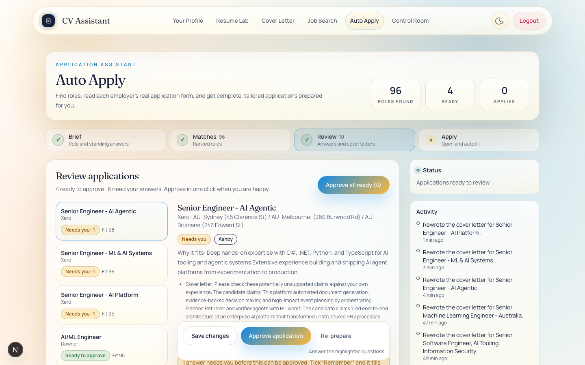
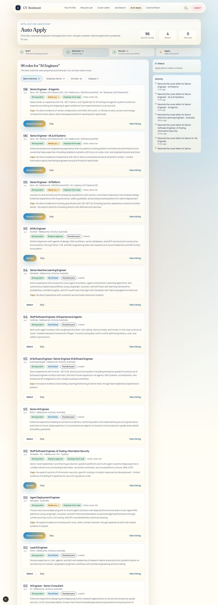
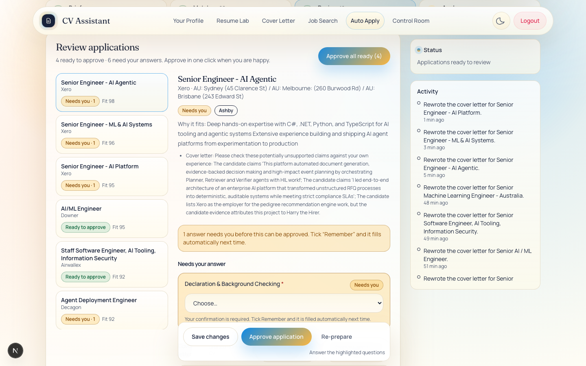
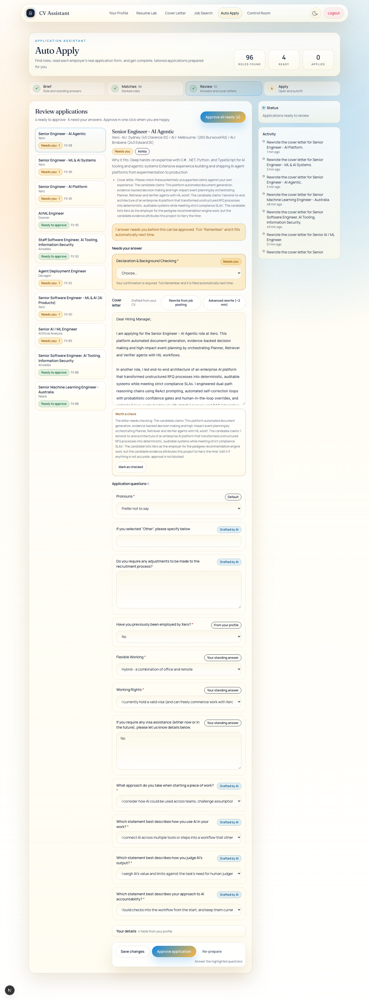
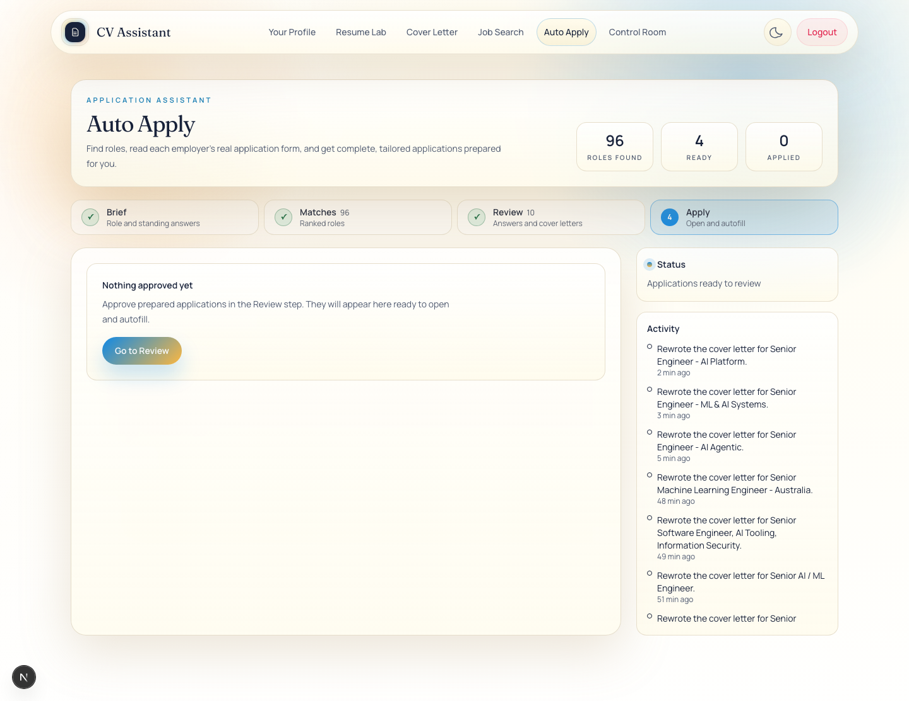
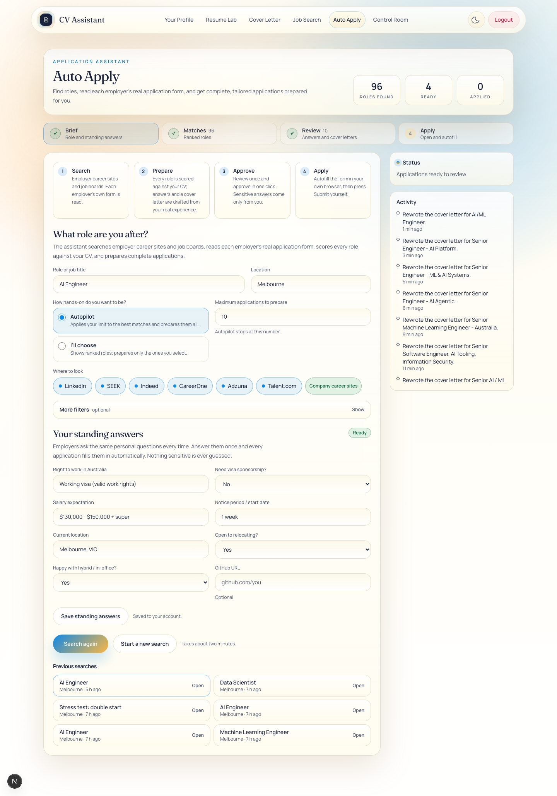
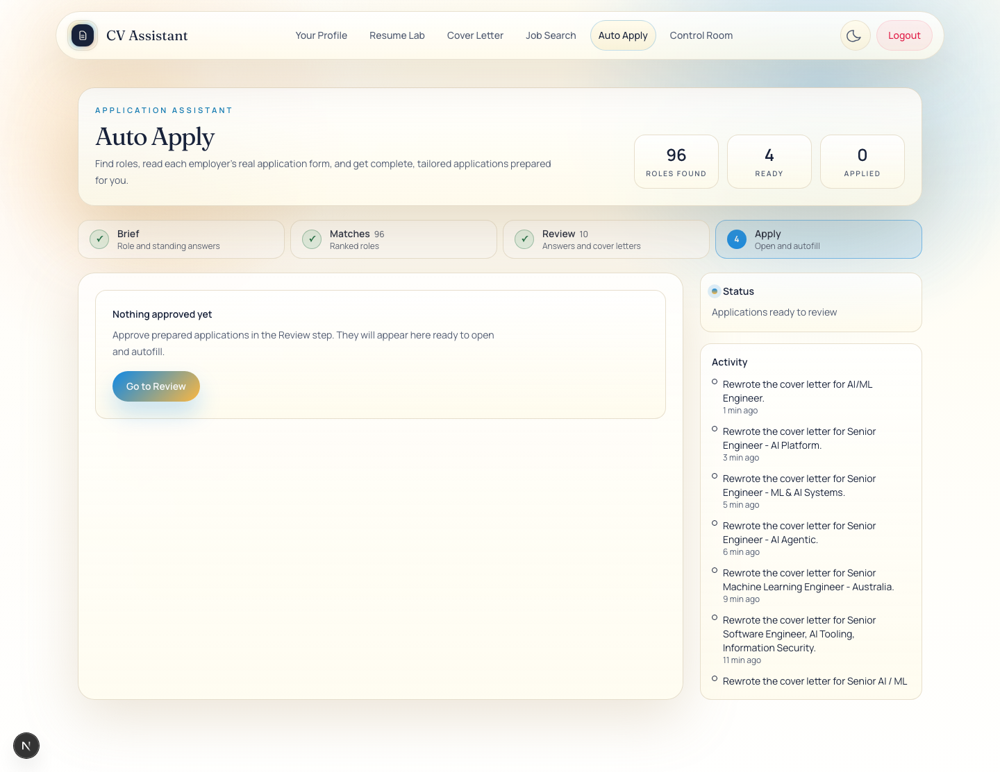

# Auto Apply

Auto Apply is the application assistant at `/auto-apply`. It finds roles, reads each employer's own application form, scores every role against the applicant's CV, drafts answers and a cover letter, and prepares an application pack. The applicant reviews and approves each application, autofills the employer's form in their own browser, and presses Submit on the employer's site.

This document covers the user interface and the HTTP API. The backend pipeline in `src/lib/auto-apply/` is documented separately. Paths are relative to `cv-assistant/`. Behaviour was checked against the source on 2026-11-07.

## Contents

1. [Purpose and safety principle](#1-purpose-and-safety-principle)
2. [User interface walkthrough](#2-user-interface-walkthrough)
3. [Session lifecycle and states](#3-session-lifecycle-and-states)
4. [Preferences and "Remember"](#4-preferences-and-remember)
5. [Profile draft](#5-profile-draft)
6. [Cover letters](#6-cover-letters)
7. [Application pack, autofill and the local browser](#7-application-pack-autofill-and-the-local-browser)
8. [Applied tracking](#8-applied-tracking)
9. [HTTP API reference](#9-http-api-reference)
10. [Local tools](#10-local-tools)
11. [Known limitations](#11-known-limitations)
12. [Source files](#12-source-files)

## 1. Purpose and safety principle

Auto Apply does the preparation work. The applicant does the applying.

The search covers employer career sites (the ATS providers listed in `src/lib/auto-apply/ats.ts`) and six job boards: LinkedIn, SEEK, Indeed, CareerOne, Adzuna and Talent.com. When the location is blank, the search uses Australia.

**Auto Apply never submits an application for the applicant.** The rule is enforced in these places:

- Apart from the local development browser (the last bullet), no route under `src/app/api/auto-apply/` sends an application to an employer. The apply-related routes read, prepare, approve or record data.
- The in-page filler `cvaAutofill` (`src/lib/auto-apply/autofill-script.ts`) fills fields, highlights what is left, and tells the applicant to review every field and press the site's Submit button. The script never calls `submit()` or `requestSubmit()`. Limitation 4 describes the one edge case in choice matching.
- `src/lib/auto-apply/submit-guard.ts` provides `isSubmitRequest`, a network rule that aborts non-GET requests whose path or body looks like an application submission, and `SUBMIT_GUARD_INIT_SCRIPT`, a capture-phase listener that cancels `submit` events. Both are used only by the local `agent:fill` script (`scripts/agent-fill.ts`).
- `POST /api/auto-apply/job/{jobId}/applied` records the applicant's own confirmation. The app cannot see the employer's confirmation page, so the UI labels the status "Applied (confirmed by you)".
- The local development browser exposes `POST /api/auto-apply/job/{jobId}/browser/action`, which can click any selector and has no submit guard. It works only when `AUTO_APPLY_DEV_BROWSER=true` outside production, and no screen calls it. Limitation 1 covers this.

After preparation, the applicant sees three statuses: "Ready to approve" (prepared), "Approved" and "Applied (confirmed by you)". Only the applicant can move an application to applied.

## 2. User interface walkthrough

### Screenshots


*The Auto Apply stepper and summary cards.*


*The Matches step with ranked roles.*


*The Review step: a role, its status and the questions that need an answer.*


*The full Review step, including the cover letter and application questions.*


*The Apply step.*


The route `/auto-apply` renders `src/app/auto-apply/page.tsx`, a client component. It uses the hook `useAutoApply` (`src/components/auto-apply/useAutoApply.ts`), which owns all state, polling and API calls through `autoApplyApi` (`src/components/auto-apply/api.ts`). Errors that escape the page render `src/app/auto-apply/error.tsx`. The entry is listed in the main navigation (`src/components/Navbar.tsx`).

### 2.1 Page layout

- **Header**: the kicker "Application assistant", the heading "Auto Apply", and the introduction "Find roles, read each employer's real application form, and get complete, tailored applications prepared for you."
- **Summary tiles**: "Roles found" (every role in the active search, including skipped ones), "Ready" (prepared plus approved) and "Applied".
- **Stepper** (section 2.2), then the **notice bar** (section 2.3).
- **Body**: the active step on the left and the **activity rail** (section 2.4) on the right. From the `xl` breakpoint the rail stays in view while the step scrolls. Below that breakpoint the rail stacks under the step.
- **Loading**: until the sessions and preferences have loaded, the page shows "Loading your workspace…" with a spinner (`aria-busy`).

On first load, the most recently updated search becomes the active search and the Brief is filled from it, unless the applicant has already typed in the form. The page then chooses a step, but only while the Brief is the current step:

1. Matches while a run is active.
2. Apply if any application is approved or applied.
3. Review if any application is prepared or needs input.
4. Matches if the search has any roles.
5. Otherwise Brief stays selected.

### 2.2 Stepper

The Stepper is a `nav` labelled "Application steps". Each step is a button with its number (replaced by a tick when done), its label, a hint on wider screens, and a count.

| Step | Hint | Count | Enabled when | Shows a tick when |
|---|---|---|---|---|
| 1 Brief | Role and standing answers | none | always | a search is active |
| 2 Matches | Ranked roles | every role in the search | roles exist, or a run is active | any role is prepared, needs input, approved or applied |
| 3 Review | Answers and cover letters | prepared plus needs input | any role is prepared, needs input, approved or applied | the same condition as Matches (limitation 12) |
| 4 Apply | Open and autofill | approved plus applied | the same condition as Review | at least one role is applied and no approved role is waiting |

- A disabled step shows the tooltip "Available once earlier steps are done". For Apply, the tooltip adds ": approve a role in Review first".
- The active step has `aria-current="step"`. The accessible name includes the count and "done" where they apply.
- Selecting an enabled step switches to it.

### 2.3 Notice bar

One message shows at a time. Errors use `role="alert"` and stay until the applicant selects **Dismiss**. Success and info messages use `role="status"` and disappear after five seconds. The full message list is in section 2.9.

### 2.4 Activity rail (`src/components/auto-apply/ActivityRail.tsx`)

The rail is an `aside` labelled "Activity" with two cards.

**Status card** (`role="status"`, `aria-live="polite"`):

- The heading is "Working", with a spinner, while the run phase is `searching`, `scoring` or `preparing`. Otherwise it is "Status".
- The message is the run's message, for example "Searching employer career sites and job boards". It shows "Idle" when a search is active and "Describe a role to begin." when none is.
- While a run is active and stats exist, chips show "N roles" (roles found), "N employer forms" (employer forms read), "N scored" (roles scored by the model) and "X/Y prepared" (roles prepared, needing input or failed, out of roles selected for preparation).
- **Stop** appears while a run is active. It asks the server to stop and shows "Stopping after the current step." Section 3.9 describes what stopping does.

**Activity card**: up to 40 events for the active search, newest first. Each row has a coloured dot, the event message and a relative time ("just now", "N min ago", "N h ago" or "N d ago"). The dot is green for `draft_ready`, `applied` and `approved`, amber for `needs_input`, red for `prepare_failed` and `run_failed`, and grey otherwise. The list scrolls and can be focused with the keyboard. With no events it reads "Search progress and application events appear here."

### 2.5 Step 1: Brief (`src/components/auto-apply/BriefStep.tsx`)

The Brief has these sections, in order.

1. **Profile warning.** Shown when the profile has neither a name nor any experience (`hasProfile` is false). It reads "Your profile is empty. Import your CV on the Profile page so applications can be tailored to you.", with a link to `/profile`. While it shows, the start buttons are disabled.
2. **How Auto Apply works.** Four cards: Search, Prepare, Approve and Apply.
3. **What role are you after?** The main search fields:
   - **Role or job title** (text, placeholder "e.g. AI Engineer") becomes the search prompt. The server accepts up to 4,000 characters.
   - **Location** (text, placeholder "e.g. Melbourne"). A blank location searches Australia.
   - **How hands-on do you want to be?** Two radio options:
     - **Autopilot** (`ai_coaching`): "Applies your limit to the best matches and prepares them all." The engine selects the best roles with a fit score of 62 or more, up to the application limit.
     - **I'll choose** (`manual_curate`): "Shows ranked roles; prepares only the ones you select." Nothing is prepared until the applicant selects roles in Matches.
   - **Maximum applications to prepare** (number, hint "Autopilot stops at this number."). The field clamps input to 1 to 50 as it is typed. A non-numeric entry becomes 1. The server accepts up to 100.
   - **Where to look**: six labelled checkboxes, LinkedIn, SEEK, Indeed, CareerOne, Adzuna and Talent.com, all on by default. A non-interactive chip, "Company career sites", shows that employer career sites are always searched. At least one checkbox must be on to start.
4. **More filters** (collapsed, marked optional):
   - **Seniority** (text, placeholder "e.g. Senior"). It is saved on the search but the pipeline does not read it (limitation 13).
   - **Workplace**: Any workplace (default), Remote, Hybrid or On-site. Passed to the search.
   - **Employment type**: Any type (default), Full-time, Part-time, Contract or Internship. Passed to the search.
   - **Must mention** (comma-separated, placeholder "python, llm"). Used by the ranking step.
   - **Exclude keywords** (comma-separated, hint "Roles containing these are skipped"). Used by the ranking step.
   - **Skip these companies** (comma-separated, placeholder "Acme, Globex"). Used by the ranking step.

   These fields are not disabled during a run. Their values are sent with the next start.
5. **Your standing answers** (section 4.1). Eight fields are shown: right to work, visa sponsorship, salary expectation, notice period or start date, current location, relocation, hybrid or in-office, and GitHub URL. A status chip reads "Recommended" or "Almost there" while work rights, salary or notice period is missing, and "Ready" when all three are filled. **Save standing answers** is enabled only with unsaved changes. The note beside it reads "Unsaved changes. Saving also fills them into applications that were waiting on you." or "Saved to your account."
6. **Action row**:
   - **Find & prepare applications** when there is no active search, or **Search again** when there is one. It shows "Starting…" while the request runs.
   - **Start a new search**, shown only with an active search. It creates a new search instead of reusing the active one.
   - Both are disabled while a run is active or starting, and while the profile is missing.
   - The hint reads "Your standing answers are saved when you start." when there are unsaved answers, and "Takes about two minutes." otherwise.

   Before starting, the page checks the inputs. A blank role shows "Describe the role you want first, for example “AI Engineer”." No selected source shows "Choose at least one source to search." Unsaved standing answers are saved first, and if that save fails the start stops.
7. **Previous searches** (shown when searches exist). The six most recent searches appear as buttons showing the prompt (or "Untitled search"), the location (or "Australia") and the time since the last update. Selecting one loads its settings and opens Matches.

### 2.6 Step 2: Matches (`src/components/auto-apply/MatchesStep.tsx`)

- **Heading**: "N roles for “<prompt>”". The subtext is "The best matches were prepared automatically. You can also select more." in Autopilot, and "Select the roles you want, then prepare them." in I'll choose.
- **Prepare N selected** appears when roles are selected but not yet prepared. It runs the search in prepare mode and shows "Preparing your selected roles." It is disabled while a run is active.
- **Filter tabs** (`role="tablist"`, labelled "Filter roles"), each with a count:
  - **Best matches** (default): not skipped and a fit score of 62 or more. The threshold is written into the component.
  - **Employer forms**: not skipped and the employer's own form was read.
  - **All roles**: every role, including skipped ones.
  - **Skipped**.
- **Role card**:
  - The fit score (0 to 100) with the label "Fit".
  - The title, then company and location. Blank values show "Company not listed" and "Location not listed".
  - A verdict chip: "Strong match", "Good match", "Stretch", "Weak match", or "Unscored" when only the heuristic scored the role.
  - A stage chip (section 3.6). A role that needs input also shows the number of unanswered questions.
  - A form chip: "Employer form read" (green, with the tooltip "The employer's own application form was read, so answers match it exactly.") or "Standard pack" (grey, "Prepared with the standard question set.").
  - The source: the career-site provider (for example "Greenhouse career site") or the job board.
  - Up to two fit reasons, up to three gaps labelled "Gaps:", and any last error in red.
  - Buttons:
    - **Answer & review** (needs input), **Review** (prepared), or **Open** (approved or applied). All three open the role in Review, except that approved and applied roles open in Apply.
    - **Select** (discovered, shortlisted, skipped or failed), shown as **Restore** for skipped roles. It queues the role for preparation with "Queued for preparation." It is the primary button in I'll choose mode and secondary in Autopilot.
    - **Retry** (failed). It prepares the role again and shows "Application prepared."
    - **Skip** (discovered, shortlisted, selected, needs input or prepared). It marks the role skipped.
    - **View listing**. It opens the posting in a new tab.
- **Empty states**:
  - While a run is active and there are no roles yet: "Finding your matches", with three placeholder cards (`aria-busy`).
  - No roles: "No roles yet", with **Set up a search**, which returns to the Brief.
  - An empty filter: "Nothing in this view", suggesting All roles.

### 2.7 Step 3: Review (`src/components/auto-apply/ReviewStep.tsx`)

Review lists roles with the statuses `needs_input`, `prepared`, `approved`, `applied` and `preparing`. A role that is being prepared shows the stage "Preparing".

- **Role list** (labelled "Applications"): title, company, stage chip (needs-input roles show the count) and fit score. The open role has `aria-current`. When Review opens with nothing selected, it opens the first role that needs input, otherwise the first prepared role, otherwise the first role.
- **Heading**: "Review applications". The subtext reads "N ready to approve" and, when relevant, " · M need your answers", followed by "Approve in one click when you are happy."
- **Approve all ready (N)** approves every prepared role in the search, shows "Approved N application(s).", and moves to Apply. It is disabled when no role is prepared. It does not show the server's skipped list (limitation 8).
- **Detail panel**:
  - A loading placeholder shows while a role loads.
  - With no role selected: "Select an application", with "Choose one from the list to review its answers and cover letter."
  - With a role that has no draft: "This role has not been prepared", with **Prepare application** ("Application prepared.").
  - Header: title, company and location; the stage chip; and the provider chip ("Employer site" when the provider is unknown). Below it, "Why it fits:" with up to two reasons, and up to three risk notes.
  - When answers are missing, an alert reads "N answer(s) need(s) you before this can be approved. Tick “Remember” and it fills automatically next time."
  - **Needs your answer**: required answers that are still empty.
  - **Cover letter**:
    - "Drafted from your CV" appears when the draft records a model.
    - **Rewrite from job posting** uses the standard agent. **Advanced rewrite (~2 min)** uses the advanced agent. Both are disabled while there are unsaved edits or a request is running. Section 6 describes them.
    - A 12-row text area labelled "Cover letter text". It is read-only once the role is approved or applied.
    - "The cover letter could not be generated. Use Re-prepare to try again." appears when the letter is empty.
    - **Worth a check** appears when the draft lists claims the CV does not support, with **Mark as checked**.
  - **Application questions**: the other non-contact questions, with a count. File fields are not shown; the pack marks them as attachments.
  - **Your details**: a collapsed section holding the contact fields from the profile ("N fields from your profile").
  - **Answer fields**: each shows the question (with a red asterisk when required), a status chip and a control.
    - Status chip: "Needs you" (unanswered), "Edited" (an unsaved change), or the source of the answer: "From your profile", "Your standing answer", "Remembered", "Drafted by AI", "You", "Attached" or "Default".
    - Control: a select listing the form's options (with "Choose…"), a text area, or a text box. A select stores the option's label.
    - Notes: the draft's note, and "Low confidence. Please check this answer." for an AI answer with confidence below 0.6.
    - **Remember this answer for future applications** appears under a non-contact field that has an unsaved, non-empty edit. Section 4.3 describes it.
  - **Footer**, sticky at the bottom of the panel:
    - For an editable role: **Save changes** (enabled with unsaved changes), **Approve application** (enabled only when nothing is unsaved, no answer is missing and the cover letter is not empty), and **Re-prepare** (regenerates the answers and letter). A status note reads "Unsaved changes", "Answer the highlighted questions" or "Everything is answered".
    - For an approved role: **Go to Apply** and **Withdraw approval**.
    - For an applied role: **Go to Apply**. The form is read-only.

Save sends only the changed answers and a changed cover letter. It shows "Saved." or, when a remembered answer was included, "Saved. Remembered answers were applied to your other applications." If the server refuses an approval, the notice shows the reason, for example "Some answers are still missing".

Empty state: "Nothing to review yet", with "Prepared applications appear here once a search completes." and **See matches**.

### 2.8 Step 4: Apply (`src/components/auto-apply/ApplyStep.tsx`)

Apply lists approved and applied roles. With none, it shows "Nothing approved yet" with **Go to Review**.

- **Heading**: "Apply". The subtext reads "X of Y applied. You press Submit on each employer's form, so every application is yours and employers see you, not a bot."
- **One-time setup**: the bookmarklet **Autofill with CV Assistant**, which the applicant drags to the bookmarks bar, or **Copy bookmarklet code**, which changes to "Copied. Make a bookmark and paste it as the address" after copying. The footer reads "Runs only in your own browser tab. It never presses Submit, solves CAPTCHAs, or sends your data anywhere." Section 7.2 gives the steps.
- **Each role**:
  - A status chip: "Applied (confirmed by you)" or "Approved", and the provider chip.
  - **Open form & copy pack** (**Open form again** for applied roles). It fetches the pack, copies the pack's JSON to the clipboard, and opens the apply URL. The pack travels in the URL fragment when the fragment is shorter than 24,000 characters; otherwise the bare URL opens. The hint then reads one of:
    - "Form opened and the pack is on your clipboard. Click the Autofill bookmark on that page."
    - "Form opened. Click the Autofill bookmark on that page." (when the clipboard write failed)
    - "Your browser blocked the new tab. Open <apply URL> yourself, then click the Autofill bookmark." (see limitation 5)
  - **Copy answers as text** copies the plain-text version of the pack and shows "Answers copied. Paste them into the form."
  - **I submitted it** asks "Did you press Submit on the employer's site?" with **Yes, mark applied** and **Not yet**. It is hidden for applied roles.
  - **Undo** (applied roles only) returns the role to Approved.
  - **View answers** opens the role in Review.

### 2.9 Messages reference

| Message | When it appears |
|---|---|
| Describe the role you want first, for example “AI Engineer”. | Start was pressed with no role |
| Choose at least one source to search. | Start was pressed with no source selected |
| Could not start the search. | The start request failed without a server message |
| Could not save your preferences. | Saving standing answers failed |
| Could not load your sessions. | The first load failed |
| Stopping after the current step. | A stop request was accepted |
| Run stopped. | The engine finished stopping (see limitation 6) |
| The run failed. | A run failed without a message |
| N applications prepared. | A run ended with prepared or needs-input applications |
| Found N roles. | A run ended with roles but none ready for review |
| Applied your standing answers to N application(s). | Saving standing answers filled applications that were waiting |
| Saved. / Saved. Remembered answers were applied to your other applications. | Save changes in Review |
| Approved. Open it from the Apply step. | Approve application |
| Approved N application(s). | Approve all ready |
| Approval withdrawn. | Withdraw approval |
| Application prepared. / Application re-prepared. | Prepare application, Retry, or Re-prepare |
| Queued for preparation. | Select on a role |
| Preparing your selected roles. | Prepare N selected |
| Cover letter rewritten from the job posting. Check the notes above for anything to verify. | Rewrite from job posting |
| Cover letter rewritten with the advanced agent. Check the notes above for anything to verify. | Advanced rewrite |
| Cover letter confirmed. | Mark as checked |
| Marked as applied. | Yes, mark applied |
| Answers copied. Paste them into the form. | Copy answers as text |
| No prepared application / Some answers are still missing / Changed since you reviewed it | Approval refused by the server (shown as the notice) |
| Network error. Check your connection and try again. | The request could not reach the server |
| Request failed (N). | The server returned an error with no message |
| That did not work. | An action failed with no message |
| Auto Apply hit a problem | An unexpected error reached the page (`src/app/auto-apply/error.tsx`). The reference code is shown when available |

### Screenshots from the verification run


*The Brief step on the test account, with the previous searches listed. The four step cards are the Search, Prepare, Approve and Apply stages.*


*The Apply step with no approved applications yet. It links back to Review.*


## 3. Session lifecycle and states

### 3.1 Records

| Collection (model file) | One per | Holds |
|---|---|---|
| `AutoApplySession` (`src/lib/models/AutoApplySession.ts`) | search | `mode`, `prompt`, `filters`, `status`, `run`, the ground-truth snapshot, `stoppedAt` |
| `AutoApplyJobCandidate` (`src/lib/models/AutoApplyJobCandidate.ts`) | role in a search (unique on session and `dedupeKey`) | Title, company, location, URLs, `fitScore`, reasons and gaps, `status` (the stage), `stageHistory`, `questions`, `approvedAt`, `appliedAt`, `lastError` |
| `AutoApplyApplicationDraft` (`src/lib/models/AutoApplyApplicationDraft.ts`) | role (unique on session and job) | `answers`, `coverLetterText`, `riskNotes`, `letterClaims`, `finalReviewStatus`, `payloadHash`, `approvedAt`, `submittedAt` |
| `AutoApplyEvent` (`src/lib/models/AutoApplyEvent.ts`) | event | `type`, `message`, `payload`; shown in the Activity rail |
| `AutoApplyMemory` (`src/lib/models/AutoApplyMemory.ts`) | remembered answer per user and question label | `answer`, `source`, `confidence`, `consentedAt` |
| `AutoApplyUploadedFile` (`src/lib/models/AutoApplyUploadedFile.ts`) | none (not used; limitation 28) | none |

Standing answers are stored on the user in `User.autoApplyPreferences` (`src/lib/models/User.ts`).

### 3.2 Creating and changing a search

- `POST /api/auto-apply/session` creates a search. It stores the mode, prompt and filters, with defaults for any filter that is missing. When the request names no ground-truth items and does not allow full resume context, it selects up to eight profile items to form the ground-truth snapshot. It logs `session_created`.
- `PATCH /api/auto-apply/session/{id}` changes the mode, prompt and filters. Filters are merged into the saved ones. A blank prompt is ignored. The server returns 409 while a run is active.
- The Brief's buttons map to these calls:
  - **Find & prepare applications** (no active search) creates a search and starts a run.
  - **Search again** patches the active search and starts a run.
  - **Start a new search** creates a new search and starts a run.
- A run starts with `POST /api/auto-apply/session/{id}/run`. The work continues in the background, and the page polls for progress.

### 3.3 Run phases (`session.run.phase`)

| Phase | Meaning | What the user sees |
|---|---|---|
| `searching` | Discovering roles on career sites and job boards. Set when a run is claimed. | "Working" in the rail; polling continues |
| `scoring` | Heuristic ranking, employer form reads and fit scoring. | As above |
| `preparing` | Drafting answers and cover letters for selected roles. | As above |
| `idle` | No run is active. The message says what happened, for example "Applications ready to review" or "Pick the roles you want, then prepare them". | Polling stops; a notice and a step change may follow |
| `cancelled` | A stop was requested. Set by the cancel endpoint before the engine acknowledges it. | Polling stops, because the phase is not running (limitation 6) |
| `failed` | The run stopped with an error. The message holds the error text, and the session status is `failed`. | Error notice with the message |
| empty | The search has never run. | Nothing |

The UI treats `searching`, `scoring` and `preparing` as running (`RUNNING_PHASES` in `src/components/auto-apply/types.ts`).

### 3.4 Session status (`session.status`)

The current code writes these values: `idle` (the default at creation), `searching`, `scoring`, `awaiting_selection` (after scoring, in "I'll choose" mode, which is `manual_curate`, so the applicant picks the roles), `preparing`, `review` (after preparation, after approvals and after stall recovery), `stopped` (after a stop completes) and `failed`.

The model enum also allows `ranking`, `applying`, `browser_active`, `awaiting_user_answer`, `ready_for_review`, `submitting`, `submitted`, `blocked` and `completed`. The current code never writes these. The schema `autoApplyStatusSchema` in `src/lib/auto-apply/types.ts` lists a different set and has no callers.

### 3.5 Derived phase in the API

`GET /api/auto-apply/session/{id}` also returns a `phase` computed by `deriveSessionPhase` (`src/lib/auto-apply/state.ts`). A run phase of `searching`, `scoring`, `preparing` or `failed` is returned as it is. Otherwise it is `setup` when there are no roles, `preparing` if any role is preparing, `review` if any role is prepared or needs input, `apply` if any role is approved, `done` if some roles are applied and no role is still selected, and `review` otherwise. The UI does not read this field; it uses `run.phase`.

### 3.6 Job stages (`job.status`)

| Stage | Label in the UI | Meaning |
|---|---|---|
| `discovered` | Found | Found by a search and not yet chosen |
| `shortlisted` | Shortlisted | Fit score of 62 or more after a run |
| `selected` | Queued | Chosen for preparation, by the applicant or by Autopilot |
| `preparing` | Preparing | Answers and letter are being drafted. The role is locked until the lock expires (section 3.8) |
| `needs_input` | Needs you (with the count) | The draft has required answers that are still empty |
| `prepared` | Ready to approve | The draft is complete and waiting for approval |
| `approved` | Approved | The applicant approved the exact draft. It is ready to autofill |
| `applied` | Applied | The applicant confirmed that they submitted it |
| `skipped` | Skipped | Not being pursued. It can be restored |
| `failed` | Failed | Preparation failed. `lastError` holds the reason and Retry is offered |

Moves allowed by `TRANSITIONS` in `src/lib/auto-apply/state.ts`:

| From | Allowed next stages |
|---|---|
| `discovered` | `shortlisted`, `selected`, `skipped`, `preparing` |
| `shortlisted` | `selected`, `skipped`, `discovered`, `preparing` |
| `selected` | `preparing`, `skipped`, `shortlisted`, `discovered` |
| `preparing` | `prepared`, `needs_input`, `failed`, `selected` |
| `needs_input` | `prepared`, `preparing`, `skipped` |
| `prepared` | `approved`, `needs_input`, `preparing`, `skipped` |
| `approved` | `applied`, `prepared`, `preparing` |
| `applied` | `approved` |
| `skipped` | `selected`, `shortlisted`, `discovered` |
| `failed` | `preparing`, `selected`, `skipped` |

- `PATCH /api/auto-apply/job/{jobId}` accepts `stage` values `selected`, `skipped`, `shortlisted` and `discovered`, and checks each move with `assertTransition`. An illegal move returns 409. A move to the stage a role is already in is always allowed.
- Preparation, approval and applied moves use their own endpoints.
- Legacy values are mapped when read by `normalizeStage`: `ready_for_review` becomes `prepared`, `submitted` becomes `applied`, and `manual_apply_recommended` becomes `discovered`. Any other unrecognised value also reads as `discovered`.

### 3.7 Draft review status (`draft.finalReviewStatus`)

- `needs_input`: at least one required answer is missing.
- `ready`: complete and not yet approved.
- `approved`: approved. `payloadHash` records the approved content.
- `applied`: confirmed as submitted. `submittedAt` is set.
- `not_ready` is the schema default. `confirmed`, `submitted` and `blocked` are never written.

### 3.8 Progress, heartbeat and stall detection

| Setting | Value | Where | Effect |
|---|---|---|---|
| Poll interval | 2.5 seconds | `useAutoApply.ts` | While a run phase is active, the search is refreshed |
| Notice dismissal | 5 seconds | `page.tsx` | Success and info notices clear themselves |
| Heartbeat | every 20 seconds | `startHeartbeat` in `engine.ts` | Updates `run.updatedAt` while a run is alive |
| Stall threshold | 150 seconds (`RUN_STALL_MS`) | `state.ts` | A running phase with no update for this long is treated as stalled |
| Stall recovery | when the search is read (`GET /session/{id}`) | `session/[id]/route.ts` | Sets the phase to `idle` and the status to `review`, with the message "The last run stopped early. Press Prepare to continue where it left off." Roles in `preparing` return to `selected` |
| Preparation lock | 4 minutes (`PREPARE_LOCK_MS`) | `state.ts` | A role stuck in `preparing` can be claimed again |
| Run budget | 270 seconds (`RUN_BUDGET_MS`) | `engine.ts` | No new roles are prepared after this. Employer form reads stop after 60% of the budget |
| Board search limit | 70 seconds (`BOARD_CRAWL_MS`) | `engine.ts` | Results found so far are kept |
| Roles scored in depth | top 28 (`SCORE_TOP_N`) | `engine.ts` | Only these get employer form reads and model scoring |
| Form reads | 6 at a time, 20 seconds each | `engine.ts` | Employer form reads for scored roles |
| Model scoring timeout | 90 seconds | `engine.ts` | Fit scoring for the scored roles |
| Preparation | 3 roles at a time, 200 seconds each | `engine.ts` | Answers and letters for selected roles |
| Shortlist and auto-select threshold | fit score of 62 or more (`SELECT_MIN_SCORE`) | `engine.ts` | Autopilot selects only roles at or above this |
| Verdict bands | strong 80 or more, good 65 or more, stretch 45 or more, otherwise poor | `verdictFor` in `src/lib/auto-apply/fit.ts` | The verdict chip in Matches |
| Heuristic cap | 58 | `engine.ts` | Roles without a model score are capped at 58 |
| Cover letter request | 250-second internal timeout; route limit 300 seconds | `job/[jobId]/cover-letter/route.ts` | Rewrites |
| Advanced letter budget | 150 seconds, then the standard letter | `src/lib/cover-letter-service.ts` | Advanced rewrites |

Autopilot's limit counts every role in the search that is selected, preparing, needing input, prepared, approved or applied. Once the count reaches the limit, further Autopilot runs in the same search select nothing new. Manual selection is not limited.

### 3.9 Starting, stopping, approving and withdrawing

- **Start.** `POST /api/auto-apply/session/{id}/run` claims the run. It returns 409 when another run is active and not stalled, and otherwise returns 202 at once. The pipeline then discovers, scores, selects (Autopilot only) and prepares in the background.
- **Stop.** `POST /api/auto-apply/session/{id}/cancel` sets the phase to `cancelled` and the message to "Stopping" straight away. The engine checks for a stop between stages and before each role. A role that is already being prepared finishes first. The session then becomes `stopped` with the message "Stopped", and the event "Run stopped." is logged.
- **Approve.** Only prepared roles can be approved. The server refuses any role with missing answers, and records the approval time and the payload hash. Roles that are not prepared are ignored without a reason (limitation 10).
- **Withdraw approval.** `POST /api/auto-apply/session/{id}/approve` with `undo: true` returns an approved role to `prepared`.
- **Editing after approval.** Review locks editing for approved and applied roles. The API does not. A change to an approved role's answers or letter moves it back to `prepared` or `needs_input` and clears `approvedAt`. Applied roles cannot be edited and return 409.
- **Re-prepare.** Refused for approved and applied roles (409, withdraw the approval first). Otherwise it replaces the draft (limitation 7).

## 4. Preferences and "Remember"

### 4.1 Standing answers

Standing answers belong to the account. They are read and written through `GET` and `PUT /api/auto-apply/preferences`, and the Brief's "Your standing answers" section edits them.

| Key | Label on screen | Accepted values | Used for |
|---|---|---|---|
| `workRights` | Right to work in Australia | text, up to 200 characters | Work-rights questions. For a yes-or-no question, the answer is "Yes" when the text reads as an unrestricted right to work (for example citizenship, permanent residence or a valid working visa) with no negation such as "not", "no", "requires" or "need" |
| `requiresSponsorship` | Need visa sponsorship? | blank, `yes`, `no` | Sponsorship questions |
| `salaryExpectation` | Salary expectation | text | Salary questions |
| `noticePeriod` | Notice period / start date | text | Notice and start-date questions |
| `currentLocation` | Current location | text | Location questions. Falls back to the most recent CV location |
| `willingToRelocate` | Open to relocating? | blank, `yes`, `no` | Relocation questions |
| `hybridOk` | Happy with hybrid / in-office? | blank, `yes`, `no` | Workplace questions. Full-time office questions always go to the applicant |
| `github` | GitHub URL (optional) | text | GitHub questions. `https://` is added to the answer when it is missing |
| `howHeard` | not shown in the UI | text | "How did you hear about us" questions. The default is "Company careers page" |
| `currentCompany` | not shown in the UI | text | Current employer questions. Falls back to the ongoing role in the CV |

A blank yes-or-no value means "Ask me each time" in the UI. The question then waits for the applicant.

Saving behaves as follows:

- `PUT` replaces all ten values. Keys that are left out are saved as empty.
- When the active search has applications that need input, saving also calls `POST /api/auto-apply/session/{id}/refresh-answers`. That call fills only deterministic answers, so no model is called. The notice reads "Applied your standing answers to N application(s)."
- Starting a search saves unsaved standing answers first.

### 4.2 Sensitive questions

Work rights, sponsorship, salary, notice, relocation, workplace, demographic, consent and relatives questions are never drafted by the model. When no standing or remembered answer applies, the answer is left empty and marked "Set this once in Application preferences and it fills automatically." (`prepare.ts`). A few categories have fixed defaults:

- Demographic questions default to a decline option when the form offers one, with the note "Voluntary disclosure defaulted to decline."
- Consent questions (declarations) are never filled by default. The applicant ticks them once, and "Remember" then fills them next time.
- Relatives questions default to "No", with a note to change it.
- How-did-you-hear questions default to "Company careers page", unless a standing answer is set.

### 4.3 Remember

To make an answer reusable:

1. In Review, change an answer to a non-empty value. The checkbox **Remember this answer for future applications** then appears under the field. It does not appear for contact fields (name, email, phone, LinkedIn, GitHub, website, location and current company).
2. Tick the checkbox and select **Save changes**.
3. The server stores one `AutoApplyMemory` record per question label, with scope `reusable_profile`, source `user`, confidence 1 and the consent time. Saving again for the same label overwrites the earlier answer.
4. The page then asks for the active search's waiting applications to be refreshed. The notice reads "Saved. Remembered answers were applied to your other applications." Limitation 17 explains the scope.

Later preparations load every reusable memory for the account (`loadUserContext`). A remembered answer is used when:

- its normalised question label matches exactly, or
- the question is in the same category and the labels overlap enough. The overlap threshold is 0.4 for sponsorship, work-rights and notice questions, and 0.8 for other categories.

Remembered answers appear with the source "Remembered". No screen or API route lists or deletes memories. To change a remembered answer, edit it in Review and tick Remember again.

### 4.4 Order of precedence

For most questions the order is: remembered answer, then standing answer, then the CV, then the model (for non-sensitive questions only). Contact fields such as name, email, phone, LinkedIn and website come from the CV. GitHub, current location and current company use the standing answer first. Limitation 16 covers the looseness of remembered-answer matching.

### 4.5 Session-level preferences

`AutoApplySession.preferences` is read and merged over the account preferences, but no code writes it. In practice only the account preferences apply (limitation 15).

## 5. Profile draft

`POST /api/auto-apply/profile-draft` proposes a search from the CV. The Brief does not call it, and no other screen in this codebase does. It is available to API clients only.

**Input.** A loose object with optional fields `prompt`, `location`, `workplaceMode`, `employmentType`, `seniority`, `salaryMin`, `salaryMax`, `workRights`, `mustHaveKeywords`, `excludeKeywords`, `companyBlacklist`, `applicationLimit`, `selectedSources`, `selectedGroundTruthIds` and `allowFullResumeContext`. These values are the baseline the draft starts from.

**Process.**

1. The route summarises the profile (name, education, skills, languages, projects and experiences). The first four experiences in the profile get priority, and the prompt treats them as the most recent.
2. Up to 20 selectable ground-truth items are passed to one "easy" model call (`generateJsonSafe` in `src/lib/ai.ts`), with instructions to use only the profile and to leave unknown fields empty.
3. The reply is validated against a fixed schema and cleaned. The prompt is limited to eight words, must-have and exclude keywords to four each, company blacklist to twelve, and the application limit to 1 to 100. Sources must be known search sources. Ground-truth IDs must match the list.
4. If the model fails or returns something unusable, the route returns a deterministic draft built from the submitted baseline, with the reasoning "Profile draft unavailable because the intake model did not return a usable result."

Nothing is saved. Each call normally makes one model request.

**Output.** `{ draft, groundTruthOptions }`:

- `draft` has `prompt`, `location`, `workplaceMode`, `employmentType`, `seniority`, `salaryMin`, `salaryMax`, `workRights`, `mustHaveKeywords`, `excludeKeywords`, `companyBlacklist`, `applicationLimit`, `selectedSources`, `selectedGroundTruthIds` and `reasoning`.
- `groundTruthOptions` lists every profile item that can be used as ground truth. Each item has `id`, `kind`, `title`, `summary` and `evidence`. The IDs are `experience:<id>`, `project:<id>`, `profile:skills`, `profile:name`, `profile:education` and `profile:languages` (`src/lib/auto-apply/ground-truth.ts`).

The selected ground-truth IDs feed the search's snapshot through `PATCH /api/auto-apply/session/{id}`. The snapshot is used by the ranking step.

## 6. Cover letters

Every application has a cover letter. Letters come from the shared cover-letter agent (`src/lib/cover-letter-service.ts`), which the Cover Letter studio also uses.

### 6.1 Standard and advanced

| Route | When it runs | Agent | Notes |
|---|---|---|---|
| Created by Prepare | Every time an application is prepared | Standard (`runCoverLetterAgent` with `advanced` off) | Runs alongside answer drafting. If the letter fails, the warning "Cover letter generation failed: …" is recorded in the risk notes |
| **Rewrite from job posting** | On demand, from Review | Standard | Re-reads the job posting and re-selects the strongest evidence. Tooltip: "Re-reads the job posting and re-picks your strongest proof, using the same cover letter agent as the Cover Letter studio." |
| **Advanced rewrite (~2 min)** | On demand, from Review | Advanced (`src/lib/cover-letter-advanced.ts`) | Plans requirement coverage, retrieves more evidence, writes, reviews and revises. It has a 150-second budget. If it fails or runs out of time, the standard agent writes the letter and the note "The advanced agent ran out of time, so the standard cover letter agent wrote this letter." is recorded |

The standard agent then applies deterministic checks. Claims and wording the CV does not support are removed where possible, and a model-based check adds a review warning when needed.

### 6.2 What a rewrite changes

`POST /api/auto-apply/job/{jobId}/cover-letter` (`advanced` optional):

- Replaces `coverLetterText` and the cover-letter answer.
- Records the model in `generatedBy`, the unsupported claims in `letterClaims`, and the review and fallback notes as risk notes that start with "Cover letter:".
- Clears `approvedAt`, recalculates the review status and the stage, and writes a `cover_letter_rewritten` event.
- Is refused with 409 when the role is applied, approved or preparing ("Withdraw the approval before rewriting the cover letter.").

The job description is read from the stored text. If that text is thinner than 1,500 characters, the server also reads the employer's ATS API (Greenhouse, Lever, Ashby and SmartRecruiters) and then the posting pages. Each posting page is fetched with a 12-second timeout (`src/lib/auto-apply/jd.ts`).

### 6.3 Checking a letter

- **Worth a check** appears when `letterClaims` lists claims the CV does not support. The note reads "The letter needs checking: … Edit it if anything is not accurate; approval is not blocked." Approval is not blocked.
- Saving an edited letter clears the flag, because the server treats the edit as a review. **Mark as checked** clears it without an edit.
- The Review text area accepts up to 8,000 characters at the API.

## 7. Application pack, autofill and the local browser

### 7.1 The pack

`GET /api/auto-apply/job/{jobId}/pack` returns `{ pack, text, applyUrl }` for approved and applied roles. It returns 409 for any other stage.

`pack` is an `AutofillPack` (`src/lib/auto-apply/pack.ts`):

- `kind`: always `"cva-autofill"`. `version`: `1`. `createdAt`: an ISO timestamp.
- `job`: `title`, `company`, `applyUrl` and `provider`.
- `fields`: one entry per question, with `fieldName`, `label`, `type`, `required`, `value` and `options` (the option labels). A cover-letter field carries the letter. A file field, such as a resume, carries a placeholder such as "Attached resume", and the filler does not fill it.
- `coverLetter`: the letter text.

`text` is a plain-text copy: the title and company, the apply URL, each non-file answer with a value, and the cover letter. It is used by **Copy answers as text**.

### 7.2 Using the bookmarklet

The bookmarklet is a `javascript:` link built by `buildBookmarklet()` in `src/lib/auto-apply/autofill-script.ts`. It runs only in the applicant's own tab.

1. **Install once.** Drag **Autofill with CV Assistant** to the bookmarks bar. Or select **Copy bookmarklet code** and create a bookmark whose address is that code.
2. **Open the form.** On an approved application, select **Open form & copy pack**. The pack is copied to the clipboard and the employer's form opens.
3. **Fill.** On the employer's page, click the bookmark. The script reads the pack from the URL fragment (`#cva=`). If the fragment is missing, it reads the clipboard. If neither source holds a pack, it asks the applicant to paste one.
4. **Review.** The script fills what it can match and marks it. Each control the script matched gets a green outline. The container of an answer that was not filled gets an amber outline. A panel in the lower right shows "Filled X of Y fields", the dropdowns to pick (listed with their values), the required questions needing an answer, a reminder to attach the resume (and the cover letter when the form has more than one file field), and the reminder "Review every field, complete any CAPTCHA, then press the site's Submit button yourself." **Copy cover letter** appears when there is a letter.
5. **Submit and confirm.** The applicant completes CAPTCHAs and uploads, presses the employer's Submit button, and returns to Auto Apply to select **I submitted it**, then **Yes, mark applied**.

The bookmarklet reports these errors in browser dialogs:

- "That is not a CV Assistant autofill pack. Open the form again from Auto Apply." (the data is not valid JSON)
- "That is not a CV Assistant autofill pack." (the JSON has a different `kind`)

The script makes no network requests. It reads the clipboard only when the fragment is missing.

If the encoded fragment is 24,000 characters or longer, the apply URL opens without the fragment, and the clipboard is the only source. The limit applies to the encoded fragment, not to the JSON.

### 7.3 Local development browser

The browser routes (`POST /api/auto-apply/job/{jobId}/browser/start` and `/browser/action`) run a Playwright Chromium window on the developer's machine.

- **Gate.** `isVisibleBrowserEnabled()` (`src/lib/auto-apply/browser-session.ts`) returns true only when `NODE_ENV` is not `production` and `AUTO_APPLY_DEV_BROWSER` is exactly `"true"`. Otherwise both routes return 404 "Not available." The job lookup happens first, so an unknown job returns "Job candidate not found." either way.
- **Window.** The window is visible by default in development. `AUTO_APPLY_BROWSER_HEADLESS=true` or `false` overrides this. Headless mode is the default only in production, where the feature is disabled.
- **Sessions.** Browser sessions live in memory, keyed by `userId:sessionId:jobId`. They cannot persist across serverless invocations.
- **Start.** The start route opens the apply URL with a 30-second navigation timeout and detects blockers from the page text. It returns a base64 PNG screenshot and guidance. Guidance comes from the supervisor model (`getAutoApplySupervisorModel` in `src/lib/ai.ts`) with a 60-second timeout, or from fixed text on job platforms.
- **Blockers** (`detectAutomationBlockers` in `src/lib/auto-apply/browser.ts`): `captcha`, `platform_login_required` (a login on LinkedIn, SEEK, Indeed, CareerOne, Adzuna or Talent.com), `employer_login_required`, `automation_blocked` and `paywall`. When a role's stored risk flags include `restricted_source_manual_guidance`, the start route adds that value to the returned `blockers` and prefixes the guidance with a restricted-source note. The current engine never stores the flag (limitation 31).
- **Actions.** `click`, `type`, `select`, `screenshot`, `read_dom`, `scroll`, `save_site_login` and `stop` (`allowedActions` in the route). `save_site_login` writes the saved site session (section 7.4). `stop` closes the window.

The Brief and Review screens do not call these routes. Limitation 1 explains that the action route has no submit guard.

### 7.4 Saved site logins

`save_site_login` saves the browser's storage state, meaning cookies and local storage, for the site under `.codex-data/auto-apply/site-auth/<userId>/`:

- `<site>.storage.json` holds the storage state as plain JSON.
- `<site>.json` holds the record. Credentials (a username and password) are stored only when `rememberCredentials` is true, encrypted with AES-256-GCM. The key is derived with SHA-256 from `AUTO_APPLY_SITE_AUTH_SECRET`, then `JWT_SECRET`, then the fixed string `cv-assistant-site-auth`.

The `.codex-data/` folder is git-ignored (`.gitignore`, line 47). Limitation 2 covers the protection gap.

## 8. Applied tracking

- **I submitted it** opens the confirmation group. **Yes, mark applied** calls `POST /api/auto-apply/job/{jobId}/applied` with `{ "confirm": true }`.
- The server requires the role to be approved. It sets the role to `applied` with `appliedAt`, sets the draft's `finalReviewStatus` to `applied` with `submittedAt`, and logs an event: "Marked applied: <title> at <company>." Marking an applied role again returns `{ stage: "applied", already: true }`.
- The status reads "Applied (confirmed by you)". The app cannot see the employer's confirmation, so the status is the applicant's own record.
- **Undo** calls the same endpoint with `{ "undo": true }`. It returns the role to `approved`, clears `appliedAt`, and returns 409 unless the role is applied. The draft's `finalReviewStatus` is not changed (limitation 9).
- The header's "Applied" tile counts applied roles. The Apply step's summary line reads "X of Y applied." The Apply step ticks when at least one role is applied and none is still approved.

## 9. HTTP API reference

### 9.1 Conventions

- **Base path.** `/api/auto-apply`. The client builds URLs with `buildApiUrl` (`src/lib/api.ts`), which adds `NEXT_PUBLIC_BASE_PATH` when it is set.
- **Auth.** Every route reads the `auth_token` cookie through `requireAutoApplyAuth` (`src/lib/auto-apply/routes.ts`). A request without a valid token receives `401` with `{ "error": "Unauthorized" }`.
- **Ownership.** Every lookup is scoped to the signed-in user. An unknown, malformed or other user's ID returns `404`. The API never returns `403` for these.
- **IDs.** Session and job IDs are MongoDB ObjectIds. A malformed ID returns `404`.
- **Errors.** Error bodies are `{ "error": "<message>" }`. Validation errors return the first message from the schema. An exception that a route does not catch returns HTTP 500 with Next.js's default error response.
- **Bodies.** Unparseable JSON is read as an empty object by the applied, run, cover-letter, profile-draft and browser action routes. The session create and update, job PATCH and preferences routes read it as `null`, so they return 400 with a validation message. `POST /approve` returns 400 `Send a JSON body.`
- **Runtime.** Every route uses the Node.js runtime and `dynamic = "force-dynamic"`.
- **Duration.** `maxDuration` is 300 seconds for the run, prepare and cover-letter routes. The other routes use the platform default.
- **Size.** `GET /api/auto-apply/session/{id}` returns every role in the search without pagination.

### 9.2 Endpoints

The table lists the 20 method and path pairs. Every route uses the `auth_token` cookie.

**Searches (session)**

| Method | Path | Request body | Success | Errors (status and message) | maxDuration |
|---|---|---|---|---|---|
| GET | `/api/auto-apply/session` | none | 200 `{ sessions }`: up to 20, most recently updated first, full documents | 401 | default |
| POST | `/api/auto-apply/session` | `{ mode?, prompt, filters?, selectedGroundTruthIds?, allowFullResumeContext? }`. `prompt` is 1 to 4,000 characters | 200 `{ session }`, a full document | 400 with the first validation message (for example `Prompt is required.`); 401 | default |
| GET | `/api/auto-apply/session/{id}` | none | 200 `{ session, jobs, counts, phase, events }`. Stalled runs are recovered here | 401; 404 `Session not found.` | default |
| PATCH | `/api/auto-apply/session/{id}` | `{ mode?, prompt?, filters? (partial), selectedGroundTruthIds?, allowFullResumeContext? }` | 200 `{ session }`, a full document | 400 `Invalid session update.` or a validation message; 401; 404; 409 `Wait for the current run to finish before changing settings.` | default |
| POST | `/api/auto-apply/session/{id}/run` | optional `{ mode?: "prepare" }` | 202 `{ started: true }` | 400 `Select at least one role first.` (prepare mode with no selected roles); 401; 404; 409 `A run is already in progress for this session.` | 300 seconds |
| POST | `/api/auto-apply/session/{id}/cancel` | none | 200 `{ cancelled: true }` | 401; 404 | default |
| GET | `/api/auto-apply/session/{id}/events` | none | 200 `{ events }`: the last 100, oldest first | 401; 404 | default |
| POST | `/api/auto-apply/session/{id}/approve` | `{ jobIds?: string[], all?: boolean, undo?: boolean, reviewedHashes?: object }`. Requires `jobIds` or `all: true` | 200 `{ approved: string[], skipped: [{ id, reason }] }` | 400 `Send a JSON body.`, `jobIds must be an array of job ids.` or `List jobIds or pass all: true.`; 401; 404 | default |
| POST | `/api/auto-apply/session/{id}/refresh-answers` | none | 200 `{ updated }` | 401; 404 | default |

**Roles (job)**

| Method | Path | Request body | Success | Errors (status and message) | maxDuration |
|---|---|---|---|---|---|
| GET | `/api/auto-apply/job/{jobId}` | none | 200 `{ job, draft }`. `draft` is `null` until the role is prepared | 401; 404 `Application not found.` | default |
| PATCH | `/api/auto-apply/job/{jobId}` | `{ stage?, coverLetterText? (up to 8,000 characters), confirmCoverLetter?, answers? ([{ questionId, value (up to 4,000 characters), remember? }], up to 80) }` | 200 `{ ok: true }` | 400 `Invalid update.` or a validation message; 401; 404; 409 `Cannot move an application from X to Y.` (illegal stage), `This application can no longer be edited.` (applied or preparing) or `Prepare this application before editing it.` | default |
| POST | `/api/auto-apply/job/{jobId}/prepare` | none | 200 `{ outcome }`: `prepared` or `needs_input` | 401; 404; 409 `This application is already approved. Unapprove it before re-preparing.` (approved or applied) or `This application is already being prepared.`; 502 `{ error: "Preparation failed. Try again in a moment.", outcome: "failed" }` | 300 seconds |
| POST | `/api/auto-apply/job/{jobId}/cover-letter` | `{ advanced?: boolean }` | 200 `{ coverLetter, mode, reviewWarning?, fallbackNote?, jdSource }` | 401; 404; 409 `Withdraw the approval before rewriting the cover letter.` or `Prepare this application first.`; 502 `The cover letter agent returned nothing. Try again.` or `Cover letter generation is temporarily unavailable. Try again in a moment.` | 300 seconds |
| GET | `/api/auto-apply/job/{jobId}/pack` | none | 200 `{ pack, text, applyUrl }` | 401; 404 `Application not found.` or `No prepared application.`; 409 `Approve this application before opening it.` | default |
| POST | `/api/auto-apply/job/{jobId}/applied` | `{ confirm: true }` or `{ undo: true }` | 200 `{ stage: "applied" }` (or `{ stage: "applied", already: true }`); undo returns `{ stage: "approved" }` | 400 `Confirm that you submitted this application.`; 401; 404; 409 `Approve this application before marking it applied.` or `This application is not marked as applied.` | default |
| POST | `/api/auto-apply/job/{jobId}/browser/start` | none | 200 `{ mode, reason, guidance, blockers, screenshotBase64 }` | 401; 404 `Job candidate not found.`; 404 `Not available.` when the local browser is disabled | default |
| POST | `/api/auto-apply/job/{jobId}/browser/action` | `{ type, selector?, value?, direction?, url?, credentials?, rememberCredentials? }`. `type` is one of the eight listed in section 7.3 | 200 `{ mode, reason, blockers, domText?, screenshotBase64, savedSiteAuth? }` | 400 `Unsupported browser action.`; 401; 404 `Job candidate not found.` or `Not available.`; 500 for unhandled errors, such as a missing selector or no active browser session | default |

**Preferences and profile**

| Method | Path | Request body | Success | Errors (status and message) | maxDuration |
|---|---|---|---|---|---|
| GET | `/api/auto-apply/preferences` | none | 200 `{ preferences, hasProfile, profileName }` | 401 | default |
| PUT | `/api/auto-apply/preferences` | the ten preference keys in section 4.1. Keys left out are saved as empty | 200 `{ preferences }` | 400 with a validation message or `Invalid preferences.`; 401 | default |
| POST | `/api/auto-apply/profile-draft` | a loose brief object (section 5) | 200 `{ draft, groundTruthOptions }`. Nothing is saved | 401; 500 for some invalid submitted values (limitation 26) | default |

### 9.3 Endpoint notes

**Searches**

- `POST /session` fills defaults: location blank, workplace and employment type `any`, application limit 10, all sources, and `maxResultsPerSource` 25 (allowed: 25, 50 or 100). It returns the full document, including `sessionGroundTruthSnapshot`.
- `GET /session` returns full documents, including `sessionGroundTruthSnapshot`. Only `GET /session/{id}` removes it (limitation 22).
- `GET /session/{id}`:
  - Jobs exclude `descriptionText`, `questions`, `stageHistory` and `resolutionNotes`, and are sorted by fit score, highest first.
  - Each job adds `missingAnswers`, `answerCount` and `hasCoverLetter`.
  - `events` holds the last 40 events, oldest first.
  - When the run is stalled, the route recovers it as described in section 3.8.
- `PATCH /session/{id}`: `prompt` is trimmed, and a blank prompt is ignored. `filters` are merged into the saved filters. Sending `selectedGroundTruthIds` or `allowFullResumeContext` rebuilds the ground-truth snapshot. When `selectedGroundTruthIds` is an empty list, the route uses the suggested selection. The response includes `sessionGroundTruthSnapshot`.
- `POST /session/{id}/run`:
  - Claims the run. A claim fails when a run is active and not stalled (409).
  - Without `mode`, it runs the full pipeline: discovery, scoring, selection (Autopilot only) and preparation.
  - With `mode: "prepare"`, it prepares the roles that are already selected and does no discovery. If none are selected, it returns 400 and resets the run to `idle`.
  - Work continues after the response, through Next.js `after()`, with a heartbeat.
- `POST /session/{id}/cancel` returns `cancelled: true` even when no run is active. It sets the phase to `cancelled`.
- `POST /session/{id}/approve`:
  - Approves roles in `prepared` only, and withdraws approval for roles in `approved` when `undo` is true. Roles in other stages are not reported (limitation 10).
  - Refusals appear in `skipped` with one of these reasons: "No prepared application", "Some answers are still missing" or "Changed since you reviewed it".
  - `reviewedHashes` maps a role ID to the payload hash the applicant reviewed. A mismatch refuses that role. The UI never sends it (limitation 23).
  - The server does not require a cover letter (limitation 24).
  - Sets the session status to `review` after any approval or withdrawal.
- `POST /session/{id}/refresh-answers` fills only deterministic answers in the search's roles with status `needs_input` or `prepared`. It returns the number of roles updated.

**Roles**

- `GET /job/{jobId}` returns the role without `questions`. It includes `descriptionText`, `stageHistory` and `resolutionNotes`. The `draft` has defaults for missing answer fields, and `letterClaims` defaults to an empty list.
- `PATCH /job/{jobId}`:
  - Applies `stage` first. The transition check runs before any other change, so a refused move leaves the answers unchanged. An accepted stage is saved before the answer checks, so a request that changes both can keep the stage change and still return 409 (limitation 30).
  - An answer edit, or a cover-letter edit or confirmation, recalculates the review status and the stage. It moves an approved role back to `prepared` or `needs_input`, and clears `approvedAt`.
  - `remember: true` upserts the answer into `AutoApplyMemory` by question label.
  - Editing a cover letter, or sending `confirmCoverLetter`, clears `letterClaims`.
  - Logs `answers_edited` for answer changes.
- `POST /job/{jobId}/prepare` refuses approved and applied roles. Otherwise it rebuilds the draft from the current profile, preferences and memories, and replaces any earlier answers and letter (limitation 7). The result is `prepared` or `needs_input`. A failure sets the role to `failed` and returns 502 with `outcome: "failed"`.
- `POST /job/{jobId}/cover-letter` is refused for applied, approved and preparing roles (409). It needs an existing draft. It returns `reviewWarning` and `fallbackNote` when the agent sets them. The `jdSource` field (`provided`, `ats_api`, `listing_page`, `page_text` or `none`) describes where the job description came from.
- `GET /job/{jobId}/pack` builds the pack from the current draft (section 7.1).
- `POST /job/{jobId}/applied` follows section 8. It is the only route that sets `applied`.
- `POST /job/{jobId}/browser/start` and `/browser/action` are local development routes (section 7.3). In the browser action route, `direction` is typed as `up` or `down` but not validated.

**Preferences and profile**

- `GET /preferences` returns the saved preferences merged with empty defaults. `hasProfile` is true when the profile has a name or an experience (limitation 18).
- `PUT /preferences` validates each value: strings are trimmed and limited to 200 characters, and the three yes-or-no fields accept only `""`, `yes` and `no`. Any key that is left out is stored as empty.
- `POST /profile-draft` has no required fields. It does not reject unknown values up front, which can cause an HTTP 500 (limitation 26).

## 10. Local tools

Three scripts in `scripts/` run through npm. Each script uses `node -r tsconfig-paths/register -r sucrase/register/ts`.

### 10.1 `npm run agent:fill`

`scripts/agent-fill.ts` opens an employer's form in a Playwright browser, fills it from a pack, and attaches a resume if one is given.

```bash
npm run agent:fill -- --pack <pack.json> [--resume <cv file>] [--headless] [--engine chromium|firefox|webkit] [--screenshot <file.png>]
```

- **Pack file.** The file must hold the JSON pack. Save the JSON that **Open form & copy pack** places on the clipboard, or take the `pack` property from `GET /api/auto-apply/job/{jobId}/pack`. The script's header suggests "Copy answers as text", but that copies plain text, which the script cannot parse (limitation 27 covers the documentation mismatch).
- **Browsers.** Chromium uses the installed Google Chrome (`channel: "chrome"`). Firefox and WebKit need `npx playwright install firefox webkit`.
- **Steps.** The script opens `job.applyUrl` (network idle, 60-second timeout) and runs the in-page filler. It then fills dropdowns that remain partial or missing with real keyboard and mouse input. With `--resume`, it attaches the file to the first file input and checks the result. It writes a summary into the on-page panel.
- **Safety.** Non-GET requests that match the submit rules are aborted, and submit events are cancelled. The script prints "Blocked N submission request(s). Nothing was submitted." It does not click submit or apply buttons itself.
- **Window.** Without `--headless`, the window stays open until the applicant closes it. The applicant reviews the fields and presses Submit. With `--headless`, the script saves a screenshot (default `agent-fill.png`) and closes the browser.

### 10.2 `npm run test:autofill-live`

`scripts/autofill-live.ts` checks the in-page filler against three live public forms, one each on Greenhouse, Ashby and Lever. It runs them in Chromium (installed Google Chrome), Firefox and WebKit. The applicant data is fixed test data. The script fails when a field is left unfilled, or when a submit event fires (it observes submit events and does not block them). Output shows, per form, the number filled and each field's status. Results depend on the live pages, so the test can fail when a form changes.

Requirements: network access, Google Chrome, and `npx playwright install firefox webkit`.

### 10.3 `npm run test:autofill-safari`

`scripts/autofill-safari.ts` runs the in-page filler in Safari through `safaridriver` on port 4723, against one live Greenhouse form. It fails when not every field is filled. It does not check for submit events; the filler itself never submits.

Requirements: macOS with Safari, and Safari's **Allow remote automation** ticked in Safari > Settings > Developer (or, if the Developer tab is missing, enable Safari > Settings > Advanced > "Show features for web developers" first).

## 11. Known limitations

These items were confirmed by reading the source on 2026-11-07. Items marked "not run" have not been exercised in a browser or against a live server.

### Safety and privacy

1. **The local browser routes have no submit guard.** `runVisibleBrowserAction` (`src/lib/auto-apply/browser-session.ts`) clicks any selector it is given, and it does not install `SUBMIT_GUARD_INIT_SCRIPT` or a request filter. The guard exists only in `scripts/agent-fill.ts`. The routes are disabled in production and no screen calls them, but a signed-in user calling the API locally could click Submit. Keep `AUTO_APPLY_DEV_BROWSER` unset outside local development.
2. **Saved site sessions are weakly protected.** Cookies and local storage are stored as plain JSON under `.codex-data/auto-apply/site-auth/`. Saved credentials are encrypted, but with a key derived from `AUTO_APPLY_SITE_AUTH_SECRET`, then `JWT_SECRET`, then the fixed string `cv-assistant-site-auth` (`src/lib/auto-apply/site-auth.ts`). Set `AUTO_APPLY_SITE_AUTH_SECRET` wherever this feature is used.
3. **Packs are visible outside the app.** The fragment is not sent in HTTP requests, but scripts on the employer's page can read `location.hash`, and browser history keeps the full URL. **Open form & copy pack** also copies the full JSON to the clipboard. Clear the clipboard after use.
4. **The filler can click a button in a question's container.** `clickChoice` in `src/lib/auto-apply/autofill-script.ts` matches answers against `button` elements as well as inputs, and does not exclude submit buttons. The rule "never clicks submit" is therefore a design intent, not a hard guarantee. The likelihood is low.

### Behaviour that may surprise users

5. **The "blocked" message is likely to show even when the form opened (not run).** `ApplyStep.tsx` treats the return value of `window.open(url, "_blank", "noopener")` as success. With `noopener`, browsers return `null`, so the hint "Your browser blocked the new tab…" is likely to appear whenever the form opened.
6. **Stop can leave the status at "Stopping" (not run).** The cancel endpoint sets `run.phase` to `cancelled` with the message "Stopping". `useAutoApply.ts` stops polling once the phase is not running, and the engine writes `stopped` only later. The rail can therefore stay at "Stopping", and "Run stopped." may not appear, until the page reloads or an action refreshes the search. A success notice for the earlier phase may appear instead.
7. **Re-prepare replaces edits.** `prepareJobById` (`src/lib/auto-apply/engine.ts`) writes freshly generated `answers` and `coverLetterText` into the draft. Edits saved in Review are lost, and the **Re-prepare** button asks for no confirmation.
8. **Approve all ready can overstate.** `ReviewStep.tsx` ignores the `skipped` list returned by the approve endpoint, and shows the number of roles it sent.
9. **Undo leaves the draft marked as applied.** `job/[jobId]/applied/route.ts` returns the role to `approved` but does not reset the draft's `finalReviewStatus`, which stays `applied`.
10. **Approve ignores roles that are not prepared.** `session/[id]/approve/route.ts` filters by status before it checks anything. A role in `needs_input`, or in any other status, listed in `jobIds` is neither approved nor reported in `skipped`.
11. **A role being prepared can show "not prepared" (not run).** Review lists roles in `preparing`. A role being prepared for the first time has no draft, so Review shows "This role has not been prepared" with a **Prepare application** button. Pressing it returns 409 "This application is already being prepared."
12. **Stepper ticks appear early.** Matches and Review use the same condition, so both show a tick as soon as any role is ready. The tick means that reviewable items exist, not that the applicant has reviewed them.
13. **Some brief filters have no effect.** The search and ranking read the location, workplace, employment type, sources, the keyword lists, the company blacklist and the application limit. Seniority, salary minimum and maximum, and the work-rights filter are stored on the search, but no code reads them. The standing work-rights answer under Application preferences is separate and is used for application questions. The Brief still offers Seniority.
14. **Changing the role does not refresh the ground-truth snapshot.** The snapshot is built when the search is created. `PATCH /session/{id}` rebuilds it only when the body includes `selectedGroundTruthIds` or `allowFullResumeContext`, and the UI never sends either. Searching again with a new role keeps the original selection.
15. **Session-level preferences are never written.** `AutoApplySession.preferences` is read and merged over the account preferences, but no code writes it.
16. **Remembered answers can be reused loosely.** `findMemoryAnswer` (`src/lib/auto-apply/questions.ts`) accepts similar labels in the same category, with a 0.8 threshold for most categories. The default branch of `answerDeterministically` also reuses a remembered answer for categories that have no rule of their own, such as motivation questions. A long answer written for one employer can therefore be reused for another. Check remembered answers in Review before approving.
17. **Refresh is limited to the active search.** `refreshStandingAnswers` works on one search at a time. The message "Remembered answers were applied to your other applications." is broader than that, because other searches are not updated.
18. **The start check and the engine's profile check disagree.** `GET /preferences` sets `hasProfile` only when the profile has a name or an experience. The engine's `hasUsableProfile` (`src/lib/auto-apply/candidate.ts`) also accepts skills. A profile with only skills therefore cannot start a search from the UI, although the engine would accept it.
19. **The fallback note is too broad.** `src/lib/cover-letter-service.ts` tells the applicant the advanced agent "ran out of time" for any error, not only for timeouts.
20. **More filters can be edited during a run.** Fields under **More filters** are not disabled while a run is active. Their values are sent with the next start.
21. **Stage edits skip the transition check.** Answer edits and cover-letter rewrites set the stage to `prepared` or `needs_input` directly, without `assertTransition`. A skipped or failed role that still has a draft can therefore move without a transition check.

### API consistency

22. **Session responses differ.** `GET /session/{id}` removes `sessionGroundTruthSnapshot`. `GET /session`, `POST /session` and `PATCH /session/{id}` return the Mongoose document with the field included. `GET /session` returns up to 20 full documents.
23. **`reviewedHashes` is API-only.** The approve endpoint accepts `reviewedHashes`, which would stop a role being approved after it changed. The UI never sends it.
24. **The server does not require a cover letter.** The UI does not allow an empty letter to be approved. The approve endpoint checks only missing answers and the payload hash.
25. **Browser action errors return 500.** `job/[jobId]/browser/action/route.ts` does not catch errors from `runVisibleBrowserAction`. A missing selector or no active browser session therefore returns HTTP 500 with Next.js's default error response (not run).
26. **Invalid profile-draft values can fail with 500.** On the fallback path, `distillAutoApplyProfileDraft` (`src/lib/auto-apply/profile-draft.ts`) runs in the `catch` block and passes the submitted `workplaceMode`, `employmentType` and `selectedSources` into `profileDraftSchema.parse`. An unknown value there throws, nothing catches it, and the route is likely to return HTTP 500 (not run).
27. **Documentation mismatches.** The `agent:fill` header says to use "Copy answers as text", which produces plain text, not the JSON pack the script reads. The Brief limits applications to 50, but the API accepts 1 to 100 (`autoApplyFiltersSchema`).
28. **Unused code.** `AutoApplyUploadedFile` has no route or reader, so the app has no resume upload path. `saveAnswerSchema`, `answerQuestionSchema` and `submitApplicationSchema` in `src/lib/auto-apply/types.ts`, and `autoApplyStatusSchema`, have no callers. `GET /session/{id}/events` is not used by the UI, which receives the last 40 events with the search. The draft values `confirmed`, `submitted` and `blocked` are never written.
29. **The stalled-run message names a missing button.** The recovery message says "Press Prepare to continue", but the buttons read "Prepare N selected" in Matches and "Prepare application" in Review.
30. **A combined PATCH can change the stage and then fail.** `PATCH /job/{jobId}` saves `stage` before it checks the answers or the cover letter. If the answer part is then refused (for example, "Prepare this application before editing it." for a role with no draft, or "This application can no longer be edited." for a role that is preparing, which the transition table allows to move to `selected`), the stage change is kept. The UI's stage changes (`setStage`) send only the stage, so this affects API clients only.

### Data

31. **Restricted-source flags never reach storage.** `src/lib/auto-apply/ranking.ts` marks LinkedIn and Indeed roles with `restricted_source_manual_guidance`, but `engine.ts` (line 295) removes every risk flag that starts with `restricted` before it saves a role. The browser start route therefore never sees the flag on a stored role, so its restricted-source guidance and blocker never appear (section 7.3).

## 12. Source files

Paths are relative to `cv-assistant/`.

- **Page and error boundary**: `src/app/auto-apply/page.tsx`, `src/app/auto-apply/error.tsx`, `src/components/Navbar.tsx` (navigation entry).
- **Components**: `src/components/auto-apply/useAutoApply.ts` (state, polling, step logic), `api.ts` (client calls), `types.ts` (client types and `RUNNING_PHASES`), `ui.tsx` (shared controls and stage labels), `Stepper.tsx`, `ActivityRail.tsx`, `BriefStep.tsx`, `MatchesStep.tsx`, `ReviewStep.tsx`, `ApplyStep.tsx`.
- **API routes**: `src/app/api/auto-apply/session/route.ts`, `session/[id]/route.ts`, `session/[id]/run/route.ts`, `session/[id]/cancel/route.ts`, `session/[id]/events/route.ts`, `session/[id]/approve/route.ts`, `session/[id]/refresh-answers/route.ts`, `job/[jobId]/route.ts`, `job/[jobId]/prepare/route.ts`, `job/[jobId]/cover-letter/route.ts`, `job/[jobId]/pack/route.ts`, `job/[jobId]/applied/route.ts`, `job/[jobId]/browser/start/route.ts`, `job/[jobId]/browser/action/route.ts`, `preferences/route.ts`, `profile-draft/route.ts`.
- **Shared helpers**: `src/lib/auto-apply/routes.ts` (auth and ownership), `state.ts` (stages, transitions, constants), `types.ts` (request schemas), `questions.ts` (answer model, standing answers, memory matching), `persistence.ts` (events and session creation), `candidate.ts` (preferences merge and profile readiness), `ground-truth.ts`, `profile-draft.ts`, `pack.ts`, `autofill-script.ts`, `submit-guard.ts`, `browser-session.ts`, `browser.ts`, `site-auth.ts`, `prepare.ts`, `jd.ts`, `ranking.ts`, `fit.ts`, `engine.ts`.
- **Cover letters**: `src/lib/cover-letter-service.ts` (standard agent and entry point), `src/lib/cover-letter-advanced.ts` (advanced agent).
- **Models**: `src/lib/models/AutoApplySession.ts`, `AutoApplyJobCandidate.ts`, `AutoApplyApplicationDraft.ts`, `AutoApplyEvent.ts`, `AutoApplyMemory.ts`, `AutoApplyUploadedFile.ts`, and `src/lib/models/User.ts` (`autoApplyPreferences`).
- **Search labels and options**: `src/lib/search/types.ts`.
- **Local tools**: `scripts/agent-fill.ts`, `scripts/autofill-live.ts`, `scripts/autofill-safari.ts`, and the `agent:fill`, `test:autofill-live` and `test:autofill-safari` entries in `package.json`.
- **Other**: `.gitignore` (the `.codex-data/` entry).
