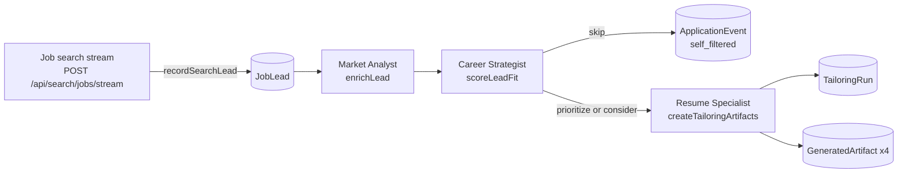
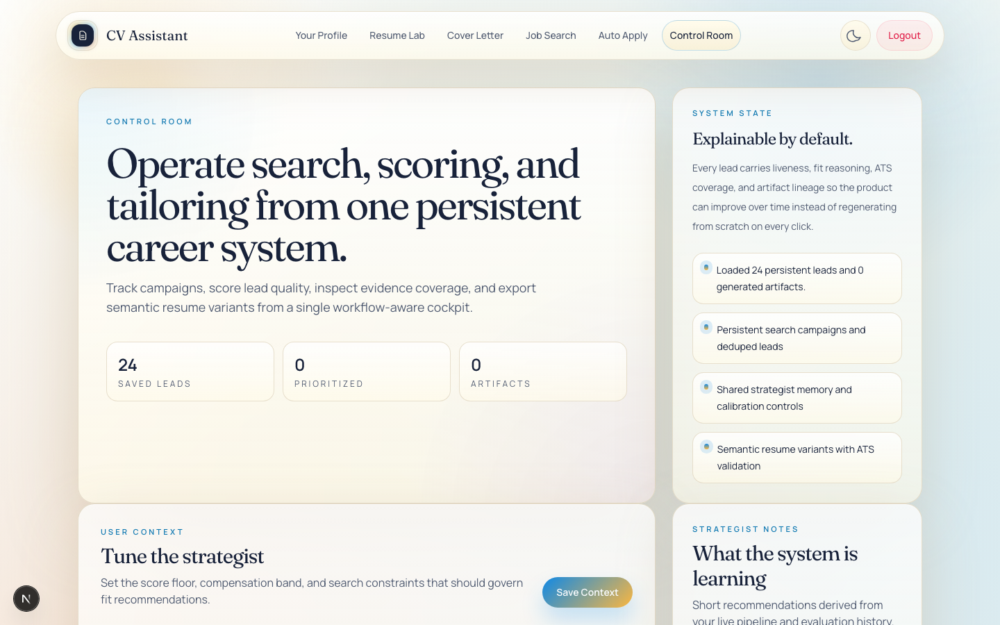
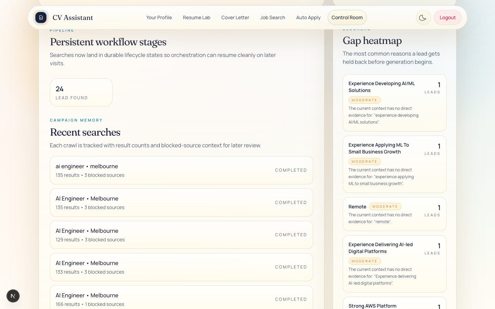
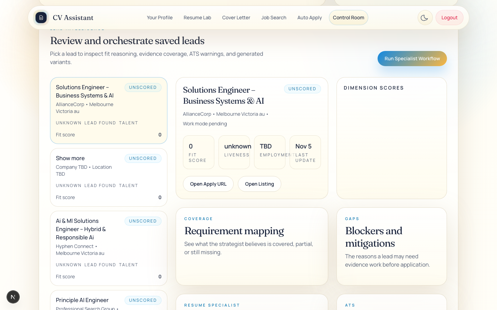
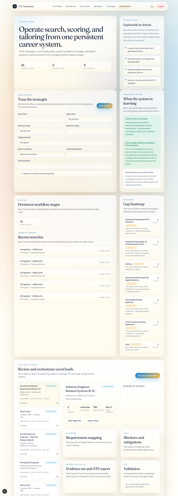
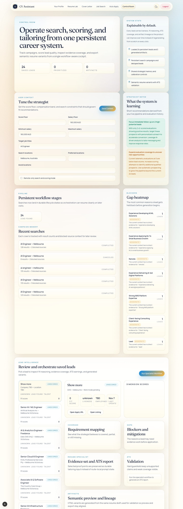

# Control Room (career pipeline)

*Scope: the `/control-room` page and the `/api/control-room/*` routes in `cv-assistant/`. Each statement comes from the source files named in its section. Checked against the code on 2026-11-07.*

## Contents

- [Purpose](#purpose)
- [User interface walkthrough](#user-interface-walkthrough)
- [Concepts glossary](#concepts-glossary)
- [The specialist workflow](#the-specialist-workflow)
- [Telemetry and events recorded](#telemetry-and-events-recorded)
- [API reference](#api-reference)
- [What "Run Specialist Workflow" does and persists](#what-run-specialist-workflow-does-and-persists)
- [Tests](#tests)
- [Known limitations](#known-limitations)

## Purpose

The Control Room is the career pipeline screen at `/control-room`. It takes the job leads that a search has saved for the signed-in user and runs each lead through three specialist stages:

1. **Market Analyst** (`enrichLead` in `src/lib/career/market-analyst.ts`) fetches the posting, classifies whether it is still live, extracts a structured job understanding and stores the readable job description.
2. **Career Strategist** (`scoreLeadFit` in `src/lib/career/career-strategist.ts`) scores the lead against the user's saved context, records dimension scores and a gap map, and returns a verdict of `prioritize`, `consider` or `skip`.
3. **Resume Specialist** (`createTailoringArtifacts` in `src/lib/career/resume-specialist.ts`) runs only for leads that are not skipped. It selects and rewrites evidence, builds a tailored draft, runs an ATS check, and stores three HTML variants and one JSON draft.

Each hand-off writes records (`JobLead`, `JobEvaluation`, `TailoringRun`, `GeneratedArtifact`, `ApplicationEvent`), so the page can show what happened and why. The page also shows pipeline counts, recent search campaigns, a blocker heatmap, and a form that tunes the strategist's context.

Outside this page:

- **The job search.** `POST /api/search/jobs/stream` (`src/app/api/search/jobs/stream/route.ts`) creates the campaigns and leads that appear here.
- **The standalone resume generator** (`src/app/api/generate-resume/route.ts`). It reuses the coaching engine in `src/lib/resume/ai-coaching.ts`, but it is not part of the Control Room.
- **Auto Apply.** Its code under `src/lib/auto-apply/` and `src/app/api/auto-apply/` does not import the career modules.

Related reading: [`docs/career-evaluation-pipeline.md`](../career-evaluation-pipeline.md) covers legacy evaluation documents (those without `analysisSource` and `analysisVersion`), the heatmap policy and re-scoring. This page does not repeat that material.

Entry point: `src/components/Navbar.tsx` lists "Control Room" and links to `/control-room`. The page is a client component (`src/app/control-room/page.tsx`, `"use client"`). It calls the API through `buildApiUrl` in `src/lib/api.ts`, which prefixes `NEXT_PUBLIC_BASE_PATH` when that variable is set.

## User interface walkthrough

### Screenshots

*The Control Room overview.*

*The gap heatmap.*

*Saved leads and the specialist workflow.*

*The full Control Room page.*

The page is one client component, `ControlRoomPage` in `src/app/control-room/page.tsx`. It loads the overview on mount, loads one lead's detail at a time, and reloads the overview after each save or workflow run. The sections below follow the on-screen order. On wide screens (`xl`), the first two rows use a main column with a 360 px side column, and the lead area uses a 340 px list column.

### Page header

- **Eyebrow** `Control Room`. **Title** "Operate search, scoring, and tailoring from one persistent career system." **Description** "Track campaigns, score lead quality, inspect evidence coverage, and export semantic resume variants from a single workflow-aware cockpit." The page has no export action (see Known limitations).
- **Three stat tiles** from `overview.summary`: **Saved leads** (`leadCount`), **Prioritized** (`prioritizedCount`) and **Artifacts** (`artifactCount`). Each shows `0` until the overview loads.
- **Side panel "System State"**, with the heading "Explainable by default." It lists the current status message and three fixed statements. One fixed statement reads "Shared strategist memory and calibration controls". The page has no calibration controls.

Status messages shown in the side panel:

| When | Text |
|---|---|
| Page opens | Loading your career operating system. |
| Overview loaded, at least one lead | Loaded {leadCount} persistent leads and {artifactCount} generated artifacts. |
| Overview loaded, no leads | No saved leads yet. Run a job search to seed the control room. |
| Context saved | Strategist context updated. Future fit scores will use the new floor and preferences. |
| Workflow running | Running Market Analyst, Career Strategist, and Resume Specialist. |
| Workflow finished | Workflow complete. The tailored draft, ATS report, and semantic variants are ready. |

The last two messages are short-lived. Saving context and finishing a workflow both reload the overview, and the reload replaces the message with the "Loaded ..." text when it completes.

### Error banner

When a load, save or run fails, a rose-bordered panel shows the message. It is the API `error` field when one is returned. Otherwise it is one of "Unable to load the control room.", "Unable to load lead details.", "Unable to save context." or "Unable to orchestrate this lead." The banner clears when the next lead load, save or workflow run starts.

### Row 1: User Context and Strategist Notes

**User Context** (eyebrow `User Context`; title "Tune the strategist"; description "Set the score floor, compensation band, and search constraints that should govern fit recommendations."). The **Save Context** button shows "Saving..." during the request. It is disabled while a save is running or the overview is loading.

The form starts from the stored `controlRoomPreferences` text when it exists, and otherwise from the numeric context fields (`createContextForm`). Before the first load it uses `EMPTY_CONTEXT_FORM`: score floor 65, the three salary fields 0, and the text fields empty.

| Input | Saved to | Effect |
|---|---|---|
| Score Floor | `scoreFloor` (a number, 0 when the input is not numeric) and `controlRoomPreferences.scoreFloor` (text) | A fit below the floor makes the verdict `skip`. The heuristic needs a fit of at least `max(scoreFloor, 78)` for `prioritize`. |
| Salary Floor | `compensation.salaryFloor` | The heuristic compensation fit uses this floor, or `targetMin` when the floor is 0. |
| Minimum salary | `compensation.targetMin` | Used by the heuristic only when `salaryFloor` is 0. |
| Maximum salary | `compensation.targetMax` | Sent to the LLM prompt only. |
| Target job titles | `searchPreferences.jobTitles` and `controlRoomPreferences.jobTitles` | Does not change `targetRoles`, which drives the heuristic role alignment. The LLM prompt receives `searchPreferences`. |
| Search locations | `searchPreferences.locations` | Sent to the LLM prompt only. |
| Preferred locations | `workPreferences.preferredLocations` | Sent to the LLM prompt. The search routes also read it. |
| Avoid locations | `workPreferences.avoidLocations` | Sent to the LLM prompt only. |
| Remote-only search and scoring mode (checkbox) | `workPreferences.remoteOnly` and `searchPreferences.remoteOnly`. When checked, `workPreferences.modes` is set to `["remote"]`. | A lead whose remote policy does not include "remote" gets a critical `work_mode_mismatch` gap, which makes the verdict `skip`. The heuristic work-mode score is 22. |

On save, the page sends a `PATCH` to `/api/control-room/context`. It sends `sources` and `visaStatus` back unchanged, because the page has no inputs for them. On success the form reloads from the response and the overview reloads, keeping the selected lead when it is still listed.

**Strategist Notes** (eyebrow `Strategist Notes`; title "What the system is learning"; description "Short recommendations derived from your live pipeline and evaluation history."). It shows up to four cards, each with a title, a body and a tone: positive (green), warning (amber) or neutral (grey). The cards come from one of two sources:

- An LLM digest asking for two or three items, built from pipeline counts (preset `easy`, one retry). It runs on every overview load.
- Three fixed cards when the digest is unavailable or fails validation (`buildStrategistRecommendationsHeuristic`):
  - "{n} leads are above your strategist floor" (counts `prioritize`).
  - "{n} listings need freshness checks" (counts `expired` listings).
  - "{n} remote-friendly leads match your current strategy" (counts leads whose remote policy includes "remote" and whose fit score is 70 or more).

### Row 2: Pipeline and Blockers

**Pipeline** (eyebrow `Pipeline`; title "Persistent workflow stages"; description "Searches now land in durable lifecycle states so orchestration can resume cleanly on later visits."). It shows one tile for each lifecycle state found among the 24 most recently updated leads. Each tile shows the count and the state name with underscores replaced by spaces. Tiles appear in the order each state is first seen in that list. The description says orchestration can resume, but every run starts again at enrichment.

**Recent searches** (eyebrow `Campaign Memory`; title "Recent searches"; description "Each crawl is tracked with result counts and blocked-source context for later review."). It takes the six most recent campaigns and then keeps only those with at least one result. Each row shows:

- "{jobTitle, or 'Untitled search'} • {location, or 'Any location'}";
- "{totalResults} results • {number of blocked sources} blocked sources";
- the campaign status on the right (`active`, `completed`, `failed` or `canceled`), displayed in uppercase.

The server returns only six campaigns and the filter runs afterwards, so an older campaign never appears here.

**Blockers** (eyebrow `Blockers`; title "Gap heatmap"; description "The most common reasons a lead gets held back before generation begins."). This is the blocker heatmap: up to eight gap themes, ranked by count. Each row shows:

- a readable label: the gap title, or its code when there is no title. Underscores and camel case are split, and each word is capitalised (`humanizeBlockerLabel`);
- a severity badge (Critical, Moderate or Minor);
- the gap's detail, or its mitigation when there is no detail;
- a count with the caption "Leads". The count is the number of evaluations that contain the gap, not the number of distinct leads.

Only v2 evaluations are included: those with `analysisSource` of `llm` or `fallback`, or with `analysisVersion` of 2 or higher. When the heatmap is empty and some evaluations were excluded, the panel shows: "Gap themes are shown for AI-scored evaluations (v2) only. Re-run the specialist workflow on leads to refresh scores and populate this view."

### Row 3: Lead Intelligence

**Lead Intelligence** (eyebrow `Lead Intelligence`; title "Review and orchestrate saved leads"; description "Pick a lead to inspect fit reasoning, evidence coverage, ATS warnings, and generated variants."). The **Run Specialist Workflow** button runs the workflow for the selected lead (see the section on what it persists). While the request runs, the label reads "Running Workflow...". The button is disabled when no lead is selected, while a run is in progress, or while the lead detail is loading.

**Lead list** (left column). Up to 24 leads, most recently updated first. Each card shows:

- the title;
- "{company} • {location}", from `displayCompany` and `displayLocation`, which fall back to "Company TBD" and "Location TBD";
- a recommendation badge with the raw value (`prioritize`, `consider`, `skip` or `unscored`), coloured green, sky blue or rose;
- three captions: `liveStatus`, `lifecycleState` (underscores replaced by spaces) and `source`;
- "Fit score", from `fitScore` (0 when unset).

The selected card has a stronger border. Selecting a card loads that lead's detail.

**Detail panel** (right column). It shows one of these states:

| State | Text |
|---|---|
| No lead selected | Save some leads from Job Search to start using the control room. |
| Lead detail loading, nothing to show yet | Loading lead intelligence... |
| Overview loading, no detail | Loading your saved leads... |
| Overview loaded, no detail | Select a lead to inspect strategist output. |
| Detail loaded | The sections below. |

When the detail is loaded, it shows these sections in order:

1. **Hero card.** The title. A line reading "{company} • {location} • {remotePolicy, or 'Work mode pending'}". The recommendation badge. Four tiles: **Fit score**, **Liveness** (`liveStatus`, or "unknown"), **Employment** (`employmentType`, or "TBD") and **Last update** (a short date, or "Just now" when missing). When an evaluation exists, a line reads "Strategist: {analysisSource} (v{analysisVersion}) · {model}", for example `Strategist: llm (v2) · NVIDIA NIM router`. Then the reasoning summary. The buttons **Open Apply URL** and **Open Listing** appear only when those URLs are set, and open in a new tab.
2. **Dimension scores** (bar chart). For each dimension: the label, the score, a horizontal bar (width clamped to 8 to 100 per cent) and the reason. The dimension set depends on the strategist path (see the specialist workflow section).
3. **Requirement mapping** (eyebrow `Coverage`; description "See what the strategist believes is covered, partial, or still missing."). One row per requirement, with its matched fact titles, or "No direct evidence connected yet", and a coverage label coloured green (`covered`), amber (`partial`) or rose (`gap`). It uses `evaluation.matchedRequirements`. The tailoring run's `requirementCoverage` is used only when there is no evaluation.
4. **Blockers and mitigations** (eyebrow `Gaps`; description "The reasons a lead may need evidence work before application."). One card per gap: the title, "Related: " followed by the supporting requirements joined with " · " when present, the severity word, the detail and the mitigation. The gap code is not shown; the code display is commented out in `page.tsx`.
5. **Evidence set and ATS report** (eyebrow `Resume Specialist`; description "Selected proof points are preserved as durable tailoring input instead of route-local prompt state."). One card per evidence item in the latest tailoring run: the title, the rounded score, the matched keywords (or "Keyword mapping pending") and the rewritten text.
6. **Validation** (eyebrow `ATS`; title "Validation"; description "Hard guardrails keep unsupported claims and weak coverage visible."). Four tiles: **Keyword coverage** (per cent), **Supported claims**, **Unsupported claims** and **Status** ("Passed" or "Needs work"). Each ATS warning appears in an amber card. Without a tailoring run it shows "Run the specialist workflow to generate an ATS report."
7. **Artifacts** (eyebrow `Artifacts`; title "Semantic preview and lineage"; description "HTML variants are generated from the same resume draft used for validation so preview and export stay aligned."). One button per `resume_html` artifact, labelled with its variant (`executive`, `clean` or `modern`). The selected button uses the primary style. Below the buttons, an iframe 720 px tall shows the selected HTML with `sandbox="allow-same-origin"`, so scripts cannot run. Without artifacts it shows "Run the workflow to render semantic preview variants." There is no download control, and no lineage details are shown.
8. **Draft** (eyebrow `Draft`; title "Source-of-truth summary"; description "The semantic draft stays available for future template engines and diffing."). The draft headline, or "Draft pending"; the draft summary, or "Run the workflow to build the semantic resume draft."; and one chip per competency.
9. **Workflow history** (eyebrow `Events`; title "Workflow history"; description "Every major state transition is tracked so the system can explain what happened."). Up to 12 events, newest first. Each shows its type (underscores replaced by spaces), a short date and, where the payload has matching keys, reason chips, stat tiles and a text note. Stat labels are "Fit score", "Recommendation", "Evidence items", "Keyword coverage" and "Generated variants". Events with no matching keys show "No additional details recorded." The `enriched` and `lead_found` payloads have no keys the page displays, so they always show that text.

Interaction notes:

- On first load the first lead is selected, its detail loads, and the selected variant moves to the first `resume_html` artifact. After a save or workflow run, the overview reload keeps the selected lead if it is still listed.
- Selecting another lead loads its detail. If that detail has HTML artifacts, the selected variant resets to the first one.
- The page has no delete, archive, export or download controls.

### Screenshots from the verification run

*A lead open in the detail panel. Fit and dimension scores show 0 and "Unscored" because the specialist workflow has not run for this lead.*

## Concepts glossary

Terms are used as the code defines them.

| Term | Meaning | Where it is stored or defined |
|---|---|---|
| Lead | One saved job posting for one user, unique on `dedupeKey` for that user. Holds listing data, enrichment output, the fit score, the recommendation, liveness and the lifecycle state. | `JobLead` in `src/lib/models/JobLead.ts` |
| Search campaign | One streamed job search: its query, status, result count, blocked sources and any error. | `SearchCampaign` in `src/lib/models/SearchCampaign.ts` |
| Lifecycle state | The stage a lead has reached: `lead_found`, `enriched`, `scored`, `tailored`, `exported`, `tracked` or `followup_due`. The code writes `lead_found`, `enriched`, `scored` and `exported`. `tailored`, `tracked` and `followup_due` are declared but never written. | `JobLead.lifecycleState`; `LeadLifecycleState` in `src/lib/career/types.ts` |
| Liveness | Whether the posting still looks open: `active`, `expired`, `uncertain`, or `unknown` before enrichment. | `JobLead.liveStatus`; `LiveStatus` in `src/lib/career/types.ts` |
| Recommendation | The verdict: `prioritize`, `consider` or `skip`. `unscored` is the value before the first run. | `JobLead.recommendation`, `JobEvaluation.recommendation` |
| Job understanding | A structured reading of the posting: role summary, must-have and preferred requirements, responsibility themes, work mode, seniority, company signals and noise tokens. | `JobLead.jobUnderstanding`; `JobUnderstanding` in `src/lib/career/types.ts` |
| Evaluation | The output of one strategist run: fit score, dimension scores, gap map, requirement matches, reasoning, next actions and provenance. A lead can have several; the newest is shown. | `JobEvaluation` in `src/lib/models/JobEvaluation.ts` |
| Dimension score | One scored area, such as "Role alignment", with a score from 0 to 100 and a reason. | `JobEvaluation.dimensionScores` |
| Gap (blocker) | A reason a lead may be held back: a stable `code`, `title`, `severity` (`critical`, `moderate` or `minor`), `detail`, `mitigation` and optional `supportingRequirements`. | `JobEvaluation.gapMap`; `StrategistGap` |
| Gap map | The list of gaps in one evaluation. | `JobEvaluation.gapMap` |
| Requirement match | A requirement with its coverage (`covered`, `partial` or `gap`) and the fact titles that support it. | `JobEvaluation.matchedRequirements`; `RequirementMatch` |
| Blocker heatmap | Counts of gap codes across the 24 most recent v2 evaluations; the top eight are shown. Computed on read, not stored. | `getControlRoomOverview` in `src/lib/career/control-room.ts` |
| Analysis source and version | How an evaluation was produced (`heuristic`, `llm` or `fallback`) and the scoring version. The current version is `CONTROL_ROOM_ANALYSIS_VERSION` = 2. | `JobEvaluation.analysisSource`, `analysisVersion`; `src/lib/career/types.ts`. Legacy policy: [`docs/career-evaluation-pipeline.md`](../career-evaluation-pipeline.md). |
| Context | The user's saved preferences and evidence used for scoring, read as a `UserContextSnapshot`. Created from the profile the first time it is read. | `UserContext` in `src/lib/models/UserContext.ts`; `src/lib/career/context.ts` |
| Control room preferences | The form's values stored as text, so the form reloads as typed. Scoring does not read them. | `UserContext.controlRoomPreferences` |
| Candidate fact | A reusable evidence item: `kind` (`profile`, `experience`, `project`, `skill` or `story`), title, summary, evidence lines, keywords, impact and confidence. Embedded in the context, not a separate collection. | `UserContext.candidateFacts`; `src/lib/models/CandidateFact.ts` |
| Story bank | Story-style evidence items (situation, task, action, result, reflection), with tags and confidence. Embedded in the context. | `UserContext.storyBank`; `src/lib/models/StoryBankItem.ts` |
| Proof point | A plain-text evidence line in the context. Stored, but no Control Room logic reads it. | `UserContext.proofPoints` |
| Tailoring run | One resume-generation attempt for a lead: evidence set, draft, ATS report and artifact ids. Its status is `exported` when the ATS check passes, otherwise `validated`. | `TailoringRun` in `src/lib/models/TailoringRun.ts` |
| Evidence set | The projects and experiences chosen for a draft, each with a score, matched keywords and rewritten text. | `TailoringRun.evidenceSet` |
| ATS validation | Keyword coverage, supported and unsupported claim counts, missing keywords, warnings and a pass flag. | `TailoringRun.atsValidation`; `validateResumeDraft` in `src/lib/career/ats.ts` |
| Generated artifact | A rendered output: `resume_html` (variants `executive`, `clean` and `modern`) or `resume_json` (the draft). | `GeneratedArtifact` in `src/lib/models/GeneratedArtifact.ts` |
| Application event | A timestamped record of one step or outcome, with a `type` and a `payload`. | `ApplicationEvent` in `src/lib/models/ApplicationEvent.ts` |
| Self-filtered | The event written when a verdict is `skip`. Its payload lists the gap titles as reasons. | `ApplicationEvent` of type `self_filtered` |
| Guardrail | A deterministic rule that overrides the model: listing freshness, work-mode mismatch and the score floor. | `applyHardGuardrails` in `src/lib/career/career-strategist.ts` |

## The specialist workflow

`orchestrateLead(userId, leadId)` in `src/lib/career/workflow.ts` runs the stages in order:

1. Load the user context (`loadUserContextSnapshot`), the outcome telemetry (`loadOutcomeTelemetry`) and the user's profile (`User.profile`), in parallel.
2. Market Analyst: `enrichLead`.
3. Career Strategist: `scoreLeadFit`, then write the evaluation.
4. If the verdict is `skip`, stop. Otherwise run the Resume Specialist (`createTailoringArtifacts`) and write the tailoring run and its artifacts.

### Model provider and presets

All model calls go through `src/lib/ai.ts`, which calls the NVIDIA NIM chat completions API. The base URL defaults to `https://integrate.api.nvidia.com/v1` and can be changed with `NVIDIA_NIM_BASE_URL`.

| Preset | Used for | Default model order |
|---|---|---|
| `hard` | Strategist, JD analysis, consultant plan, item scoring, rewrites, ATS review | `nvidia/nemotron-3-ultra-550b-a55b`, `nvidia/nemotron-3-nano-omni-30b-a3b-reasoning`, `deepseek-ai/deepseek-v4.1-flash` |
| `easy` | Job understanding, company and location extraction, overview digest | `poolside/laguna-xs-2.1`, `nvidia/nemotron-3-nano-omni-30b-a3b-reasoning`, `nvidia/nemotron-3-ultra-550b-a55b` |

- `NVIDIA_NIM_EASY_MODELS` and `NVIDIA_NIM_HARD_MODELS` replace the default order (comma-separated).
- Keys are read from `NVIDIA_NIM_API_KEY_1` to `NVIDIA_NIM_API_KEY_9`. Duplicate values count once. With no keys, every model call throws.
- `generateJsonSafe(preset, prompt, maxRetries)` makes `maxRetries + 1` attempts (the default `maxRetries` is 2). It parses the text between the first `{` and the last `}`. Callers validate the result with zod.
- Rewrites call `getModel("hard")` directly, so they get failover but no JSON retry.
- Each attempt has an overall budget of `NVIDIA_NIM_TIMEOUT_S` (default 240 seconds), an idle timeout of `NVIDIA_NIM_IDLE_TIMEOUT_S` (default 90), and a first-token timeout of `NVIDIA_NIM_FIRST_TOKEN_TIMEOUT_S` (default 20; 55 for `stepfun-ai/step-5-preview` and 75 for `deepseek-ai/deepseek-v4.1-flash`). `NVIDIA_NIM_MAX_TOKENS` (default 65536) is the upper limit for output tokens, and a lower per-model limit also applies.
- Failover: an HTTP 401 or 402 disables that key for at least five minutes. Statuses 403, 404, 429 and 5xx, and network failures, put that key and model pair on cooldown. Other statuses skip that model for the rest of the request.

### Stage 1: Market Analyst

Inputs: the lead's `applicationUrl`, or its `listingUrl` when there is no application URL, plus its title, snippet and location.

1. **Fetch.** The URL is fetched with a desktop browser User-Agent, `Accept-Language: en-AU,en;q=0.9`, `cache: "no-store"` and a 10-second timeout. Any failure is ignored, and the stored title, snippet and location are used as the description.
2. **Readable text** (`extractReadableText`, using cheerio). It removes `script`, `style`, `noscript`, `svg`, `template` and `[aria-hidden='true']` elements. It then uses the first of `main`, `article`, `[data-job-description]`, `.description`, `.job-description` or `body` whose text is longer than 240 characters, and otherwise all body text.
3. **Liveness** (`classifyLeadLiveness` in `src/lib/career/liveness.ts`). Checks run in this order:

   | Order | Test | Result |
   |---|---|---|
   | 1 | HTTP status 404 or 410 | `expired` |
   | 2 | Final URL contains `error=true` | `expired` |
   | 3 | Text contains one of seven closed-job phrases (`EXPIRED_PATTERNS`) | `expired` |
   | 4 | Text is shorter than 220 characters | `uncertain` |
   | 5 | Text contains the word "apply", "submit application" or "start your application" | `active` |
   | 6 | Anything else | `uncertain` |

   The seven phrases are "job no longer available", "no longer open", "position has been filled", "this job has expired", "page not found", "job no longer exists" and "job is closed". A failed fetch has status 0, so rule 1 does not match and the checks run on the stored text.

4. **Job understanding.** `extractJobUnderstandingWithLlm` (preset `easy`, one retry) runs only when the text is at least 120 characters, and sends at most 6,000 characters. If it returns nothing, `buildFallbackJobUnderstanding` is used. That fallback takes the 20 most frequent tokens, removes noise tokens, makes the first eight `mustHaveRequirements` and the next six `preferredRequirements`, and uses the first sentence as `roleSummary`.
5. **Extracted keywords.** `mergeKeywordsForAts(jobUnderstanding, 14)` returns the must-have requirements, then the first four preferred requirements, then the work-mode and seniority values. The result is unique and capped at 14.
6. **Salary, remote policy and employment type.** `parseSalaryRange`, `inferRemotePolicy` and `inferEmploymentType` (`src/lib/career/utils.ts`) read the whole text. Their accuracy is covered in Known limitations.
7. **Company signals.** Derived flags are merged with the model's `companySignals`: "salary transparency", "{remote policy} policy", "customer-facing scope", "ownership culture", "agentic systems focus" and "applied ai scope".
8. **Writes.** The lead gets `canonicalJobDescription` (the full readable text), `jobUnderstanding`, `extractedKeywords`, `salaryText`, `remotePolicy`, `employmentType`, `companySignals`, `liveStatus`, `lifecycleState` = `enriched` and `lastWorkflowAt`. An `enriched` event is written.

`salaryText` is written as `{currency, or AUD} {min}`, or `{currency, or AUD} {min}-{max}`, with no thousands separators (for example `AUD 140000-160000`).

### Stage 2: Career Strategist

**Mode selection** (`scoreLeadFit`):

| Condition | Path | `analysisSource` | `analysisVersion` | `model` |
|---|---|---|---|---|
| `CONTROL_ROOM_STRATEGIST_MODE` is exactly `heuristic` | Heuristic | `heuristic` | 0 | `heuristic` |
| Description is shorter than 40 characters | Heuristic | `fallback` | 2 | `heuristic` |
| The model call or its validation throws | Heuristic | `fallback` | 2 | `heuristic` |
| Otherwise | LLM | `llm` | 2 | `NVIDIA NIM router` |

Errors on the fallback path are neither logged nor stored.

**LLM path.** One call with `generateJsonSafe("hard", prompt, 2)`. The prompt contains:

- the user context: target roles, score floor, compensation, work and search preferences, tech stack, culture signals, candidate facts (title, kind, keywords, a summary cut to 400 characters and the first two evidence lines) and story-bank entries (title, tags, and action and result each cut to 200 characters);
- the telemetry counts;
- the lead's company, title, location, salary text, remote policy, liveness and company signals;
- the structured job understanding;
- the first 8,000 characters of the job description.

It asks for JSON with `fitScore`, `recommendation`, `dimensionScores` (named `role_alignment`, `evidence_coverage`, `compensation`, `work_mode`, `culture`, `liveness` and `historical`), `gapMap`, `matchedRequirements`, `reasoningSummary` and `nextActions`. The response is validated with zod: at least four dimension scores, at most eight gaps, at most 20 requirement matches and at most six next actions. Scores are rounded and clamped to 0 to 100. The `model` label is the fixed string `NVIDIA NIM router`, not the model that answered.

**Heuristic path** (`scoreLeadFitHeuristic`) produces seven dimensions. Overlap is the number of items in the first list that appear in the second, divided by the length of the longer list. Role alignment compares tokens of the title and target roles. Skill coverage and culture compare whole lower-cased strings.

| Key | Label | Score |
|---|---|---|
| `role_alignment` | Role alignment | Title and target-role token overlap × 100, rounded. 32 when that is 0. Clamped to 20 to 100. |
| `skill_coverage` | Evidence coverage | Extracted keyword and candidate keyword overlap × 100, plus 4 for each covered requirement. Clamped to 18 to 100. |
| `compensation` | Compensation fit | 58 when there is no floor or no parsed salary; 82 when the parsed maximum meets the floor; 68 when the parsed minimum meets it; otherwise 34. The floor is `salaryFloor`, or `targetMin` when that is 0. |
| `work_mode` | Work-mode fit | 22 when remote-only is set and the policy is neither "remote" nor "global remote"; 85 when the modes include "remote" and the policy includes "remote"; 63 for "hybrid"; otherwise 55. |
| `culture` | Culture signal fit | Culture label and company signal overlap × 100, rounded. 55 when that is 0. Clamped to 35 to 95. |
| `liveness` | Posting quality | 88 for `active`, 52 for `uncertain`, 10 otherwise. |
| `historical` | Historical calibration | 60 when there are no evaluations. Otherwise 45 + 6 × prioritised − 2 × skipped + 3 × covered requirements, clamped to 20 to 95. |

The fit score is the rounded mean of the seven scores.

**Gaps (heuristic).** Up to four `missing_evidence_{requirement}` gaps (severity `moderate`) for requirements with coverage `gap`. `listing_freshness` (critical) is added first when the listing is `expired`. `work_mode_mismatch` (critical) is added when remote-only is set and the lead is not remote.

**Verdict (heuristic).** `skip` when the fit is below `scoreFloor` or any gap is critical. `prioritize` when the fit is at least `max(scoreFloor, 78)`. Otherwise `consider`.

**Requirement seeds and matches.** If the job understanding has must-have requirements, the seeds are the first 12 unique values of the must-haves followed by the extracted keywords. Otherwise they are the first eight extracted keywords. `buildRequirementMatches` checks the first eight seeds. The signal count for a requirement is the number of candidate facts whose keywords include it, plus one if it appears in the candidate keyword pool (tech stack, fact keywords, target roles and story tags). Two or more signals give `covered`, one gives `partial`, and none gives `gap`.

**Guardrails** (`applyHardGuardrails`, run on LLM results and on fallback results). It adds `listing_freshness` (critical) for an expired listing, and `work_mode_mismatch` (critical) for a remote-only context with a lead that is not remote. Each code is added only when it is not already present. The verdict then becomes `skip` if any gap is critical or the fit is below `scoreFloor`. Otherwise the model's verdict stands. In heuristic mode the two critical gaps are added inline and the guardrail function is not run.

**Gap codes.** LLM gaps keep their `code`. A missing code becomes `gap_theme_{index}_{slug}`, truncated to 64 characters.

### Stage 3: Resume Specialist

The stage runs only when the verdict is not `skip`. It has two preconditions:

- At least one project or experience. Otherwise the run fails with "Add at least one project or experience before using AI Coaching."
- A job description of at least 20 words (`MIN_JOB_DESCRIPTION_WORDS` in `src/lib/resume/constants.ts`). Otherwise the run fails with "Job description is too short. Please add at least 20 words so AI Coaching has enough context."

Either failure, like any unhandled model error at this stage, ends the request with HTTP 500 after the evaluation has been saved (see the API reference).

**Coaching engine** (`runAICoaching` in `src/lib/resume/ai-coaching.ts`, shared with `/api/generate-resume`):

1. **Collect items.** Projects first, then experiences. An experience is named "{company} {role}". Each item's original content is its description, or its summary when there is no description.
2. **JD analysis.** A `hard` call with the full job description. A result marked `isValid: false` ends the run with the model's reason. A schema failure is not caught.
3. **Consultant plan.** A `hard` call that returns requirement coverage, ATS keywords and guidance. If it fails, a fallback plan is built from the JD priorities and a warning is logged.
4. **Score each item.** A `hard` call per item, three at a time, returning `score`, `directTechnicalMatch`, `industryRelevance` and `complexityScale` (each 0 to 100), matched keywords, missing signals and a rationale. A failed item scores 0 with the rationale "Scoring failed, so this item was deprioritized."
5. **Rank.** Sort by score, adding 12 points for experiences. Ties are broken by direct match, industry relevance, complexity, then original order.
6. **Select** (`selectRetainedItems`). Let `top` be the best score and `hardFloor` be max(52, min(72, top − 24)). Items with content are considered in rank order. An item is kept when it passes at least one of these tests:
   - score is at least `hardFloor`;
   - direct match is at least 62 and score is at least `hardFloor − 6`;
   - it is a project with score at least `hardFloor + 8` and direct match at least 68;
   - it has at least two matched keywords and score at least `hardFloor − 4`.

   An item is rejected when it is too weak (score below max(45, top − 38), direct match below 55 and fewer than two keywords), or when returns diminish (three or more kept, utility below 48, and more than 18 below the lowest kept utility). Selection stops at `MAX_RESUME_ITEMS` (20). If nothing is kept, the top item is kept. If no experience is kept, the best experience with a score of at least max(45, top − 35) is added, so the total can reach 21.

   Utility = 0.46 × score + 0.30 × direct match + 0.14 × industry relevance + 0.10 × complexity + 4 per new signal, plus 8 for an experience or minus 5 for a project.
7. **Rewrite.** For each kept item, one call through `getModel("hard")` (not JSON). Experiences get up to three bullets and projects up to two. Output is normalised to "- " bullets with dashes replaced. A failure keeps the original text. Rewrites run two at a time.
8. **ATS review.** A `hard` call. The engine returns its output, but the Control Room neither stores nor displays it.

**Draft** (`buildResumeDraft`):

- `competencies`: the first eight extracted keywords plus the top six keywords from the profile skills, unique, at most 10.
- `experiences` and `projects`: only the selected items. The text is the rewrite, or the summary or description when there is no rewrite. Projects get the label "Selected proof point".
- `headline`: "{name} — {lead title}".
- `summary`: the formatted profile summary, or "Targeting {title} roles with proven experience across {top four competencies}."
- `education`: school, major and study period. A missing school or major is replaced with the literal text "Education" or "Major".
- `skills`: the profile skills, or the tech-stack preferences when those are empty, split into at most 14 items. `languages` holds at most six.
- `requirementCoverage`: the evaluation's `matchedRequirements`.

**ATS validation** (`validateResumeDraft` in `src/lib/career/ats.ts`) runs with the extracted keywords and a page budget of two.

- **Keyword coverage.** The draft is serialised to JSON, lower-cased and tokenised. Tokens are runs matching `[a-z0-9][a-z0-9.+/#-]*` that are longer than two characters and are not stop words (the list in `src/lib/career/utils.ts`). A keyword is covered when its lower-cased text equals a token. Coverage is covered ÷ total × 100, rounded, and is 100 when there are no keywords. Known effects of this matching are listed in Known limitations.
- **Unsupported claims.** 1 when the JSON matches `/placeholder|tbd|lorem ipsum|<metric>/i`, otherwise 0.
- **Warnings.** An empty section (`summary`, `competencies`, `experiences`, `projects`, `education` or `skills`); coverage below 55; and an estimated length above the page budget (`ceil(length / 3200)` pages against 2). The page estimate adds a warning only.
- **`passed`.** Coverage of at least 55 and no unsupported-claim marker.
- **`supportedClaims`.** The number of covered keywords. It is not a count of claims.

**Artifacts** (`createTailoringArtifacts`): three `resume_html` documents (variants `executive`, `clean` and `modern`), each with inline CSS and its own accent palette and summary "{variant} semantic preview"; and one `resume_json` document (variant `executive`) holding the draft JSON, with summary "Semantic draft source-of-truth".

**Evidence set**: for each kept item, its type, index, title, score, matched keywords and rewritten content.

### Constants and thresholds

| Constant | Value | Where |
|---|---|---|
| `CONTROL_ROOM_ANALYSIS_VERSION` | 2 | `src/lib/career/types.ts` |
| Default score floor | 65 | `UserContext` schema, `createEmptySnapshot`, `toSnapshot` |
| Heuristic `prioritize` threshold | max(score floor, 78) | `scoreLeadFitHeuristic` |
| Fetch timeout | 10 seconds | `fetchLeadDetailHtml` |
| Liveness text threshold | 220 characters | `classifyLeadLiveness` |
| Readable text threshold | 240 characters | `extractReadableText` |
| Job understanding minimum | 120 characters; 6,000 sent | `src/lib/career/job-understanding.ts` |
| Strategist minimum | 40 characters; 8,000 sent | `scoreLeadFit`, `runStrategistLlm` |
| Company and location extraction | 3,200 characters | `MAX_DESCRIPTION_CHARS` in `src/lib/career/control-room.ts` |
| Minimum job description words for coaching | 20 | `MIN_JOB_DESCRIPTION_WORDS` |
| Maximum retained resume items | 20 | `MAX_RESUME_ITEMS` |
| ATS keyword floor | 55 per cent | `validateResumeDraft` |
| Page budget and estimate | 2 pages; 3,200 characters per page | `validateResumeDraft` |
| Keywords per lead | 14 | `mergeKeywordsForAts` |
| Overview windows | 24 leads, 24 evaluations, 6 campaigns | `getControlRoomOverview` |
| Heatmap rows | 8 | `getControlRoomOverview` |
| Telemetry windows | 40 evaluations, 25 self-filtered events | `loadOutcomeTelemetry` |
| Event rows on lead detail | 12 | `getLeadDetail` |

## Telemetry and events recorded

### What the strategist reads

`loadOutcomeTelemetry(userId)` in `src/lib/career/telemetry.ts` reads:

- `evaluationCount`: the number of the 40 most recent evaluations.
- `skippedCount` and `prioritizedCount`: how many of those 40 have the verdict `skip` or `prioritize`.
- `commonExclusions`: up to eight reasons from the 25 most recent `self_filtered` events. Each reason is a gap title.
- `winningKeywords`: up to 12 entries taken from the `matchedFacts` of covered requirements in prioritised evaluations. The entries are fact titles, not keywords (see Known limitations).

Telemetry is read before the current run writes its evaluation, so a run does not count itself. The values feed the LLM prompt hint, the heuristic `historical` dimension, the stored `telemetrySnapshot`, and the heuristic reasoning summary (up to three winning patterns).

### Events

| Type | Written by | When | Payload keys |
|---|---|---|---|
| `lead_found` | `recordSearchLead` in `src/lib/career/search-persistence.ts` | A search result creates a new lead. A result for an existing lead updates its `campaignIds` and `lastSeenAt` and writes no event. | `source`, `queryMatch`, `campaignId` |
| `enriched` | `enrichLead` | Every run, after the lead's enrichment is saved. | `liveReason`, `salaryText`, `remotePolicy`, `keyTakeaway` |
| `scored` | `orchestrateLead` | Every run, after the evaluation is saved. | `fitScore`, `recommendation` |
| `self_filtered` | `orchestrateLead` | The verdict is `skip`. | `reasons` (the gap titles) |
| `tailored` | `orchestrateLead` | Tailoring succeeded. | `evidenceCount`, `keywordCoverage` |
| `exported` | `orchestrateLead` | Artifacts were saved. | `artifactCount`, `variants` |
| `tracked`, `followup_due`, `context_updated` | Nothing | Declared in the `ApplicationEvent` enum. Never written. | None |

Each step writes its own event, and events are not transactional with the other writes. The detail shows the 12 newest events for a lead, newest first.

### Campaign records

`SearchCampaign` is created when a search stream starts, with status `active`. Each `result` event creates or updates a lead. The stream then sets the status to `completed` (with the total and the blocked sources), `failed` (with the error message) or `canceled` (when the client disconnects). A stream that ends without any of these is completed in the `finally` block (`src/app/api/search/jobs/stream/route.ts`).

### Logging

The Control Room writes no log lines of its own. The coaching engine logs with `console.warn` when consultant planning, item scoring, rewriting or the ATS review fails. The strategist's fallback is silent.

## API reference

All routes are under `src/app/api/control-room/`.

### Common behaviour

- Every route exports `runtime = "nodejs"` and `dynamic = "force-dynamic"`. None exports `maxDuration`, and `vercel.json` sets no function duration.
- **Authentication.** Each handler calls `getAuthFromCookies` (`src/lib/auth.ts`), which reads the `auth_token` cookie and verifies it with `JWT_SECRET`. A missing cookie, an invalid token and a missing `JWT_SECRET` all return `401 {"error":"Unauthorized"}`. The user comes from the token only; no route takes a user id.
- **Database.** `connectToDatabase` (`src/lib/db.ts`) connects with `MONGO_URI` to the database `cv_assistant`.
- **Errors.** Errors that a handler catches return JSON of the shape `{"error": "<message>"}`. An error that a handler does not catch becomes a 500 response without that JSON body.

### Configuration

| Variable | Used for | Needed |
|---|---|---|
| `MONGO_URI` | Database connection | Yes |
| `JWT_SECRET` | Verifying the auth cookie | Yes |
| `NVIDIA_NIM_API_KEY_1` to `NVIDIA_NIM_API_KEY_9` | Every model call | For the LLM stages. Without keys, see the failure notes below. |
| `NVIDIA_NIM_EASY_MODELS`, `NVIDIA_NIM_HARD_MODELS` | Model order per preset | No |
| `NVIDIA_NIM_BASE_URL`, `NVIDIA_NIM_TIMEOUT_S`, `NVIDIA_NIM_IDLE_TIMEOUT_S`, `NVIDIA_NIM_FIRST_TOKEN_TIMEOUT_S`, `NVIDIA_NIM_MAX_TOKENS` | Provider tuning | No |
| `CONTROL_ROOM_STRATEGIST_MODE` | `heuristic` forces the heuristic strategist | No |
| `NEXT_PUBLIC_BASE_PATH` | Prefix for client API calls | No |

### GET /api/control-room/context

- **Request:** no body.
- **Response 200:** `{ "context": UserContextSnapshot }`.
- **Side effect:** on the first call for a user, creates the `UserContext` document from the profile.
- **Errors:** 401 as above. An unhandled database error becomes a 500.

### PATCH /api/control-room/context

- **Request:** a JSON object with any of the keys below. Keys that are not sent are left unchanged.
- **Response 200:** `{ "context": UserContextSnapshot }`, the stored snapshot after the update.
- **Errors:** 400 `{"error":"Invalid context payload."}` when the body is missing, is not JSON, or is not an object (a JSON array passes this check). 401 as above. A 500 occurs when a nested value has the wrong shape. The handler has no try/catch, so that 500 has no JSON error body.

| Key | Shape | Stored as |
|---|---|---|
| `targetRoles` | string array | Unique values |
| `searchPreferences` | `jobTitles`, `locations` and `sources` (string arrays), and `remoteOnly` | All three arrays must be present |
| `compensation` | `targetMin`, `targetMax` and `salaryFloor` (numbers), and `currency` | Non-numeric values become 0. Currency defaults to `AUD`. |
| `workPreferences` | `modes`, `preferredLocations` and `avoidLocations` (string arrays), `visaStatus` and `remoteOnly` | All three arrays must be present |
| `techStackPreferences` | string array | Unique values |
| `cultureSignals` | array of `{ label, weight }` | Entries with no label are dropped. Weight defaults to 0. |
| `proofPoints` | string array | Unique values |
| `learnedExclusions` | string array | Unique values |
| `scoreFloor` | number | Stored only when the JSON value is a number |
| `controlRoomPreferences` | the eight text fields and `remoteOnly` | Merged with the defaults |

Other keys (for example `archetypes`, `outreachPreferences`, `candidateFacts`, `storyBank` and `calibration`) are ignored without an error.

### GET /api/control-room/overview

- **Request:** no body.
- **Response 200:**

| Field | Contents |
|---|---|
| `context` | The user context snapshot. |
| `summary` | `activeCampaigns`, `leadCount`, `prioritizedCount`, `tailoredCount` and `artifactCount`. |
| `pipelineCounts` | `{ state, count }` for each lifecycle state found among the leads. |
| `campaigns` | Up to six `SearchCampaign` documents, newest first. |
| `leads` | Up to 24 `JobLead` documents, most recently updated first, each with `displayCompany` and `displayLocation`. |
| `blockerHeatmap` | Up to eight `{ label, code, count, severity, detail, mitigation }` entries. |
| `heatmapExcludesLegacyHeuristic` | True when at least one evaluation exists and some of the 24 newest are not v2. |
| `recommendations` | One to four `{ title, body, tone }` cards. |

- **Scope.** `leads`, `pipelineCounts`, `leadCount`, `prioritizedCount` and `tailoredCount` cover the 24 most recently updated leads. `campaigns` and `activeCampaigns` cover the six newest campaigns. `blockerHeatmap` covers the 24 newest evaluations. `artifactCount` counts every artifact for the user.
- `tailoredCount` counts leads whose lifecycle state is `tailored` or `exported`.
- Display names are computed without AI.
- **Side effects.** The `UserContext` seed on the first call. One digest call to the model (preset `easy`). If that call fails or returns no items, three cards are built from the pipeline counts by `buildStrategistRecommendationsHeuristic` in `src/lib/career/control-room.ts`.
- **Errors.** 401 as above. The route has no try/catch, so other errors become 500.

### GET /api/control-room/leads/{leadId}

- **Path:** `leadId`, a MongoDB ObjectId string.
- **Response 200:**

| Field | Contents |
|---|---|
| `lead` | The `JobLead`, with `displayCompany` and `displayLocation`. |
| `evaluation` | The newest `JobEvaluation` for the lead, or `null`. |
| `tailoringRun` | The newest `TailoringRun` for the lead, or `null`. |
| `artifacts` | Every `GeneratedArtifact` for the lead, newest first, including full bodies. |
| `events` | The 12 newest `ApplicationEvent` documents, newest first. |

- **Side effects.** No database writes. When the company or location is not found by pattern matching and the description is present, one model call (preset `easy`, one retry) extracts them. The result is not stored and is recalculated on each request.
- **Errors.** 401 as above. 404 `{"error": message}` for every thrown error:
  - `Lead not found.` when no lead matches both `_id` and the user;
  - a Mongoose cast error when `leadId` is not a valid ObjectId;
  - any database error.

### POST /api/control-room/leads/{leadId}/orchestrate

- **Request:** no body.
- **Response 200:** the same shape as the lead detail, reflecting the run. This is also returned for a `skip` verdict.
- **Side effects:** see "What Run Specialist Workflow does and persists". Each call creates new records. The call is not idempotent.
- **Errors.** 401 as above. A 500 `{"error": message}` is returned for any error thrown during the run, including:
  - `Lead not found.` (500 here, where the GET route returns 404);
  - the coaching messages quoted in Stage 3, and the model's reason when the posting is judged invalid;
  - provider errors from `src/lib/ai.ts`, such as "No NVIDIA NIM API keys configured (NVIDIA_NIM_API_KEY_1 through NVIDIA_NIM_API_KEY_9)", "NVIDIA NIM request timed out" and "All configured NVIDIA NIM keys are temporarily unavailable for the selected models";
  - zod validation messages from an invalid JD analysis response. The coaching engine does not catch these, so the route returns them.
- **Duration.** No `maxDuration` is set, so the deployment default applies. Each model call has an overall limit of `NVIDIA_NIM_TIMEOUT_S` (240 seconds by default) across the keys and models it tries, and each request also has idle and first-token limits (see the configuration table above). JSON calls are retried. A run makes many calls in sequence and in small batches, so a full run can take several minutes.

## What "Run Specialist Workflow" does and persists

The button calls `POST /api/control-room/leads/{leadId}/orchestrate` for the selected lead, then reloads the overview. The steps below follow `orchestrateLead`.

1. **Read.** The user context (seeded if it does not exist), the outcome telemetry and the user's profile.
2. **Enrich** (`enrichLead`). Reads the lead, which must belong to the user, or the run fails with `Lead not found.`. Fetches the posting and makes the model calls described in Stage 1. Writes the lead fields listed there, sets `lifecycleState` to `enriched`, and writes an `enriched` event.
3. **Score** (`scoreLeadFit`). May call the model. No writes.
4. **Record the verdict.** Writes a `JobEvaluation`. Sets the lead's `fitScore`, `recommendation`, `lifecycleState` (to `scored`) and `lastWorkflowAt`. Writes a `scored` event.
5. **Stop on skip.** When the verdict is `skip`, writes a `self_filtered` event whose reasons are the gap titles, then returns the detail. There is no tailoring, no artifact and no tailoring run. The lead stays `scored`.
6. **Tailor** (otherwise). Runs `createTailoringArtifacts`, which makes the coaching model calls. Creates a `TailoringRun` with status `exported` when the ATS check passed, otherwise `validated`. Inserts four `GeneratedArtifact` documents and saves their ids on the run. Sets the lead to `exported` and updates `lastWorkflowAt`, writes `tailored` and `exported` events, and sets the lead to `exported` again.
7. **Return** the lead detail.

### Writes by collection

| Collection | Operation | When |
|---|---|---|
| `UserContext` | Create | The first read for a user (seeded from the profile) |
| `JobLead` | Update | Enrichment save, scoring save, and two export writes that set the same lifecycle state |
| `JobEvaluation` | Create | Every run, after scoring |
| `ApplicationEvent` | Create | `enriched`, then `scored`, then either `self_filtered` (skip) or `tailored` and `exported` (tailored) |
| `TailoringRun` | Create, then update | Tailored runs only |
| `GeneratedArtifact` | Insert (four documents) | Tailored runs only |

`User` is read, never written.

### Behaviour to be aware of

- **Not transactional.** Each write is separate. If a step fails after the evaluation is saved, the earlier writes stay. For example, a profile with no projects or experiences, a job description under 20 words, or a model outage after scoring leaves a `JobEvaluation`, a `scored` lead and its events, with no tailoring run. The request returns 500 and the page shows the message.
- **Re-runs accumulate.** Earlier evaluations, runs and artifacts are kept. The detail shows the newest evaluation and run, but `artifacts` includes every run's artifacts. The page builds one variant button per `resume_html` artifact, so after a second run each variant name appears twice, and the React keys (`{artifactType}-{variant}`) collide.
- **Skip messages.** A `skip` verdict still shows "Workflow complete. The tailored draft, ATS report, and semantic variants are ready." The panels then show "Draft pending" and "Run the workflow to render semantic preview variants."
- **Heatmap window.** Old v2 evaluations keep counting in the heatmap until they fall outside the 24 newest evaluations.
- **Model calls per run.** Enrichment calls job understanding (preset `easy`, when the text is at least 120 characters). Scoring calls the strategist (preset `hard`, when not in heuristic mode and the description is at least 40 characters). When the verdict is not `skip`, tailoring calls the JD analysis, the consultant plan, one score per item and the ATS review (preset `hard`), plus one rewrite per kept item. The JD analysis, consultant plan, item scores and review each use `generateJsonSafe` with the default two retries. Rewrites call the `hard` model directly.

## Tests

`npm run test:unit` runs `tests/career/run-tests.ts` through `tsconfig-paths` and `sucrase` (`package.json`). The file sets `process.env.CONTROL_ROOM_STRATEGIST_MODE = "heuristic"` (line 19), so the strategist tests never call a model. The runner prints each result and sets a failing exit code when any test fails. When this page was written, all 18 tests passed.

**Control Room tests (6).**

| Group | Test | What it asserts |
|---|---|---|
| Liveness | liveness marks closed listings as expired | A body containing "This job has expired and is no longer open." with status 200 gives `expired`. |
| Liveness | liveness marks listings with apply controls as active | A long body ending in "Apply now to start your application." gives `active`. |
| ATS | ATS validation catches placeholder or unsupported claim markers | A bullet containing `<metric>` gives one unsupported claim and `passed` false. |
| ATS | ATS validation passes a complete citation-safe draft | A complete draft with four keywords gives `passed` true and 100 per cent coverage. |
| Strategist | strategist prioritizes high-fit remote roles with covered evidence | A remote lead with matching keywords, a salary of AUD 145k to 170k and a floor of 70 gives `prioritize` and a fit of at least 70. |
| Strategist | strategist skips roles that violate remote-only constraints | An onsite lead with a remote-only context gives `skip`, with a gap titled "Work-mode mismatch" or the code `work_mode_mismatch`. |

**Other tests in the same runner (12).** These are not Control Room tests, but the summary line "All 18 career unit tests passed." counts them. They cover profile PDF extraction (1), NVIDIA preset routing (1), auto-apply screenshot and computer-output mapping (2), the auto-apply browser default (1), auto-apply ranking (2), auto-apply profile-draft refinement (1), ground-truth suggestion (1), the employer-question answerer (1), reusable-answer consent (1) and the submit confirmation schema (1).

**Not covered by the tests:**

- Anything that needs the database or the network: `orchestrateLead`, `enrichLead`, `getControlRoomOverview`, `getLeadDetail`, `loadUserContextSnapshot`, `updateUserContextSnapshot` and `recordSearchLead`.
- Every model path. The career tests never call `generateJsonSafe`, so the LLM strategist, job understanding, digest, company extraction, JD analysis and coaching are untested. The separate `tests/ai` suite calls `generateJsonSafe` directly, not these callers.
- The coaching selection and rewrite logic, `buildResumeDraft`, `renderResumeVariant` and `toBulletLines`. The bullet defect in Known limitations would not be caught.
- Salary parsing, remote-policy and employment inference, the job-understanding fallback and `topKeywords`.
- Heatmap aggregation, telemetry, `humanizeBlockerLabel`, the API routes and the page.

## Known limitations

Items marked **(reproduced)** were confirmed by calling the real helper functions with sample input when this page was written. The other items follow from reading the code.

### Defects

1. **Salary parsing misses common amounts (reproduced).** `parseSalaryRange` in `src/lib/career/utils.ts` reads only two or three digit groups, so `$120,000` is read as 120 and `140000` as 140. Both are then discarded as under 1,000. The salary text that enrichment stores (for example `AUD 140000-160000`) therefore parses to 0 when the strategist reads it back, and the heuristic compensation fit is 58, the no-salary default, for enriched leads. Amounts written as `140k` do parse.
2. **A dollar sign is read as USD (reproduced).** `parseSalaryRange` maps `$` to `USD`, so an Australian posting written with a dollar sign is labelled USD.
3. **"Not remote" is read as remote (reproduced).** `inferRemotePolicy` has no negation handling. "We are not remote; this is an office-based role in Sydney." gives `remote`.
4. **ATS keyword matching (reproduced).** `validateResumeDraft` in `src/lib/career/ats.ts` has four effects:
   - a multi-word keyword never matches, because tokens are single words. "stakeholder management" is reported missing even when the phrase is in the summary;
   - a keyword of two characters or fewer never matches. "ai" is reported missing when "AI" is in the text;
   - a keyword followed by a full stop is missed. "...in React." tokenises as `react.`, so "react" is reported missing;
   - JSON key names count as matches. With empty sections, the keywords `summary` and `languages` give 100 per cent coverage, alongside six "empty section" warnings.
5. **Bullets collapse into one (reproduced).** `toBulletLines` in `src/lib/career/resume-specialist.ts` calls `cleanText`, which turns newlines into spaces, and only then splits on newlines. Three rewritten bullets become one bullet: "Led AWS migration - Built React dashboards - Cut costs by 20%".
6. **The "n/a" placeholder cannot match.** `normalizeCandidate` in `src/lib/career/control-room.ts` removes every character except letters, digits and spaces before comparing, so "n/a" becomes "n a" and never matches the placeholder list (reproduced for this step).
7. **PATCH returns 500 for partial nested objects (reproduced for the helper).** `uniqueStrings(undefined)` throws, and `updateUserContextSnapshot` does not catch it. A `searchPreferences` object without `jobTitles` is one example.
8. **"ai" substring check.** `deriveCompanySignals` in `src/lib/career/market-analyst.ts` tests `includes("ai")` (or `includes("machine learning")`), which also matches "email", "available" and "maintain" (reproduced for the substring). The "applied ai scope" company signal is therefore added to any posting that contains one of those words.
9. **Liveness reads "apply" anywhere.** `classifyLeadLiveness` in `src/lib/career/liveness.ts` marks a posting `active` when the text is 220 characters or more, no closed-job phrase is present, and "apply", "submit application" or "start your application" appears anywhere in the text.

### Scoring and extraction

10. **Exact-match heuristics.** Role alignment compares tokens, and skill coverage and culture compare whole strings, so near-matches count as misses. The seeded culture labels "builder culture" and "clear ownership" never equal a derived company signal (the derived signals include "ownership culture"), so the culture score is 55, the no-overlap default, until the user edits the labels.
11. **Strategist failures are silent.** When the model call or its validation fails, the evaluation is marked `fallback`. Neither the error nor its cause is stored or logged.
12. **The `model` label is fixed.** LLM evaluations store `NVIDIA NIM router`, not the model id. [`docs/career-evaluation-pipeline.md`](../career-evaluation-pipeline.md) describes this field as a "resolved model id string", which the code does not do.
13. **Prompt and schema limits differ.** The prompt asks for at most six gaps and four next actions. The schema accepts eight and six. The digest prompt asks for two or three items, and the schema accepts one to four.
14. **`winningKeywords` holds fact titles.** Telemetry takes these values from `matchedFacts`, so the name and the heuristic summary wording ("Recent winning patterns") describe titles, not keywords.
15. **Strategist Notes copy.** The expired-listing card counts only `expired`, but its body says "Expired or uncertain listings". The "above your strategist floor" card counts only `prioritize` verdicts. In heuristic mode, a lead that clears the floor but has a fit below 78 is marked `consider` and is not counted.
16. **Keyword-based inference.** `inferRemotePolicy` and `inferEmploymentType` use keywords from the whole page text, so a mention in boilerplate can set the value.
17. **Repeated extraction.** The lead detail calls the model for company or location whenever either is missing and the description is present. The result is not stored, so the call repeats on every read.

### Resume and ATS

18. **`supportedClaims` counts keywords.** The ATS report's `supportedClaims` is the number of covered keywords. The page labels it "Supported claims".
19. **The page budget does not affect `passed`.** The two-page check adds a warning only, and the HTML has no page constraint.
20. **Placeholder words reach the draft.** Empty profile fields become the literal text "Candidate", "Company", "Role", "Project", "Education" or "Major". The ATS check does not flag these words.
21. **The ATS review is computed and discarded.** In the Control Room workflow, the review returned by `runAICoaching` is not used. It costs one model call per run, and its output is neither stored nor shown. (`/api/generate-resume` does return it.)
22. **Coaching fallbacks degrade silently.** A failed item score becomes 0, and a failed rewrite keeps the original text. The run is then stored as a normal tailoring run. Only a `console.warn` records the failure.
23. **No export.** The HTML is a preview only. The page has no download, print or PDF control, and the `resume_json` draft is not displayed.
24. **Unused artifact fields.** `cover_letter_html` is allowed by the `GeneratedArtifact` enum but never produced. `lineageVersion` is never set and always defaults to 1. The "lineage" heading shows no lineage.

### Context and data

25. **Context is seeded once.** Candidate facts, story-bank items, tech stack, culture signals, proof points, target roles and the other seeded fields are created from the profile on the first read and are not refreshed from the profile afterwards. Later profile edits do not reach the strategist. The Control Room cannot edit candidate facts or story-bank items, because the PATCH route ignores them.
26. **Target job titles do not reach `targetRoles`.** The form writes `searchPreferences.jobTitles`. Heuristic role alignment reads `targetRoles`, which only the seed and the API write.
27. **Several fields have no heuristic effect.** `compensation.targetMax`, `workPreferences.preferredLocations`, `workPreferences.avoidLocations`, `workPreferences.visaStatus`, `searchPreferences.jobTitles`, `searchPreferences.locations` and `searchPreferences.sources` reach the LLM prompt only. The job search stream reads `preferredLocations` and `sources`, but scoring does not. `proofPoints`, `learnedExclusions`, `outreachPreferences` and `archetypes` are stored but not read by Control Room code. `controlRoomPreferences` is a copy of the form and is not read by scoring.
28. **`calibration` is never written or read.** The `UserContext` schema has a `calibration` field, but no code uses it, so the "calibration controls" copy describes a feature that does not exist.
29. **A score floor of 0 reads back as 65.** The PATCH stores 0, but `toSnapshot` reads it with `scoreFloor || 65`. The save response therefore resets the form to 65, and scoring uses 65.
30. **Unknown PATCH keys are ignored silently.** The route still returns 200 with the unchanged snapshot, so a misspelt key looks like a successful save.
31. **First-read seeding is not guarded.** Two simultaneous first reads for the same user could race on the unique `userId` index, and one of them would fail.
32. **Write-only fields.** `campaignIds` and `lastSeenAt` are written and never read. The `TailoringRun` statuses `planned` and `generated` are never set.

### Workflow and page behaviour

33. **Partial writes after a failure.** See "What Run Specialist Workflow does and persists". The lead stays `scored`, and no tailoring run exists.
34. **Validation failures return 500 here.** The same coaching validation returns 400 in `/api/generate-resume`, because `AICoachingValidationError` carries a status code that this route ignores.
35. **No model means no tailoring.** Without NVIDIA keys, the strategist falls back to the heuristic, but tailoring fails with 500 for every lead that is not skipped.
36. **Skipped leads show success copy.** "Workflow complete..." appears for a `skip` verdict.
37. **Status messages are overwritten.** "Strategist context updated" and "Workflow complete" are replaced when the overview reload finishes.
38. **Lifecycle and copy overstate the code.** The `tailored`, `tracked` and `followup_due` lifecycle states are never assigned. A lead moves to `exported` even when the ATS check fails, and its run is then `validated`. The Pipeline description says orchestration can "resume cleanly", but every run starts again at enrichment.
39. **Summary counts use a window.** Pipeline counts, `leadCount`, `prioritizedCount`, `tailoredCount` and the heatmap cover the 24 most recent items. Only `artifactCount` covers every record.
40. **The heatmap counts occurrences.** The count is the number of times a gap appears across the v2 evaluations, so one evaluation that lists the same gap twice adds two. The caption under each count reads "Leads", which is misleading.
41. **Recent searches are filtered after the limit.** Zero-result campaigns are removed after the six newest are taken.
42. **Campaigns can stay `active`.** A stream finalises its campaign in a `finally` block, but `finalizeCampaign` sets its `finalized` flag before the database write. If that write fails, the block does not retry, so the campaign stays `active`. A process killed mid-stream also leaves it `active`. Nothing clears such a campaign later.
43. **No live refresh.** The page loads on mount and after its own actions. It does not poll.

### API, security and performance

44. **Same message, different status.** `GET /api/control-room/leads/{leadId}` returns 404 for `Lead not found.`, while `POST .../orchestrate` returns 500 for the same message. The GET route also returns 404 for database errors.
45. **No `maxDuration`.** The Control Room routes do not set it. Some auto-apply routes that call models set `maxDuration = 300`.
46. **Server-side fetch of stored URLs.** `enrichLead` fetches `applicationUrl` or `listingUrl` from the server, with no host allowlist and no check for private or local addresses. These URLs come from third-party search results.
47. **Large responses.** The overview returns full job descriptions and job understanding for up to 24 leads, and the lead detail returns the full HTML of every artifact.
48. **Configuration errors look like sign-in failures.** A missing `JWT_SECRET` returns 401, the same as a missing cookie.
49. **Keep the preview sandboxed.** The preview iframe uses `sandbox="allow-same-origin"` and no `allow-scripts`. Adding `allow-scripts` would let the model-generated HTML run script with this app's origin.
