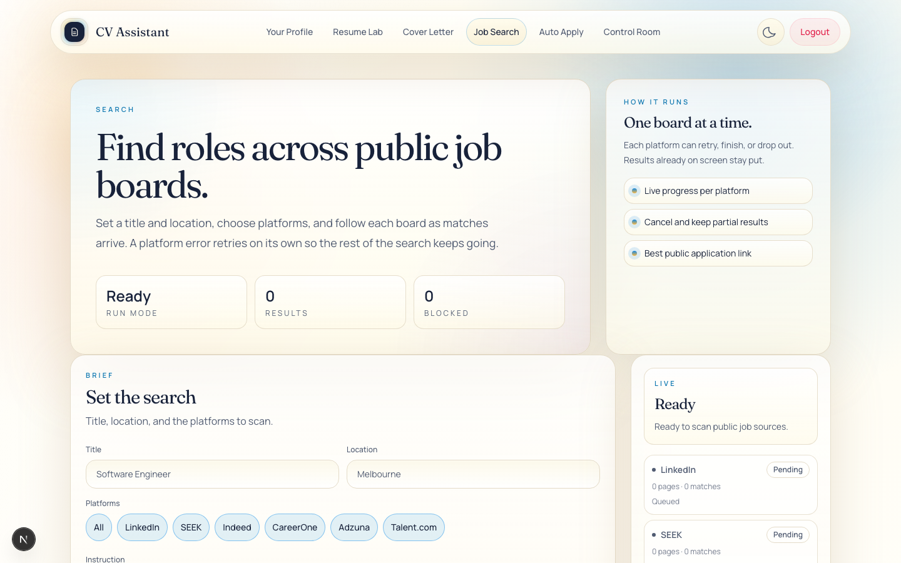

# Job Search

Job Search is the public job-board search in CV Assistant (CVA). It streams matches for a job title and location from six sources, and it saves each run and each unique listing so the Control Room can use them.

This document is derived from the source code in `cv-assistant/`. Paths are relative to that folder. Behaviour that was run against the real modules (with a stubbed `fetch` or direct input) is marked **Reproduced**. Behaviour taken from reading the code only is marked **Code reading**. No live job board was contacted.

**Contents**

1. [Purpose](#1-purpose)
2. [User interface walkthrough](#2-user-interface-walkthrough)
3. [Search pipeline](#3-search-pipeline)
4. [Filter semantics](#4-filter-semantics)
5. [Persistence](#5-persistence)
6. [Control Room and Auto Apply](#6-control-room-and-auto-apply)
7. [API reference](#7-api-reference)
8. [Tests](#8-tests)
9. [Known limitations](#9-known-limitations)
10. [Verification notes](#10-verification-notes)

## Key files

| Area | Files |
|---|---|
| Page | `src/app/search/page.tsx` |
| Components | `src/components/search/CrawlFilters.tsx`, `MobileSearchBar.tsx`, `PlatformPicker.tsx`, `ResultCard.tsx`, `ResultToolbar.tsx`, `SourceRail.tsx`, `labels.ts` |
| API routes | `src/app/api/search/jobs/stream/route.ts`, `src/app/api/search/advanced-sequential/route.ts`, `src/app/api/search/advanced/route.ts` |
| Contracts and rules | `src/lib/search/types.ts`, `schema.ts`, `filters.ts`, `retry.ts` |
| Server modules | `src/lib/search/server/stream.ts`, `sources.ts`, `fallback.ts`, `intent.ts`, `utils.ts` |
| Persistence | `src/lib/career/search-persistence.ts`, `src/lib/models/SearchCampaign.ts`, `src/lib/models/JobLead.ts`, `src/lib/models/ApplicationEvent.ts` |
| Tests | `tests/search/run-tests.ts` (run with `npm run test:search`) |

## 1. Purpose

### What it does

- Searches six public sources for a job title and location: LinkedIn, SEEK, Indeed, CareerOne, Adzuna and Talent.com. The UI calls them platforms. This document uses "source" and "platform" for the same thing.
- Streams progress and results to the page as they are found, as NDJSON.
- Optionally refines the title, location, platforms and filters from a free-text Search Instruction and an Advanced Q&A session. An AI model is used when an instruction is given. Deterministic fallbacks apply otherwise.
- Retries a failing source automatically. If it still fails, reports that source and carries on with the others.
- Saves each run as a `SearchCampaign` and each unique listing as a `JobLead`.

### What it does not do

- It does not apply for jobs or contact employers.
- It does not score fit. Fit scores are written later by Control Room workflows (`JobLead.fitScore`).
- It does not check whether a listing is still open. That happens in Control Room enrichment (section 6.1).
- It does not rank results. Cards appear in arrival order.
- It does not log in to any job board. All requests are public pages or public endpoints.

### Access

- The page is under the app's auth middleware. Without an `auth_token` cookie the request is redirected to `/login` (`src/middleware.ts`). The middleware does not run on `/api` routes, so each search route checks the token itself (section 7).
- The page is linked from the navbar as "Job Search" (`src/components/Navbar.tsx`).

## 2. User interface walkthrough

### Screenshots


*The Job Search page with the search form and filters.*


The page is a client component (`src/app/search/page.tsx`). Its state lives in browser memory for the current tab. Reloading the page clears results, archive choices and the Advanced Q&A session. Saved campaigns and leads are visible only in the Control Room.

### 2.1 Quick start

1. Enter a job title and a location.
2. Choose at least one platform. All six are selected by default.
3. Optionally set Posted, Workplace, Type and Max (section 4).
4. Optionally add a Search Instruction, or run the Advanced Q&A.
5. Select **Search**. Watch the **Live** panel. Results appear in **Application targets** as they arrive.
6. Use **Open application URL** to apply on the employer or board page. Use **Cancel** at any time. Partial results stay on screen.

Results link to third-party sites. The page does not check that a link still works.

### 2.2 Header and stats

- Eyebrow "Search". Title "Find roles across public job boards."
- Description: "Set a title and location, choose platforms, and follow each board as matches arrive. A platform error retries on its own so the rest of the search keeps going."
- Stat chips:
  - **Run mode**: "Live" while a search runs, otherwise "Ready".
  - **Results**: every result received in this run, including cards hidden by filters or the archive.
  - **Blocked**: the number of visible platforms whose status is `blocked`.
- The side panel "How it runs" lists three fixed points: "Live progress per platform", "Cancel and keep partial results" and "Best public application link".

### 2.3 Set the search form

The form has the id `job-search-form`.

| Control | Field | Behaviour |
|---|---|---|
| Title | `jobTitle` | Placeholder "Software Engineer". Required for Search and for Start questions. Typing clears any Advanced Q&A error. |
| Location | `location` | Placeholder "Melbourne". Required for Search. |
| Platforms | `selectedSources` | Section 2.4. |
| Instruction | `searchInstruction` | Placeholder "Optional. Tools, industries, or work setup." Whitespace is collapsed before sending. The textarea has no length limit, but the server rejects more than 1,200 characters. |
| Crawl filters | `filters`, `maxResultsPerSource` | Section 2.5 and section 4. |
| Advanced Q&A | `advancedSearchSession` | Section 2.6. |
| Search, Cancel, Reset | Not a field | Section 2.7. |

### 2.4 Platforms

`PlatformPicker` renders these chips in order: **All**, LinkedIn, SEEK, Indeed, CareerOne, Adzuna and Talent.com. The labels come from `SOURCE_LABELS` in `src/lib/search/types.ts`. Each chip has `aria-pressed`.

- **All** selects every platform. When all six are already selected, it clears the selection instead.
- A platform chip adds or removes that platform. Selected platforms are kept in `SEARCH_SOURCES` order.
- With none selected, the hint "Select at least one platform." appears and Search is disabled.

### 2.5 Crawl filters

Rendered by `CrawlFilters`. Below the `sm` breakpoint the filters sit in a collapsible "Filters" summary. The summary lists the active values joined with " · ", or shows "Any" when none are set. From `sm` upward they show as a grid.

| Label | Values (value: label) |
|---|---|
| Posted | any: Any time; 24h: Past 24 hours; 3d: Past 3 days; 7d: Past 7 days; 14d: Past 14 days; 30d: Past 30 days |
| Workplace | any: Any workplace; remote: Remote; hybrid: Hybrid; onsite: On-site |
| Type | any: Any employment type; full-time: Full-time; part-time: Part-time; contract: Contract; internship: Internship |
| Max | 25 results; 50 results; 100 results (per platform) |

Defaults: Any time, Any workplace, Any employment type, 50 results. The summary adds "{n} max" when Max is not 50. Section 4 explains what each filter does.

### 2.6 Advanced Q&A

A disclosure button labelled "Advanced Q&A" has `aria-expanded`. Its right-hand text reads "Ready" when the session is complete, "Question N" while a question is open, and "Optional" otherwise.

Inside the panel:

- **Start questions**, or **Refresh questions** once questions exist. The button shows "Preparing..." while loading and is disabled while a search runs. It needs a title. Without one it shows "Please fill in your job title and location first.", although only the title is checked.
- Failures from the Q&A calls appear in the page-level error panel, not in the Q&A panel. The missing-title message is the exception.
- **Complete:** followed by the session summary and "N question(s) answered" once the session is complete.
- The current question shows its prompt, a textarea ("Add your answer"), helper text and **Submit answer**. While loading, the button reads "Loading next question...". Submit stays disabled until there is text.
- From the second question on, "Question N of 5" appears above the prompt. The session has a limit of five questions.
- When the server gives no helper text, the page writes one from keywords in the question. "location" gives "Mention places you want to prioritize or avoid." "remote", "hybrid" or "onsite" gives "Describe the work setup that would make you say yes quickly." "stack", "technology" or "tool" gives "List the technologies or problem spaces you want to stay close to." Anything else gives "Keep the answer brief and concrete so the search brief can stay specific."
- **Previous answers** lists each answer as "Q1: ...".

The session is sent with the search as `advancedSearchSession`. Its effect on the search is narrow (section 9).

### 2.7 Actions

Desktop (`sm` and up):

- **Search** submits the form. Its label becomes "Searching…" while running. It is disabled unless there is a title, a location and at least one platform, and no search is running.
- **Cancel** is enabled only while a search runs. It aborts the request. The page keeps partial results and shows "Search canceled. Partial results are still available below."
- **Reset** is always enabled. It aborts any running search, clears results, the archive, the Q&A session and the form, and restores the defaults: all six platforms, Any, Any, Any and 50 results.

Phones: `MobileSearchBar` is fixed to the bottom of the screen. It has **Search**, which submits the form through `form="job-search-form"`, and either **Cancel** while searching or **Reset** otherwise.

### 2.8 Live panel (`SourceRail`)

- Kicker "Live". The headline reads "Searching" while running, "Finished" after a `complete` event, and "Ready" otherwise.
- A status line shows the latest message. It is a live region (`role="status"`, `aria-live="polite"`).
- After completion: "Finished in {elapsed} with {n} results." Elapsed time is shown as "N ms" below one second, otherwise "N.N s".
- One row per platform. The rows show the platforms chosen when the search started. When idle they show the current selection, or all six if none are selected.

Each row shows the platform name, a status chip, "{n} page(s) · {m} match(es)", a line of copy and, when present, the blocked reason (for example "LinkedIn blocked guest access.").

Status chip labels: **Pending**, **Running**, **Retrying**, **Complete**, **Blocked** and **Error**. "Retrying" appears when the status is `running` and the message is the automatic retry message.

Copy under each chip:

- Retrying: "Trying this platform again. Matches already found stay listed."
- Error: "This platform stopped after automatic retries. The other platforms continued."
- Otherwise: the latest progress message, or "Queued" before any message arrives.

### 2.9 Results panel

- Heading "Application targets". The metric chip reads "N in {elapsed}" after completion and "N results" otherwise.
- **AI brief** appears only when an Advanced Q&A summary exists. It does not show the instruction summary the server derives (section 9).
- **Archived groups: N** and its unarchive buttons appear when at least one duplicate group is archived. The buttons read "Unarchive group i" when there are several groups, or "Unarchive linked duplicates" for one group.
- **Hidden cards: N** appears whenever any received card is hidden by the archive or by the toolbar filters. The count includes both kinds.
- The toolbar (section 2.10) and the cards (section 2.11).
- Empty states:
  - No results after completion: "The crawl finished without any jobs that survived the source-level and post-normalization filters."
  - No results before completion: "Start a search to stream application targets into this panel."
  - Results hidden by the toolbar or the archive: "No results match the current card filters."

### 2.10 Result toolbar

Five selects. They filter the cards already received. They do not start a new crawl.

| Select | Options (value: label) |
|---|---|
| Match | any: Any match; strong: Strong matches only; partial: Partial matches only |
| Platform | any: Any platform; then the six platforms |
| Posted | The same options and labels as the crawl filter |
| Workplace | The same options and labels as the crawl filter |
| Type | The same options and labels as the crawl filter |

Posted, Workplace and Type use the same function as the server post-filter (`passesPostFilters`), applied in the browser. On phones the toolbar sits in a "Refine" disclosure.

### 2.11 Result card

Each card (`ResultCard`) shows:

- Chips: the platform label; the application type ("External apply", "Board listing" or "Listing page"); the match ("Strong match" or "Partial match"); and the duplicate label ("{n} linked duplicates" when more than one card in this run shares the group, otherwise "Unique card").
- The title.
- Company and location, separated by " • ". Missing values show "Company TBD" and "Location TBD".
- The posted text in uppercase, or "Posted time unavailable".
- The snippet, or "No snippet was publicly exposed for this listing.".
- Buttons:
  - **Open application URL** opens `applicationUrl` in a new tab.
  - **Open listing page** opens `listingUrl` in a new tab.
  - **Archive linked duplicates** or **Unarchive linked duplicates** appears only when the group has more than one card.

Archiving hides every card in the same duplicate group. The group key is the normalised title, company and location. Archiving deletes nothing. It is not saved, and it resets on a new search and on Reset.

### 2.12 Messages

| Text | When shown |
|---|---|
| Ready to scan public job sources. | On page load and after Reset |
| Preparing the hybrid crawl. | When a search starts |
| Searching for "{jobTitle}" in "{location}". | First server status event. Uses the expanded title and location, which may differ from the form. |
| Search finished. | Server status event before `complete` |
| "{Platform}" is retrying automatically. | Automatic retry |
| "{Platform}" could not complete after automatic retries. Other sources continued. | Non-fatal source error |
| The search ended early because the worker failed. | Fatal error event |
| Search finished with {n} deduped matches. | Complete, with results |
| Search finished without any matching jobs. | Complete, no results |
| Search canceled. Partial results are still available below. | Cancel |
| The search could not complete. | Request failed |
| Failed to start the job search. | Non-OK response with no `error` field |
| The search stream did not return a body. | Response has no body |
| Search failed unexpectedly. | Other failures with no message |

Server `error` messages appear in the red error panel (`role="alert"`). Section 7 lists them.

## 3. Search pipeline

### 3.1 Overview

```
Browser: handleSearch (src/app/search/page.tsx)
  POST /api/search/jobs/stream   (JSON body)
   1. auth_token cookie verified                     -> 401 JSON on failure
   2. searchRequestSchema validates the body         -> 400 JSON on failure
   3. connectToDatabase; loadUserContextSnapshot
   4. expandSearchInstruction                        (model call only with a Search Instruction)
   5. mergeSearchInstructionExpansion                (form values replaced where the expansion says so)
   6. createPersistedSearchCampaign                  (SearchCampaign, status "active")
   7. 200 application/x-ndjson
        streamSearchJobs: platforms one after another
          crawl -> post-filter -> per-platform cap -> run dedupe -> result event
        result event    -> recordSearchLead            (JobLead and ApplicationEvent)
        complete event  -> completePersistedSearchCampaign
```

### 3.2 Client request

`handleSearch` sends the form to `buildApiUrl("/api/search/jobs/stream")`. The Search Instruction is whitespace-collapsed, and `advancedSearchSession` is set or null. The page never sets `instructionExpansion`, so the server always receives null for it and computes its own.

The browser reads the response as a stream. Each line is parsed as JSON and applied to the page state. A line that fails to parse ends the search and shows the parser's error message.

### 3.3 Validation and user context

1. `getAuthFromCookies` reads the `auth_token` cookie and verifies it. A missing or invalid token gives 401.
2. `searchRequestSchema` validates the body (section 7.2). The first issue's message is returned with a 400.
3. `connectToDatabase()` runs, then `loadUserContextSnapshot(userId)`. The snapshot holds target roles, preferred locations and sources, a remote-only flag, tech-stack preferences and culture signals. If the user has no `UserContext` document, one is created from values derived from the profile.

The snapshot is used only to build the prompt for the instruction step (3.4) and for the Advanced Q&A routes.

### 3.4 Instruction expansion (`src/lib/search/server/intent.ts`)

`expandSearchInstruction` always returns a `SearchInstructionExpansion`.

- **No Search Instruction** (after trimming). It returns a deterministic expansion. `suggestedJobTitle` is the form title, `suggestedLocation` is the form location, `suggestedSources` is the selected platforms, `suggestedFilters` is `{}`, both keyword lists are empty, and `summary` is "". No model call is made, and the user context is not used.
- **With a Search Instruction.** It calls `generateJsonSafe("easy", prompt, 1)` from `src/lib/ai.ts`. The prompt contains the whole request, including any Advanced Q&A session, and the user context. The reply must pass `searchInstructionExpansionSchema` in `src/lib/search/schema.ts`. Any error, and any reply that fails validation, falls back to a deterministic expansion. That fallback sets `normalizedInstruction` to the lowercased instruction and `summary` to the instruction text.

The schema fields are `normalizedInstruction`; optional `suggestedJobTitle` and `suggestedLocation`; `suggestedSources` (platform enum, default `[]`); `suggestedFilters` (partial filters, default `{}`); `preferredKeywords` and `optionalKeywords` (default `[]`); and `summary` (default ""). The prompt asks for 0 to 6 preferred keywords and 0 to 8 optional keywords. The schema does not enforce those counts.

**Model details.** `generateJsonSafe` makes `maxRetries + 1` attempts, so two here. Each attempt goes through `createResponse` in `src/lib/ai.ts`, which uses NVIDIA NIM. It tries the configured models with up to nine keys (`NVIDIA_NIM_API_KEY_1` to `NVIDIA_NIM_API_KEY_9`), respects cooldowns, and stops at the `NVIDIA_NIM_TIMEOUT_S` deadline (default 240 seconds). The "easy" model list is `DEFAULT_MODELS.easy`, overridden by `NVIDIA_NIM_EASY_MODELS` when set. The intent calls do not pass the request's abort signal.

### 3.5 Merge into the request (`mergeSearchInstructionExpansion`, `src/lib/search/server/utils.ts`)

| Field | Rule |
|---|---|
| `jobTitle` | `suggestedJobTitle` when present, otherwise the form title |
| `location` | `suggestedLocation` when present, otherwise the form location |
| `selectedSources` | When `suggestedSources` is non-empty: every platform that is selected or suggested, in `SEARCH_SOURCES` order. Otherwise unchanged. Suggestions can add platforms but cannot remove them. |
| `filters` | The form filters, with each key present in `suggestedFilters` replacing the form value |
| `instructionExpansion` | The expansion, stored on the campaign |

Two consequences follow.

- The crawl uses the expanded values, which can differ from the form. The first status line shows the expanded title and location.
- Filters from a model-parsed expansion can overwrite the user's choices. Zod fills each missing key in `suggestedFilters` with `"any"`, and the merge then replaces the form value. This is the most serious issue in the pipeline (section 9, item 10).

### 3.6 Campaign creation

`createPersistedSearchCampaign` writes a `SearchCampaign` with status `active` before the stream starts. Its `query` is the enriched request, so it holds the expanded values, not the form values. The row is written even if the user cancels a moment later.

### 3.7 Stream orchestration (`streamSearchJobs`, `src/lib/search/server/stream.ts`)

1. Yield a `status` event with phase `starting`: `Searching for "<jobTitle>" in "<location>".`
2. For each platform in `selectedSources`, in the order given:
   - Run the crawler: `crawlLinkedIn` for LinkedIn, `crawlBlockProneSource` for the rest. Up to three attempts apply (section 3.11).
   - Forward each crawler progress event as a `source-progress` event. The stream overwrites `resultsFound` with its own unique count, and it keeps `pagesScanned` from decreasing.
   - For each candidate the crawler yields, in this order:
     1. Apply the post-filter (section 4). A candidate that fails is dropped without an event.
     2. Drop it if the platform already has `maxResultsPerSource` unique results.
     3. Drop it if its `dedupeKey` was already seen in this run, on any platform.
     4. Otherwise record it, increase the platform and run totals, and yield a `result` event.
3. Yield a `status` event with phase `finished` and the message "Search finished.", then yield `complete`.

Platforms run one at a time. Fetches within a platform are sequential too.

### 3.8 LinkedIn (`crawlLinkedIn`)

- **Search URL:** `https://www.linkedin.com/jobs-guest/jobs/api/seeMoreJobPostings/search`, with `keywords`, `location` and `start`. `start` goes up in steps of 10 while it is below `maxResultsPerSource`. Filter parameters are added to the URL (section 4.3).
- **Cards:** elements matching `.base-search-card`, each with an `a.base-card__full-link` and a title. Cards without a link or a title are skipped.
- **Detail pages:** each card's detail page is fetched next. Detail values (title, company, location, posted time, description and apply link) replace the card values where present. A detail fetch that fails or is blocked is ignored, and the card values are used.
- **Paging:** stops when a page has no cards, fewer than 10 cards, or the cap is reached.
- **Blocked:** a blocked search page emits a `source-progress` event with status `blocked` and stops. LinkedIn has no discovery fallback.
- **Output:** one result per card, yielded as soon as it is built.

Progress messages: "Scanning public guest listings.", "Reading LinkedIn cards.", "Streaming LinkedIn matches.", "LinkedIn blocked the guest crawl." (blocked) and "LinkedIn scan finished." (complete).

### 3.9 Other platforms (`crawlBlockProneSource`)

This path applies to SEEK, Indeed, CareerOne, Adzuna and Talent.com. A landing page is a search results page. A detail page is a single listing. JSON-LD is structured data embedded in the page.

| Platform | Search URL (page 1) | Later pages | Page size | Listing link must contain |
|---|---|---|---|---|
| SEEK | `https://www.seek.com.au/jobs?keywords=<title>&where=<location>` | `page=N` | 20 | `/job/` |
| Indeed | `https://au.indeed.com/jobs?q=<title>&l=<location>` | `start=(N-1)*10` | 10 | `/viewjob` or `/rc/clk` |
| CareerOne | `https://www.careerone.com.au/jobs-in-<location slug>/keyword-<title slug>` | `?page=N` | 20 | `/jobview/` |
| Adzuna | `https://www.adzuna.com.au/search?what=<title>&where=<location>` | `p=N` | 10 | `/land/ad/` |
| Talent.com | `https://au.talent.com/jobs?k=<title>&l=<location>` | `p=N` | 20 | `/view?id=` |

Slugs are lowercased, runs of non-alphanumeric characters become hyphens, and an empty slug becomes `australia`. None of these URLs carries the Posted, Workplace or Type filters.

The crawl runs in these steps:

1. Pages to fetch: `max(1, ceil(maxResultsPerSource / pageSize))`. For example, 25 results means two pages for SEEK and three for Indeed.
2. Each landing page is fetched. Links matching the listing pattern are collected and canonicalised. Links already seen during this platform run are skipped. The crawl stops when a page adds no new links or the cap is reached.
3. Each link's detail page is fetched. The JSON-LD `JobPosting` supplies the title, hiring organisation name, `jobLocation` address parts, `datePosted`, `employmentType`, description and apply link. Without JSON-LD, the description comes from `meta[name='description']`. If the detail fetch fails or is blocked, the link text and card hints are used.
4. Results from a landing page are built after the whole page has been processed, then yielded together. These platforms therefore deliver results page by page, not card by card.

Outcome rules:

- Direct results found: the platform completes with "{Label} scan finished.".
- No direct results: discovery runs (section 3.10). If discovery finds results, the platform completes. If it does not:
  - when the direct crawl was blocked, the platform reports `blocked` with "{Label} remained unavailable after fallback." and the block reason;
  - when it was not blocked, the platform completes with "{Label} scan finished without matches.".
- The progress message reads "Direct crawl came up short, trying discovery fallback." when there was no block, and "Direct access was blocked, trying discovery fallback." when there was one.

### 3.10 Discovery fallback (`src/lib/search/server/fallback.ts`)

- Runs only for the generic platforms, and only after the direct crawl produces nothing.
- POSTs to `https://html.duckduckgo.com/html/` with the form fields `q` (for example "Software Engineer Melbourne SEEK jobs") and `kl=au-en`. The request has a desktop user agent and `Accept-Language: en-AU,en;q=0.9`.
- Keeps unique anchors whose `href` starts with `http` and contains the platform's domain. It keeps at most three (`limit = 3`), in page order.
- Each URL is fetched and parsed as a landing page.
- A non-OK response throws "DuckDuckGo fallback failed with HTTP <status>.". That error is treated as a source error and retried.
- Search hints used in the query: "LinkedIn jobs", "SEEK jobs", "Indeed jobs", "CareerOne jobs", "Adzuna jobs" and "Talent.com jobs". LinkedIn does not use this path.

### 3.11 Blocked responses and retries

There are three layers.

**Layer 1: blocked responses (`fetchHtmlWithBlockedRetry`, `src/lib/search/server/sources.ts`).** A response counts as blocked when it returns HTTP 403 or 429, or when the page text matches one of these patterns (case-insensitive):

| Platform | Text match | Reason shown |
|---|---|---|
| Any | HTTP 403 or 429 | `<SOURCE> returned HTTP <code>.` (uppercase key, so "TALENT returned HTTP 403.") |
| Indeed | "security check - indeed.com" | Indeed presented a security check. |
| SEEK | "safe-job-searching" | SEEK returned a bot-protection page. |
| LinkedIn | "unusual activity detected" | LinkedIn blocked guest access. |
| Adzuna | "access denied" | Adzuna denied access to this page. |
| Talent.com | "access denied" | Talent.com denied access to this page. |

- A blocked request is retried up to five times. The waits are 250, 500, 750, 1,000 and 1,250 ms, which is 250 ms times the attempt number capped at 1,500 ms. The total wait is at most 3,750 ms.
- After the last retry, the response is returned and treated as blocked.
- Any other response with a status of 400 or above throws `<SOURCE> returned HTTP <code>.`. On a landing page this reaches layer 2. On a detail page it is ignored.

**Layer 2: platform retries (`streamSearchJobs`).**

- Up to three attempts per platform (`SOURCE_ERROR_RETRIES = 2`). The waits between attempts are 600 ms, then 1,200 ms (`SOURCE_RETRY_DELAYS_MS`).
- Each retry emits a `source-progress` event with status `running` and the message "Temporary error. Retrying automatically…".
- Results already sent stay on screen. The retry re-reads from the start, and the run's dedupe removes the repeats.
- After the third failure the platform emits a `source-progress` event with status `error` and the message "Source failed after automatic retries: HTTP <code>" (or "Connection failed" for other errors). It then emits a non-fatal `error` event that names the platform.
- A failed platform is not added to `blockedSources`.
- HTTP 4xx responses are retried in the same way as other failures.

**Layer 3: model calls.** Section 3.4: two attempts for the intent JSON, then the deterministic fallback.

**Cancellation.** Aborting the request (Cancel, or closing the page) reaches every fetch and every retry wait. Abort errors are never retried.

### 3.12 Dedupe (`src/lib/search/server/utils.ts`)

- **`dedupeKey`**, applied in order:
  1. The canonical application URL, when it is non-empty and does not contain `/jobs?`.
  2. Otherwise the canonical listing URL, under the same rule.
  3. Otherwise `<source>::<duplicateGroupKey>`.
- **Canonical URL** (`canonicalizeUrl`): removes `refid`, `trackingid`, `trk`, `gclid`, `fbclid` and every key that starts with `utm_`. It removes the fragment, removes trailing slashes from the path, and lowercases the host.
- **`duplicateGroupKey`**: the normalised title, company and location, joined with `::`. It groups cards for the duplicate label and the archive. It does not drop results.
- **`id`**: the first 16 hex characters of the SHA-1 hash of `dedupeKey`.
- The run-level dedupe and the persisted lead key (`JobLead.dedupeKey`) use the same value.

Consequence: two platforms that link to the same employer URL produce one card. Two platforms that link to their own listing pages produce two cards with the same `duplicateGroupKey`. The comment in `stream.ts` says cross-platform duplicates stay visible. That holds only in the second case (section 9, item 9).

### 3.13 Query match (`computeSearchQueryMatch`)

Each result gets a `searchQueryMatch` value:

- `strong` when any of these holds:
  1. Every title token is present in the searchable text. Tokens are letters and digits, longer than two characters, and not in the short stop-word list.
  2. At least 60% of the ranking tokens are present. Ranking tokens come from the title, the suggested title, and the preferred and optional keywords (`deriveSearchTermsFromRequest`).
  3. At least one preferred keyword has all of its words present.
  4. At least two optional keywords have all of their words present.
- Otherwise `partial`.

Matching is substring matching. For LinkedIn, the searchable text is the card title, company, detail snippet and location. For the other platforms it is the link title, the company (from the detail page or a hint), and the listing context.

This is a label, not a score. The page does not sort or score by it.

### 3.14 Ranking

Search does not rank results. Cards appear in arrival order: platforms in selection order, then each platform's pages in order. The page does not sort them. Fit scoring happens in the Control Room (section 6.1). Auto Apply has its own ranking (section 6.2).

### 3.15 Liveness

Search does not check whether a listing is still open. The only fetches are the search pages and the detail pages read during the crawl. Liveness is classified during Control Room enrichment (section 6.1).

### 3.16 Completion and campaign finalisation (route)

| Outcome | Campaign update | Stream output |
|---|---|---|
| `complete` event | `completed`, with `totalResults` and `blockedSources` from the event | `complete` is forwarded |
| An exception escapes the generator (for example, a failed lead write) | `failed`, with the message | Fatal `error` event, then the stream closes |
| Client aborted | `canceled` | Nothing further (the client has gone) |
| Generator ends without `complete` | `completed`, or `canceled` if aborted | Stream closes |

`elapsedMs` in the `complete` event measures the crawl only, from the start of `streamSearchJobs`. It excludes the intent step and campaign creation.

## 4. Filter semantics

### 4.1 Values

From `src/lib/search/types.ts`:

- `POSTED_WITHIN_OPTIONS`: `any`, `24h`, `3d`, `7d`, `14d`, `30d`.
- `WORKPLACE_MODE_OPTIONS`: `any`, `remote`, `hybrid`, `onsite`.
- `EMPLOYMENT_TYPE_OPTIONS`: `any`, `full-time`, `part-time`, `contract`, `internship`.
- `MAX_RESULTS_OPTIONS`: `25`, `50`, `100`.

Defaults (`defaultSearchRequest`): `any`, `any`, `any`, `50`.

### 4.2 Where each filter applies

| Control | LinkedIn URL | Server post-filter (every result) | Browser toolbar |
|---|---|---|---|
| Posted | `f_TPR` | Yes | Yes |
| Workplace | `f_WT` | Yes | Yes |
| Type | `f_JT` | Yes | Yes |
| Max | Page count and per-platform cap | Applies to candidates counted before the post-filter (section 9) | No |
| Match | No | No | Yes |
| Platform | No | No | Yes |

The toolbar applies the same logic in the browser, to cards already received.

### 4.3 LinkedIn URL parameters

| Filter | Value | Parameter |
|---|---|---|
| Posted | 24h, 3d, 7d, 14d, 30d | `f_TPR=r86400`, `r259200`, `r604800`, `r1209600`, `r2592000` |
| Workplace | onsite, remote, hybrid | `f_WT=1`, `2`, `3` |
| Type | full-time, part-time, contract, internship | `f_JT=F`, `P`, `C`, `I` |

The value `any` adds no parameter.

### 4.4 Posted age (`parsePostedAgeDays` and `passesPostFilters`, `src/lib/search/filters.ts`)

- Maximum age: 24h is 1 day, 3d is 3, 7d is 7, 14d is 14 and 30d is 30.
- A result passes when its age is known and no greater than the maximum. An unknown age fails.
- The age comes from `postedText`, lowercased and whitespace-collapsed. The rules run in this order:
  1. The text contains "today", "just posted", "new", "hour ago", "hours ago" or "h ago": 0 days. Matching is substring matching, so "new" matches inside other words.
  2. The text contains "yesterday": 1 day.
  3. The first number followed by a unit (`minute`, `hour`, `day`, `week`, `month`, `year`, `m`, `h`, `d`, `w` or `mo`, with an optional trailing `s`). `minute`, `hour`, `m` and `h` give 0 days. `day` and `d` give the number. `week` and `w` give 7 days per unit. `month` gives 30 days per unit. `year` gives 365 days per unit. `mo` is never reached, because `m` is tried first (section 9, item 1).
  4. "listed <number word> days ago", where the number word is one to twenty, thirty, or a two-word form such as "twenty one": that many days.
  5. Anything else: unknown.

### 4.5 Workplace and type inference

These rules apply to the searchable text: title, company, location and snippet, joined with spaces and lowercased.

- **Workplace.** Contains "hybrid" gives hybrid. Otherwise "remote", "work from home" or "wfh" gives remote. Otherwise "onsite", "on-site" or "in office" gives onsite. Otherwise `any`.
- **Type.** Contains "full time" or "full-time" gives full-time. Otherwise "part time" or "part-time" gives part-time. Otherwise "contract" gives contract. Otherwise "intern" gives internship. Otherwise `any`.

A selected value must equal the inferred value. A card with no matching words infers `any`, so it is excluded whenever Workplace or Type is set to anything else. **Reproduced.**

### 4.6 Match and platform (toolbar only)

- **Match** equals the card's `searchQueryMatch` (`strong` or `partial`).
- **Platform** equals the card's `source`.

### 4.7 Max and page sizes

- Max per platform: 25, 50 or 100. The default is 50.
- Page sizes used for paging: LinkedIn 10 (a fixed step), SEEK 20, Indeed 10, CareerOne 20, Adzuna 10 and Talent.com 20.
- Generic platforms fetch at most `ceil(max / pageSize)` landing pages.

## 5. Persistence

### 5.1 SearchCampaign (`src/lib/models/SearchCampaign.ts`)

Fields: `userId` (indexed); `status` (`active`, `completed`, `failed`, `canceled`; indexed); `query` (a sub-document with `jobTitle`, `location`, `filters`, `maxResultsPerSource`, `selectedSources`, `searchInstruction`, `instructionExpansion` and `advancedSearchSession`); `totalResults`; `blockedSources`; `errorMessage`; `startedAt`; `completedAt`; and timestamps.

| Moment | Write |
|---|---|
| Request validated, before the first event | Create with `status: "active"`, `query` set to the enriched request, and `startedAt` set to now |
| `complete` event | `status: "completed"`, `totalResults`, `blockedSources`, `completedAt` |
| Fatal error | `status: "failed"`, `errorMessage` |
| Client aborted | `status: "canceled"` |
| Generator ends without `complete` | `completed`, or `canceled` if aborted |

`blockedSources` lists only platforms whose final status was `blocked`. A campaign is created for every accepted request, including requests that find nothing.

### 5.2 JobLead (`src/lib/models/JobLead.ts`)

`recordSearchLead` in `src/lib/career/search-persistence.ts` runs for every `result` event.

- **New lead** (no document exists for `userId` and `dedupeKey`). It creates the lead with `source`, `dedupeKey`, `title`, `company`, `location`, `postedText`, `snippet`, `listingUrl`, `applicationUrl`, `applicationUrlType`, `searchQueryMatch`, `campaignIds: [campaignId]`, `lifecycleState: "lead_found"` and `lastSeenAt`.
- **Existing lead.** It adds the campaign to `campaignIds` with `$addToSet`, and it updates the display fields and `lastSeenAt`. It leaves `lifecycleState`, `fitScore`, `recommendation` and the enrichment fields alone. Mongoose timestamps update `updatedAt`.

Index: unique `{ userId: 1, dedupeKey: 1 }`.

Not stored: `result.id` and `duplicateGroupKey`. Archive state and duplicate counts exist only in the open page.

Fields written later by the Control Room workflow: `liveStatus`, `canonicalJobDescription`, `jobUnderstanding`, `extractedKeywords`, `salaryText`, `remotePolicy`, `employmentType`, `companySignals`, `fitScore`, `recommendation` and `lastWorkflowAt`.

### 5.3 ApplicationEvent (`src/lib/models/ApplicationEvent.ts`)

Created only for a new lead, with `type: "lead_found"` and `payload: { source, queryMatch, campaignId }`. Re-sightings create no event.

### 5.4 Other writes

- The first search by a user who has no `UserContext` creates one (`loadUserContextSnapshot` in `src/lib/career/context.ts`).
- No retention or cleanup is defined for campaigns, leads or events, and none of these models declares a TTL index. **Code reading.**

### 5.5 Failure behaviour

An exception from `recordSearchLead` ends the run as `failed` and sends a fatal event. One failed lead write therefore stops the whole search (section 9).

## 6. Control Room and Auto Apply

### 6.1 Control Room (persisted path)

Routes and functions:

- `GET /api/control-room/overview` calls `getControlRoomOverview` (`src/lib/career/control-room.ts`). It loads the six most recent campaigns (by `createdAt`) and the 24 most recently updated leads (by `updatedAt`), plus counts by `lifecycleState`. The page shows only campaigns with at least one result, so fewer than six may appear.
- Each campaign card reads "{jobTitle} • {location}", then "{totalResults} results • {n} blocked sources", then the status.
- `GET /api/control-room/leads/[leadId]` calls `getLeadDetail`.
- `POST /api/control-room/leads/[leadId]/orchestrate` calls `orchestrateLead` (`src/lib/career/workflow.ts`). The Control Room page calls this route. It is the only path that enriches, scores or tailors a lead. Search does not.

Lifecycle steps for a lead. The write locations were confirmed by grep.

| Step | Function | Writes |
|---|---|---|
| Found | `recordSearchLead` (search) | `lifecycleState: "lead_found"`; event `lead_found` |
| Enrich | `enrichLead` (`src/lib/career/market-analyst.ts`) | Fetches the detail page with a 10-second timeout. Sets `liveStatus`, description, salary text, remote policy, employment type, job understanding (a model call with a fallback), keywords and company signals. Sets `lifecycleState: "enriched"` and event `enriched`. |
| Score | `scoreLeadFit`, called from `orchestrateLead` | Creates a `JobEvaluation`. Sets `fitScore` and `recommendation`, `lifecycleState: "scored"` and event `scored`. If the recommendation is `skip`, it adds event `self_filtered` and stops. |
| Tailor and export | `createTailoringArtifacts`, called from `orchestrateLead` | Creates a `TailoringRun` (status `exported` if ATS validation passes, otherwise `validated`) and `GeneratedArtifact` documents. Sets `lifecycleState: "exported"` and events `tailored` and `exported`. |

`tailored`, `tracked` and `followup_due` appear in the schema enums, but the code never sets a lead's `lifecycleState` to any of them. `tailored` appears only as an ApplicationEvent type.

Liveness is classified by `classifyLeadLiveness` in `src/lib/career/liveness.ts`, in this order:

1. HTTP 404 or 410: `expired`.
2. Final URL contains `error=true`: `expired`.
3. Body contains one of "job no longer available", "no longer open", "position has been filled", "this job has expired", "page not found", "job no longer exists" or "job is closed": `expired`.
4. Body is shorter than 220 characters: `uncertain`.
5. Body matches `apply`, "submit application" or "start your application": `active`.
6. Otherwise: `uncertain`.

If the detail fetch fails, the body is the search text (title, snippet and location), so liveness is classified from the snippet (section 9, item 33).

### 6.2 Auto Apply (in-process path)

Auto Apply does not use the search routes and does not write `SearchCampaign` or `JobLead` documents. The Job Search page does not link to Auto Apply (checked by grep).

- `src/lib/auto-apply/engine.ts` calls `streamSearchJobs(toSearchRequest(session.prompt, filters), { signal })`. The signal is `AbortSignal.timeout(BOARD_CRAWL_MS)`, where `BOARD_CRAWL_MS = 70_000`.
- `toSearchRequest` in `src/lib/auto-apply/types.ts` sets `jobTitle` to the whole Auto Apply prompt, trimmed. It sets `location` to the Auto Apply location, or "Australia" when blank. It fixes `postedWithin` to `any`, takes `workplaceMode` and `employmentType` from the Auto Apply filters, and takes `maxResultsPerSource` and `selectedSources` from the same filters (defaults 25 and all six). No instruction expansion is applied.
- The engine collects `result` events and blocked sources. Errors and the timeout keep whatever was found. Results are merged with employer career-site postings from `discoverFromDirectory` (`src/lib/auto-apply/discovery.ts`), ranked and scored (`src/lib/auto-apply/ranking.ts`, `src/lib/auto-apply/fit.ts`), and saved as `AutoApplyJobCandidate` documents.
- The crawler, filters, dedupe and retries are the same code. The campaign, lead and lifecycle features are not used.

## 7. API reference

### 7.1 Common rules

- All three routes export `runtime = "nodejs"` and `dynamic = "force-dynamic"`.
- No search route exports `maxDuration`, and `vercel.json` sets no function duration, so the platform default applies. Some auto-apply routes export `maxDuration = 300`.
- Authentication: `getAuthFromCookies` (`src/lib/auth.ts`) reads the `auth_token` cookie and verifies it as a JWT. A missing, invalid or expired token gives 401. `verifyAuthToken` returns null for any error, including a missing JWT secret, so configuration errors also appear as 401.
- Only POST is exported. There is no GET.
- Errors before streaming return JSON. An unhandled exception, such as a database connection failure, is not caught by the route and surfaces as HTTP 500 from Next.js.

### 7.2 POST `/api/search/jobs/stream`

Request body (JSON), validated by `searchRequestSchema` in `src/lib/search/schema.ts`. Zod strips keys that are not in the schema.

| Field | Rules | Default |
|---|---|---|
| `jobTitle` | String, trimmed, at least 1 character | None. Message "Job title is required." |
| `location` | String, trimmed, at least 1 character | None. Message "Location is required." |
| `filters` | Object with `postedWithin` (`any`, `24h`, `3d`, `7d`, `14d`, `30d`), `workplaceMode` (`any`, `remote`, `hybrid`, `onsite`) and `employmentType` (`any`, `full-time`, `part-time`, `contract`, `internship`) | Each `any` |
| `maxResultsPerSource` | Number literal 25, 50 or 100 | 50 |
| `selectedSources` | Array of `linkedin`, `seek`, `indeed`, `careerone`, `adzuna` and `talent`, with at least one entry. Message "Select at least one hiring platform." | All six |
| `searchInstruction` | String, trimmed, at most 1,200 characters | "" |
| `instructionExpansion` | Null, or an object matching the expansion schema. Accepted, then replaced by the server | null |
| `advancedSearchSession` | Null, or `{ summary, questionsAsked: [{ id, prompt, helperText? }], answers: [{ questionId, answer }] }`, with non-empty ids and answers | null |

Example request (illustrative):

```json
{
  "jobTitle": "Data Analyst",
  "location": "Sydney",
  "filters": { "postedWithin": "7d", "workplaceMode": "any", "employmentType": "full-time" },
  "maxResultsPerSource": 25,
  "selectedSources": ["seek", "indeed"],
  "searchInstruction": "",
  "advancedSearchSession": null
}
```

Responses:

| Status | Body | When |
|---|---|---|
| 200 | NDJSON stream. `Content-Type: application/x-ndjson; charset=utf-8`, `Cache-Control: no-cache, no-transform` | Request accepted |
| 400 | `{"error": "<first validation message>"}` | Validation failed, or the body is not a JSON object |
| 401 | `{"error": "Unauthorized"}` | No valid cookie |
| 500 | Next.js error response | Unhandled failure before streaming (database, context load or campaign creation) |

Validation messages observed (Zod v4):

- Body is not an object, for example `null`: "Invalid input: expected object, received null".
- Empty title: "Job title is required.".
- Empty location: "Location is required.".
- No platforms: "Select at least one hiring platform.".
- `maxResultsPerSource` of 30: "Invalid input".
- `searchInstruction` of 1,201 characters: "Too big: expected string to have <=1200 characters".

#### Stream events

Each event is one JSON object followed by a newline.

| `type` | Fields | Notes |
|---|---|---|
| `status` | `phase`: `starting` or `finished`; `message` | The type also allows `running`, but the stream never sends it. |
| `source-progress` | `source`; `status`: `running`, `complete`, `blocked` or `error`; `pagesScanned`; `resultsFound`; `message?`; `blockedReason?` | `pending` exists only as the browser's starting state. `resultsFound` is the platform's unique post-filter count. |
| `result` | `result`: a `JobSearchResult` | One per card. |
| `complete` | `totalResults`; `blockedSources`: array of platforms; `elapsedMs` | The last event on success. |
| `error` | `message`; `source?`; `fatal?` | A non-fatal error for one platform has `source` and no `fatal` key. A fatal error has `fatal: true` and ends the stream. |

`JobSearchResult` fields: `id`, `source`, `title`, `company`, `location`, `postedText`, `snippet`, `listingUrl`, `applicationUrl`, `applicationUrlType` (`external`, `board-detail` or `listing`), `searchQueryMatch` (`strong` or `partial`), `dedupeKey` and `duplicateGroupKey`.

Example sequence (illustrative shape, not captured output):

```
{"type":"status","phase":"starting","message":"Searching for \"Data Analyst\" in \"Sydney\"."}
{"type":"source-progress","source":"seek","status":"running","pagesScanned":1,"resultsFound":0,"message":"Inspecting SEEK search page 1."}
{"type":"result","result":{ ...JobSearchResult... }}
{"type":"source-progress","source":"seek","status":"complete","pagesScanned":2,"resultsFound":12,"message":"SEEK scan finished."}
{"type":"status","phase":"finished","message":"Search finished."}
{"type":"complete","totalResults":12,"blockedSources":[],"elapsedMs":41250}
```

Fatal error example: `{"type":"error","message":"<message>","fatal":true}`.

Non-fatal error example: `{"type":"error","message":"SEEK failed after retry: SEEK returned HTTP 404.","source":"seek"}`. The message repeats the platform name (section 9, item 23).

### 7.3 POST `/api/search/advanced-sequential`

Used by the page for the Advanced Q&A.

- Authentication: as section 7.1. An unauthenticated request gets 401 with `{"error":"Unauthorized"}`.
- Body: JSON, not validated by Zod.

| Field | Use | Default |
|---|---|---|
| `jobTitle` | Required (must be truthy) | None |
| `location` | Required (must be truthy) | None |
| `filters` | Prompt context | Any, Any, Any |
| `selectedSources` | Prompt context | `[]` |
| `searchInstruction` | Prompt context | "" |
| `previousQuestions` | `[{ id, prompt, helperText? }]` | `[]` |
| `previousAnswers` | `[{ questionId, answer }]` | `[]` |

- 400 with `{"error":"Job title and location are required."}` when either field is missing or the body is not JSON.
- 200 with JSON: `{ "question": { id, prompt, helperText? } | null, "isComplete": boolean, "summary"?: string }`.
  - `isComplete` is true when the model says so, or when `previousQuestions` has five items.
  - The model reply is not validated. A reply with `isComplete: false` and no question returns `question: null`.
  - On a model failure with five questions already asked, the response is `{ "isComplete": true, "question": null, "summary": "Gathered sufficient context for tailored job search." }`.
  - On a model failure with fewer than five questions, the response is a question with id `question-N`, the prompt "What matters most to you in a <jobTitle> role?" and the helper text "Share your priorities so we can focus the search.".
- The prompt includes up to three experience facts (`candidateFacts` of kind `experience`) and asks for at most five questions in total.

### 7.4 POST `/api/search/advanced` (plan)

- Authentication: as section 7.1.
- Body: `searchRequestSchema` with `maxResultsPerSource`, `advancedSearchSession` and `instructionExpansion` made optional. `jobTitle` and `location` are required. Any validation failure returns 400 with `{"error":"Job title and location are required."}`.
- Omitting `selectedSources` gives all six platforms, because the schema default applies. It does not give an empty list.
- 200 with JSON: `{ "summary": string, "questions": [{ id, prompt, helperText? }] }`. The model's questions must number two to five. On failure the fallback has two questions, or three when a Search Instruction exists, with ids `fallback-1` to `fallback-3`.
- A reply with no `questions` key is accepted with an empty list, because the schema default skips the two-question minimum. **Reproduced.**
- No caller was found by searching `src/` and `tests/` for `api/search/advanced`.

### 7.5 Status summary

| Route | 200 | 400 | 401 | 500 |
|---|---|---|---|---|
| `/api/search/jobs/stream` | NDJSON stream | Validation message | Unauthorized | Unhandled error before streaming |
| `/api/search/advanced-sequential` | JSON | Title or location missing | Unauthorized | Unhandled error |
| `/api/search/advanced` | JSON plan | Title or location missing or invalid | Unauthorized | Unhandled error |

## 8. Tests

- Command: `npm run test:search`. The script in `package.json` runs `tests/search/run-tests.ts` through `node -r tsconfig-paths/register -r sucrase/register/ts`.
- The file uses a small custom harness, not a test framework. It runs each case in order, prints `PASS <name>` or `FAIL <name>`, and sets the exit code to 1 if any case fails. It restores `globalThis.fetch` after each case.
- All 12 cases call `streamSearchJobs` with a stubbed `fetch`:

  1. search retries a source error and completes when the next attempt recovers
  2. search retries twice and completes when the third attempt recovers
  3. source progress is delivered while a fetch is still pending
  4. a fetch rejection while the consumer pauses after progress is handled safely
  5. search reports a source error after automatic retries are exhausted
  6. search retries HTTP 503 responses and recovers on the next attempt
  7. HTTP 4xx failures reach the bounded source error path and do not stop later sources
  8. a successful empty search is complete rather than reported as blocked
  9. canceling during retry delay aborts promptly
  10. retry deduplicates results already streamed before the source failed
  11. retry progress counts unique filtered matches across changed result sets
  12. canceling while loading a detail page does not get swallowed as a fallback

- Platforms exercised: LinkedIn in most cases, and SEEK in cases 7 and 8.
- Case 11 refers to "filtered matches", but its request uses no post-filters. It tests dedupe across a retry.

Not covered by any test:

- Post-filters and posted-age parsing (`filters.ts`).
- Dedupe keys, URL canonicalisation and query match (`utils.ts`).
- Blocked detection and blocked retries. No case returns HTTP 403 or 429.
- Parsing for SEEK, Indeed, CareerOne, Adzuna and Talent.com, including JSON-LD.
- The discovery fallback (`fallback.ts`).
- Instruction expansion, schema validation and the merge (`intent.ts`, `schema.ts`, `utils.ts`).
- The three API routes, persistence and the campaign lifecycle.
- Control Room enrichment and the Auto Apply integration.

Suggested first additions: unit tests for `passesPostFilters` and the age parser; a 403 and a 429 case for the blocked path; dedupe and canonicalisation cases; route tests for the 400 and 401 responses; and a persistence test with a stubbed model.

## 9. Known limitations

**Reproduced** means the behaviour was run against the real module. **Code reading** means it was read from the source only.

### Filters and results

1. **The posted-age parser reads "mo" as minutes.** `3mo ago` becomes 0 days and passes every Posted filter. The unit alternation tries `m` before `mo`. Possible fix: list `mo` before `m` in the alternation, after `month`. **Reproduced.**
2. **The posted-age parser ignores ISO dates.** A `postedText` such as `2026-10-20T00:00:00+11:00` has no age and fails any Posted filter. Detail pages' JSON-LD `datePosted` is used as `postedText` unchanged, so this can happen in practice. **Reproduced** for the parser. Whether live boards send ISO dates was not checked.
3. **"intern" matches inside other words.** "International Sales Manager" passes an Internship filter, and so would "internal" or "internet". **Reproduced.**
4. **schema.org type values are not recognised.** A snippet containing `FULL_TIME` does not match Full-time. **Reproduced** for the parser. Whether boards send these values was not checked.
5. **Workplace and Type are strict.** A card with no matching words is removed. **Reproduced.** Cards from boards that do not state the setting in their text will disappear when either filter is set.
6. **The Max cap counts raw candidates.** Each crawler stops after `maxResultsPerSource` candidates, before the post-filter and dedupe. With filters on, fewer results can appear even when more pages exist. **Code reading.**
7. **Generic platforms ignore the filters in their URLs.** Only LinkedIn receives them. The other platforms fetch everything and filter afterwards, which costs extra requests. **Code reading.**
8. **SEEK card hints use one collapsed line.** Whitespace is collapsed before the SEEK hint parser runs, so there are no line breaks left to split on. If the detail page has no JSON-LD, `postedText` becomes the whole card text and `company` is blank. **Reproduced** with a stubbed SEEK page, which gave `postedText` as "Software EngineerAcme Pty LtdMelbourne VICPosted 3d ago". The fixture had no whitespace between elements, so real pages will show the same text with spaces.
9. **Shared employer links collapse.** Two results with the same external apply URL produce the same `dedupeKey`, so the second is dropped and only one card appears, even across platforms. The comment in `stream.ts` says cross-platform duplicates stay visible. **Reproduced** for the dedupe key. The run-level drop follows from the code.

### Instruction and Q&A

10. **Filters from a model-parsed instruction can overwrite the user's choices. This is the highest-impact issue.** When the model returns any `suggestedFilters` object, Zod fills each missing key with `"any"`, and the merge then replaces the user's Posted, Workplace and Type values. For example, with Remote selected, a reply of `{}` gives `workplaceMode: "any"`. The campaign stores the overwritten values, but the form still shows the user's selections. Only the fallback path (no model call) and replies that omit `suggestedFilters` keep the user's filters. **Reproduced** at the schema and merge functions. Possible fix: parse `suggestedFilters` without defaults, or merge only the keys that were present in the raw reply.
11. **The instruction can change the title and location.** The crawl uses the replacement values. The only visible trace is the first status line. **Code reading.**
12. **Suggested platforms can be added but not removed.** A suggestion that omits a selected platform leaves it selected. **Reproduced.** Platforms added this way produce result cards but no row in the Live panel, because the panel shows the platforms chosen at the start. **Code reading.**
13. **The AI brief shows only the Advanced Q&A summary.** The instruction summary is stored on the campaign but is never sent to the page. **Code reading.**
14. **Q&A answers affect the search only when a Search Instruction is filled in.** Without one, the expansion is deterministic and the model is not called. **Code reading.**
15. **`advanced-sequential` does no validation.** Its body and the model's reply are used as they are. A reply with no question is an error when the session starts, but it silently completes the session when an answer is submitted. **Code reading.**
16. **`/api/search/advanced` has no caller.** A reply with no `questions` key is accepted with an empty list (section 7.4). **Reproduced** for the schema. No caller was found.
17. **Keyword limits are not enforced.** The prompt asks for 0 to 6 preferred and 0 to 8 optional keywords, but the schema has no maximum. **Code reading.**

### Crawling and retries

18. **Runs are slow by design.** Platforms run one at a time, and each detail page is fetched in turn. A LinkedIn run for 100 results makes about 110 requests (10 search pages and up to 100 detail pages), before any blocked-page retries. **Code reading.**
19. **No explicit fetch timeouts and no overall deadline.** Fetches rely on the abort signal and the platform limit. No `maxDuration` is set, so a long run can reach the platform's function limit. If that happens, finalisation does not run and the campaign can stay `active`. **Code reading.**
20. **Blocked pages take a long time to fail.** Each blocked page is retried up to five times, with waits totalling 3.75 seconds. **Code reading.**
21. **Client errors are retried.** HTTP 4xx responses are retried like server errors. Test case 7 expects three calls for a 404. **Code reading.**
22. **Detail-page failures are silent.** Only landing-page failures reach the error event. **Code reading.**
23. **Error text repeats the platform name.** For example, "SEEK failed after retry: SEEK returned HTTP 404.". **Code reading.**
24. **Model calls run before the first event.** The intent step does not receive the abort signal. It can take up to 240 seconds per attempt by default, with two attempts. Cancelling during that window is noticed only once the stream starts, and the campaign row is still created. **Code reading.**
25. **A malformed NDJSON line ends the search.** The browser shows the `JSON.parse` error text. **Code reading.**

### Persistence

26. **Duplicate groups are not stored.** `result.id` and `duplicateGroupKey` are not saved. Archive choices and duplicate counts are lost on reload. **Code reading.**
27. **Lead writes are not atomic.** `recordSearchLead` does a find, then a create or an update. Two searches by one user for the same listing at the same time can collide on the unique index, which ends the run as `failed`. **Code reading.**
28. **One lead write error ends the whole search.** A failure in `recordSearchLead` is treated as fatal. **Code reading.**
29. **Campaign counts are results, not new leads.** `totalResults` counts results sent. Existing leads are updated, not created. **Code reading.**
30. **No retention.** Campaigns, leads and events are never removed. **Code reading.**
31. **Empty runs leave campaigns behind.** Cancelled runs and runs with no results still create a campaign row. **Code reading.**

### Control Room and Auto Apply

32. **Control Room lists are capped.** Only the six most recent campaigns and the 24 most recently updated leads are loaded, with no paging. Older leads still exist but are not listed. **Code reading.**
33. **Liveness can come from the snippet.** When the detail fetch fails, the search text is classified. A text of 220 characters or more that contains "apply" can produce `active`. **Code reading.**
34. **Three lifecycle states are never written.** `tailored`, `tracked` and `followup_due` are defined but not set on leads. **Code reading.**
35. **Auto Apply searches the whole prompt.** The Auto Apply prompt is used as the job title, so the query match is judged against the full prompt text. This is a design choice worth knowing about. **Code reading.**

### Operations

36. **Configuration errors look like sign-in failures.** `verifyAuthToken` returns null for any error, so a missing JWT secret gives 401. **Code reading.**
37. **Terms of use.** Public job boards may restrict automated access in their terms. This document does not assess that.

## 10. Verification notes

- Read for this document: every file under [Key files](#key-files), plus `src/lib/career/search-persistence.ts`, both models, the overview portion of `src/lib/career/control-room.ts`, `src/lib/career/workflow.ts`, the enrichment portion of `src/lib/career/market-analyst.ts`, `src/lib/career/liveness.ts`, and the search call and request mapping in the Auto Apply engine.
- Behaviour marked **Reproduced** was run with `node -r tsconfig-paths/register -r sucrase/register/ts` from `cv-assistant/`, against the real modules, with a stubbed `fetch` where needed. No repository file was changed.
- Callers and wiring were checked with grep. The searches covered `streamSearchJobs`, `recordSearchLead`, `JobLeadModel` writes, `SearchCampaignModel` uses, `enrichLead` and `orchestrateLead`, `api/search/advanced`, `maxDuration`, and any Auto Apply link in `src/app/search` and `src/components/search`.
- No live job board was contacted. Platform behaviour is documented as coded, not as currently served.
