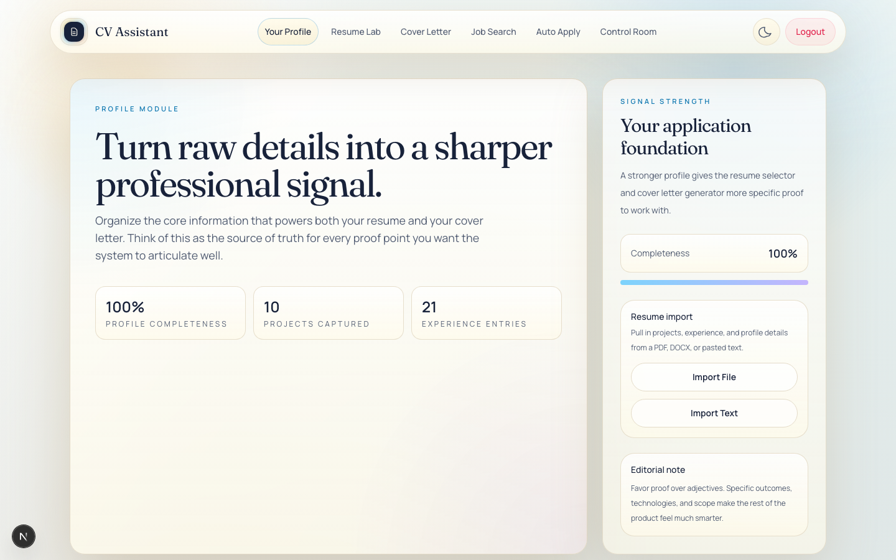
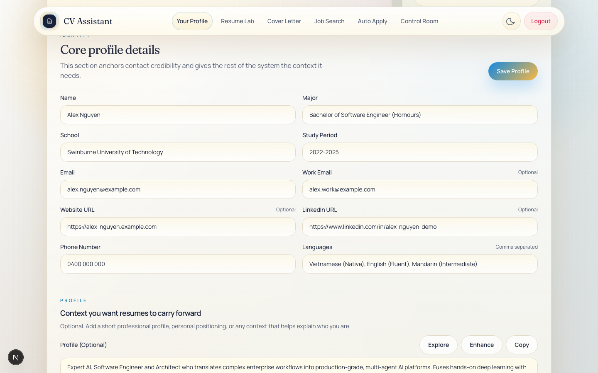
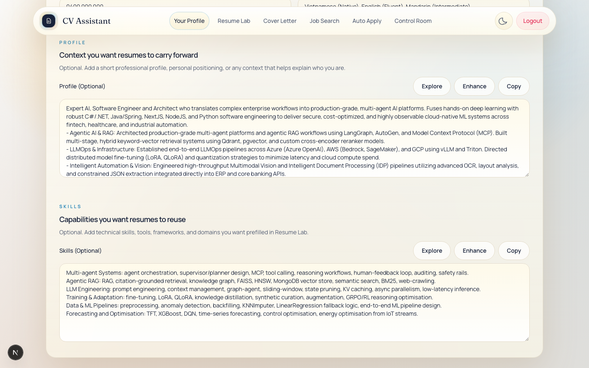
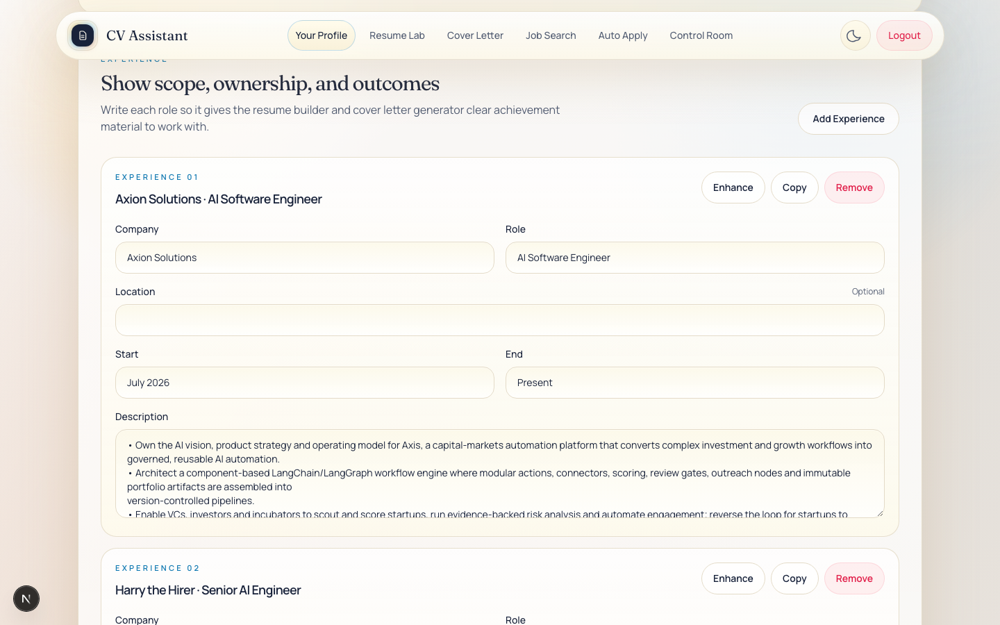
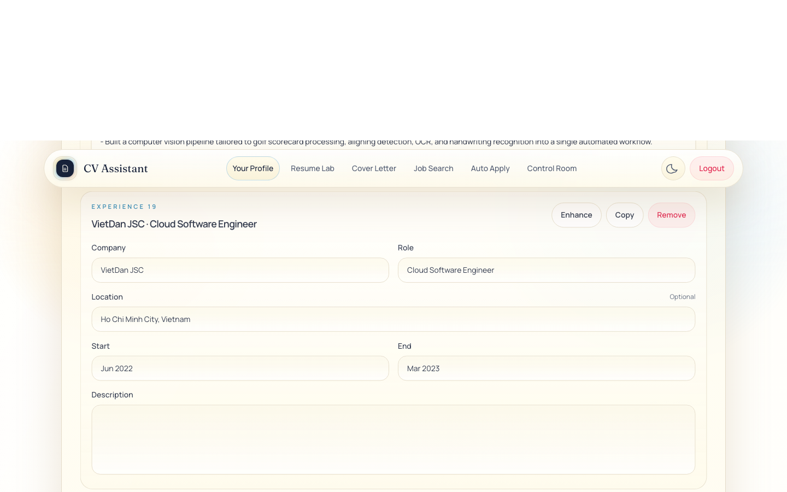
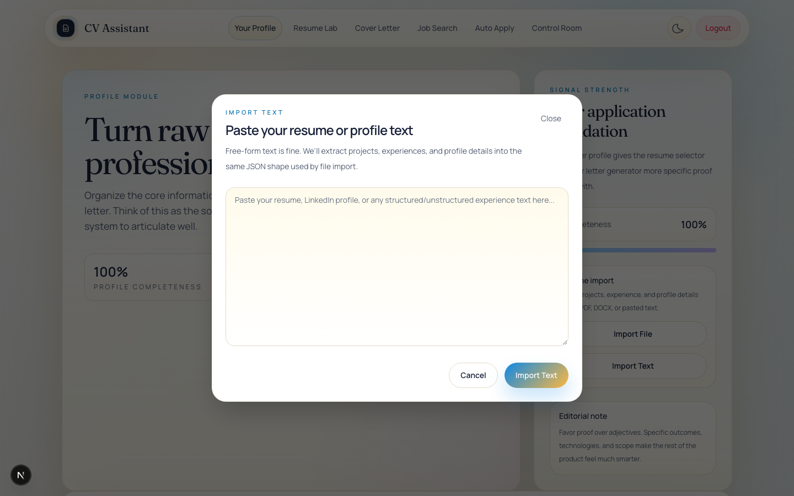
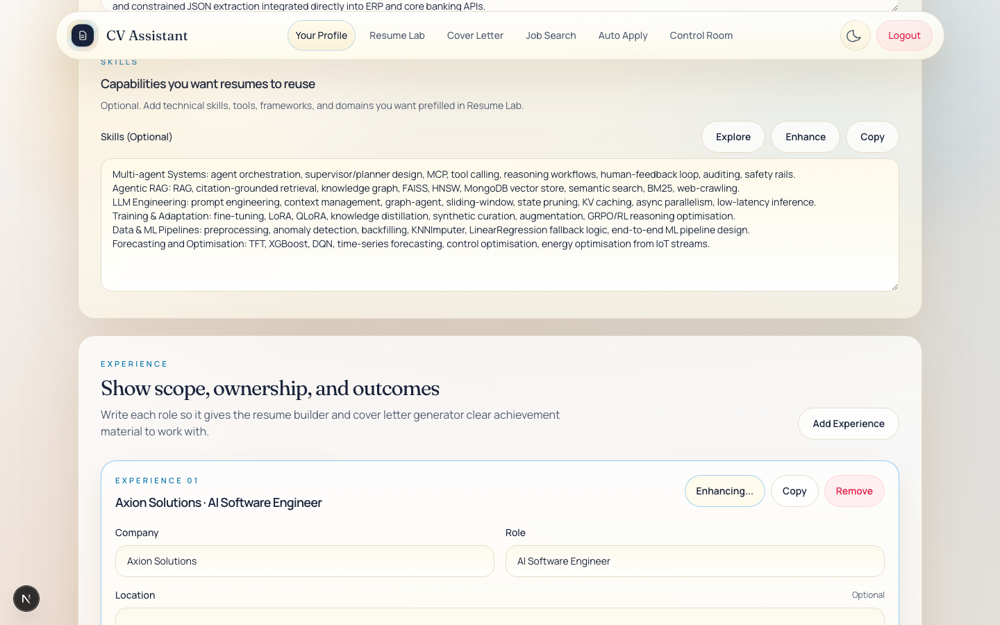

# Profile

> Status: derived from the source code in `cv-assistant/` as at 2026-11-07. File paths are relative to `cv-assistant/`. This document was written by reading the code. It has not been checked against a running instance. Items marked **(code reading)** are inferred from the code and should be confirmed in the app before anyone relies on them.

## Contents

1. [Purpose](#1-purpose)
2. [Source file map](#2-source-file-map)
3. [User interface walkthrough](#3-user-interface-walkthrough)
4. [Data shape](#4-data-shape)
5. [Import pipeline](#5-import-pipeline)
6. [Enhancement pipeline](#6-enhancement-pipeline)
7. [API reference](#7-api-reference)
8. [How profile data feeds other modules](#8-how-profile-data-feeds-other-modules)
9. [Edge cases and known limitations](#9-edge-cases-and-known-limitations)
10. [Automated tests](#10-automated-tests)

## 1. Purpose

The Profile is the candidate's source of truth in CV Assistant (CVA). It holds contact details, a short profile statement, skills, work experience (`experiences`) and project evidence (`projects`). Other modules read it so the candidate does not have to enter the same information twice:

- **Cover Letter** (`/generate`) builds its evidence list from projects and experiences.
- **Resume Lab** (`/resume`) lists projects and experiences for selection, prefills its Skills field, and renders PDFs from the stored profile.
- **Auto Apply** (`/auto-apply`) uses contact fields, employers, location and per-entry summaries to answer application questions and to draft the search brief.
- **Control Room** (`/control-room`) seeds its own `UserContext` from the profile the first time it is loaded.

Beyond plain editing, the Profile page does three things:

1. **Import.** It reads an uploaded PDF or DOCX, or pasted text, and fills the form with an AI-extracted draft.
2. **Enhance and explore.** It rewrites or generates text for project and experience descriptions, the profile statement and Skills.
3. **Summarise on save.** Each new or changed project and experience gets a one or two sentence AI summary. Other modules use these summaries.

Typical workflow:

1. Import a CV (file or pasted text), or type the details directly.
2. Review the imported entries. Imported entries appear in the form but are not saved yet.
3. Optionally use Enhance or Explore on any text.
4. Click **Save Profile**. Nothing is saved until this click, except the Location field, which saves on its own (see section 3.7).

## 2. Source file map

| File | Role |
|---|---|
| `src/app/profile/layout.tsx` | Wraps the page and mounts `ExperienceLocationInjector`. |
| `src/app/profile/page.tsx` | Client page: form state, import, enhance, explore, copy, save. |
| `src/components/profile/ExperienceLocationInjector.tsx` | Client component (renders nothing) that adds a Location input to each experience card and saves it. |
| `src/app/api/profile/route.ts` | `GET` and `PUT` for the profile, including summary generation. |
| `src/app/api/ocr/route.ts` | `POST` for resume import (pasted text, PDF, DOCX). |
| `src/app/api/enhance/route.ts` | `POST` for AI enhancement and exploration of text. |
| `src/lib/profile-import.ts` | Text and PDF extraction, the import prompt, and output normalisation. |
| `src/lib/profile-sync.ts` | Broadcasts a "profile updated" signal (localStorage and a window event). |
| `src/lib/experience-ordering.ts` | Date parsing and the recency sort for experiences. |
| `src/lib/resume/text-section-prompts.ts` | Prompts and output handling for the Profile statement and Skills. |
| `src/lib/resume/high-impact-rewrite.ts` | Prompt and output handling for project and experience bullets. |
| `src/lib/resume/profile.ts` | Paragraph helpers for profile text (used by the Control Room resume specialist). |
| `src/lib/models/User.ts` | `User` model with the `profile` sub-schemas and `autoApplyPreferences`. |
| `src/lib/ai.ts` | Model presets (`easy`, `hard`, `document`) and the NVIDIA NIM client. |
| `src/lib/auth.ts` | Auth cookie, JWT signing and verification. |
| `src/lib/db.ts` | MongoDB connection (database `cv_assistant`). |
| `src/lib/api.ts` | `buildApiUrl`, which prefixes `NEXT_PUBLIC_BASE_PATH` onto API calls. |
| `src/middleware.ts` (re-exported by root `middleware.ts`) | Redirects page requests without an `auth_token` cookie to `/login`. |

Libraries used in this area (from `package.json`): `next` 15.5.15, `react` 19.1.0, `mongoose` ^8.17.2, `mammoth` ^1.12.0 (DOCX text), `pdfjs-dist` ^4.10.38 (PDF text and page rendering), `@napi-rs/canvas` ^0.1.100 (rendering PDF pages to images), `jsonwebtoken` 9.0.3.

## 3. User interface walkthrough

### Screenshots


*Profile overview with completeness, import panel and signal strength.*


*Core profile fields. Contact details shown here are placeholders.*


*Profile summary and skills, each with Explore, Enhance and Copy.*


*Experience cards with Enhance, Copy and Remove actions.*


*Project cards in the Projects section.*


*The Import Text dialogue for pasted resume text.*


*An experience card while AI enhancement is running.*


### 3.1 Page structure and states

- **Route and navigation.** `/profile`, a client component in `src/app/profile/page.tsx`. The navigation label is "Your Profile" (`src/components/Navbar.tsx`).
- **Layout.** The page is a single scrolling view with no tabs. It has three panels, Identity (contact details, Profile statement and Skills), Experience and Projects, plus a sidebar (the `aside` of `ModuleShell`) holding the completeness meter and the import controls.
- **Header statistics** (from `ModuleShell`): "Profile completeness" (percentage), "Projects captured" (count, including unsaved new entries) and "Experience entries" (count, including unsaved new entries).

| State | When it appears | What the user sees |
|---|---|---|
| Loading | Until the first `GET /api/profile` has finished | Spinner panel: "Loading profile workspace", with "Preparing your identity and evidence canvas." |
| Ready | Normal state | The full form. |
| Error banner | Any failed copy, import, enhance or save action | A red panel above the Identity panel with the message. It is cleared when the next save, import, enhance or copy starts. |
| Import dialog | "Import Text" clicked | Modal dialog (section 3.9). |
| No experiences | `experiences` is empty | Card: "No experience entries yet. Add internships, freelance work, or employment to widen your evidence base." |
| No projects | `projects` is empty | Card: "No projects yet. Add a few signature builds to strengthen your application evidence." |
| Saving | Save in progress | The "Save Profile" button reads "Saving..." and is disabled. |
| Parsing a file | A file has been selected | The "Import File" label reads "Parsing file...". |
| Importing text | "Import Text" clicked in the dialog | The dialog's button reads "Importing..." and is disabled. |

**Save.** "Save Profile" (in the Identity panel header) sends the whole profile in one `PUT /api/profile`: all 12 scalar fields, the Profile statement, Skills, every experience and every project. There is no autosave and no success message. The button simply returns to "Save Profile" when the save finishes. Location is the one exception (section 3.7).

**Deletion.** "Remove" on an experience or project opens the browser's native confirmation. The confirmation texts are "Are you sure you want to delete this experience?" and "Are you sure you want to delete this project?". A confirmed removal takes effect in the form at once and is stored only when the profile is saved.

### 3.2 Profile completeness

The completeness percentage (`completeness` in `src/app/profile/page.tsx`) counts how many of these eight fields are non-blank, then rounds the share to a whole number:

Name, Major, School, Email, Phone Number, Website URL, LinkedIn URL and Languages.

Work Email, Study Period, Skills, the Profile statement and the entries are not counted. Website URL, LinkedIn URL and Languages are counted even though they are marked Optional, so 100% needs all eight fields.

The percentage appears in the header statistics and in the sidebar "Completeness" row, which has a progress bar.

### 3.3 Identity panel: core details

Heading: kicker "Identity", title "Core profile details", description "This section anchors contact credibility and gives the rest of the system the context it needs." The "Save Profile" button sits in this header.

| Label | Stored field | Input type | Placeholder | Hint |
|---|---|---|---|---|
| Name | `name` | text | none | none |
| Major | `major` | text | none | none |
| School | `school` | text | none | none |
| Study Period | `studyPeriod` | text | `2019 - 2023` | none |
| Email | `email` | email | none | none |
| Work Email | `workEmail` | email | `you@company.com` | Optional |
| Website URL | `website` | text | `https://yourwebsite.com` | Optional |
| LinkedIn URL | `linkedin` | text | `https://linkedin.com/in/yourprofile` | Optional |
| Phone Number | `phone` | text | none | none |
| Languages | `languages` | text | `English, Spanish, French` | Comma separated |

Notes:

- No `<form>` element wraps these inputs. None of them has `required`, `maxLength` or `pattern`. The email inputs use `type="email"`, but nothing checks the format on the page or on the server.
- Values are stored as typed (section 9.1).
- Each label's `htmlFor` is derived from the label text, for example `study-period`, `work-email` and `linkedin-url`.

### 3.4 Profile statement

Panel: kicker "Profile", title "Context you want resumes to carry forward", text "Optional. Add a short professional profile, personal positioning, or any context that helps explain who you are."

- Label: "Profile (Optional)". Textarea `id="profile-summary"`, stored in `profileSummary`.
- Placeholder: "Product-minded software engineer with experience shipping AI-assisted workflows, translating ambiguity into systems, and collaborating across design, product, and engineering."
- Buttons: Explore, Enhance and Copy (section 3.6).

### 3.5 Skills

Panel: kicker "Skills", title "Capabilities you want resumes to reuse", text "Optional. Add technical skills, tools, frameworks, and domains you want prefilled in Resume Lab."

- Label: "Skills (Optional)". Textarea `id="profile-skills"`, stored in `skills`.
- Helper text beside the buttons: "Comma separated or line separated". It is hidden below the `2xl` breakpoint.
- Placeholder: "Python, TypeScript, React, Node.js, Docker, RAG, LLM evaluation".
- Resume Lab copies this value into its own Skills field when it loads (`src/components/resume/useResumeStudio.ts`).

### 3.6 Explore, Enhance and Copy (Profile statement and Skills)

Both text areas share the same button group (`TextSectionActionButtons` in `src/app/profile/page.tsx`).

| Button | Busy label | What it does | Messages |
|---|---|---|---|
| Explore | "Exploring..." | Sends the field text and the rest of the form to `POST /api/enhance` with `mode: "explore"`, then replaces the field with the result. | Blank evidence: "Please add education, project, or experience details before exploring profile" (or "skills"). Failure: "Failed to explore profile content" (or "skills"). |
| Enhance | "Enhancing..." | Sends the field text with `mode: "enhance"`, then replaces the field with the result. | Blank field: "Please add profile details before enhancing" (or "skills"). Failure: "Failed to enhance profile content" (or "skills"). |
| Copy | "Copied" for 1.5 seconds | Copies the trimmed field text to the clipboard. | Blank field: "Please add profile details before copying" (or "skills"). Clipboard failure: "Failed to copy profile details" (or "skills"). |

Notes:

- Explore and Enhance are disabled only for the field whose action is running. Copy is never disabled.
- Explore and Enhance overwrite the text area without confirmation and without undo. Nothing is saved until Save Profile.
- The Explore button has a tooltip (`HoverTooltip`) and a native `title` attribute with the same text. The Profile statement tooltip is: "Explore writes a direct, concise profile from your education, projects, experience, and saved skills so the summary sounds confident and employer-ready." The Skills tooltip is: "Explore derives the strongest employer-friendly skills from your education, projects, and experience so this section stays concise, focused, and ATS-friendly."
- Explore sends this evidence: Major, School, Study Period, projects (name, summary, description) and experiences (company, role, start, end, summary, description). Blank projects and experiences are dropped. Location is not sent. For the Profile statement, the current Skills text is also sent. For Skills, it is not.
- The client allows Explore only when there is at least one of Major, School, Study Period, a project or an experience with some content. The server checks the same rule (section 6.2).

### 3.7 Experience

Panel: kicker "Experience", title "Show scope, ownership, and outcomes", text "Write each role so it gives the resume builder and cover letter generator clear achievement material to work with." Button: "Add Experience".

"Add Experience" inserts a blank entry at the top of the list. The entry is pinned to the top as a draft until the next successful save. Because it has no dates, it sorts below dated entries once saved (section 4.6).

Each card has:

- **Header.** "Experience NN" (the display position, zero-padded to two digits) and the title "{Company or 'Company'} · {Role or 'Role'}".
- **Buttons.** Enhance (busy label "Enhancing..."; sends the description, section 6), Copy (shows "Copied" for 1.5 seconds) and Remove (confirmation, then deletes).
- **Fields.**

| Label | Stored field | Placeholder | Notes |
|---|---|---|---|
| Company | `companyName` | none | Blank allowed. |
| Role | `role` | none | Blank allowed. |
| Start | `timeFrom` | `Jan 2023` | Free text. |
| End | `timeTo` | `Present` | Free text. Drives the ordering (section 4.6). |
| Description | `description` | none | Textarea, 5 rows. |

Copy produces lines for the non-blank values only: "Company: ...", "Role: ...", "Start: ...", "End: ...", "Description: ...".

**Location (added at runtime).** Each experience card also shows a "Location" text input (hint "Optional") placed before the Start field. The page's own code does not render it. `src/components/profile/ExperienceLocationInjector.tsx` adds it to the DOM after load and after DOM changes, and saves it independently of Save Profile:

- 650 ms after typing stops, or on blur, the component sends `PUT /api/profile` with the full experience list, changing only that card's `location`.
- Clicking any button whose text matches "save profile" also saves all visible Location values after 900 ms.

Auto Apply uses the first non-blank Location as the candidate's current location when preferences do not set one. Section 9.3 lists the limitations of this approach.

### 3.8 Projects

Panel: kicker "Projects", title "Keep proof points specific", text "Projects should read like compact case studies: what you built, how you built it, and why it mattered." Button: "Add Project", which inserts a blank draft at the top.

Each card has:

- **Header.** "Project NN" and the name, or "Untitled Project" when the name is blank.
- **Buttons.** Enhance (busy label "Enhancing..."), Copy ("Copied" for 1.5 seconds) and Remove (confirmation).
- **Fields.** "Project Name" (`name`, text) and "Project Description" (`description`, textarea, 5 rows).

Copy produces "Project: ..." and "Description: ..." lines for the non-blank values.

Projects have no visible summary field. Project numbers follow creation time, newest first (section 4.6). Projects cannot be reordered by hand.

### 3.9 Import Text dialog

Opened from the sidebar's "Import Text" button. It is a modal (`role="dialog"`, `aria-modal="true"`, labelled by its heading):

- Kicker "Import Text". Heading "Paste your resume or profile text". Text: "Free-form text is fine. We'll extract projects, experiences, and profile details into the same JSON shape used by file import."
- Close button with visible text "Close" and accessible name "Close import text modal".
- Textarea with placeholder "Paste your resume, LinkedIn profile, or any structured/unstructured experience text here...". The UI sets no length limit.
- Buttons: "Cancel" (closes and clears the text) and "Import Text" (disabled while importing; reads "Importing...").

Behaviour:

- **Blank text.** The error "Paste resume text before importing" is shown. The dialog stays open.
- **Success.** The result is merged into the form (section 5.8), the text is cleared and the dialog closes. The merge is local: it is not saved until Save Profile.
- **Failure.** The server's error message is shown in the page error banner. If the request itself failed, the banner shows "Failed to parse text. Please try again." The dialog stays open. **(code reading)** The banner sits behind the modal overlay, so the message may not be visible while the dialog is open.
- The dialog closes only through Close, Cancel or a successful import. Escape and backdrop clicks do nothing.

### 3.10 Import File control

In the sidebar's "Resume import" panel, a label styled as a button reads "Import File" (or "Parsing file..." while parsing). It wraps a file input with `accept=".pdf,.docx"`. Choosing a file starts the import at once.

- The picker is filtered to `.pdf` and `.docx`, but the server also checks the file type (section 5.2). Users can still select other files by changing the picker's filter.
- The control is not disabled while parsing, so a second selection starts another request.
- On success, the result is merged as for text. The file input is then reset.
- On failure the banner shows the server's error text, or "Failed to parse file" when the response has no error text, or "Failed to parse file. Please try again." when the request itself failed.
- The file input has the `hidden` class (display: none), so the control cannot be reached with the keyboard. **(code reading)**

### 3.11 Messages reference

| Message | When it appears |
|---|---|
| Paste resume text before importing | Import Text is clicked with blank text. |
| Failed to parse text | The text import returned an error without an `error` field. |
| Failed to parse text. Please try again. | The text import request threw. |
| Failed to parse file | The file import returned an error without an `error` field. |
| Failed to parse file. Please try again. | The file import request threw. |
| Failed to save | Save failed and the response had no JSON error. |
| The server's error text (for example `Unauthorized` or `User not found`) | Save failed with a JSON error. |
| Please add a description before enhancing | Enhance on a project or experience with a blank description. |
| Failed to enhance project description | Project Enhance failed. This also happens when the project name is blank (section 9.5). |
| Failed to enhance experience description | Experience Enhance failed. |
| Please add project details before copying | Copy on a project with a blank name and description. |
| Failed to copy project details | The clipboard write failed. |
| Please add experience details before copying | Copy on an experience with every field blank. |
| Failed to copy experience details | The clipboard write failed. |
| The Profile and Skills messages in section 3.6 | Explore, Enhance and Copy on the two text areas. |

There are no success messages.

### 3.12 Validation summary

- The page has no HTML validation attributes and no `<form>` element.
- Blank values are allowed everywhere, including project names, company and role.
- The only client-side checks are the messages in sections 3.6 and 3.11.
- The server checks authentication, the presence of the required request fields on `/api/enhance` and `/api/ocr`, and the user's existence on save. It does not check formats or lengths (sections 6 and 7).

## 4. Data shape

### 4.1 The User document

`src/lib/models/User.ts` defines the Mongoose model `User`. The connection is made in `src/lib/db.ts` to database `cv_assistant`.

| Path | Type | Default | Notes |
|---|---|---|---|
| `username` | String | required, unique, indexed | Login name. |
| `passwordHash` | String | required | Not used by the Profile. |
| `profile` | `ProfileSchema` (sub-document) | `{}` | Described in 4.2 to 4.4. |
| `autoApplyPreferences` | Mixed | `{}` | Written by `PUT /api/auto-apply/preferences` (`src/app/api/auto-apply/preferences/route.ts`). `PUT /api/profile` does not touch it. |

The TypeScript types `Profile`, `Project`, `Experience` and `User` are inferred from these schemas.

Sign-up (`src/app/api/auth/register/route.ts`) does not set any profile fields, so new users get the schema defaults.

### 4.2 Profile fields

| Field | Type | Default | Where it is used (section 8 has the detail) |
|---|---|---|---|
| `name` | String | `""` | Page, cover letter claim checks, PDF name, Auto Apply contact answers. |
| `major` | String | `""` | Explore evidence, PDF education line, Auto Apply education. |
| `school` | String | `""` | As for `major`. |
| `studyPeriod` | String | `""` | As for `major`. |
| `email` | String | `""` | PDF contact line (after Work Email), Auto Apply email answer. |
| `workEmail` | String | `""` | Preferred for the cover letter and PDF contact lines. |
| `phone` | String | `""` | Cover letter and PDF contact lines, Auto Apply phone answer. |
| `website` | String | `""` | Cover letter and PDF contact lines, Auto Apply website answer. |
| `linkedin` | String | `""` | Cover letter and PDF contact lines, Auto Apply LinkedIn answer. |
| `profileSummary` | String | `""` | PDF summary, Auto Apply candidate summary, Control Room resume specialist. |
| `skills` | String | `""` | Resume Lab Skills prefill, PDF skills fallback, Auto Apply candidate summary, Control Room tech stack. |
| `languages` | String | `""` | Cover letter contact line, PDF languages, Auto Apply candidate summary. |
| `projects` | `[ProjectSchema]` | `[]` | Entry lists in Generate, Resume and Auto Apply (section 4.3). |
| `experiences` | `[ExperienceSchema]` | `[]` | Entry lists in Generate, Resume and Auto Apply (section 4.4). |

### 4.3 Project entries (`ProjectSchema`)

| Field | Type | Default | Notes |
|---|---|---|---|
| `_id` | ObjectId | generated | Identity for matching on save. |
| `name` | String | none (declared `required`) | Not enforced on save (section 9.1). |
| `description` | String | `""` | Source text. Replaced by Enhance when used. |
| `summary` | String | `""` | AI summary, generated on save (section 6.6). Not shown on the page. |
| `createdAt` | Date | now | Drives project order (section 4.6). |

### 4.4 Experience entries (`ExperienceSchema`)

| Field | Type | Default | Notes |
|---|---|---|---|
| `_id` | ObjectId | generated | Identity for matching on save. |
| `companyName` | String | none (declared `required`) | Not enforced on save (section 9.1). |
| `role` | String | none (declared `required`) | Not enforced on save (section 9.1). |
| `location` | String | `""` | Set by the Location field (section 3.7). Not in the import. |
| `timeFrom` | String | `""` | Start, free text such as `Jan 2023`. |
| `timeTo` | String | `""` | End, free text such as `Present`. |
| `description` | String | `""` | Source text. |
| `summary` | String | `""` | AI summary, generated on save. Not shown on the page. |
| `createdAt` | Date | now | Tie-break in ordering. |
| `updatedAt` | Date | now | Set to the save time when the content changes; otherwise kept. Tie-break in ordering. |
| `normalizedTimeTo` | String | `""` | Normalised date in `DD/MM/YY` form, taken from End or, when End is blank, Start. |
| `normalizedTimeToSortKey` | Number | `null` | Sort key `YYYY * 10000 + MM * 100 + DD`. `null` when undated or current. |
| `normalizedTimeToIsPresent` | Boolean | `false` | `true` for "Present" and similar words. |
| `normalizedTimeToSource` | String | `""` | `timeTo` or `timeFrom` when the entry is dated or current. Empty when undated. |

The four `normalized*` fields are recalculated by `deriveExperienceOrderingMetadata` on every save (`src/lib/experience-ordering.ts`).

### 4.5 Fields used only in the browser

| Field | Used on | Purpose |
|---|---|---|
| `_clientId` | Projects and experiences | Stable React key for each card. Stripped before every save. |
| `_needsSummary` | Projects and experiences | Set to `true` by the page on any edit to the entry, on Enhance, and on every new or imported entry. Tells the save to regenerate the summary. Not stored. |

### 4.6 Ordering rules

**Projects** are sorted by `createdAt`, newest first. The server does this on save (`normalizeTimeline` in `src/app/api/profile/route.ts`) and the page does it on load (`hydrateList`). "Project 01" is the newest.

**Experiences** are sorted by `compareExperiencesByRecency` (`src/lib/experience-ordering.ts`), on the server and in the page:

1. Entries marked current (`normalizedTimeToIsPresent`) come first.
2. Dated entries come before undated entries.
3. Among dated entries, the later date comes first.
4. Ties go to the newer `updatedAt`, then the newer `createdAt`.

The date used is End (`timeTo`) when End is not blank, otherwise Start (`timeFrom`). If End is filled but cannot be parsed, the entry is undated; Start is not used as a fallback. A blank End does not make an entry current.

Words that mark an entry as current (whole value, case-insensitive): `present`, `current`, `now`, `ongoing`, `today`.

Accepted date forms, with the result the parser produces:

| Input | Result | Notes |
|---|---|---|
| `Jan 2023`, `January 2023` | 1 January 2023 | Day defaults to 1. |
| `5 March 2021`, `March 5th, 2021` | 5 March 2021 | Ordinal suffixes are removed first. |
| `Sept. 2020` | 1 September 2020 | Full stops and hyphens are treated as spaces. |
| `2021-03`, `2021/03`, `03/2021` | 1 March 2021 | Two numeric parts. A four-digit part is the year and the other part is the month. |
| `03/04/2021` | 3 April 2021 | Numeric dates are read day first unless one part is above 12. |
| `13/04/2021`, `04/13/2021` | 13 April 2021 | The part above 12 must be the day. |
| `2019` | 1 January 2019 | Year only. |
| `Jan 21` | 1 January 2021 | Two-digit years: 70 to 99 mean 19xx, 00 to 69 mean 20xx. |
| `Summer 2020` | Undated | No month name or numeric pattern is recognised. |

### 4.7 Example profile response (illustrative)

Values are invented for illustration only.

```json
{
  "profile": {
    "name": "Example Candidate",
    "major": "Information Systems",
    "school": "Example University",
    "studyPeriod": "2019 - 2023",
    "email": "candidate@example.com",
    "workEmail": "",
    "phone": "",
    "website": "",
    "linkedin": "",
    "profileSummary": "Analyst focused on reporting automation.",
    "skills": "SQL, Python, Power BI",
    "languages": "English",
    "projects": [],
    "experiences": [
      {
        "_id": "66a1f0c2e4b0a1b2c3d4e5f6",
        "companyName": "Example Pty Ltd",
        "role": "Data Analyst",
        "location": "Sydney, NSW",
        "timeFrom": "Jan 2023",
        "timeTo": "Present",
        "description": "- Automated monthly reporting in SQL and Power BI",
        "summary": "Data analyst at Example Pty Ltd since January 2023, automating monthly reporting.",
        "createdAt": "2026-01-10T03:12:45.000Z",
        "updatedAt": "2026-01-10T03:12:45.000Z",
        "normalizedTimeTo": "",
        "normalizedTimeToSortKey": null,
        "normalizedTimeToIsPresent": true,
        "normalizedTimeToSource": "timeTo"
      }
    ]
  }
}
```

## 5. Import pipeline

### 5.1 Overview

There are two entry points, the Import Text dialog and the Import File control. Both call one endpoint, `POST /api/ocr`. The route delegates to `src/lib/profile-import.ts`. The import makes one model call per attempt and returns a draft. The client merges the draft into the form. **The import never writes to the database.** The user must click Save Profile.

### 5.2 Input types

| Input | How it is detected | Extraction | What the model receives | Limits | Errors (HTTP status 500 unless noted) |
|---|---|---|---|---|---|
| Pasted text | JSON body `{ "text": ... }` | The text is trimmed. | One text part. | None in the code. | 400 `No text provided` when the text is blank. |
| DOCX | MIME `application/vnd.openxmlformats-officedocument.wordprocessingml.document`, or a name ending in `.docx` | `mammoth.extractRawText`. Raw text only; images are not extracted. | The raw text, as for pasted text. | No page or size limit in the code. | Empty text gives `No profile text provided`. Errors from mammoth are returned unchanged. |
| PDF | MIME `application/pdf`, or a name ending in `.pdf` | pdf.js, page by page (section 5.5). | Text parts (`Page N:`) and image parts (`Page N image:` followed by a JPEG). | 12 pages maximum. | `Please upload a PDF with no more than 12 pages.` or `Could not read the PDF. Please upload a valid, unprotected PDF or a DOCX file.` |
| Anything else (for example `.doc` or an image) | Neither check matches. | None. | None. | None. | `Unsupported file type. Please upload a PDF or DOCX file.` |

Type detection checks the browser MIME type and the file name, so a `.pdf` with an unexpected MIME type is still treated as a PDF.

### 5.3 Step by step: pasted text

1. The client (`importText` in `src/app/profile/page.tsx`) rejects blank input with "Paste resume text before importing".
2. The client sends `POST /api/ocr` with `Content-Type: application/json` and body `{ "text": "..." }`. The client sets no size limit.
3. The route checks the auth cookie (401 `Unauthorized`), then checks that `text` is not blank (400 `No text provided`).
4. `parseProfileImportFromText` trims the text and calls `runProfileImport` with one text part.
5. `runProfileImport` calls `getModel('document')`, sends the import prompt and the text, and parses the reply (section 5.6).
6. The route returns `{ "data": ImportedProfileData }`.
7. The client merges the data (section 5.8), clears the text and closes the dialog.

### 5.4 Step by step: DOCX

Steps 1 and 2 are as for pasted text, with `multipart/form-data` and a field named `file`.

3. The route checks auth, then reads `formData.get('file')`. A missing or non-file value gives 400 `No file`.
4. `parseProfileImportFromFile` detects the type and reads the file into a Buffer (there is no size check).
5. `mammoth.extractRawText({ buffer })` returns the raw text. Its `value` is passed to `parseProfileImportFromText`, so an empty document gives `No profile text provided`.
6. There is no try/catch around mammoth. A corrupt DOCX returns the library's own error message in the 500 response.
7. Steps 5 to 7 of section 5.3 follow.

### 5.5 Step by step: PDF

1. The file is read into a Buffer and opened with `getDocument({ data, useSystemFonts: true })` from `pdfjs-dist/legacy/build/pdf.mjs`.
2. If the document has more than 12 pages, the process stops with `Please upload a PDF with no more than 12 pages.`
3. Each page is processed in order:
   1. **Text.** `getTextContent()` is read. Text items are joined with single spaces and trimmed. If the result is not empty, a text part `Page N:` followed by the text is added. Line breaks are not kept. **(code reading)**
   2. **Image check.** `getOperatorList()` is read. The page is also rendered as an image if its text is shorter than 100 characters, or if it contains any image paint operator (inline image, image XObject or image mask). A page can be sent as both text and image.
   3. **Rendering.** The page is drawn at a scale of `min(2, 1800 / longer side in points)`, so the longer side is at most 1800 pixels and the scale is at most 2. The canvas comes from `@napi-rs/canvas` and is encoded as JPEG at quality 85. The image is added as a text part `Page N image:` followed by an `image/jpeg` part.
4. Any other error (encrypted, corrupt, or a rendering failure) gives `Could not read the PDF. Please upload a valid, unprotected PDF or a DOCX file.`
5. The parts are passed to `runProfileImport`.

A blank page has no text, so it is sent as an image. A 12-page scanned CV therefore sends 12 images.

### 5.6 Model call and parsing

- **Prompt.** `PROFILE_IMPORT_PROMPT` in `src/lib/profile-import.ts` asks for strict JSON with the 12 scalar fields, `projects` as `[{name, description}]` and `experiences` as `[{companyName, role, timeFrom, timeTo, description}]`. It says "Return ONLY JSON with no markdown fences", asks for empty strings or empty arrays when data is missing, and says "Preserve the candidate's own facts and avoid inventing details." The prompt is sent as the first part, followed by the document parts.
- **Model tier.** `getModel('document')`. For text-only input the `document` model list is used. If any image part is present, `src/lib/ai.ts` uses the vision model list instead, whatever the tier (section 6.5).
- **Attempts.** Up to 3. An error from the model, or a reply that cannot be parsed, counts as a failed attempt. The JSON is taken from the first `{` to the last `}` in the reply, parsed, and normalised.
- **Failure.** After three failed attempts the error is `Failed to parse profile import JSON: <last error>`, for example `Failed to parse profile import JSON: Error: NVIDIA NIM request timed out`. Each model call has its own deadline (section 6.5), so the worst case is three deadlines in a row.

### 5.7 Normalisation

`normalizeImportedProfile` in `src/lib/profile-import.ts`:

- Non-string values become `""`. Strings are trimmed.
- Array items that are not objects are dropped.
- A project is kept when its `name` or `description` is non-empty.
- An experience is kept when any of `companyName`, `role`, `timeFrom`, `timeTo` or `description` is non-empty.
- The output never includes `location`, `summary` or any date normalisation.

### 5.8 Client merge

`mergeImportedProfile` in `src/app/profile/page.tsx`:

- Each of the 12 scalar fields takes the imported value only when the current value is blank. Existing values win.
- Imported projects are added to the top of the project list.
- Imported experiences are added and the experience list is sorted by recency.
- Every imported entry gets `_needsSummary: true`, so its summary is generated on Save.
- Imported entries get timestamps of "import time plus index" milliseconds. Projects therefore keep the source order until the first save, which then reverses it (section 9.2).
- There is no de-duplication against existing entries (section 9.4).
- The result is not saved. The user must click Save Profile.

### 5.9 Operational notes

- `src/app/api/ocr/route.ts` sets `export const runtime = 'nodejs'` and `export const dynamic = 'force-dynamic'`.
- `next.config.ts` lists `mongoose`, `pdfjs-dist` and `@napi-rs/canvas` as `serverExternalPackages`. It includes `node_modules/pdfjs-dist/legacy/build/pdf.worker.mjs` and the `@napi-rs/canvas` platform binaries in the traced output of `/api/ocr`.
- No `maxDuration`, body size limit or file size limit is set in the route, in `next.config.ts` or in `vercel.json`.

## 6. Enhancement pipeline

### 6.1 Entry points

| Where | Button | `type` sent | `name` sent | `mode` |
|---|---|---|---|---|
| Project card | Enhance | `project` | Project name (may be blank) | Bullet rewrite (no mode) |
| Experience card | Enhance | `experience` | `Company - Role` (never blank, because of the separator) | Bullet rewrite (no mode) |
| Profile statement | Enhance | `profile` | `Profile` | `enhance` |
| Profile statement | Explore | `profile` | `Profile` | `explore`, with `context` |
| Skills | Enhance | `skills` | `Skills` | `enhance` |
| Skills | Explore | `skills` | `Skills` | `explore`, with `context` |

Only the Profile page calls `/api/enhance`. Resume Lab's `/api/resume/enhance-targeted` route reuses the bullet prompt module (`src/lib/resume/high-impact-rewrite.ts`), with its own format option.

### 6.2 Routing inside `/api/enhance`

`src/app/api/enhance/route.ts` works as follows:

1. Auth. Missing or invalid cookie gives 401 `Unauthorized`.
2. The JSON body is read. This happens outside the try block, so malformed JSON gives a framework 500.
3. If `type` or `name` is missing, the route returns 400 `Missing required fields`.
4. The model is `getModel('hard')`.
5. **Text-section branch** (`type` is `profile` or `skills`):
   - Mode is `explore` only when `mode === 'explore'`. Any other value means `enhance`.
   - Explore without evidence returns 400 `Missing education, project, or experience context`. The evidence test passes when there is a major, school or study period, or any project or experience with some content. Skills alone do not count.
   - Enhance without a description returns 400 `Missing required fields`.
   - The prompt comes from `buildTextSectionPrompt`, and the output from `normalizeTextSectionOutput(text, description.trim())`.
   - Success returns 200 with `message` set to `profile content generated successfully` (explore) or `profile content enhanced successfully` (enhance). The same pattern applies to `skills`.
6. **Bullet branch** (any other `type`):
   - A missing description returns 400 `Missing required fields`.
   - The prompt comes from `buildHighImpactRewritePrompt({ itemType: type, itemName: name, originalContent: description })`. No requested format is passed, so the default `preserve` mode applies.
   - The output comes from `normalizeHighImpactBulletOutput(text, description)`.
   - Success returns 200 with `message` set to `<type> description enhanced successfully`.
7. Any error inside the try block returns 500 `{ "error": "Failed to enhance description" }`, and the error is logged with `console.error`.

The `type` value is not validated. Any string other than `profile` or `skills` goes to the bullet branch and is placed in the prompt as the item type.

### 6.3 Prompt strategy

All prompts are plain-text instructions. None uses few-shot examples.

| Target | Prompt (source) | Input | Main instructions |
|---|---|---|---|
| Profile statement, enhance | `buildTextSectionPrompt`, type `profile`, mode `enhance` | The current text only | Rewrite as "a concise professional summary suitable for a resume". Preserve only grounded information. Factual, polished, specific tone. A short paragraph, not bullets. Avoid first-person pronouns. Return only the summary. |
| Profile statement, explore | `buildTextSectionPrompt`, type `profile`, mode `explore` | Education, existing Skills, projects (summary and description) and experiences (dates, summary and description) | Industrially professional, employer-ready tone. One short paragraph of 2 to 3 sentences. Confident, active language. No first-person phrasing ("I am", "I have", "My skills", "My background"). If early-career, anchor in the major or education. No invented achievements, technologies, seniority or scope. Return only the summary text. |
| Skills, enhance | Type `skills`, mode `enhance` | The current text only | Rewrite as a concise, polished list. Preserve only grounded information. Remove duplicates and normalise tool and framework names. Prefer one comma-separated line. |
| Skills, explore | Type `skills`, mode `explore` | Education, projects and experiences (not the existing Skills) | Create a concise skills section from verified evidence only. Prefer broad professional categories and core strengths. Deduplicate. Do not invent tools, certifications or domains. Return plain text as one compact comma-separated list or a very short line-separated list. |
| Project or experience bullets | `buildHighImpactRewritePrompt`, default `preserve` | The item name and original description only | Role: executive resume writer and career coach. Provide 4 to 5 bullets. Each bullet starts with a strong, varied action verb. Use only metrics, tools and outcomes in the source. If there is no metric, describe scope without numbers. Lead with the result. Avoid passive phrasing and repeated openings. Return plain newline-separated bullets with no preamble or markdown emphasis. |

### 6.4 Output handling

**Text sections** (`normalizeTextSectionOutput`):

- Fenced code blocks are removed together with their contents.
- A leading "Here's ...:" or "Here is ...:" line is removed.
- The text is trimmed, and one pair of wrapping double quotes is removed.
- If the result is empty, the original text is returned. For explore this is the current text area content.

**Bullets** (`normalizeHighImpactBulletOutput`):

- Fenced code blocks are removed together with their contents, and a leading "Here are ...:" line is removed.
- The text is split into lines and trimmed.
- Leading bullet and number characters are removed (the pattern is `^[-*•\d.)\s]+`).
- Empty lines are dropped and at most 5 lines are kept (the `preserve` maximum).
- Each remaining line is prefixed with `- `.
- If no lines remain, the original description is passed through the same bullet conversion (still capped at 5 lines) and returned.

### 6.5 Model tiers and provider behaviour

Tiers are defined in `src/lib/ai.ts`. The first model in each list is tried first, and the lists can be overridden by environment variables.

| Tier or list | Used for | Default model order | Override |
|---|---|---|---|
| `easy` | Summaries on save (`PUT /api/profile`); Auto Apply profile draft (`generateJsonSafe('easy')`) | `poolside/laguna-xs-2.1`, `nvidia/nemotron-3-nano-omni-30b-a3b-reasoning`, `nvidia/nemotron-3-ultra-550b-a55b` | `NVIDIA_NIM_EASY_MODELS` |
| `hard` | Every `/api/enhance` call | `nvidia/nemotron-3-ultra-550b-a55b`, `nvidia/nemotron-3-nano-omni-30b-a3b-reasoning`, `deepseek-ai/deepseek-v4.1-flash` | `NVIDIA_NIM_HARD_MODELS` |
| `document` | Import with text only | `nvidia/nemotron-3-ultra-550b-a55b`, `nvidia/nemotron-3-nano-omni-30b-a3b-reasoning`, `deepseek-ai/deepseek-v4.1-flash` | `NVIDIA_NIM_DOCUMENT_MODELS` |
| Vision list | Import when any part is an image (any tier) | `nvidia/nemotron-3-nano-omni-30b-a3b-reasoning`, `stepfun-ai/step-5-preview` | `NVIDIA_NIM_VISION_MODELS` |

Provider behaviour (`src/lib/ai.ts`):

- **Provider.** NVIDIA NIM chat completions, streamed. The base URL defaults to `https://integrate.api.nvidia.com/v1` and can be set with `NVIDIA_NIM_BASE_URL`.
- **Keys.** `NVIDIA_NIM_API_KEY_1` to `NVIDIA_NIM_API_KEY_9`. Duplicate values count once. With no keys configured the error is `No NVIDIA NIM API keys configured (NVIDIA_NIM_API_KEY_1 through NVIDIA_NIM_API_KEY_9)`.
- **Failover.** Each round tries each model with a key that has not yet been tried for that model. Responses 401 and 402 disable a key for at least five minutes. Responses 403, 404, 429, 5xx and network errors put that model and key pair on a cooldown. Other errors drop the model for the rest of the call.
- **Timeouts.** Each call has an overall deadline of `NVIDIA_NIM_TIMEOUT_S` (default 240 seconds). It also has a first-token timeout of `NVIDIA_NIM_FIRST_TOKEN_TIMEOUT_S` (default 20 seconds; 55 for `stepfun-ai/step-5-preview`; 75 for `deepseek-ai/deepseek-v4.1-flash`) and an idle timeout of `NVIDIA_NIM_IDLE_TIMEOUT_S` (default 90 seconds).
- **Truncation.** A reply that finishes for any reason other than `stop` (for example the token limit) is treated as a failed attempt, not as partial output.
- **Images.** Sent as `image_url` data URIs. Only `image/*` types are accepted.

### 6.6 Summaries on save

`PUT /api/profile` regenerates summaries for entries that need one (`createSummarizer` and `resolveProjects` / `resolveExperiences` in `src/app/api/profile/route.ts`).

- **Trigger.** An entry is summarised when it has `_needsSummary: true`, when it has no stored summary, or when its content has changed. For projects, content means `name` and `description`. For experiences, it means `companyName`, `role`, `location`, `timeFrom`, `timeTo` and `description`. Note that `location` is included (section 9.3).
- **Input.** For projects: `"{name}\n{description}"`. For experiences: `"{companyName} - {role} ({timeFrom} - {timeTo})\n{description}"`.
- **Prompt.** "Summarize in 1-2 concise sentences, return answer in text-only, no comments, not markdown:" followed by the input.
- **Tier.** `easy`. The output is trimmed and stored as `summary`. It is not otherwise normalised.
- **Concurrency.** All changed entries are summarised together with `Promise.all`. A failure in any call fails the whole save (section 9.1).

## 7. API reference

### 7.1 Conventions

- **Base path.** Client calls use `buildApiUrl` (`src/lib/api.ts`), which prefixes `NEXT_PUBLIC_BASE_PATH` when it is set.
- **Authentication.** The `auth_token` cookie is an httpOnly JWT signed with `JWT_SECRET` and valid for 7 days (`src/lib/auth.ts`). Each route calls `getAuthFromCookies(req)`. A missing or invalid token gives 401 `{ "error": "Unauthorized" }`.
- **Middleware.** The root `middleware.ts` re-exports `src/middleware.ts`. The middleware skips `/api/*` and `/login`. For other pages it redirects to `/login` when the `auth_token` cookie is absent. It checks only that the cookie is present, not that the token is valid.
- **Errors.** Errors are JSON `{ "error": "<message>" }`. Exceptions that are not caught return the framework's default 500 response, which is not a JSON error body.
- **Methods.** Each route module exports only the methods listed here. Other methods return 405 from Next.js.

| Method and path | Auth | Success | Error responses |
|---|---|---|---|
| `GET /api/profile` | Cookie | 200 `{ "profile": Profile \| null }` | 401 |
| `PUT /api/profile` | Cookie | 200 `{ "ok": true, "profile": Profile }` | 401; 404 `User not found`; framework 500 |
| `POST /api/ocr` | Cookie | 200 `{ "data": ImportedProfileData }` | 401; 400 `No text provided` or `No file`; 500 with a message |
| `POST /api/enhance` | Cookie | 200 `{ "enhancedDescription": string, "message": string }` | 401; 400 `Missing required fields` or `Missing education, project, or experience context`; 500 `Failed to enhance description` |

### 7.2 GET /api/profile

**Source:** `src/app/api/profile/route.ts`.

**Request:** no body.

**Response 200:** `{ "profile": Profile | null }`.

- `profile` is `null` when the user record does not exist or has no `profile` object.
- Projects are sorted newest first. Experiences are sorted by the recency rules (section 4.6).
- Each project and experience includes `_id`, `createdAt`, and for experiences `updatedAt` and the `normalized*` fields as stored.

**Errors:** 401 `{ "error": "Unauthorized" }`. Database errors are not caught.

### 7.3 PUT /api/profile

**Source:** `src/app/api/profile/route.ts`.

**Request:** a JSON object. Only the keys below are read. Unknown keys, including `_clientId` and the `normalized*` fields, are ignored.

| Key | Behaviour |
|---|---|
| The 12 scalar fields: `name`, `major`, `school`, `studyPeriod`, `email`, `workEmail`, `phone`, `website`, `linkedin`, `profileSummary`, `skills`, `languages` | If the key is present, its value replaces the stored value. A non-string value is stored as `""`. If the key is absent, the stored value is kept. Values are stored without trimming. |
| `projects` | If present, replaces the whole list. A non-array value (including `null`) clears the list. If absent, the list is kept. |
| `experiences` | As for `projects`. |

Project item keys:

- `_id`: matches an existing project by id only.
- `name`, `description`.
- `createdAt`: ISO date string. Defaults to now.
- `summary`: used only when the entry is not regenerated and no summary is stored.
- `_needsSummary`: `true` forces regeneration. Not stored.

Experience item keys:

- `_id`: matches an existing experience by id first. Otherwise it matches on case-insensitive equality of `companyName`, `role`, `timeFrom` and `timeTo`.
- `companyName`, `role`, `timeFrom`, `timeTo`, `description`.
- `location`: kept when the key is absent.
- `createdAt`, `updatedAt`, `summary`, `_needsSummary` (as for projects).

Behaviour:

- Summaries are regenerated as described in section 6.6.
- If the result equals the stored profile, nothing is written.
- Otherwise only the changed scalar fields and the changed lists are written, using `$set`. The update does not run schema validators.
- `updatedAt` on an experience becomes the save time when its content changes. Otherwise the submitted value is kept, then the stored value, then `createdAt`.

**Responses:**

- 200 `{ "ok": true, "profile": Profile }`, the stored profile after the save. This is also returned when nothing changed.
- 401 `{ "error": "Unauthorized" }`.
- 404 `{ "error": "User not found" }`.
- Not handled, so the framework returns its default 500: malformed JSON, any failure while generating a summary, and database errors.

**Partial update example.** This request changes only the experiences. All other stored fields are kept.

```json
{
  "experiences": [
    {
      "_id": "66a1f0c2e4b0a1b2c3d4e5f6",
      "companyName": "Example Pty Ltd",
      "role": "Data Analyst",
      "location": "Sydney, NSW",
      "timeFrom": "Jan 2023",
      "timeTo": "Present",
      "description": "- Automated monthly reporting in SQL and Power BI"
    }
  ]
}
```

If the stored `location` differs from the value sent, this example also triggers a summary regeneration (section 9.3).

### 7.4 POST /api/ocr

**Source:** `src/app/api/ocr/route.ts`, with `src/lib/profile-import.ts`.

**Request**, one of:

- `Content-Type: application/json` with body `{ "text": "<string>" }`.
- `multipart/form-data` with a field named `file` containing a PDF or DOCX (section 5.2).

Any other content type fails when the route parses the body. The route then returns 500 with the parser's message.

**Response 200:** `{ "data": ImportedProfileData }`.

- Scalar fields are strings and may be empty.
- `projects` is an array of `{ "name": string, "description": string }`.
- `experiences` is an array of `{ "companyName": string, "role": string, "timeFrom": string, "timeTo": string, "description": string }`.

**Error responses:**

- 401 `{ "error": "Unauthorized" }`.
- 400 `{ "error": "No text provided" }`: a JSON body with blank text.
- 400 `{ "error": "No file" }`: a multipart body with no `file` field that is a file.
- 500 `{ "error": "<message>" }` for everything else. The route does not use 4xx codes for the user's own mistakes. The messages are:
  - `Unsupported file type. Please upload a PDF or DOCX file.`
  - `Please upload a PDF with no more than 12 pages.`
  - `Could not read the PDF. Please upload a valid, unprotected PDF or a DOCX file.`
  - `No profile text provided`: the DOCX contains no text.
  - `Failed to parse profile import JSON: <last error>`: three attempts failed. Provider errors appear inside this message.
  - Errors from mammoth, returned unchanged.
  - `Failed to parse import`: the thrown value was not an `Error`.

The route never writes to the database.

### 7.5 POST /api/enhance

**Source:** `src/app/api/enhance/route.ts`.

**Request body (JSON):**

| Key | Type | Required | Behaviour |
|---|---|---|---|
| `type` | string | yes | `profile` and `skills` use the text-section branch. Any other value uses the bullet branch. |
| `name` | string | yes, non-empty | Used in the bullet prompt. Only checked for presence in the text-section branch. |
| `description` | string | Yes, except in explore mode | The text to enhance. |
| `mode` | `"enhance"` or `"explore"` | no | Any value other than `explore` means `enhance`. Only used by the text-section branch. |
| `context` | object | Explore only | `{ major, school, studyPeriod, skills, projects: [{ name, summary, description }], experiences: [{ companyName, role, timeFrom, timeTo, summary, description }] }`. Only `skills` is used, and only for `profile`. |

**Responses:**

- 200 `{ "enhancedDescription": string, "message": string }`.
- 400 `{ "error": "Missing required fields" }`.
- 400 `{ "error": "Missing education, project, or experience context" }`.
- 401 `{ "error": "Unauthorized" }`.
- 500 `{ "error": "Failed to enhance description" }`.
- Malformed JSON: the framework's default 500.

## 8. How profile data feeds other modules

### 8.1 Access paths

There are two access patterns:

- **Client fetch.** The Cover Letter, Resume Lab and Profile pages call `GET /api/profile` when they mount. The data is held in component state. It does not refresh when the Profile page saves.
- **Server read.** Route handlers and services load `user.profile` from MongoDB with `UserModel.findById`. They see the last saved state at the time of the request, so unsaved edits are never visible to them.

| Module | Client load | Server reads (examples) |
|---|---|---|
| Cover Letter (`/generate`) | `src/app/generate/page.tsx`, once on mount | `src/app/api/generate/*` (`cover-letter`, `employer-question`, `select`, `clarifications`, `cover-letter/pdf`) |
| Resume Lab (`/resume`) | `src/components/resume/useResumeStudio.ts`, on mount and when the retry counter changes | `src/app/api/resume/style1` to `style5`, `src/app/api/generate-resume` |
| Auto Apply (`/auto-apply`) | None | `src/lib/auto-apply/engine.ts` (`loadUserContext`), `src/app/api/auto-apply/*` |
| Control Room (`/control-room`) | None | `src/lib/career/context.ts`, `src/lib/career/workflow.ts` |

### 8.2 Cover Letter (`/generate`)

- **Page.** Loads the profile once (`useEffect` with an empty dependency list). While loading it shows "Loading your evidence…". If the load fails, `profile` is `null` and the evidence list shows "Profile evidence is unavailable".
- **Manual selection.** The selection is a list of indices. The combined list has projects first (indices 0 to P-1), then experiences (indices P onwards), as in `src/app/generate/page.tsx` and `getCoverLetterItems` in `src/lib/cover-letter.ts`. The selection is saved in the browser's localStorage under `cv-assistant.generate.cover-letter.v3`. It is clamped to the current list length when loaded (`clampManualSelection`).
- **Server evidence.** `getCoverLetterItems(profile)` builds one item per project (title: the name, or "Untitled Project") and per experience (title: "Company - Role", or "Untitled Experience"), each with its summary and description. `selectCoverLetterItems` returns the chosen items. An index beyond the list gives 400 `Invalid evidence selection`.
- **Contact block.** `getCoverLetterContactDetails` uses `name`, `phone`, `workEmail` (or `email` when Work Email is blank), `website`, `linkedin` and `languages`.
- **Claim checks.** `profile.name` is passed as `candidateName`.
- **Load failure.** The cover letter and employer question routes return 503 `Unable to load your profile. Please try again.` when the database read fails.

### 8.3 Resume Lab (`/resume`)

- **Page.** `GET /api/profile` on mount. If the response is not OK, the page shows "We couldn’t load your profile. Check your connection or sign-in, then try again.", with a retry. If `profile` is `null`, the page shows the title "Your profile is needed" and the text "Add your profile details and experience before building a resume.".
- **Skills.** The Skills field is prefilled with `profile.skills` at load.
- **Selection.** The project and experience lists are built from `profile.projects` and `profile.experiences` by index (`src/app/resume/page.tsx`).
- **Enhancement.** The selected item's text comes from `profile.projects[index]` or `profile.experiences[index]` (`useResumeStudio.ts`).
- **PDF routes.** `style1` to `style5` read `user.profile` directly. The request carries `selectedProjects` and `selectedExperiences` (integer indices), `skills`, `jobDescription` and related options. At least one item is required (400 `Please select at least one project or experience`). The combined limit is `MAX_RESUME_ITEMS`, which is 20 (400 `Too many items selected`).
- **Generate route.** `POST /api/generate-resume` applies the same 20-item limit with the message `You can include at most 20 items across projects and experiences.` when AI coaching is off.
- **PDF content** (`src/lib/resume/pdf-renderer.ts`):
  - Name from `name`, with the fallback "Your Name".
  - Contact line: `workEmail`, or `email` when Work Email is blank; then `phone`, `website` and `linkedin`.
  - Education: `school`, `major` and `studyPeriod`.
  - Languages.
  - Skills: the first non-empty of the enhanced skills, the request `skills`, and the profile `skills`.
  - Summary: `profileSummary`, trimmed to 58 words by `compactWords`. If it is blank, a fallback sentence begins "AI and Software Engineer focused on …", built from up to three experience roles, or the major, or "production software delivery", plus skills.
- **Control Room.** Its resume specialist (`src/lib/career/resume-specialist.ts`) builds its own HTML from the profile and formats the statement with `formatResumeProfileParagraph` (`src/lib/resume/profile.ts`).

### 8.4 Auto Apply (`/auto-apply`)

- **Pipeline start.** `runPipeline` in `src/lib/auto-apply/engine.ts` loads `user.profile` through `loadUserContext`. If `hasUsableProfile` is false (no name, no experiences and no skills), it throws "Add your CV to your profile first so applications can be tailored to you."
- **Brief step.** `GET /api/auto-apply/preferences` returns `hasProfile`, which is true when there is a name or at least one experience. When it is false, the Brief step disables the start buttons and shows the warning "Your profile is empty." with a link to `/profile`, labelled "Import your CV on the Profile page".
- **Contact answers** (`src/lib/auto-apply/questions.ts`). Full name from `name`. Email from `email`, then `workEmail`. Phone from `phone`. LinkedIn and website from their fields. GitHub and current location come from the Auto Apply preferences, and location falls back to the first experience's location.
- **Candidate contact** (`candidateContact` in `src/lib/auto-apply/candidate.ts`). `currentEmployer` is the company of the first entry marked current (`normalizedTimeToIsPresent`, or an End of `present`, `current`, `now` or `ongoing`). `employers` lists every company.
- **Candidate summary** (`buildCandidateSummary`, at most 6,000 characters). Includes the name, the Profile statement, Skills, education, languages, the first 10 experiences (role, company, dates, location, and the summary or description cut to 420 characters), and the first 8 projects (the summary or description cut to 260 characters). Resume text is appended only when the summary is under 400 characters.
- **Profile draft** (`POST /api/auto-apply/profile-draft`, which calls `distillAutoApplyProfileDraft` in `src/lib/auto-apply/profile-draft.ts`). Sends the profile summary, the four most recent experiences (`RECENT_EXPERIENCE_PRIORITY_K` = 4) and up to 20 ground-truth options to the `easy` tier, and expects JSON. Any failure falls back to a deterministic draft whose `reasoning` is "Profile draft unavailable because the intake model did not return a usable result." No error is shown to the user.
- **Ground-truth options** (`buildGroundTruthOptions` in `src/lib/auto-apply/ground-truth.ts`). IDs are `experience:<id>`, `project:<id>`, `profile:skills`, `profile:name`, `profile:education` and `profile:languages`. The `<id>` is the entry's `_id` when present, otherwise its index.
- **Preferences** are a separate store on the User document (`autoApplyPreferences`), set from the Auto Apply preferences page and not from the Profile page.

### 8.5 Control Room (`/control-room`)

- `loadUserContextSnapshot` in `src/lib/career/context.ts` creates a `UserContext` document from the profile the first time it runs for a user. The seed holds target roles, up to 14 tech-stack preferences taken from Skills, proof points, candidate facts and a story bank (capped at 12 items). If a `UserContext` already exists, the profile is not read again, so later profile edits do not reach it.
- `orchestrateLead` in `src/lib/career/workflow.ts` reads the profile when a lead is orchestrated.

### 8.6 Where the summary fields are used

| Field | Used by |
|---|---|
| `experiences[].summary` | Cover Letter evidence (`getCoverLetterItems`), Auto Apply candidate summary and ground truth, Control Room facts, Resume Explore prompt (sent from the page). |
| `projects[].summary` | Cover Letter evidence, Auto Apply candidate summary (summary, falling back to description), Control Room facts. |
| `experiences[].location` | Auto Apply current location (first non-blank value). |
| `experiences[].normalizedTimeToIsPresent`, `timeTo` | Auto Apply current employer. Ordering on the Profile page and in the API. |
| `skills` | Resume Lab Skills prefill, PDF skills fallback, Auto Apply candidate summary, Control Room tech stack. |
| `workEmail` | Preferred for the cover letter and PDF contact lines. Auto Apply email answer uses it only when Email is blank. |
| `name` | Cover letter claim checks, PDF name, Auto Apply name answers, Control Room headline. |

`totalExperienceYears` in `src/lib/auto-apply/candidate.ts` is exported but has no call sites in `src/` or `tests/`.

## 9. Edge cases and known limitations

Items marked **(code reading)** have been inferred from the code and not reproduced in the app.

### 9.1 Saving and data integrity

- **Whole-profile saves; no version check.** Every save sends all fields and both lists. The Location autosave (section 3.7) also writes lists. There is no ETag, version or timestamp check, so the last write wins. **(code reading)**
- **Failed initial load gives a blank form.** If `GET /api/profile` returns a non-OK response, the page ignores it and shows empty fields (the first `useEffect` in `src/app/profile/page.tsx`). A later Save sends blank values and empty lists, and `PUT` stores them. **(code reading)**
- **Network error on load leaves the spinner showing.** The load request is not wrapped in a try/catch, so `setLoading(false)` is never reached if the request throws. **(code reading)**
- **A summary failure blocks the whole save.** Summaries are generated before anything is written. If any summary call fails, the PUT fails with a framework 500, nothing is saved, and the page shows "Failed to save". **(code reading)**
- **Unbounded concurrency.** Every changed entry is summarised at once (`Promise.all`). A large import, or an edit to many entries, starts that many model calls together. **(code reading)**
- **Required fields are not enforced.** The schema declares `name`, `companyName` and `role` as required. The PUT uses `findByIdAndUpdate` with `$set` and no `runValidators`, and the page allows blank entries, so blank values are stored.
- **No trimming, format checks or limits.** Values are stored as sent. The trimming in the code is used only for comparisons. Email, URL and phone values are not validated. There is no cap on the number of entries, the length of a field, or the size of the request body.
- **Removal is replacement.** Saving sends the whole list, so an entry removed in the form is deleted on the server. Its Location goes with it.
- **Summaries are invisible.** `summary` values are not displayed or editable on the Profile page, but other modules use them (section 8.6). The model's output is stored without normalisation, so any Markdown or code fences it returns are stored as they are.

### 9.2 Dates and ordering

- **A blank End does not mean current.** An entry with Start filled and End blank is dated by Start. Enter `Present` (or `Current`, `Now`, `Ongoing` or `Today`) to mark a current role.
- **An unparseable End hides the date.** A value such as `Summer 2020` in End makes the entry undated, even when Start is valid.
- **Numeric dates are read day first.** `03/04/2021` becomes 3 April 2021 unless one part is above 12.
- **New blank experiences sort last after saving.** A new experience has no dates. It stays at the top as a draft until the next successful save, then sorts below every dated entry.
- **Project order follows creation time.** Imported projects are timestamped in source order, so after the first save they appear in reverse of the source order. **(code reading)**
- **"Current" is detected in three different ways.** `src/lib/experience-ordering.ts` accepts `today`. `candidateContact` in `src/lib/auto-apply/candidate.ts` accepts `ongoing` but not `today`, and checks the stored flag as well. `totalExperienceYears` uses an unanchored `/present|current|now/i`. Nothing reconciles these.

### 9.3 The Location field

- **Injected at runtime.** The field exists only in the DOM. The component finds it by text: a `.interactive-card` whose text has a line beginning "Experience" and a number, a `.grid.gap-4.md:grid-cols-2` container, a label starting "Start", and a button whose text matches "save profile". A change to any of these breaks the field without an error. **(code reading)**
- **Matched by position, not by `_id`.** Cards are paired with saved experiences by their index in the DOM. Unsaved new cards, or edited dates that change the sort order, can attach a Location value to a different experience. **Save the profile before editing Location.** **(code reading; confirm in the app)**
- **Competing saves.** Location is saved with a full experience list, and so is Save Profile. The page does not reload after the injector saves, so Save Profile can send the older Location value it loaded. The injector's click handler re-saves the visible value about 900 ms later. The final value therefore depends on timing. **(code reading)**
- **A Location change calls the model.** Location is part of the content hash, so changing it regenerates that experience's summary with the `easy` tier. If that call fails, the whole PUT fails, the Location is not saved, and the injector shows no error.
- **Every DOM change fetches the profile.** The `MutationObserver` calls `inject()` on every child-list change under `document.body`, and each call fetches `/api/profile` with no debounce. **(code reading)**
- **Card detection is loose.** Any `.interactive-card` whose text contains a line starting "Experience" followed by a number is treated as an experience card.

### 9.4 Import

- **No de-duplication.** Importing the same CV again adds the projects again. An imported experience with the same company, role, start and end as an existing one is matched on the server to that entry's `_id`, so two entries can end up sharing an `_id`. Check for duplicates after importing. **(code reading)**
- **Imported data is local until saved.** The dialog closes on success, but nothing is persisted until Save Profile.
- **No location or summary from the import.** Imported experiences have no Location, and the import never returns a summary.
- **Text layout is lost.** PDF text items are joined with spaces, so line breaks and columns are not kept. **(code reading)**
- **Scanned pages cost more.** Any page with under 100 characters of text, or with an image operator, is sent as a JPEG. Blank pages are sent as images too.
- **Raw library errors.** DOCX errors from mammoth reach the user unchanged.
- **Truncated replies fail.** A reply cut short by the token limit is treated as a failed attempt. After three failures the import fails, and no partial result is used.
- **Retries multiply the wait.** Each of the three attempts has its own provider deadline (section 6.5).
- **No file size limit.** The application sets none. Any limit comes from the hosting platform. **(code reading)**
- **Client errors return 500.** Unsupported types, too many pages and blank DOCX content all return HTTP 500.
- **Keyboard access.** The Import File control cannot be reached with the keyboard (section 3.10).
- **Dialog errors are hidden.** The error banner sits behind the modal overlay (section 3.9). **(code reading)**

### 9.5 Enhancement and AI

- **A blank project name blocks Enhance.** The route requires a non-empty `name`, and the project card sends the project name. A project with no name therefore cannot be enhanced, and the user sees "Failed to enhance project description".
- **Fenced output is discarded.** Fenced blocks are removed with their contents. If the model answers only inside a fence, the result is the original text, or the bullets built from it.
- **The fallback re-bullets the original.** If no usable lines come back, the original description is converted to bullets, capped at five lines, and returned as a success. Lines beyond the fifth are lost.
- **Five-bullet cap.** Enhanced descriptions have at most five bullets. The prompt asks for 4 to 5, and that is a target, not a minimum.
- **Leading figures are stripped.** The cleanup removes leading digits, so `40% reduction in latency` becomes `% reduction in latency`. **(code reading; confirm in the app)**
- **Overwrite without undo.** Enhance and Explore replace the text with no confirmation, no undo and no diff.
- **Bullet prompts see only the item.** The bullet prompt receives the item's name and description, not the rest of the profile.
- **The experience name is never blank.** The `Company - Role` name is always non-empty, so an experience with a blank company and role is accepted, and the prompt receives ` - `.
- **Errors are generic.** Every failure inside `/api/enhance` becomes `Failed to enhance description`.
- **Malformed requests are not JSON errors.** A malformed request body produces the framework's 500.
- **`type` is not validated.** Any string is accepted and placed in the bullet prompt.
- **Shared prompt module.** The bullet prompt module is also used by Resume Lab's `/api/resume/enhance-targeted`, so a change to it affects both.

### 9.6 API behaviour

- **Inconsistent status codes.** Import errors that are the user's fault return 500. The profile routes return 401 and 404 for their own errors.
- **Uncaught exceptions.** `GET` and `PUT` have no try/catch. Database errors, malformed JSON in `PUT`, and summary failures all reach the framework default.
- **A null list clears it.** `"projects": null` or any non-array value clears the list. It does not return 400.
- **No concurrency control.** `PUT` has no ETag, version or timestamp check.

### 9.7 Accessibility and interface

- **Duplicate element IDs.** Every experience card renders inputs with the IDs `company`, `role`, `start`, `end` and `description`. Every project card renders `project-name` and `project-description`. Each label's `htmlFor` therefore points to the first matching element on the page. **(code reading)**
- **Native confirmation dialogs.** Deletion uses the browser's `confirm()`.
- **No success feedback.** Saves and imports give no success message. The form simply updates.
- **Errors appear at the top.** The error banner sits above the Identity panel, not beside the control that failed.

### 9.8 Across modules

- **Selections go stale.** Cover Letter and Resume Lab selections are indices. Reordering, deleting or re-dating an entry changes which item an index points to. Cover Letter clamps indices to the list length but does not remap them.
- **No live refresh.** Cover Letter and Resume Lab load the profile once per mount. The Profile saves broadcast `cv-assistant:profile-updated`, but nothing in `src/` listens for it. Other open tabs do not refresh.
- **The Control Room is seeded once.** Profile changes after its `UserContext` exists do not reach it.
- **Hard-coded persona in the PDF fallback.** When the profile statement is empty, the PDF summary begins "AI and Software Engineer focused on …" whatever the candidate's background (`compactSummaryFallback` in `src/lib/resume/pdf-renderer.ts`).
- **Email preference differs.** The cover letter and the PDFs prefer Work Email. The Auto Apply email answer prefers Email.
- **Unused helper.** `totalExperienceYears` (`src/lib/auto-apply/candidate.ts`) has no call sites.
- **Unguarded storage write.** `broadcastProfileUpdated` (`src/lib/profile-sync.ts`) writes to localStorage with no try/catch. A storage error propagates to the caller.

## 10. Automated tests

- `tests/career/run-tests.ts`, run by `npm run test:unit`, includes "profile PDF extraction reads text and renders scanned pages". It exercises `extractProfilePdfParts` with a text-only PDF, a scanned PDF, a mixed PDF and an invalid file.
- Nothing in `tests/` or `evals/` covers `GET` or `PUT /api/profile`, `POST /api/enhance`, `src/lib/experience-ordering.ts`, `ExperienceLocationInjector`, or the Profile page.
- The 12-page limit is not tested.
