# Resume Studio

> **Scope.** The Resume Studio at `/resume`, which the navigation bar labels "Resume Lab". It covers the page, its components, the generation API, the PDF renderer and the AI helpers behind them.
>
> **Basis.** Written from a full read of the files in the [code map](#code-map) and checked against the source on 2026-11-07. Nothing was executed (no dev server, test run or PDF render), so runtime behaviour is inferred from the code and marked as inference where that matters. Paths are relative to `cv-assistant/` unless stated. Line numbers refer to the files as read.

## Contents

- [Purpose](#purpose)
- [Code map](#code-map)
- [Generation flow](#generation-flow)
- [User interface walkthrough](#user-interface-walkthrough)
- [The template library](#the-template-library)
- [The two-phase AI coaching system](#the-two-phase-ai-coaching-system)
- [Content enhancement formats and modification options](#content-enhancement-formats-and-modification-options)
- [Skills handling](#skills-handling)
- [PDF rendering pipeline](#pdf-rendering-pipeline)
- [Limits and validation](#limits-and-validation)
- [API reference](#api-reference)
- [Data used](#data-used)
- [Tests](#tests)
- [Known limitations verified in code](#known-limitations-verified-in-code)

## Purpose

The Resume Studio turns the profile saved on the Profile page into a PDF resume of at most two A4 pages. A signed-in user:

1. chooses which skills, experiences and projects to consider (at most 20 items in total in manual mode);
2. optionally pastes a job description so the server ranks the whole stored history against it, keeps the strongest matches and rewrites them. The UI calls this "Use AI coaching". This document calls it **JD tailoring**;
3. optionally sets styling (font size, emphasis and accent colour) and rewrites up to three selected items with the model. The UI calls this "Manual AI coaching";
4. picks one of five template styles, previews the PDF and downloads it as `resume.pdf`.

The resume routes only read the profile. They do not save generated text or PDFs and do not write to MongoDB. The PDF exists only as a blob URL in the browser tab.

Terms used in this document:

| Term | Meaning |
|---|---|
| Included items | Projects and experiences selected in Step 1, or chosen by JD tailoring. |
| JD tailoring | The "Use AI coaching" switch in Step 2. Runs `runAICoaching` in `src/lib/resume/ai-coaching.ts` on the server. |
| Manual AI coaching | The "Manual AI coaching" switch in Step 3. Holds the styling flow and the content flow. |
| Styling preferences | Font size, bold, italic and accent colour, saved as `stylePreferences`. |
| Content enhancement | A rewrite of up to three selected items, stored in `contentEnhancementData` under `project-<index>` or `experience-<index>`. |
| Style (template) | One of `style1` to `style5`. Each has its own API route and layout function in the renderer. |

## Code map

| Path | Role |
|---|---|
| `src/app/resume/page.tsx` | The page. Profile gate, layout and the four numbered steps. |
| `src/components/resume/useResumeStudio.ts` | All client state, the coaching state machine and the generate request. |
| `src/components/resume/CoachingPanel.tsx` | Manual AI coaching panel: styling controls, content questions and the message log. |
| `src/components/resume/AICoachingInput.tsx` | JD tailoring switch, job description textarea and word count. |
| `src/components/resume/SelectionList.tsx` | Toggle lists for experiences and projects. |
| `src/components/resume/StylePickerDialog.tsx` | Style chooser dialog (desktop tabs, mobile previous and next). |
| `src/components/resume/ResumePreview.tsx` | PDF iframe, "Edit resume" and "Download PDF". |
| `src/components/resume/style-options.ts` | `STYLE_OPTIONS`: the five template entries and their preview files. |
| `src/components/resume/types.ts` | Client types: `Profile`, `StyleId`, `FontSize`, `AccentColor`, `StylePreferences`, `CoachMessage`, `ContentSelection`, `CoachingAgent`. |
| `src/app/api/generate-resume/route.ts` | Entry point. Optional JD tailoring, then forwards to the style route. |
| `src/app/api/resume/style1/route.ts` to `style5/route.ts` | One renderer call per template. The five files are identical apart from the template ID. |
| `src/app/api/resume/enhance-targeted/route.ts` | Rewrites one item in the content flow. |
| `src/app/api/resume/beautify/route.ts` | Adds Markdown emphasis markers to a rewritten item. Called only when Bold or Italic is saved. |
| `src/app/api/resume/coach/route.ts` | LLM content questions. No caller in the repository. |
| `src/app/api/resume/enhance/route.ts` | Generic "about 50% longer" rewrite. No caller in the repository. |
| `src/app/api/resume/summarize/route.ts` | Generic "about 50% shorter" rewrite. No caller in the repository. |
| `src/app/api/resume/style-parser/route.ts` | Parses free-text styling answers. No caller in the repository. |
| `src/app/api/resume/pdf-layout.ts` | Text wrapping and measuring helpers. Also imported by the cover-letter PDF route. |
| `src/app/api/resume/embed-noto-sans-fonts.ts` | Registers fontkit and embeds the bundled Noto Sans files. Also used by the cover-letter PDF route. |
| `src/lib/resume/constants.ts` | Shared limits. Some constants here are unused (see Limits and validation). |
| `src/lib/resume/pdf-renderer.ts` | Renderer: content choice, density presets, fit loop, five layouts and telemetry. |
| `src/lib/resume/ai-coaching.ts` | JD tailoring pipeline: analysis, board plan, scoring, selection, rewrite and review. |
| `src/lib/resume/high-impact-rewrite.ts` | Prompt and output normalisation for targeted rewrites. |
| `src/lib/resume/text-section-prompts.ts` | Summary and skills prompts for the Profile page. Not used by the Studio. |
| `src/lib/resume/skills.ts` | Skills text precedence and cleaning. |
| `src/lib/resume/profile.ts` | Profile paragraph cleaning. Used by the career module, not by the Studio renderer. |
| `src/lib/ai.ts` | Model client for NVIDIA NIM: `getModel`, `generateJsonSafe`. |
| `src/lib/models/User.ts` | `ProfileSchema`, `ProjectSchema`, `ExperienceSchema`. |
| `src/app/api/profile/route.ts` | `GET` (used by the Studio) and `PUT` for the profile. |
| `src/middleware.ts` | Redirects page requests without an `auth_token` cookie to `/login`. |
| `public/style1.pdf` to `public/style5.pdf` | Preview files shown in the style chooser. |
| `public/fonts/NotoSans-Regular.ttf`, `public/fonts/NotoSans-Bold.ttf` | Fonts used when the text needs more than Latin-1. |

Other code that depends on this module:

- `src/app/api/generate/cover-letter/pdf/route.ts` imports `pdf-layout.ts` and `embed-noto-sans-fonts.ts`.
- `src/lib/career/resume-specialist.ts` imports `runAICoaching`, `profile.ts` and `skills.ts`. Changes to the coaching pipeline also affect the career module.
- `src/app/api/enhance/route.ts`, used by the Profile page, imports `high-impact-rewrite.ts` and `text-section-prompts.ts`. It is a different route from `src/app/api/resume/enhance/route.ts`.

## Generation flow

1. The page calls `GET /api/profile` and stores the result. The Skills textarea is seeded from `profile.skills`.
2. The user selects items and, optionally, turns on JD tailoring and Manual AI coaching.
3. "Generate PDF" is enabled only when the coaching state is complete and there are no input errors. It opens the style dialog.
4. The user picks a style and clicks Generate. The client sends `POST /api/generate-resume` with a JSON body.
5. `generate-resume` checks the `auth_token` cookie and the payload. If `ai_coaching_enabled` is true, it runs `runAICoaching` on the profile stored in MongoDB and replaces the selections with the result.
6. It then calls `POST /api/resume/{selectedStyle}` on the same origin, forwarding the caller's cookie. That route loads the profile from MongoDB and calls `renderResumePdf`.
7. The PDF bytes pass back through `generate-resume`. The client reads a blob, creates an object URL and shows it in an iframe. "Download PDF" saves it as `resume.pdf`.

## User interface walkthrough

### Screenshots

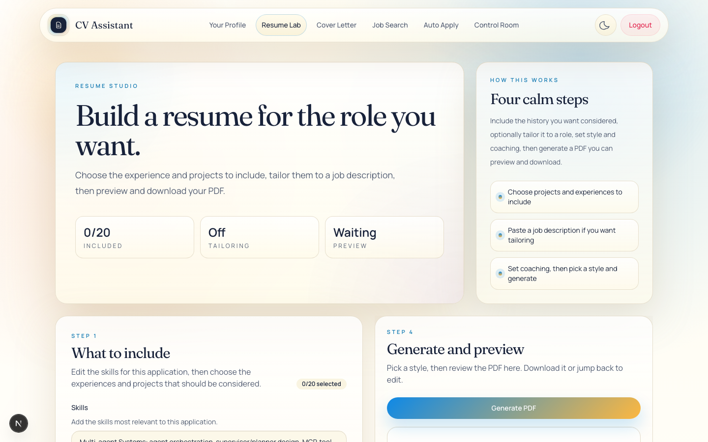
*Resume Lab header, the four-step guide and the Step 1 panel.*

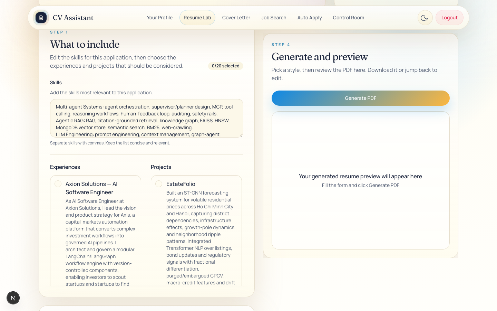
*Skills field and the experience and project selectors.*

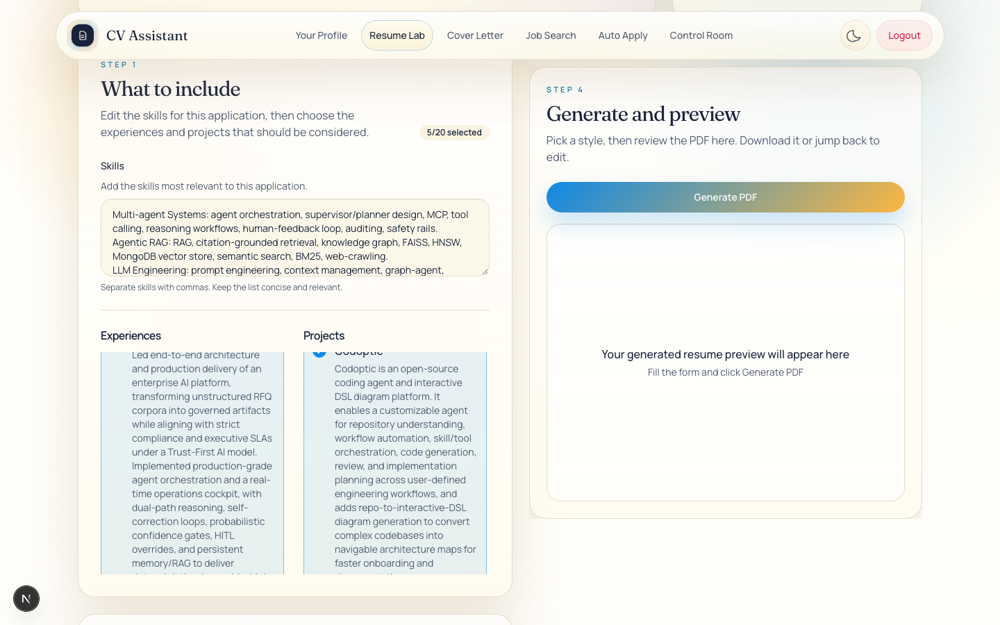
*Items selected for the resume.*

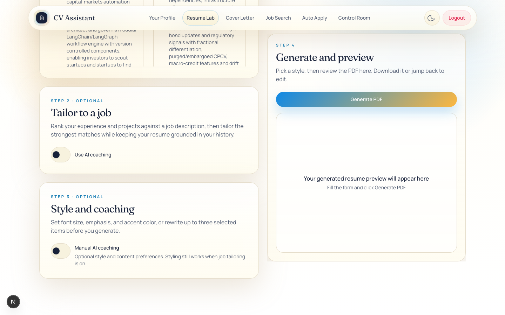
*Tailor to a job with AI coaching switched off.*

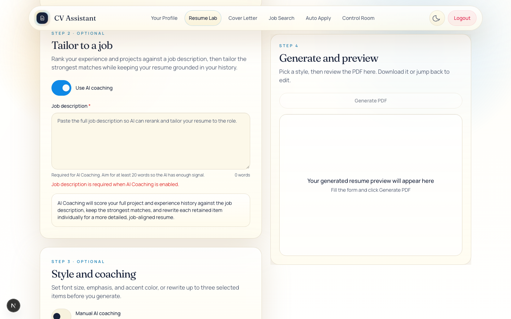
*Tailor to a job with AI coaching switched on, showing the job description field.*


*Step 3 with Manual AI coaching switched off.*

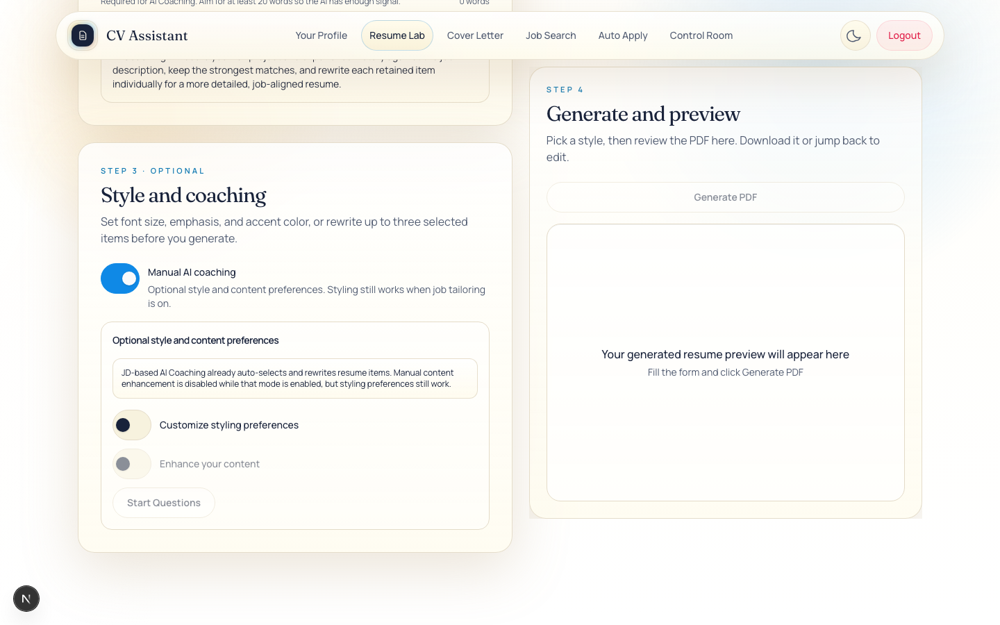
*Manual AI coaching switched on, with the style and content options.*

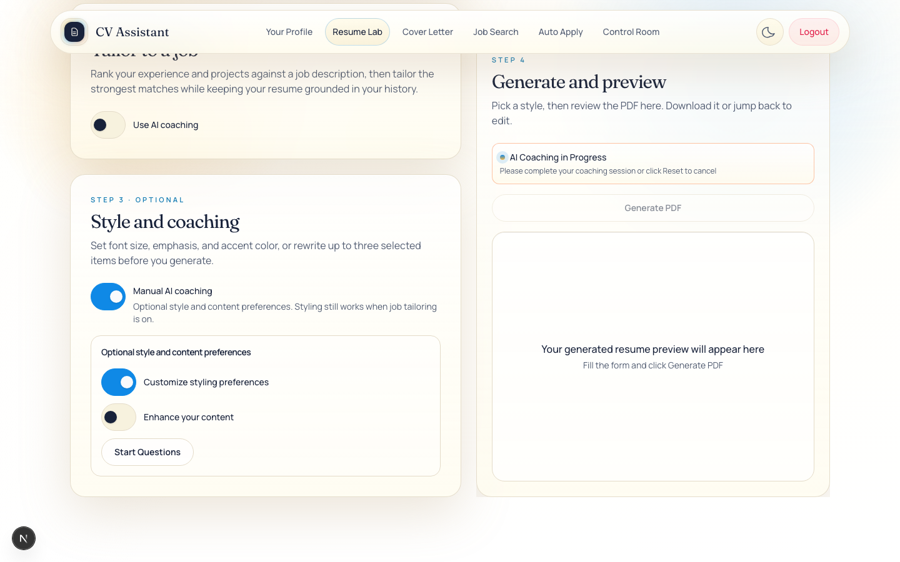
*Styling preferences with Customize styling preferences switched on.*


*Choosing up to three projects or experiences to enhance.*

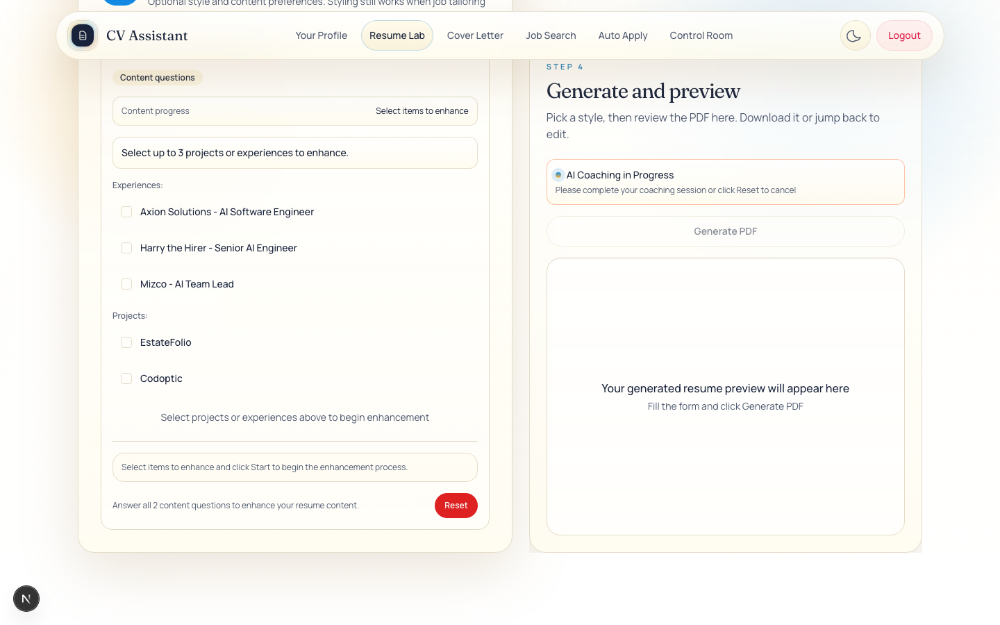
*An item picked for content coaching.*


*Coaching questions in progress, with the styling section.*

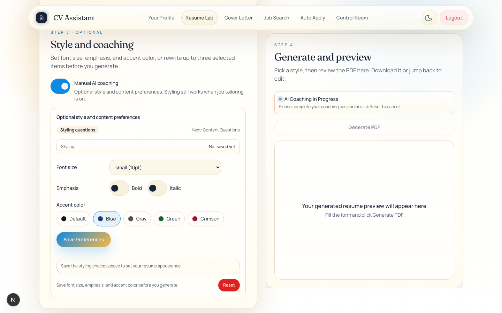
*Font size, emphasis and accent colour chosen before saving.*

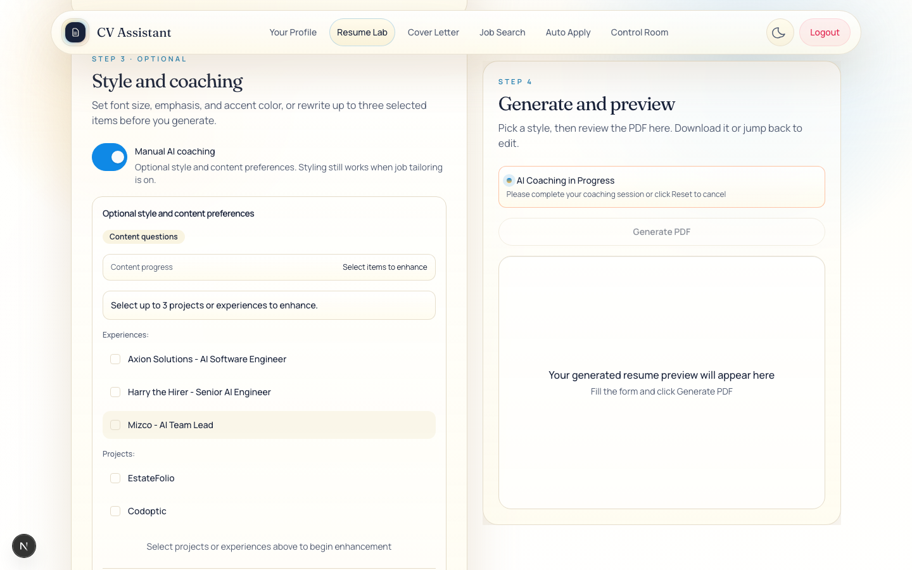
*The next step after saving styling preferences.*

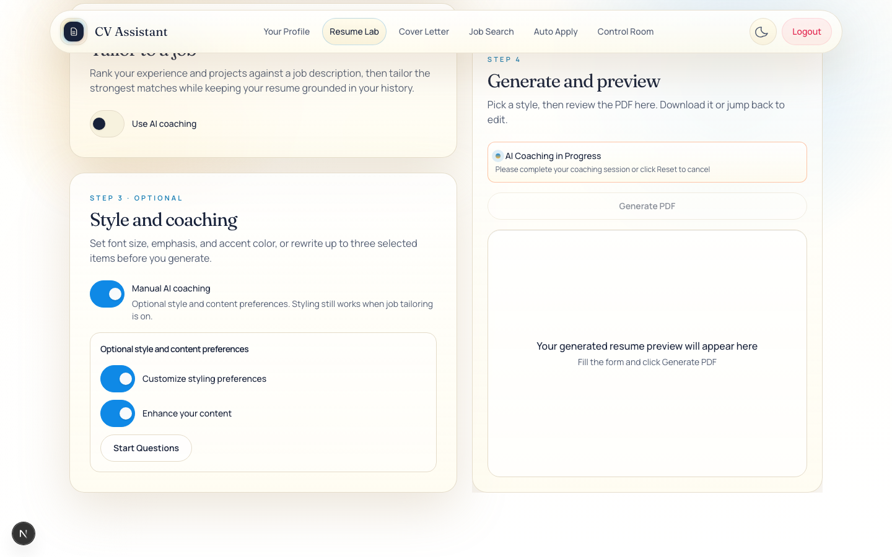
*Both styling and content enhancement switched on, with Start Questions.*


*Step 4 before a PDF is generated.*

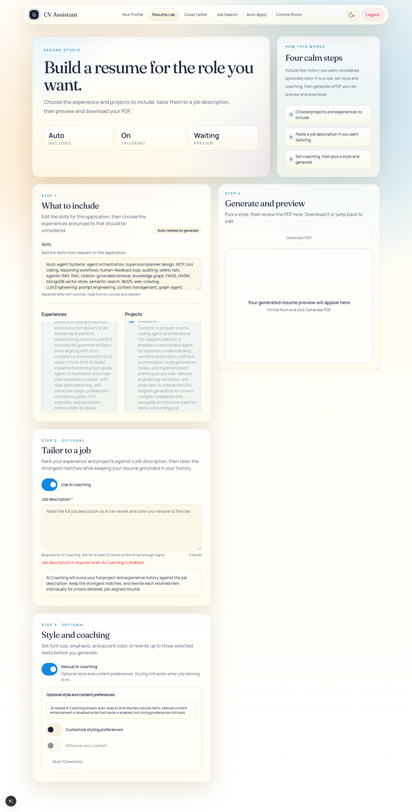
*The full Resume Lab page with items selected and coaching options set.*


The page is `src/app/resume/page.tsx` and its parts are in `src/components/resume/`. From the wide breakpoint (`xl`) the page uses two columns: the steps on the left and a sticky preview on the right. Below `xl` it is a single column with a sticky bar of section links (Include, Tailor, Coaching, Preview).

### Page states

| State | When | What the user sees |
|---|---|---|
| Loading | Profile not loaded yet and no error | Spinner panel: "Loading your profile..." (`ResumeGate`). |
| Profile needed | The response has no profile object (`profileMissing`) | Title "Your profile is needed", text "Add your profile details and experience before building a resume.", and a link "Open profile" to `/profile`. |
| Load error | The request failed or returned a non-OK status (`profileLoadError`) | Title "Could not load your profile", text "We couldn’t load your profile. Check your connection or sign-in, then try again.", and buttons "Try again" and "Open profile". |
| Studio | Profile loaded | The four steps below. |

`profileMissing` is set only when the response has no profile object. `GET /api/profile` returns `profile: null` when the user record or its `profile` field is absent. A stored profile with empty lists counts as loaded, so the studio opens with empty lists.

Authentication: `src/middleware.ts` redirects page requests without an `auth_token` cookie to `/login`. It checks only that the cookie is present. An invalid token passes the middleware, and the profile request then returns 401, which shows the load-error state.

### Header and stats

- Eyebrow "Resume studio". Title "Build a resume for the role you want." Description "Choose the experience and projects to include, tailor them to a job description, then preview and download your PDF."
- Three stats:
  - Included: "Auto" when JD tailoring is on, otherwise "N/20" (selected count out of `MAX_RESUME_ITEMS`).
  - Tailoring: "On" or "Off".
  - Preview: "Ready" when a PDF exists, "Working" while a request runs, otherwise "Waiting".
- A side panel "How this works" with the heading "Four calm steps" and three short points.

### Error banner

`studio.error` appears at the top in a destructive panel with `role="alert"`. It shows failures from the generate request.

### Step 1: What to include (`#include`)

| Control | Element | Behaviour |
|---|---|---|
| Skills | `textarea#resume-skills` | Free text with no length limit. Placeholder "e.g., JavaScript, React, Node.js, Python, SQL". Help text "Separate skills with commas. Keep the list concise and relevant." Seeded from `profile.skills` once the profile loads. |
| Experiences | `SelectionList` titled "Experiences" | One toggle per stored experience. Label "<companyName> — <role>" with `summary` underneath. Empty text: "No experiences yet. Add them on your profile." |
| Projects | `SelectionList` titled "Projects" | One toggle per stored project. Label is `name`, or "Untitled Project". Empty text: "No projects yet. Add them on your profile." |
| Count badge | `Badge` | "N/20 selected" (destructive variant when over the limit), or "Auto-ranked on generate" in JD mode. |
| Over-limit text | `p[role="alert"]` | "You can include at most 20 items. Please deselect some." |

Behaviour:

- Both lists are disabled while JD tailoring is on. `toggle()` in `useResumeStudio.ts` also returns early in that mode.
- Selections are array indices into the profile as returned by `GET /api/profile`. Known limitations explains when this can misalign with the stored order.
- In manual mode the toggle has no cap. Selecting more than 20 turns the badge red and blocks Generate, but does not stop the selection.
- Selections are kept when JD tailoring is switched on. The server ignores them in that mode.

### Step 2: Tailor to a job (`#tailor`)

| Control | Element | Behaviour |
|---|---|---|
| Use AI coaching | `Switch#ai-coaching` (aria-label "Tailor to a job") | Disabled while a request runs. Turning it on shows the job description field and an information panel. |
| Job description | `Textarea#job-description` | Placeholder "Paste the full job description so AI can rerank and tailor your resume to the role." Required while the switch is on. |
| Word count | `span[aria-live]` | "N words", counted by splitting on whitespace. |
| Help | `#job-description-help` | "Required for AI Coaching. Aim for at least 20 words so the AI has enough signal." |
| Error | `p#job-description-error[role="alert"]` | "Job description is required when AI Coaching is enabled." or "Job description is too short. Please add at least 20 words so AI Coaching has enough context." |

When the switch is on, the information panel reads: "AI Coaching will score your full project and experience history against the job description, keep the strongest matches, and rewrite each retained item individually for a more detailed, job-aligned resume." Scoring covers the whole stored history, not the Step 1 selection. For the length of the rewrites, see [JD tailoring pipeline](#jd-tailoring-pipeline).

### Step 3: Style and coaching (`#coaching`)

Rendered by `src/components/resume/CoachingPanel.tsx`.

- **Manual AI coaching** (`Switch#enhance`, aria-label "Manual AI coaching"). Help text: "Optional style and content preferences. Styling still works when job tailoring is on." Turning it on opens the panel. Turning it off hides the panel but does not clear state (see [Known limitations](#known-limitations-verified-in-code)). In manual mode, the renderer also rewrites the selected items with the model when this switch is on, even if no content questions were answered (see [Manual AI coaching in the renderer](#manual-ai-coaching-in-the-renderer-switch-on-no-answers-needed)).
- **JD notice** (only while JD tailoring is on): "JD-based AI Coaching already auto-selects and rewrites resume items. Manual content enhancement is disabled while that mode is enabled, but styling preferences still work."

Idle view (no session running):

- "Customize styling preferences" (`Switch#styling`).
- "Enhance your content" (`Switch#content`). Disabled while JD tailoring is on.
- "Start Questions" button. Disabled until one switch is on. It starts the styling session if the styling switch is on, otherwise the content session.

Session view (a session is running):

- A badge reads "Styling questions" or "Content questions". While styling is active and content is also on, a hint reads "Next: Content Questions".
- A progress strip. Styling shows "Saved" or "Not saved yet". Content shows "Select items to enhance", "N item(s) selected - Click Start to begin", "i/N items enhanced" or "N/N items enhanced".

Styling session controls:

| Control | Element | Values and behaviour |
|---|---|---|
| Font size | `select#resume-font-size` | Options "extra-small (8pt)", "small (10pt)", "default (11pt)", "large (12pt)" and "extra-large (14pt)". Values `8pt`, `10pt`, `11pt`, `12pt`, `14pt`. The default in state is `11pt`. What each value does to the PDF is set out in [Font size from styling](#font-size-from-styling). |
| Bold | `Switch#resume-bold` | Saved as `stylePreferences.useBold`. It decides only whether the beautify step runs for content. No bold text is drawn in the PDF. |
| Italic | `Switch#resume-italic` | Saved as `stylePreferences.useItalic`. Same effect as Bold. |
| Accent color | `div[role="radiogroup"]` of `button[role="radio"]` | "Default" (`black`), "Blue" (`dark-blue`), "Gray" (`dark-gray`), "Green" (`dark-green`) and "Crimson" (`crimson`). Arrow keys move the selection. |
| Save Preferences | `Button` | Copies the controls into `stylePreferences`. Changes made without saving are not used. If the content switch is also on, the content session starts 500 ms later. |

Messages after saving:

- Styling only: "Styling is ready. You can now click Generate PDF to create your resume with these styling choices."
- Styling and content: "Styling preferences set successfully."

Content session:

- Text "Select up to 3 projects or experiences to enhance."
- Lists headed "Experiences:" and "Projects:" containing only items selected in Step 1. Each is a toggle (`aria-pressed`). A toggle is disabled when three items are already chosen and this one is not.
- "Start Enhancing N Item" (or "Items") button, shown once at least one item is chosen. Empty-state text: "Choose projects or experiences in the include step first." when Step 1 is empty, otherwise "Select projects or experiences above to begin enhancement".
- After Start, the panel shows "Enhancing: <item name>" and Question 1. After the first answer it shows Question 2. After the second answer it shows "Content enhancement complete. Moving to next item..." or "All items enhanced.".
- An answer box is shown only while the content session is in progress and fewer than two answers exist. It is a `Textarea` with aria-label "Coaching answer" and placeholder "Type your answer... (Enter to send, Shift+Enter for new line)", plus a "Submit" button. Enter submits. Shift+Enter adds a new line.
- When every item is done: "All content enhancements complete. You can now click Generate PDF to create your resume with the enhanced content."

The two static questions (`CONTENT_QUESTION_ONE` and `CONTENT_QUESTION_TWO` in `CoachingPanel.tsx`):

- Question 1: "How would you like this content formatted? Choose: 'concise' (shorter, focused bullets), 'preserve' (keep current length), or 'enhance' (expand with more context and achievements)?"
- Question 2: "What specific aspects would you like to emphasize or modify? (e.g., "Focus on technical skills", "Highlight leadership", "Add metrics", "Make it more ATS-friendly")"

The model does not generate these questions.

Message log (both views):

- A scrollable box, at most 12 rem high (`max-h-48`). Entries are labelled "System:" (assistant) or "You:" (user).
- Empty-state text: "Save the styling choices above to set your resume appearance." (styling), "Select items to enhance and click Start to begin the enhancement process." (content, not started), or "Answer the content questions above to enhance your resume content." (content, started).

Footer:

- Hint: "Save font size, emphasis, and accent color before you generate." (styling) or "Answer all 2 content questions to enhance your resume content." (content).
- "Reset" button (destructive, small). See [Reset](#reset).

### Step 4: Generate and preview (`#preview`)

- **Banner.** "AI Coaching in Progress", with the text "Please complete your coaching session or click Reset to cancel". Shown while `coachingComplete` is false.
- **Limit text.** "You can include at most 20 items across projects and experiences." Shown when the limit is exceeded.
- **Generate PDF button.** Its label becomes the loading message while a request runs: "Generating your PDF…" in manual mode or "Tailoring your resume…" in JD mode. It is disabled while a request runs, when the limit is exceeded, when coaching is incomplete, or when the job description is invalid. Its tooltip gives the reason: "Please complete your AI coaching session first, or click Reset to cancel", or the job description error. Clicking it opens the style dialog. It does not generate by itself.
- **Preview card.** Before a PDF exists: "Your generated resume preview will appear here" and "Fill the form and click Generate PDF". While loading: a spinner and the loading message. With a PDF: an iframe titled "Generated resume PDF preview", height `min(75vh, 800px)` and at least 320 px.
- **Edit resume** (secondary button). Clears the preview. Selections and settings are kept.
- **Download PDF** (link). `download="resume.pdf"`.

### Style dialog (`StylePickerDialog.tsx`)

- Title "Choose a resume style".
- The description depends on `isMobile`, which is `window.innerWidth < 700` at load and on resize:
  - Desktop: "Preview a style at a readable size, select it, then generate." A vertical tab list (aria-label "Resume styles") shows each style. The current tab shows "Showing" and the chosen one shows "Selected". A tall iframe preview sits beside a "Select this style" button, which changes to "Selected" (`aria-pressed`) once chosen.
  - Mobile: "Use Previous and Next to preview each style, then select the one you want." Buttons "Previous" (aria-label "Previous style") and "Next" (aria-label "Next style"), a counter "N of 5", and a shorter preview. The counter adds "· Selected: <label>" when a different style is chosen.
- Footer: "Cancel" closes the dialog. "Generate" is enabled once a style is chosen and there is no job description error. Helper text reads "Select a style to enable Generate." or the job description error.
- Closing: the × button (aria-label "Close"), Escape and Cancel. Clicking the backdrop does nothing; `src/components/ui/dialog.tsx` has no outside-click handler. Escape calls `onOpenChange(false)`.
- Each time the dialog opens, the preview returns to Style 1 and the selection is cleared (`useEffect` on `isStyleModalOpen`).
- Focus: the dialog is given the preview column as `restoreFocusRef`, so focus should return there on close.
- "Generate" closes the dialog and sends the request (`confirmStyle` then `requestResumePreview`).

Each preview is an iframe of a sample PDF with the viewer toolbar hidden. See [The template library](#the-template-library).

### Error and status messages

| Where | Text (quoted from the code) | When |
|---|---|---|
| Profile gate | "Your profile is needed" | No profile object returned. |
| Profile gate | "We couldn’t load your profile. Check your connection or sign-in, then try again." | Request failed. |
| Step 1 | "You can include at most 20 items. Please deselect some." | More than 20 selected in manual mode. |
| Step 4 | "You can include at most 20 items across projects and experiences." | Same condition, shown above Generate. |
| Step 2 | "Job description is required when AI Coaching is enabled." | Empty job description with the switch on. |
| Step 2 | "Job description is too short. Please add at least 20 words so AI Coaching has enough context." | Fewer than 20 words. |
| Step 4 tooltip | "Please complete your AI coaching session first, or click Reset to cancel" | Coaching incomplete. |
| Step 4 banner | "AI Coaching in Progress", "Please complete your coaching session or click Reset to cancel" | Coaching incomplete. |
| Generate failure | The server's `error` text, otherwise "Failed to generate PDF. Please try again." | Non-OK response. |
| Generate failure | "Generated PDF is empty. Please check your selections and try again." | Empty response body. |
| Generate failure | "Could not generate the PDF. Please try again." | Exception that is not an `Error`. |
| Content flow | "Processing your enhancement request..." | Shown after the second answer. |
| Content flow | "No content found for this item. Moving to next item..." | The item has no description or summary. |
| Content flow | "Enhanced content for "<name>"!" | Success. The code adds a tick emoji, omitted here. |
| Content flow | "Enhancement failed. Moving to next item..." | Rewrite request failed. The code adds a warning emoji, omitted here. |
| Styling (unreachable from the UI) | "Styling preferences set successfully!" | See [Known limitations](#known-limitations-verified-in-code). |

## The template library

`STYLE_OPTIONS` in `src/components/resume/style-options.ts` lists five entries. Each has `id`, `label`, `previewKind` and `previewSrc`. The file has no description field, so the summaries below are written from the label and from the layout code in `src/lib/resume/pdf-renderer.ts`.

Each style route (`src/app/api/resume/styleN/route.ts`) differs only in the `template` value it passes to `renderResumePdf`. The layout traits therefore come from the matching `drawTemplateN` function, not from the route.

| ID | Label | Summary | Preview file (`previewSrc`) | Layout function | Sample matches the renderer |
|---|---|---|---|---|---|
| `style1` | Style 1 - Harvard | Single column with a centred header and a rule above each section. | `public/style1.pdf` (zoom 1.15) | `drawTemplate1` | Partly |
| `style2` | Style 2 - Chronological | Left-aligned header, tinted skills band, experience first. | `public/style2.pdf` (zoom 1.05) | `drawTemplate2` | Weak |
| `style3` | Style 3 - Modernised | Two columns with a grey rail for contact, education, skills and languages. | `public/style3.pdf` (zoom 1.15) | `drawTemplate3` | Partly |
| `style4` | Style 4 - Creative | Full-width accent banner, tinted capability box, bordered cards. | `public/style4.pdf` (zoom 1.15) | `drawTemplate4` | Partly |
| `style5` | Style 5 - Ledger | Tinted skills band over two columns, with a boxed rail for contact, education and languages. | `public/style5.pdf` (zoom 1.05) | `drawTemplate5` | Partly |

The zoom values come from `style-options.ts`. "Partly" means some features match and the structure or order differs. "Weak" means the sample's structure differs in most respects. See [Samples compared with the renderer](#samples-compared-with-the-renderer).

### Layouts in the renderer

All five layouts use A4 pages, the same text helpers and the density presets in [Density presets](#density-presets). All have the same bullet caps for each density.

**style1 (`drawTemplate1`)**

- Centred name, up to two centred contact lines, then a rule.
- Sections in order: Summary, Professional Experience, Education (only when `school` or `major` is set), Projects, Skills, and Languages (only when set).
- Item titles are bold. The right side of the title line shows location and dates in italic. The line below shows company and location.

**style2 (`drawTemplate2`)**

- Left-aligned name, with up to two right-aligned contact lines, then a rule.
- Tinted band at the top with the skills paragraph (minimum height 24 pt).
- Sections in order: Profile, Experience, Selected Projects, Education, Languages.

**style3 (`drawTemplate3`)**

- A 150 pt left rail with a light grey background. Boxed rail sections in order: Contact, Education, Skills, Languages.
- Main column: name, rule, Profile, Experience, Projects.

**style4 (`drawTemplate4`)**

- Full-width banner in the accent colour, with the name and up to two contact lines in white.
- Sections in order: Executive Summary, Capability Stack (tinted box with skills), Experience Cards, Project Cards, Education.
- Experiences and projects are bordered cards in a single column.

**style5 (`drawTemplate5`)**

- Name at the top left (no contact line in the header), then a tinted skills band with no heading.
- Two columns. The main column is the page width minus the 136 pt rail and an 18 pt gap, and holds Profile Ledger, Career Ledger (experiences) and Technical Proof (projects). The rail holds boxed Contact, Education and Languages.

### Samples compared with the renderer

The sample files are static. They do not change when the renderer changes. Each was checked by opening it with the file viewer.

- `public/style1.pdf`: one page. Centred bold name, centred contact line, uppercase headings with rules, justified bullets and right-aligned dates. Order is Education, Skills, Experience. No Summary or Projects section, and Languages sits inside Skills. The typeface appears to be Helvetica or Arial. The renderer uses Times Roman for Latin text.
- `public/style2.pdf`: one page. Centred headings, with Education, then Skills, then Experience. No tinted band. Several bullets contain literal asterisks, and one contains the placeholder "[X]".
- `public/style3.pdf`: one page. A grey left rail with Contact, Skills and Languages as plain lists, and a main column. Blue accent. The serif body is closer to the renderer's Times output than the others. Education sits in the main column, while the renderer puts it in the rail, and the sample's rail sections are not boxed.
- `public/style4.pdf`: one page. Maroon banner with the name on the left, skills as outlined chips, and two columns of bordered cards. The renderer uses a single column of cards and a tinted box for skills.
- `public/style5.pdf`: two pages. "RESUME LEDGER" caption, a "CAPABILITIES" band, a date column beside each experience, a rail with blue top bars, and a "Ledger continued" header on page two. The renderer has no caption, no date column and no continuation header.

All five samples, and `public/1.pdf`, show one sample person with a name and contact details. Confirm that this content is fictional or cleared before the files are published.

Other files in `public/`:

- `public/1.pdf` is not referenced by any file in `src/`, `scripts/` or `tests/`. It shows overlapping text and literal `**` markers. It is not part of the template library.
- `public/harvard.webp` is not referenced by the source.

Font sizes differ too. The renderer's default body text is 7.15 pt in the professional preset (see [Density presets](#density-presets)). The samples appear to be set larger.

## The two-phase AI coaching system

The UI uses "AI coaching" for two different features. This section separates them.

| Feature | UI label | Model use | Main code |
|---|---|---|---|
| Manual AI coaching | "Manual AI coaching" (Step 3) | Styling: none. Content: one rewrite per item through `/api/resume/enhance-targeted`, plus `/api/resume/beautify` when Bold or Italic is saved. Renderer: rewrites when the switch is on. | `CoachingPanel.tsx`, `useResumeStudio.ts`, `high-impact-rewrite.ts`, `pdf-renderer.ts` |
| JD tailoring | "Use AI coaching" (Step 2) | Several calls per generation. See [JD tailoring pipeline](#jd-tailoring-pipeline). | `ai-coaching.ts`, `generate-resume/route.ts` |

Manual AI coaching has two agents:

- The **styling agent** collects formatting choices from controls. It makes no model call.
- The **content agent** asks two fixed questions for each selected item and sends the answers in one rewrite call.

`src/app/api/resume/coach/route.ts` was written to run an LLM content agent with its own two questions and a `<CONTENT_READY>` marker. The Studio does not call that route. The questions the user sees are the static ones in `CoachingPanel.tsx`.

### Phase 1: Styling agent

Inputs are the controls in the styling session: font size, Bold, Italic and accent colour.

Output, built by `saveStylePreferences` (`useResumeStudio.ts`, line 378):

```ts
{
  fontSize: uiFontSize,        // "8pt" | "10pt" | "11pt" | "12pt" | "14pt"
  useBold: uiUseBold,
  useItalic: uiUseItalic,
  boldSections: [],
  italicSections: [],
  contentDensity: "balanced",  // constant; not read by the renderer
  additionalNotes: "Set via UI",
  accentColor: uiAccentColor,  // "black" | "dark-blue" | "dark-gray" | "crimson" | "dark-green"
}
```

The object is sent to `generate-resume` as `stylePreferences` and then to the style route. The renderer reads `fontSize` and `accentColor`. The beautify step reads the whole object into its prompt. `boldSections`, `italicSections` and `contentDensity` are not read by the renderer.

No prompt is used in this phase. Two other pieces exist but are not used by the Studio:

- `parseStylingPreferences` (`useResumeStudio.ts`, line 18) turns free-text answers into the same shape. It runs only from the styling branch of `handleQuestionSubmit`. The UI never shows an answer box for the styling agent, so this branch cannot run.
- `src/app/api/resume/style-parser/route.ts` asks the 'easy' model for JSON with the same keys. It has no caller.

### Phase 2: Content agent

The content agent works through the selected items in order. The list holds at most three items. For each item:

1. The panel shows Question 1 (static text). The user types a format answer and presses Submit or Enter. Nothing is sent yet.
2. The panel shows Question 2. The user types a modifications answer. `handleQuestionSubmit` now holds both answers.
3. The hook builds `originalContent` from the stored item: `description`, or `summary` when there is no description. If both are empty, it adds "No content found for this item. Moving to next item..." and moves on.
4. It posts to `/api/resume/enhance-targeted`:

   ```json
   {
     "itemType": "project or experience",
     "itemName": "company - role for experiences, or the project name",
     "originalContent": "description or summary",
     "userPreferences": { "format": "answer to Question 1", "modifications": "answer to Question 2" }
   }
   ```

5. The route builds the prompt with `buildHighImpactRewritePrompt`, calls the 'hard' model and normalises the output with `normalizeHighImpactBulletOutput`.
6. If `stylePreferences` has Bold or Italic on, the hook posts the result to `/api/resume/beautify` with `{ content, contentType, stylePreferences }`. If that call fails, the plain rewrite is kept.
7. The result is stored as `contentEnhancementData["<type>-<index>"]`. The panel shows the success message and moves to the next item after 1000 ms.
8. If the rewrite request fails, the panel shows "Enhancement failed. Moving to next item..." and moves on. The item has no entry, so the renderer uses the stored text.

Prompt for the rewrite (`buildHighImpactRewritePrompt` in `src/lib/resume/high-impact-rewrite.ts`, summarised):

- Role: "an expert Executive Resume Writer and Career Coach specialising in quantifiable achievements and technical precision".
- Rules: the bullet count for the chosen mode; every bullet starts with a varied action verb; use only metrics, tools, domains and outcomes that appear in the source or the user's answers; when there is no metric, describe the scope without inventing a number; lead with the result; avoid passive phrasing; return plain newline-separated bullets with no preamble.
- Inputs: item type, item name, source content, the requested format (or "preserve") and the modification requests (or "None provided").

Prompt for emphasis (`src/app/api/resume/beautify/route.ts`, summarised): keep all facts and wording, keep bullet order, add only Markdown emphasis (`**bold**` for achievements and metrics, `*italic*` for tools and methods), and return only the Markdown. The prompt says "Do NOT add new facts" and "Do NOT change names, dates, companies, metrics, or technologies". The code does not check these rules.

Unused prompt, `src/app/api/resume/coach/route.ts`: asks the model to ask exactly two questions, one at a time. The first asks about format with the options 'concise', 'balanced' and 'detailed'. The second asks for quantified achievements, with "None" as an option. It then sends `<CONTENT_READY>`. For `agentType: "styling"` the route returns `<STYLING_UI>` without a model call.

### State machine (`useResumeStudio.ts`)

Main state:

| Variable | Type | Purpose |
|---|---|---|
| `stylingCustomization`, `contentCustomization` | boolean | The two switches shown in the idle view. |
| `currentAgent` | `"styling"`, `"content"` or `null` | The active session. |
| `stylingMessages`, `contentMessages` | `CoachMessage[]` | Message log for each session. |
| `contentSelectedItems` | `ContentSelection[]` | Items chosen for enhancement, at most three. |
| `currentContentItem` | number | Index of the item in progress. Equal to the list length when all items are done. |
| `contentEnhancementStarted` | boolean | Set by Start Enhancing. |
| `contentEnhancementData` | `Record<string, string>` | Rewrite results, keyed `project-<index>` or `experience-<index>`. |
| `stylePreferences` | `StylePreferences` or `null` | Saved styling. |
| `uiFontSize`, `uiUseBold`, `uiUseItalic`, `uiAccentColor` | controls | Not used until saved. |
| `enhance` | boolean | The Manual AI coaching switch. |
| `aiCoachingEnabled`, `jobDescription` | boolean, string | JD tailoring. |

Transitions:

| From | Event (function) | To | Side effects |
|---|---|---|---|
| Idle | Start Questions with styling on (`startQuestions`) | Styling session | `startStylingQuestions` clears the styling messages. |
| Idle | Start Questions with only content on | Content session | `startContentQuestions` clears selection, messages and progress. |
| Styling session | Save Preferences (`saveStylePreferences`) | Same session | `stylePreferences` set. If content is on, the content session starts after 500 ms. |
| Content session, not started | Start Enhancing (`startEnhancing`) | Content in progress | `currentContentItem` set to 0; messages cleared. |
| In progress, no answers | Submit the first answer (`handleQuestionSubmit`) | Same item | The answer is stored as the first content message. |
| In progress, one answer | Submit the second answer | Same item, request running | Calls `enhance-targeted`, then optionally `beautify`. |
| Rewrite succeeded | Automatic after 1000 ms (`moveToNextContentItem`) | Next item, or done | Messages cleared. |
| Rewrite failed | Automatic after 1000 ms | Next item, or done | Failure message added. No entry is stored for the item. |
| All items done | (none) | Complete | `coachingComplete` becomes true. |
| Any | Reset (`resetCoaching`) | Idle | See [Reset](#reset). |
| Job tailoring switched on | Effect (lines 83 to 93) | Content switch off; content session cleared if it was the active agent | `contentEnhancementData` and styling state are not cleared. |

`moveToNextContentItem` moves to the next item while `currentContentItem + 1 < contentSelectedItems.length`. Otherwise it sets `currentContentItem` to the list length and clears the messages.

`isAllCoachingComplete()` (line 283) decides whether coaching is complete:

1. If neither switch is on, coaching is complete.
2. If the styling switch is on and `stylePreferences` is `null`, it is not complete.
3. If the content switch is on, it is complete only when items were chosen, the content session was started and `currentContentItem` has reached the list length. Otherwise it is not complete.

`coachingComplete` feeds `generateDisabled` (line 462), which is `loading || limitReached || !coachingComplete || !!aiCoachingInputError`.

Other effects in the hook:

- Lines 83 to 93: while JD tailoring is on, the content switch is turned off, and a content session that is active is cleared.
- Lines 95 to 102: `isMobile` follows `window.innerWidth < 700`.
- Lines 104 to 108: opening the dialog resets the preview index to 0 and the selection to `null`.
- Lines 110 to 133: loads `GET /api/profile`. Re-runs when `profileLoadAttempt` changes.
- Lines 135 to 137: revokes the previous object URL when the PDF changes.

Timers: 500 ms (styling then content, after Save), 1000 ms (after each content item), and 1500 ms (styling then content inside `handleQuestionSubmit`, which cannot run from the UI).

### Reset

`resetCoaching` (`useResumeStudio.ts`, line 413) does the following.

Clears:

- `currentAgent` (to `null`), `stylingCustomization` and `contentCustomization` (to `false`).
- `stylingMessages` and `contentMessages` (to empty lists).
- `contentSelectedItems` (to empty), `currentContentItem` (to 0) and `contentEnhancementStarted` (to `false`).
- `contentEnhancementData` (to `{}`). Every rewrite from the session is discarded.

Does not clear:

- `stylePreferences`. Saved styling stays and is sent with the next generation.
- `coachInput`. Text in the answer box stays in state.
- `enhance`. The Manual AI coaching switch stays on.
- The Step 1 selections, the JD tailoring switch and the job description.

After Reset, `coachingComplete` is true, so Generate is enabled.

### Why generation is blocked during coaching

`generateDisabled` includes `!coachingComplete`. The reason is shown as the button tooltip and in the Step 4 banner. The code gives no rationale. The effect is that no PDF can be produced while a switched-on styling or content step is unfinished, so the PDF never reflects a half-finished session or a styling choice that was not saved. This explanation is inferred from the code, not stated in it.

### JD tailoring pipeline

Code: `src/lib/resume/ai-coaching.ts`.

Entry point: `runAICoaching({ jobDescription, profile })`. It is called by `generate-resume` in JD mode and by `src/lib/career/resume-specialist.ts`.

1. **Collect.** `collectResumeItems` builds one item for each stored project, then one for each stored experience. `originalContent` is `description`, or `summary` when there is no description, with whitespace collapsed. If there are no items, the request fails with `AICoachingValidationError` and the message "Add at least one project or experience before using AI Coaching.".
2. **Analyse the job description** (`analyzeJobDescription`). The server requires at least 20 words (`MIN_JOB_DESCRIPTION_WORDS`). `generateJsonSafe('hard', …)` returns JSON that is checked by `jdAnalysisSchema` (zod). It holds `isValid`, `relevanceReason`, `summary`, `jobTitle`, `industry`, `seniority`, `mustHaveTechnologies`, `optionalTechnologies`, `softSkills` and `priorities` (each with `name`, `weight` from 1 to 100, and `rationale`). If `isValid` is false, the request fails with the `relevanceReason` text. A model failure has no fallback, and the route returns 500.
3. **Consultant board plan** (`buildConsultantBoardPlan`). One JSON call. Output: `requirementCoverage` (requirement, priority `critical`, `important` or `preferred`, coverage `covered`, `partial` or `gap`, evidence preference `experience`, `project` or `either`, and a rewrite instruction), `atsKeywords`, `missingSignals`, `consultantNotes`, `rewriteStrategy` and `finalSelectionGuidance`. On failure, a fallback board is built from the priorities: weight 80 or more is `critical`, 55 or more is `important`, otherwise `preferred`; coverage is `partial`; keywords come from the analysis lists; and the notes are fixed text.
4. **Score** (`scoreResumeItem`). One JSON call per stored item, three at a time, including items with no text. Output, each clamped to 0 to 100: `score`, `directTechnicalMatch`, `industryRelevance`, `complexityScale`, plus `matchedKeywords`, `missingSignals` and `rationale`. On failure, every score is 0 and the rationale reads "Scoring failed, so this item was deprioritized.".
5. **Rank** (`compareRankedItems`). Experiences get 12 points added to `score` for ranking. Ties are broken by `directTechnicalMatch`, `industryRelevance`, `complexityScale` and then original order, where projects come before experiences.
6. **Select** (`selectRetainedItems`, line 333). Only items with content are eligible. Let `topScore` be the score of the first eligible item, and `hardFloor` be `max(52, min(72, topScore - 24))`. Walk the list in rank order, stopping at 20 kept items. Skip an item when either of these holds:
   - it is too weak: `score < max(45, topScore - 38)`, `directTechnicalMatch < 55`, and fewer than two matched keywords;
   - returns are diminishing: at least three items are already kept, `utility < 48`, and `utility < lastUtility - 18`.

   Keep an item only when at least one of these holds:
   - `score >= hardFloor`;
   - `directTechnicalMatch >= 62` and `score >= hardFloor - 6`;
   - it is a project, `score >= hardFloor + 8` and `directTechnicalMatch >= 68`;
   - it has at least two matched keywords and `score >= hardFloor - 4`.

   `utility = 0.46 × score + 0.30 × directTechnicalMatch + 0.14 × industryRelevance + 0.10 × complexityScale + 4 × newSignals + 8 (experience) - 5 (project)`. `newSignals` counts matched keywords and rationale tokens that the kept items do not already cover.

   Afterwards, at least one item is kept. If no experience is kept, the best experience with `score >= max(45, topScore - 35)` is added.
7. **Rewrite** (`rewriteResumeItem`). One plain-text call per kept item, two at a time. The call receives the analysis, the board, the item's scores and the item. Output is split into lines, bullet markers are removed, em and en dashes are replaced by hyphens, and the result is capped at 3 bullets for an experience or 2 for a project. Empty output, or a model error, returns the original text. This step makes one attempt and does not retry.
8. **Review** (`reviewTailoredResume`). One JSON call that returns `estimatedAtsScore`, `strengths`, `residualGaps` and `revisionInstructions`. On failure it returns a score of 76 and fixed text. The review is not shown to the user.
9. **Return.** `selectedProjects` and `selectedExperiences` (indices into the stored profile), `contentEnhancementData` (keys `project-<index>` and `experience-<index>`), and the analysis objects.

In the route, `generate-resume`:

- merges the client's `contentEnhancementData` first, so AI entries win on the same key;
- sets `enhance` to false;
- sets `autoFit` to true; and
- forwards `coachingTrace` (the analysis objects) to the style route, which does not use it. The trace is never returned to the user.

In the renderer, when a job description is present and either `autoFit` or `enhance` is true, `maybePrepareNarrative` makes one 'easy' JSON call for `summary` (two sentences, at most 58 words) and `skills` (at most 38 items). Any failure uses the fallback text. Backfill is also enabled, as described in [PDF rendering pipeline](#pdf-rendering-pipeline).

Call budget for one generation: 1 (analysis) + 1 (board) + N (one score per stored project and experience) + R (one rewrite per kept item) + 1 (review) + 1 (narrative). The JSON calls each make up to three attempts, through `generateJsonSafe`. Rewrites make one attempt each.

## Content enhancement formats and modification options

### Format answer

The format answer is free text. Question 1 offers three options: `concise`, `preserve` and `enhance`. The server reads the answer with `resolveRewriteMode` (`src/lib/resume/high-impact-rewrite.ts`, line 17). It checks for these substrings, case-insensitively, in this order:

| Substring in the answer | Mode | Bullets requested | Cap applied | Intent |
|---|---|---|---|---|
| `concise` | concise | 3 to 4 | 4 | Sharpest, highest-signal outcomes only. |
| `enhance` | enhance | 5 to 7 | 7 | Deeper technical and business detail. |
| Anything else, including `preserve`, `balanced`, `detailed` or an empty string | preserve | 4 to 5 | 5 | Balanced depth. |

`concise` is checked first, so an answer such as "concise, enhance" resolves to concise.

The `/api/resume/coach` route offers `balanced` and `detailed` instead. Both resolve to preserve, so "detailed" does not select the enhance mode. That route has no caller.

### Modification answer

- Free text (Question 2). The UI sends it only when non-empty, because Submit ignores an empty answer.
- Included in the prompt as "Additional modification requests: <text>", or "None provided" when empty on the server.
- There are no preset modification options and no checkboxes.

### Output handling (`normalizeHighImpactBulletOutput`)

1. Remove fenced code blocks and a leading "Here are …:" line.
2. Split into lines, trim each line, and remove leading bullet or number markers.
3. Keep the first `max` lines for the mode and prefix each with "- ".
4. If nothing usable remains, use the same steps on the original content. If that is also empty, return the original content.

The route returns 200 with the original content when the model returns nothing usable. It returns 500, with `fallback` set to the original content, only when the model call throws. This normaliser does not replace dashes. The renderer replaces them when drawing.

### Emphasis (Bold and Italic)

If Bold or Italic is saved as on, the rewritten text goes to `/api/resume/beautify`, which adds `**` and `*` markers. The renderer then removes those markers (`stripMarkdownForPdf`), so the PDF has no bold or italic item text. See [Known limitations](#known-limitations-verified-in-code).

### Manual AI coaching in the renderer (switch on, no answers needed)

When the Manual AI coaching switch is on, `maybeEnhanceContent` (`src/lib/resume/pdf-renderer.ts`, line 201) makes model calls with the 'hard' preset. These prompts are fixed. The UI offers no format choice for them.

| Target | Prompt constraint (quoted or summarised) | Limit |
|---|---|---|
| Skills | "Rewrite these resume skills into one dense ATS-friendly comma-separated line." Do not invent technologies. | One line, then the skills cleaner (see [Skills handling](#skills-handling)). |
| Each selected experience | "Rewrite this work experience into 4 strong, dense resume bullets for the target role." Do not invent employers, metrics, credentials or technologies. | No normalisation. The renderer caps bullets by density (4, 4 or 3). |
| Each selected project | "Rewrite this project into 2-3 strong resume bullets for the target role." | The renderer caps bullets by density (3, 2 or 2). |

- A failure stops the rest of the sequence, because the `try` covers the whole block. Results already obtained are kept.
- Studio content in `contentEnhancementData` takes precedence over these results for the same item.
- The output is used as returned. Nothing checks it against the source.

### The `qa` field

The client sends `qa: [...stylingMessages, ...contentMessages]`. The renderer adds these as "User coaching notes" to the manual prompts. From the UI, the list is empty whenever Generate is allowed: `contentMessages` is cleared after each item and after the last one, and the styling chat has no UI path. The field therefore has no effect from the UI.

## Skills handling

### Sources and precedence

- The Skills textarea (`#resume-skills`) is seeded once from `profile.skills` when the profile loads.
- The text is sent as `skills` to `generate-resume` and then to the style route.
- In the renderer, `resolveResumeSkillsText(enhancedSkills, request.skills, profile.skills)` (`src/lib/resume/skills.ts`) returns the first non-empty value. `enhancedSkills` exists only when the Manual AI coaching switch is on and the skills text is not empty.

### Where the skills text goes

`maybePrepareNarrative` (`pdf-renderer.ts`, line 233) decides where the Skills line comes from:

| Condition | Source of the Skills line |
|---|---|
| No job description, or neither JD tailoring nor the Manual AI coaching switch is on | `compactSkillsFallback` applied to the precedence value above. |
| A job description is present, `autoFit` or `enhance` is on, and the model call succeeds | The model's `skills` string, passed through `compactSkillsFallback`. The model sees `profile.skills`, not the textarea or `enhancedSkills`. |
| Same as the previous row, but the model call fails | Fallback as in the first row. |

With JD tailoring on, edits in the Skills textarea therefore do not reach the PDF when the narrative call succeeds. See [Known limitations](#known-limitations-verified-in-code).

### `compactSkillsFallback` (`pdf-renderer.ts`, line 133)

1. `formatResumeSkillsParagraph` splits the text on commas, semicolons and line breaks, removes Markdown markers and joins the items with ", ".
2. Each item is scored: 4 points for each of its tokens that appears inside the lower-cased job description, plus `max(0, 16 - index × 0.08)` for its position. A token is letters, digits and `+#.-`, at least three characters long.
3. Items are sorted by score, highest first, and the top 38 are kept.

Without a job description, the original order is kept. With a job description, matching items move to the front. Items beyond 38 are dropped without a message.

### Where skills appear

- style1: a "Skills" section with a paragraph.
- style2: the tinted band at the top.
- style3: the "Skills" box in the rail.
- style4: the "Capability Stack" box.
- style5: the tinted band at the top, with no heading.

When the profile has no summary, the fallback summary also uses `profile.skills` to build its "stack" phrase.

The Studio's textarea edits are not written back to the profile.

## PDF rendering pipeline

### Libraries and files

- `pdf-lib` (`^1.17.1` in `package.json`) builds the document: pages, text, rectangles, lines, metadata and saving.
- `@pdf-lib/fontkit` (`^1.1.1`) is registered by `embedNotoSansFonts` for the TrueType path.
- Bundled fonts: `public/fonts/NotoSans-Regular.ttf` (about 556 KB) and `public/fonts/NotoSans-Bold.ttf` (about 562 KB).
- `@napi-rs/canvas` is not used by the resume pipeline. It is imported by `src/lib/profile-import.ts` and listed under `serverExternalPackages` in `next.config.ts`. No canvas is used to draw the resume.

### Page geometry

- A4 pages: `PAGE_WIDTH = 595.28` and `PAGE_HEIGHT = 841.89` points (`pdf-renderer.ts`, lines 56 and 57).
- Maximum pages: `MAX_PAGES = 2` (line 58).
- Colours: a near-black ink, a grey for contact and meta text, grey rules, and a pale fill for cards. The accent colour applies to headings, rules, the banner and the tinted boxes, which use a tint derived from the accent (`tintFromAccent`).

### Density presets

`DENSITIES` (`pdf-renderer.ts`, lines 67 to 71):

| Preset | Margin X, Y (pt) | Name | Section | Title | Meta | Body | Line height | Max experience bullets | Max project bullets |
|---|---|---|---|---|---|---|---|---|---|
| `professional` | 30, 24 | 18 | 10.4 | 8.35 | 7.2 | 7.15 | 8.55 | 4 | 3 |
| `compact` | 27, 22 | 17 | 9.9 | 8.05 | 6.9 | 6.9 | 8.1 | 4 | 2 |
| `micro` | 24, 20 | 16 | 9.35 | 7.75 | 6.6 | 6.55 | 7.65 | 3 | 2 |

Sizes are in points. The body sizes in this table apply when no font size has been saved.

### Font size from styling

`parsePreferredBodySize` (line 97) reads the number in `stylePreferences.fontSize`. When it finds one, `applyStylePreferenceDensity` (line 106) sets the body size in every preset to `clamp(size - 2.2, 6.4, 8.15)`. Title, section and line heights are then recalculated from the new body size.

| Saved option | Body size in the PDF |
|---|---|
| 8pt | 6.4 pt (lower limit) |
| 10pt | 7.8 pt |
| 11pt | 8.15 pt (upper limit) |
| 12pt | 8.15 pt (upper limit) |
| 14pt | 8.15 pt (upper limit) |

With no saved styling, the preset's own body size applies: 7.15 pt, 6.9 pt or 6.55 pt.

Because the body size is fixed across presets, the fit loop can change only margins, gaps, title and section sizes, and bullet caps. A larger body size leaves less room, so more items can be dropped.

### Accent colours

`accentColor` (`pdf-renderer.ts`, line 85):

| Key | PDF colour (RGB, 0 to 1) | UI swatch (`CoachingPanel.tsx`) |
|---|---|---|
| `black` (default) | 0.04, 0.04, 0.04 | #171717 |
| `dark-blue` | 0.06, 0.16, 0.33 | #1e3a8a |
| `dark-gray` | 0.16, 0.16, 0.16 | #57534e |
| `crimson` | 0.48, 0.06, 0.10 | #9f1239 |
| `dark-green` | 0.05, 0.26, 0.14 | #166534 |

The UI swatches are not the colours used in the PDF.

### Pipeline (`renderResumePdf`, line 582)

1. **Manual enhancement** (`maybeEnhanceContent`). Runs only when `enhance` is true. See [Manual AI coaching in the renderer](#manual-ai-coaching-in-the-renderer-switch-on-no-answers-needed).
2. **Collect items** (`collectItems`, line 172). Selected experiences first, then selected projects, each in stored order. The body is the first non-empty value of: `contentEnhancementData["<type>-<index>"]`, the manual rewrite, `description`, then `summary`. Weights: experiences `1000 - index`, projects `410 - index`. Items are sorted by weight.
3. **Backfill** (`collectBackfillItems`, line 191). Only when `autoFit` is true. Unselected experiences (weight `860 - index`), then projects (`300 - index`). Used one at a time by step 5.
4. **Narrative** (`maybePrepareNarrative`, line 233). Summary and skills, as described in [Skills handling](#skills-handling). The summary falls back to `compactSummaryFallback`, which uses at most 58 words.
5. **Fit loop** (lines 588 to 608). For up to 40 cycles, try the presets in order `professional`, `compact`, `micro`:
   - render an attempt and keep the best attempt so far (fewest pages, otherwise the smaller file);
   - if the attempt fits in two pages:
     - in JD mode, when the last page is less than 60% full (`TARGET_MIN_LAST_PAGE_FILL = 0.60`) and a backfill candidate remains, render again with that candidate added; if that fits, keep it and move on to the next preset, without returning;
     - otherwise return this attempt;
   - if no preset fits, drop one item (`dropWeakestItem`: the lowest-weight project, or else the lowest-weight experience) and go round again. Stop when one item or fewer remains.
6. **Fallback.** If nothing fitted, use the best attempt (or a `micro` render). If that still has more than two pages, `truncateToTwoPages` keeps pages one and two. The rest is discarded, and telemetry reports `truncatedToTwoPages: true`.
7. **Telemetry.** Returned to the route as response headers (see below).

Each attempt (`renderAttempt`, line 547):

1. Applies the saved font size to the preset.
2. Builds a text corpus from the name, contact line, narrative, languages, school, major and item text. The corpus decides the font.
3. Creates the document, sets metadata, embeds fonts and chooses the accent colour.
4. Draws the template with `drawResumeLayout`.
5. Counts pages and computes `lastPageFillRatio` as `(top - y) / usableHeight` for the last page.
6. Saves with object streams.

### Fonts (`embedResumeFonts`, line 251)

- **Times path.** If every character in the corpus has a code point of 255 or less (`isStandardFontSafe`), the document uses pdf-lib's standard `TimesRoman`, `TimesRomanBold` and `TimesRomanItalic`. Italic is used for meta text and subtitles. The telemetry header `X-CV-Assistant-Resume-Times-Style` is `true`.
- **Noto path.** Otherwise `embedNotoSansFonts(pdf, { subset: true })` embeds Noto Sans Regular and Bold as subsets. Italic is set to Regular. The header is `fallback`.

pdf-lib's standard fonts are referenced by name rather than embedded, so the viewer supplies a Times-compatible face. The Noto path embeds the font data.

`src/app/api/resume/embed-noto-sans-fonts.ts` reads both TrueType files with `fs.readFileSync` when the module loads, from `path.join(process.cwd(), 'public', 'fonts')`. It calls `pdf.registerFontkit(fontkit)` for each document. The code comment says the reason: "pdf-lib StandardFonts encode through WinAnsi and throw on common Unicode (e.g. Vietnamese)."

### Unicode handling

- `normalizeInline` and `normalizeBody` (lines 73 to 79) replace en and em dashes with a hyphen, curly double quotes with straight double quotes and curly single quotes with straight apostrophes. `normalizeInline` also collapses whitespace. `normalizeBody` keeps paragraph breaks.
- The Times-or-Noto test runs on the raw values of `profile.name`, `major`, `school` and `languages`. A dash in one of these forces the Noto path, even though the dash would be drawn as a hyphen.
- The test checks code points, not glyph coverage. This code does not check which scripts the bundled Noto Sans files cover, so characters without a glyph may not render. This was not tested.
- Code points from U+0080 to U+009F pass the test, but not all of them can be encoded in WinAnsi. This was not tested.

### Layout primitives (`createDrawContext`, line 311)

- `ensure(height)` starts a new page when the content would cross the bottom margin. Headers are not repeated, and page numbers are not drawn.
- `section(title)` draws a bold heading in the accent colour, with a rule unless the caller turns it off (cards and some banners do). It reserves room for the heading.
- `paragraph(text, …)` wraps and draws line by line. Lines of one paragraph can continue on the next page.
- `bullets(text, …)` draws each bullet with a "•" marker and justified lines. A bullet is not split across pages.
- Cards (style4): `measureItemHeight` measures the card first, and the whole card is kept on one page.
- Rail boxes (style3 and style5): `drawRailSectionBox` cuts the text to the room left and skips the box entirely if even the box does not fit.
- Justification: a line is justified only when its spare width is 35 pt or less. Otherwise it is left-aligned.

Wrapping (`src/app/api/resume/pdf-layout.ts`): `wrapTextLines` splits on spaces and breaks an over-long word character by character (`splitLongToken`).

### Text composition rules

- Item title: the role for an experience, or the name for a project, wrapped to the title width. For experiences, the right side of the title line shows location and dates joined with " | ". The subtitle line shows company and location joined with " · ", and only when both company and role exist.
- Bullet splitting (`splitBulletSource`): markdown markers are stripped first. A multi-line text gives one bullet per line. A single line is split before capital letters at " • " or " - ". Otherwise it is split at sentence ends, keeping sentences longer than 18 characters.
- Summary and skills are capped at 58 words and 38 items (`compactWords`, `compactSkillsFallback`). A cut summary gets a full stop added.
- Contact line: work email (or email), phone, website and LinkedIn, joined with " | ". Shown on at most two lines.
- Name fallback "Your Name". PDF title metadata is "<name> Resume", or "Candidate Resume" without a name.

### Telemetry and response headers

`generate-resume` copies these headers from the style route. The UI does not read them.

| Header | Value |
|---|---|
| `X-CV-Assistant-Resume-Pages` | Page count, 1 or 2. |
| `X-CV-Assistant-Resume-ATS-Score` | Heuristic score (below). |
| `X-CV-Assistant-Resume-Density` | `professional`, `compact` or `micro`. |
| `X-CV-Assistant-Resume-Selected-Experiences` | Experiences in the final output. |
| `X-CV-Assistant-Resume-Selected-Projects` | Projects in the final output. |
| `X-CV-Assistant-Resume-Times-Style` | `true` for the Times path, `fallback` for Noto. |
| `X-CV-Assistant-Resume-Truncated` | `true` when the output was cut to two pages. |

The ATS score comes from `scoreAts` (`pdf-renderer.ts`, line 162). It is the share of job description keywords (up to 70 unique tokens with stop words removed) that appear in the text, mapped to `round(52 + 48 × coverage)` and clamped to 0 to 100. With no keywords it returns 84 for two pages. This is a keyword-coverage heuristic, not a test of any real applicant tracking system.

Metadata: Title "<name> Resume", Subject "ATS-optimized resume", Creator and Producer "CV Assistant".

### Cost

Each fit attempt builds a new `PDFDocument`, embeds the fonts again and draws the whole layout. The worst case is 40 cycles of three presets, which is 120 attempts, plus any backfill re-renders. This was read from the code and not timed.

## Limits and validation

| Limit | Value | Where enforced | What happens when exceeded |
|---|---|---|---|
| Included items, manual mode (projects and experiences combined) | 20 (`MAX_RESUME_ITEMS`) | `useResumeStudio.ts` (`limitReached`), `generate-resume` (400), style routes (400) | The UI blocks Generate. The server returns 400. |
| Items kept by JD tailoring | At most 20 (`selectRetainedItems`); the number depends on the scores | `ai-coaching.ts` | Not user-selectable. See the 21-item edge case in Known limitations. |
| Items for manual content enhancement | 3 | `toggleContentItem` (`< 3`) and disabled buttons in `CoachingPanel.tsx` | Extra items are not added. |
| Job description minimum | 20 words (`MIN_JOB_DESCRIPTION_WORDS`) | `AICoachingInput.tsx`, `useResumeStudio.ts`, `ai-coaching.ts` | The UI blocks Generate. The server returns 400. |
| Job description maximum | None | Not enforced | The full text is sent to the model. |
| Skills text | No input limit. At most 38 items are used. | `skills.ts`, `pdf-renderer.ts` | Extra items are dropped without a message. |
| Summary | 58 words | `compactWords`; the AI prompt | Cut, with a full stop added. |
| PDF pages | 2 (`MAX_PAGES`) | `pdf-renderer.ts` | Items are dropped. If that is not enough, pages beyond two are discarded. |
| Backfill trigger | Last page less than 60% full (`TARGET_MIN_LAST_PAGE_FILL`) | `pdf-renderer.ts` | Backfill runs only in JD mode. |
| Fit attempts | 40 cycles of 3 presets | `renderResumePdf` | An item is dropped at the end of each cycle. |
| Bullets per experience and project | Experience 4, 4, 3; project 3, 2, 2 (by preset) | `DENSITIES` | Extra bullets are dropped silently. |
| Rewrite bullets, JD tailoring | 3 for experience, 2 for project | `normalizeBulletOutput` | Extra lines are dropped. |
| Rewrite bullets, targeted | concise 3 to 4 (cap 4); preserve 4 to 5 (cap 5); enhance 5 to 7 (cap 7) | `high-impact-rewrite.ts` | Extra lines are dropped. |
| Body font size | 6.4 to 8.15 pt when saved; 7.15, 6.9 or 6.55 pt by default | `parsePreferredBodySize`, `DENSITIES` | See [Font size from styling](#font-size-from-styling). |
| Font size options | 5 (8, 10, 11, 12 and 14 pt) | `types.ts` (`FontSize`), `CoachingPanel.tsx` | Only these can be chosen in the UI. |
| Accent options | 5 | `types.ts` (`AccentColor`), `CoachingPanel.tsx` | Only these can be chosen in the UI. |
| Template styles | 5 | `style-options.ts`, `generate-resume` (enum) | Any other `selectedStyle` fails schema validation (400). |
| JD scoring concurrency | 3 | `ai-coaching.ts` | Not configurable. |
| Rewrite concurrency | 2 | `ai-coaching.ts` | Not configurable. |
| JSON call attempts | 3 (`generateJsonSafe` with `maxRetries = 2`) | `ai.ts` | Then the caller's fallback, or an error. |
| Provider deadline per call | 240 s by default (`NVIDIA_NIM_TIMEOUT_S`) | `ai.ts` | The call fails. |
| Mobile dialog threshold | Window width below 700 px | `useResumeStudio.ts` | The compact dialog is used. |
| Coaching answer length | No limit | `CoachingPanel.tsx` | None. |

Constants in `src/lib/resume/constants.ts` that have no caller:

- `MAX_RESUME_PAGES = 2` (the renderer uses its own `MAX_PAGES = 2`).
- `TARGET_MIN_PAGE_FILL_RATIO = 0.62`. The renderer uses `TARGET_MIN_LAST_PAGE_FILL = 0.60`.
- `DEFAULT_FINAL_EXPERIENCE_BUDGET = 6`.
- `DEFAULT_FINAL_PROJECT_BUDGET = 4`.

Used constants: `MAX_RESUME_ITEMS = 20` and `MIN_JOB_DESCRIPTION_WORDS = 20`.

## API reference

### Conventions

- The Studio's client calls go through `buildApiUrl` (`src/lib/api.ts`), which prefixes `NEXT_PUBLIC_BASE_PATH` when it is set. `next.config.ts` sets the same base path for Next.js.
- Authentication: each route checks the `auth_token` cookie with `getAuthFromCookies` (`src/lib/auth.ts`). A missing or invalid token returns `401` with `{"error":"Unauthorized"}`. The middleware passes `/api` paths straight through.
- Errors are JSON with an `error` string unless noted. An unhandled exception returns the framework's 500.
- Bodies are read with `req.json()`. Only some routes catch malformed JSON (see each route).

### POST /api/generate-resume

Source: `src/app/api/generate-resume/route.ts`.

Request body, validated by a zod `requestSchema`:

| Field | Type | Default | Notes |
|---|---|---|---|
| `selectedStyle` | `"style1"` to `"style5"` | Required | Chooses the style route. |
| `skills` | string | `""` | Skills text. |
| `selectedProjects` | number array | `[]` | Indices into the stored profile. |
| `selectedExperiences` | number array | `[]` | Indices into the stored profile. |
| `enhance` | boolean | `false` | Manual AI coaching switch. |
| `qa` | array of `{ role, content }` | `[]` | Coaching notes. See [The qa field](#the-qa-field). |
| `stylePreferences` | any | None | Saved styling, or `null`. |
| `contentEnhancementData` | object of strings | `{}` | Keys `project-<index>` or `experience-<index>`. |
| `ai_coaching_enabled` | boolean | `false` | JD tailoring switch. |
| `job_description` | string | `""` | Used when JD tailoring is on. |

Behaviour:

1. Checks the auth cookie (401).
2. Validates the payload (400).
3. In manual mode only, rejects more than 20 selected items (400).
4. In JD mode, loads the user with `UserModel.findById`, runs `runAICoaching` on the stored profile, replaces the selections with the result, sets `enhance` to false and `autoFit` to true, and merges `contentEnhancementData` (AI entries win).
5. Calls `POST ${req.nextUrl.origin}/api/resume/${selectedStyle}` with `Content-Type: application/json`, the caller's `cookie` header, and the body `{ skills, selectedProjects, selectedExperiences, enhance, qa, stylePreferences, contentEnhancementData, jobDescription, autoFit, coachingTrace }`.
6. If the style route fails, its status and body are returned unchanged.
7. On success, returns the PDF with the headers listed in the telemetry section.

Responses:

| Status | Body | When |
|---|---|---|
| 200 | `application/pdf` bytes | Success. Headers: `Content-Type`, `Content-Disposition: inline; filename="resume.pdf"` and the `X-CV-Assistant-Resume-*` headers. |
| 400 | `{"error":"Invalid resume generation payload."}` | Payload fails the schema, or the body is not JSON. |
| 400 | `{"error":"You can include at most 20 items across projects and experiences."}` | Manual mode with more than 20 items. |
| 400 | `{"error":"<message>"}` | JD mode, from `AICoachingValidationError`: no items, job description too short, or the model's `relevanceReason`. |
| 401 | `{"error":"Unauthorized"}` | Missing or invalid token. |
| 500 | `{"error":"AI Coaching could not analyze this job description right now. Please try again."}` | JD mode, any other error. |
| Upstream status | Upstream body | The style route failed, for example 400 `{"error":"Please select at least one project or experience"}`. |

Side effects: none in the database. Model calls in JD mode.

Inference: the internal URL is built from `req.nextUrl.origin` without the base path. With `NEXT_PUBLIC_BASE_PATH` set, this URL may not reach the route. See [Known limitations](#known-limitations-verified-in-code).

### POST /api/resume/style1 to /api/resume/style5

Source: `src/app/api/resume/styleN/route.ts`. The five files are identical apart from `template: 'styleN'`.

Request body (JSON). It is read without a schema, and these fields are used:

| Field | Use |
|---|---|
| `selectedProjects` | Filtered to integers. |
| `selectedExperiences` | Filtered to integers. |
| `skills` | Used when it is a string, otherwise `""`. |
| `contentEnhancementData` | Used when present, otherwise `{}`. |
| `enhance`, `qa`, `stylePreferences`, `jobDescription`, `autoFit`, `coachingTrace` | Passed to the renderer unchanged. |

Behaviour: the profile is loaded with `UserModel.findById(auth.userId).lean()`. If no user is found, the profile is `{}`. The route then returns a 200 PDF with no content items.

Responses:

| Status | Body | When |
|---|---|---|
| 200 | `application/pdf` bytes | Success, with the telemetry headers. |
| 400 | `{"error":"Please select at least one project or experience"}` | No valid integer indices. Also returned when the body is not valid JSON. |
| 400 | `{"error":"Too many items selected"}` | More than 20 indices. |
| 401 | `{"error":"Unauthorized"}` | Missing or invalid token. |
| 500 | Framework default | Unhandled error in the renderer or database call. The route sets no JSON body. |

Indices that match no stored item are counted towards the limit and then ignored when rendering.

### POST /api/resume/enhance-targeted

Source: `src/app/api/resume/enhance-targeted/route.ts`.

Request: `{ itemType, itemName, originalContent, userPreferences: { format, modifications } }`. All four top-level fields must be truthy.

| Status | Body |
|---|---|
| 200 | `{ enhancedContent, itemType, itemName, originalLength, enhancedLength }` |
| 400 | `{"error":"Missing required fields"}` |
| 401 | `{"error":"Unauthorized"}` |
| 500 | `{"error":"Failed to enhance content","fallback":"<originalContent>"}`. The Studio ignores `fallback`. |

Model: 'hard'. Malformed JSON is not caught, so the framework returns 500.

### POST /api/resume/beautify

Source: `src/app/api/resume/beautify/route.ts`.

Request: `{ content: string, contentType?: string, stylePreferences?: object }`.

| Status | Body |
|---|---|
| 200 | `{ formattedContent: string, hasMarkdown: boolean }` |
| 400 | `{"error":"Invalid content"}` (missing or not a string) |
| 401 | `{"error":"Unauthorized"}` |
| 500 | `{"error":"Failed to beautify content"}` |

Model: 'hard'. Malformed JSON is not caught.

### POST /api/resume/coach (no caller)

Source: `src/app/api/resume/coach/route.ts`.

Request: `{ messages?: { role, content }[], hint?: string, agentType?: "styling" | "content" }`. `agentType` defaults to `styling`.

| Status | Body |
|---|---|
| 200 | `{ message: "<STYLING_UI>", agentType: "styling" }`. No model call. |
| 200 | `{ message: string, agentType: "content" }` from the 'hard' model. |
| 200 | When the model call fails, a fixed question: the first for no user messages, the second after one, and `<CONTENT_READY>` after that. |
| 401 | `{"error":"Unauthorized"}` |

Malformed JSON is not caught.

### POST /api/resume/enhance (no caller)

Source: `src/app/api/resume/enhance/route.ts`. Request: `{ content, contentType?, qaContext? }`.

| Status | Body |
|---|---|
| 200 | `{ enhancedContent, originalLength, enhancedLength, expansionPercentage }` |
| 400 | `{"error":"Invalid content"}` |
| 500 | `{"error":"Failed to enhance content"}` |

Model: 'easy'. The prompt asks for about 50% more text. This route is unrelated to `src/app/api/enhance/route.ts`, which the Profile page calls.

### POST /api/resume/summarize (no caller)

Source: `src/app/api/resume/summarize/route.ts`. Request: `{ content, contentType? }`.

| Status | Body |
|---|---|
| 200 | `{ summarizedContent, originalLength, summarizedLength, reductionPercentage }` |
| 400 | `{"error":"Invalid content"}` |
| 500 | `{"error":"Failed to summarize content"}` |

Model: 'easy'. Malformed JSON is not caught.

### POST /api/resume/style-parser (no caller)

Source: `src/app/api/resume/style-parser/route.ts`. Request: `{ userResponse: string }`.

| Status | Body |
|---|---|
| 200 | `{ fontSize, useBold, useItalic, boldSections, italicSections, contentDensity, additionalNotes }` parsed from the model reply |
| 200 | Default values with `additionalNotes: "Using default preferences due to API error"` when the model call or parsing throws |
| 400 | `{"error":"Invalid user response"}` |
| 500 | `{"error":"Failed to parse style preferences"}` when the reply contains no JSON object |

Model: 'easy'. `fontSize` is not validated. Malformed JSON is not caught.

### GET /api/profile (used by the Studio)

Source: `src/app/api/profile/route.ts`, line 350.

| Status | Body |
|---|---|
| 200 | `{ profile }`. `profile` is `null` when the user or the profile field is absent. Projects are sorted by `createdAt`, newest first. Experiences are sorted by `sortExperiencesByRecency` from `src/lib/experience-ordering.ts`. |
| 401 | `{"error":"Unauthorized"}` |

`PUT /api/profile` sorts experiences by recency before saving (`sortExperiencesByRecency`), and normalises projects by `createdAt` (`normalizeTimeline`).

### Environment variables

| Variable | Used by | Default and notes |
|---|---|---|
| `MONGO_URI` | `src/lib/db.ts` | MongoDB connection string. |
| `JWT_SECRET` | `src/lib/auth.ts` | Verifies the `auth_token` cookie. |
| `NEXT_PUBLIC_BASE_PATH` | `src/lib/api.ts`, `next.config.ts` | Optional base path. |
| `NVIDIA_NIM_API_KEY_1` to `NVIDIA_NIM_API_KEY_9` | `src/lib/ai.ts` | API keys. Duplicate values count once. At least one is required. |
| `NVIDIA_NIM_BASE_URL` | `src/lib/ai.ts` | Default `https://integrate.api.nvidia.com/v1`. |
| `NVIDIA_NIM_EASY_MODELS`, `NVIDIA_NIM_HARD_MODELS`, `NVIDIA_NIM_DOCUMENT_MODELS` | `src/lib/ai.ts` | Comma-separated model lists that replace the defaults. |
| `NVIDIA_NIM_TIMEOUT_S` | `src/lib/ai.ts` | Deadline for one call, including retries across models and keys. Default 240 seconds. |
| `NVIDIA_NIM_IDLE_TIMEOUT_S` | `src/lib/ai.ts` | Default 90 seconds without data. |
| `NVIDIA_NIM_FIRST_TOKEN_TIMEOUT_S` | `src/lib/ai.ts` | Default 20 seconds. 55 for `stepfun-ai/step-5-preview` and 75 for `deepseek-ai/deepseek-v4.1-flash`. |
| `NVIDIA_NIM_MAX_TOKENS` | `src/lib/ai.ts` | Default 65536, capped per model. |
| `NVIDIA_NIM_VISION_MODELS`, `NVIDIA_NIM_SUPERVISOR_MODEL` | `src/lib/ai.ts` | Used for image input or the auto-apply supervisor. Not used by the Studio. |

Default model order (`DEFAULT_MODELS` in `src/lib/ai.ts`):

- 'easy': `poolside/laguna-xs-2.1`, then `nvidia/nemotron-3-nano-omni-30b-a3b-reasoning`, then `nvidia/nemotron-3-ultra-550b-a55b`.
- 'hard': `nvidia/nemotron-3-ultra-550b-a55b`, then `nvidia/nemotron-3-nano-omni-30b-a3b-reasoning`, then `deepseek-ai/deepseek-v4.1-flash`.

`getModel` returns an object whose `generateContent` resolves to `{ response: { text() } }`. When a key or model fails, the client tries the next one, subject to cooldowns. `generateJsonSafe` extracts the text from the first `{` to the last `}`, parses it, and retries up to three attempts in total.

## Data used

The profile is stored under `profile` on the user document (`src/lib/models/User.ts`).

- Scalars: `name`, `major`, `school`, `studyPeriod`, `email`, `workEmail`, `phone`, `website`, `linkedin`, `profileSummary`, `skills`, `languages`.
- `projects[]`: `name` (required), `description`, `summary`, `createdAt`.
- `experiences[]`: `companyName` (required), `role` (required), `location`, `timeFrom`, `timeTo`, `description`, `summary`, `createdAt`, `updatedAt`, and the `normalizedTimeTo`, `normalizedTimeToSortKey`, `normalizedTimeToIsPresent` and `normalizedTimeToSource` fields.

The resume code reads the scalars, the text fields of projects and experiences, `location`, `timeFrom` and `timeTo`. It does not read `updatedAt` or the `normalizedTimeTo*` fields. Those are used by the profile's recency sort.

Client types in `src/components/resume/types.ts`:

- `Profile`, `Project` and `Experience` (the client's view of the profile).
- `StyleId`, `FontSize`, `AccentColor` and `StyleOption`.
- `StylePreferences`, `CoachMessage`, `CoachRole`, `CoachingAgent` and `ContentSelection`.

Request and response shapes are listed in the [API reference](#api-reference).

## Tests

- No automated test covers `src/components/resume/*`, `src/lib/resume/*`, `src/app/api/resume/*` or `src/app/api/generate-resume/route.ts`.
- A search of `tests/`, `scripts/` and `evals/` for "resume" finds only an unrelated classifier check in `tests/auto-apply/run-tests.ts` (line 269, where "Attach" on a file input is classified as "resume") and career-draft validation in `tests/career/run-tests.ts`, which calls `validateResumeDraft` from `src/lib/career/ats.ts`.
- Test runners in `package.json`:
  - `test:unit` runs `tests/career/run-tests.ts`. It imports PDF and canvas helpers and career modules, but not the resume modules.
  - `test:search` runs `tests/search/run-tests.ts`.
  - `test:ai` runs `tests/ai/run-tests.ts`, which imports `generateJsonSafe` and `getModel` from `src/lib/ai.ts`. The resume pipeline depends on these, but the test does not exercise any resume module.
  - `test:auto-apply` runs `tests/auto-apply/run-tests.ts`.
- `tests/generate/*.test.ts` covers other generation flows. It contains no resume references.
- Checks that apply to this code but are not tests of it: `npm run lint` (ESLint) and `npm run build` (Next.js build, which type-checks the app).

Suggested first tests, if coverage is added: `resolveRewriteMode` and `normalizeHighImpactBulletOutput`; `selectRetainedItems`, including the 21-item case; `parsePreferredBodySize` and the resulting body sizes; `compactSkillsFallback` ordering; the style route status codes; and a render test that asserts two pages or fewer for a long profile and reports `truncatedToTwoPages`.

## Known limitations verified in code

Items are grouped by type. "Verified" means the behaviour follows from reading the code. Items marked "inferred" were not run.

### A. Behaviour that differs from what the UI says

1. **Bold and Italic do not change the PDF.** The beautify step adds `**` and `*` markers, and `stripMarkdownForPdf` removes them before drawing (`pdf-layout.ts`, called from `splitBulletSource` in `pdf-renderer.ts`). The renderer draws bullet text in one weight (item titles are always bold). `useBold` is typed but never read (`pdf-renderer.ts`, line 29), and italic has no input at all.
2. **"default (11pt)" is 8.15 pt, not 11 pt.** Sizes 11, 12 and 14 all give 8.15 pt. Without saved styling, body text is 7.15 pt, which is small for print. See [Font size from styling](#font-size-from-styling).
3. **Skills edits are dropped when the narrative call succeeds.** This happens in JD mode, and in manual mode when a job description is present. The model receives `profile.skills`, not the textarea (`maybePrepareNarrative`).
4. **The Manual AI coaching switch alone triggers model rewrites** of the skills line and of every selected item. Nothing in the UI says so. See [Manual AI coaching in the renderer](#manual-ai-coaching-in-the-renderer-switch-on-no-answers-needed).
5. **Coaching notes are effectively always empty.** The renderer's "User coaching notes" never receive UI content, because `contentMessages` is cleared before Generate is allowed (see [The qa field](#the-qa-field)).
6. **Turning off Manual AI coaching does not clear its state.** The panel hides, but `stylingCustomization` and `contentCustomization` remain. If a content session was in progress, `coachingComplete` stays false, so Generate is blocked. The banner asks for Reset, but Reset is inside the hidden panel, so the user has to turn the switch back on. Meanwhile, `stylePreferences` and `contentEnhancementData` are still sent and applied, because the request does not depend on `enhance` for either field.
7. **Reset keeps more than its name suggests.** Saved styling, the answer-box draft (`coachInput`) and the Manual AI coaching switch all survive. After Reset, Generate is enabled with the old styling. See [Reset](#reset).
8. **A rewrite still in flight at Reset is written back.** `handleQuestionSubmit` has no cancellation. When `enhance-targeted` returns after Reset, `setContentEnhancementData` stores the result. It is sent with the next generation if that item is selected then.
9. **Manual selections above 20 are allowed in the UI.** The toggle has no cap. Only Generate is blocked, and only above 20.
10. **JD tailoring promises more detail than it delivers.** The UI says each retained item is rewritten "for a more detailed" resume. The rewrite caps give 3 bullets for an experience and 2 for a project, and the renderer then caps at 4, 4 or 3 and 3, 2 or 2 bullets by density.
11. **Telemetry and the AI review are never shown.** The ATS score, density and truncation headers are set but not read. The ATS score is a keyword heuristic. The AI ATS review and the JD analysis are computed, forwarded as `coachingTrace`, and discarded.
12. **Sample PDFs do not match the output.** Fonts, headings, section order, headers and body size all differ. See [Samples compared with the renderer](#samples-compared-with-the-renderer).
13. **Sample content uses one named person.** All five samples, and `public/1.pdf`, use one name and contact details. Confirm they are fictional or cleared before publishing.
14. **The fallback summary asserts a profession.** When the profile has no `profileSummary` and the AI narrative is not used, `compactSummaryFallback` (`pdf-renderer.ts`, line 144) writes "AI and Software Engineer focused on …", followed by a skills stack and "Builds reliable systems, automation workflows, data products, and stakeholder-ready engineering outcomes." The candidate has not written any of this. It should be removed or made opt-in, in line with the prompts' "do not invent" rules.
15. **Location appears twice** for experiences that have both a company and a role: on the title line (meta) and in the subtitle (`collectItems`, `drawTitleLine`).

### B. Defects and risks (verify before relying on them)

16. **Silent page truncation.** If no combination fits after 40 cycles, pages beyond two are discarded (`truncateToTwoPages`). The user is not told. The `X-CV-Assistant-Resume-Truncated` header is not read by the UI.
17. **Backfill ordering.** After a successful backfill, the fit loop moves to the next preset instead of returning (`pdf-renderer.ts`, lines 594 to 600). The final preset can therefore be denser than the first preset that fitted. A backfill candidate is also removed from the list even when the expanded render does not fit.
18. **Index alignment with the stored order.** Selections are indices into the list from `GET /api/profile`, which sorts projects by `createdAt` and experiences by recency. The resume routes index the stored arrays. The two agree only when the stored order matches the sort. `PUT /api/profile` sorts experiences before saving and normalises projects by `createdAt`, so normal saves appear to agree. I did not audit every write path. A mismatch would select the wrong items.
19. **No index validation.** Indices outside the stored list still count towards the 20-item limit and are then ignored. A 200 PDF with no items is possible.
20. **A missing user renders an empty resume.** `(user?.profile || {})` in the style routes means a valid token for a deleted user returns a 200 PDF with no content.
21. **Possible base-path failure (inferred).** `generate-resume` builds its internal URL from `req.nextUrl.origin` without the base path. When `NEXT_PUBLIC_BASE_PATH` is set, the style route may return 404 for that URL. Test on a base-path deployment.
22. **Time limits (inferred from configuration).** The AI routes set no `maxDuration`. Each model call can take up to 240 seconds by default, and JD mode makes many calls in sequence. A long run may exceed the hosting platform's limit.
23. **Font files depend on the working directory.** `embed-noto-sans-fonts.ts` reads from `process.cwd()` at module load. `next.config.ts` adds traced files only for `/api/ocr`. Check that `public/fonts` is included in the deployed function.
24. **No licence file for Noto Sans.** `public/fonts` holds OFL text files for Fraunces and Manrope, but none for Noto Sans. Add the licence before distributing the bundle.
25. **Standard fonts are not embedded** on the Times path. The viewer substitutes a font, so the printed result varies.
26. **Glyph coverage is not checked** on the Noto path. Characters the bundled files lack may not render (inferred).
27. **Rail text is cut silently** in styles 3 and 5, and boxes that do not fit are skipped.
28. **No keep-with-next.** A section heading or item title can end a page while its content starts on the next page. There are no page numbers or running headers.
29. **Contact lines are capped at two lines** (`slice(0, 2)` in the header helpers). Any further text is dropped without a message.
30. **Skills are reordered and capped** when a job description is present. Items are sorted by keyword score and truncated to 38, with no message.
31. **Summaries and bullets are cut mid-sentence** when they exceed their limits. A full stop is then added.
32. **The font test reads raw strings** for name, major, school and languages. Em dashes there force the Noto path. Control characters from U+0080 to U+009F pass the test, and some cannot be encoded in WinAnsi (not tested).
33. **21-item edge case.** `selectRetainedItems` adds the best experience after the 20-item cap. If 20 projects are kept and no experience is, the result has 21 items. The style route then returns 400 `Too many items selected`.
34. **Performance.** Each fit attempt rebuilds the document and re-embeds the fonts. The worst case is 120 attempts plus backfill re-renders.

### C. Unused code and inconsistencies

35. **Routes without callers.** `/api/resume/coach`, `/api/resume/enhance`, `/api/resume/summarize` and `/api/resume/style-parser` are not called anywhere in the repository. `/api/enhance` (root) is called by the Profile page and is a different route.
36. **Conflicting options.** `/api/resume/coach` offers "balanced" and "detailed". `resolveRewriteMode` does not recognise either, so both fall back to preserve.
37. **Unused constants** in `src/lib/resume/constants.ts`: `MAX_RESUME_PAGES`, `TARGET_MIN_PAGE_FILL_RATIO` (0.62, while the renderer uses 0.60), `DEFAULT_FINAL_EXPERIENCE_BUDGET` and `DEFAULT_FINAL_PROJECT_BUDGET`.
38. **Unused helpers** in `src/app/api/resume/pdf-layout.ts`: `splitResumeItems`, `packItemsIntoLines`, `measureLineBlock`, `estimateWrappedHeight` and `estimateBulletBlockHeight`.
39. **Unreachable styling path.** The styling branch of `handleQuestionSubmit`, `parseStylingPreferences`, its success message and its 1500 ms timer cannot run from the UI, because the answer box appears only for the content agent.
40. **Unused type fields.** `StyleOption.previewKind` allows `"mock"`, which no entry uses. `StyleOption` has no description field. `StylePreferences.contentDensity` is typed in the renderer but never read. `coachingTrace` is forwarded but never read.
41. **Naming.** The navigation bar says "Resume Lab"; the page says "Resume studio".
42. **Swatches do not match the PDF.** The UI swatches in `CoachingPanel.tsx` are not the RGB values used in the PDF (see [Accent colours](#accent-colours)).
43. **Dash mismatch.** The experience list label uses an em dash (`src/app/resume/page.tsx`). The content-flow item name and the coaching panel use a hyphen (`useResumeStudio.ts` and `CoachingPanel.tsx`).
44. **Message filter.** The content flow removes every message containing "Processing", including a user's own answer.
45. **Progress wording.** "i/N items enhanced" counts the item in progress as already enhanced.
46. **Inconsistent malformed-JSON handling.** `beautify`, `enhance-targeted`, `coach`, `enhance`, `summarize` and `style-parser` do not catch a malformed body, so they return 500. The style routes catch it and return the empty-selection 400. `style-parser` returns 500 when there is no JSON in the reply, but 200 with defaults when the model call fails.
47. **Unreferenced sample.** `public/1.pdf` is not referenced anywhere. It shows overlapping text and literal `**` markers. Whether to remove it is a decision for the owner.

### D. Verification still needed

48. There are no automated tests for this module (see [Tests](#tests)).
49. Items 18, 21, 22, 23 and 33 depend on the deployment and on the data, and were not run. Check them on a deployed build with a real profile and a base path set.
