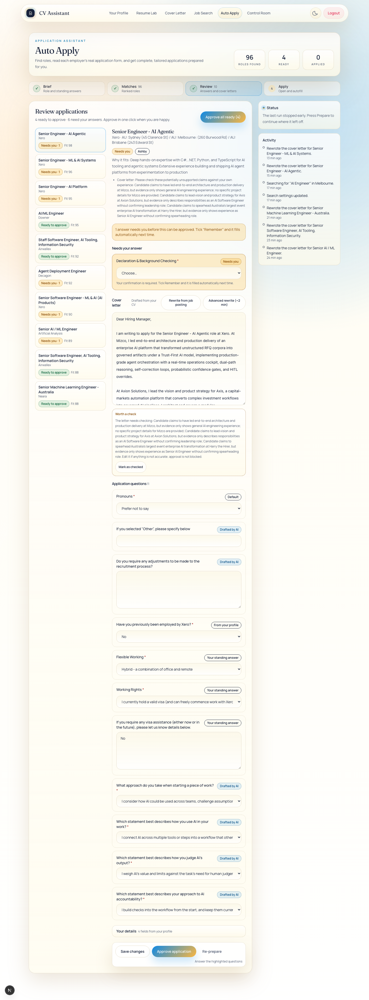
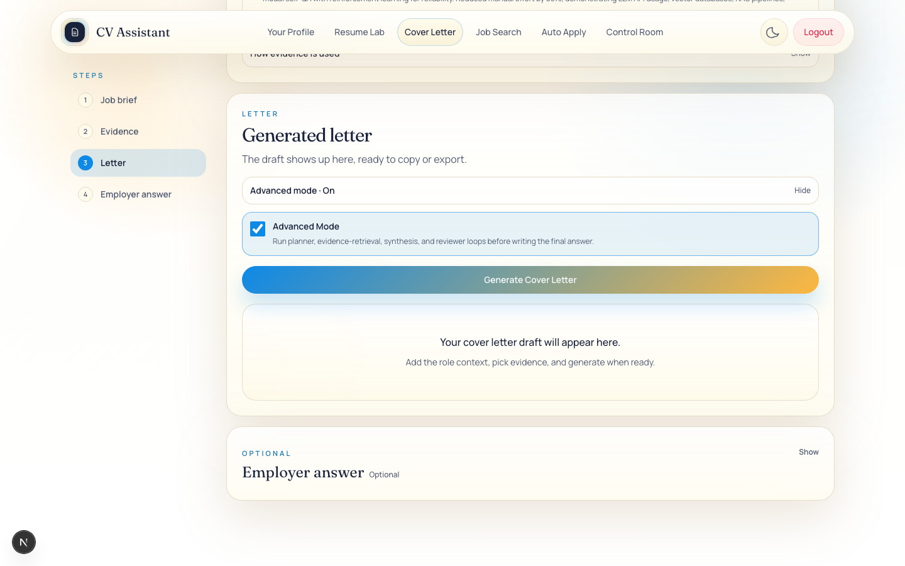

# Verification run log

This page records what was actually run against the live app and the eval suite while the documentation was refreshed on 2026-11-07. It separates what was exercised from what was only read in code, and it records failures as they happened. The feature docs describe behaviour; this page describes what was observed.

## Setup

| Item | Value |
|---|---|
| Date | 2026-11-07 (AEDT) |
| App server | `next dev` on port 3100, the development server already running in the project. A second preview server on port 3101 was started first, then stopped, because two `next dev` processes sharing one `.next` cache produced "missing required error components" errors. All browser checks after that used port 3100. |
| Account | The test account supplied for this run. Credentials were read from the environment and are not recorded here. |
| Browser | Headless Chromium through Playwright 1.60, at a 1440 px viewport. A 390 px viewport was used for mobile captures. |
| Personal data | The profile API response was rewritten in the browser to placeholder contact details, and the page text was masked before each screenshot. The generated PDFs contain the real profile and were kept out of the repository. |

## Results by flow

| Flow | Exercised | Outcome |
|---|---|---|
| Sign-in and home | Signed in, opened home in light and dark themes, phone width, mobile navigation | Pass |
| Sign-in errors | Wrong password on `/login`; account creation form opened, not submitted | Pass (error shown, no account created) |
| Profile | Page sections, Import Text dialog opened and cancelled, Enhance on one experience | Pass. The Enhance request ran and returned. The save request was intercepted so the stored profile was not changed. |
| Resume Lab: selection and coaching | Five items selected, Tailor toggled, Manual AI coaching toggled, styling preferences filled and saved, content enhancement toggled, Start Questions opened | Pass for the UI states. Styling saved. Content coaching was not run to completion. |
| Resume Lab: PDF | Style picker, Generate, PDF returned | Pass. `POST /api/generate-resume` returned 200 with `application/pdf`. Headers: 3 experiences, 2 projects, one page, ATS score 84, style fallback used, not truncated. The file opens and its text extracts (name, contact line, summary, experience). |
| Cover letter: evidence | Job description entered, AI Coaching run | Pass. Six evidence items ranked. |
| Cover letter: letter | Three clarification decisions answered, letter generated | Pass. `clarifications` 200, `cover-letter` 200. The letter rendered. |
| Cover letter: PDF | Export PDF | Pass. `POST /api/generate/cover-letter/pdf` returned 200 with `application/pdf`, filename `<company>-cover-letter.pdf`, about 21 KB. The file opens and its text extracts. |
| Cover letter: Advanced Mode | Run twice. Run 1: two decision questions were shown and not answered, so no letter was produced. Run 2: both decisions answered, then `POST /api/generate/cover-letter` returned **504** after about four minutes. | **Fail.** The letter was not generated. The draft area was empty afterwards (see the screenshot below). |
| Job Search: live run | Title, location and platforms set, Search run to completion, results panel read | Partial. See the Job Search findings below. |
| Auto Apply: read-only | Brief, Matches, Review and Apply steps viewed on the existing account (96 ranked roles, 10 prepared) | Pass for viewing. Nothing approved, edited or submitted. |
| Auto Apply: prepare | A two-application prepare run was started from the Brief step (`PATCH` then `POST .../run`, both accepted). The run then stopped early. The page shows "The last run stopped early. Press Prepare to continue where it left off." A resume attempt found no Prepare button. | **Not verified. The run did not complete.** The cause is not known. The account still shows 4 ready and 0 applied, so no new applications were prepared. |
| Control Room: overview and lead | Overview, one lead detail opened | Pass for viewing. The specialist workflow was not run. |
| Control Room: specialist workflow | Run once on one lead (`POST /api/control-room/leads/<id>/orchestrate`, 200 in about 5 s) | Pass with a caveat. The lead ended `scored`, fit 43, recommendation `skip`, `analysisSource: fallback`, `model: heuristic`. The LLM strategist did not produce the result and the response does not record why. The lead is a Talent.com record whose title is "Show more" and whose company is empty, so the result is not meaningful. Each run appends events and an evaluation to the lead. |
| Promptfoo cover-letter eval | `npm run eval:letters`, 3 cases, live model calls, run twice | **Run 1: 1 of 3 passed. Run 2: 3 of 3 passed.** The same inputs gave different outcomes, so the eval is not stable. See below. |
| Live browser scripts | Not run | They fill real employer forms (Greenhouse, Ashby and Lever) with name and contact details. That needs explicit permission from the user first. Not requested yet. |

Evidence screenshots from these two attempts:

*The Review step after the run stopped early. The status line says the last run stopped and asks for Prepare to be pressed again.*

*The letter area after the Advanced Mode request returned 504. No draft was produced.*

## Job Search findings (live run)

- The title "AI Engineer" and location "Melbourne" produced 128 results in about 141 seconds across the platforms that returned data.
- SEEK and Indeed returned HTTP 403 and were marked blocked, after a fallback attempt.
- CareerOne and Adzuna completed. Talent.com was still running when the panel was read.
- The panel reported "The search could not complete." in one of the two runs.
- Many CareerOne cards are not AI Engineer roles. Examples on the first page were Retail Manager, Beauty Therapist, Baker / Pastrycook and Handyperson. The title query was not enforced for that board.
- Cards from that board show "Company TBD" and "Location TBD" and "Posted time unavailable" when the board does not supply those fields.
- One card description shows an undecoded HTML entity (`&amp;`).
- Reloading the page clears the results. The campaign and leads remain in the Control Room.

## Cover-letter eval failures (Promptfoo, 2026-11-07)

Export file: stored in the scratchpad of the run, not in the repository. Command: `npm run eval:letters`. Result: 1 passed, 2 failed, 0 errors. The eval exited with code 100 because of the failures.

| Case | Result | Failing check | Detail |
|---|---|---|---|
| Northwind Labs, AI Engineer (run 1) | Fail | Defect check: refers to the applicant by name in the body (third person) | 249 words. The check is a regression for a known defect. |
| Contoso Cloud, Senior Machine Learning (run 1) | Fail | Defect check: no sign-off with the applicant's name | 241 words. Claim check also listed three warnings, though the unsupported list was empty. |
| Fabrikam, Software Engineer (run 1) | Pass | None | 121 words, flagged to the applicant as short because the profile is thin. |

The three warnings on the Contoso case quote claims ("architected scalable ETL workflows...", "became the backbone of the support team...", "integrating model inference steps...") that the warning text says the candidate evidence does not state. The unsupported list is empty for that case, so these are warnings only. They are the same kind of internal warning noise listed in `docs/auto-apply-quality-metrics.md`.

The eval asserts 170 to 400 words. The letter prompt asks for 250 to 350 words. The two documents disagree, and this is recorded in the cover-letter feature doc.

**Rerun:** a second run of the same suite passed all three cases (`Results: 3 passed`, exit 0). The first two defects did not recur on that run. Model output varies between runs, so a single eval result is not a reliable pass or fail signal.

**Status:** the first run's defects are real occurrences of the failure, and the letter agent is not changed by this documentation work. The eval should be run several times before a result is trusted. Any fix needs a decision from the user.

## Data written by these runs

These runs used the real account, so they wrote records to the database:

- **Search campaigns and leads.** Each Job Search run creates a `SearchCampaign` and `JobLead` documents. Each Job Search run in this session created a campaign and its leads. The Control Room lists campaigns from this session's runs and from earlier runs, all titled "AI Engineer • Melbourne" or similar. The app has no delete action for them, so they can only be removed from the database.
- **Cover letter, Resume Lab and coaching runs.** These may store `GeneratedArtifact` or `TailoringRun` records. This was not checked against the database.
- **Profile.** Unchanged. The save request was intercepted.
- **Auto Apply and Control Room.** Read-only in this run.

These records were not removed. Remove them if they are not wanted.

## Not verified

- Auto Apply prepare and the apply handoff.
- The Control Room specialist workflow.
- Cover-letter Advanced Mode.
- The live browser autofill scripts.
- Job Search results from the blocked platforms.
